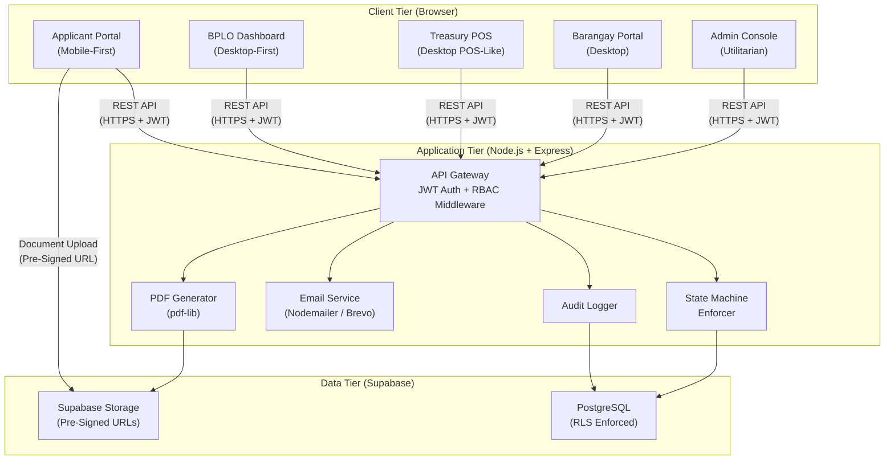
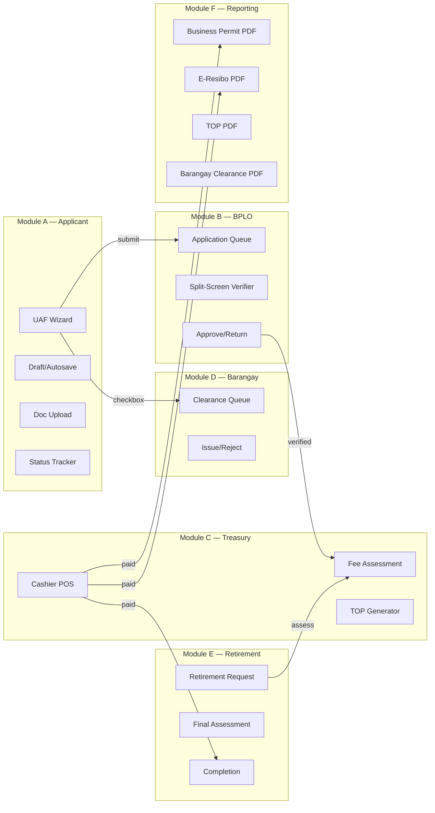
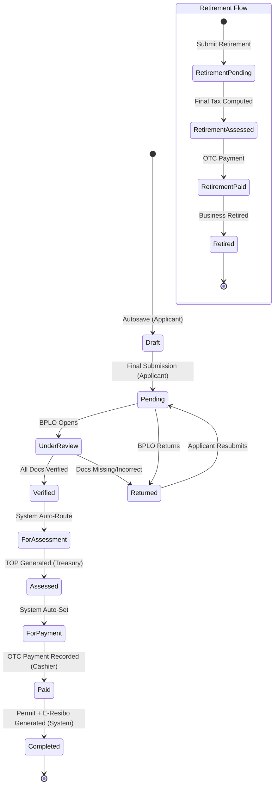
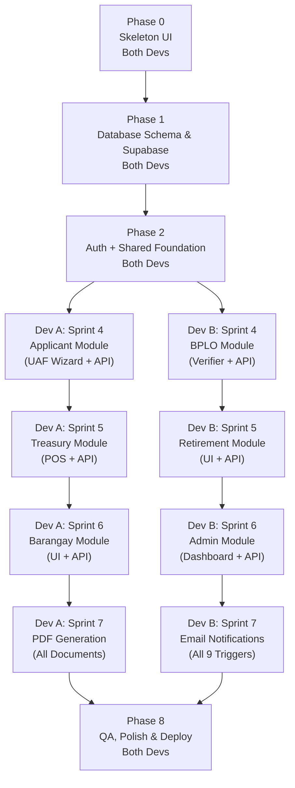

# eBPLS — Electronic Business Permits and Licensing System

**BOSS & E-Resibo | Municipality of Liliw**

> A Web-Based Client-Server system for end-to-end business permit processing with strict OTC-Only payment enforcement, Role-Based Access Control, and DPA 2012 compliance.

| | |
|---|---|
| **Frontend** | React.js + Tailwind CSS + Zustand |
| **Backend** | Node.js + Express.js |
| **Database** | PostgreSQL via Supabase (RLS Enforced) |
| **Documents** | pdf-lib (Permit, E-Resibo, TOP) |
| **Email** | Nodemailer / Brevo |
| **Maps** | Leaflet.js + OpenStreetMap |

---

## Quick Links

| Document | Description |
|---|---|
| [System Architecture](system-planning/eBPLS_System_Architecture.md) | Full architecture, state machine, RBAC, and data model |
| [Implementation Plan](system-planning/eBPLS_Implementation_Plan.md) | Phase-by-phase agile plan with parallel dev tracks |
| [File Structure](system-planning/eBPLS_File_Structure.md) | Backend and frontend codebase directory maps |
| [SDD v2.0](system-planning/eBPLS_SDD_v2.md) | Original Software Design Document |

---

<details>
<summary><h2>📐 System Architecture</h2></summary>

### Architecture Overview

**Pattern:** Web-Based Client-Server Architecture with Role-Based Access Control (RBAC)

**Principle:** OTC Payment STRICT Enforcement — the system supports Over-The-Counter cash and manager's check payments ONLY. Online payment channels are **explicitly excluded**.



### Technology Stack

| Layer | Technology | Responsibility |
|---|---|---|
| **Frontend** | React.js + Tailwind CSS | SPA with role-based views |
| **State Mgmt** | Zustand | Client-side global state (auth, application, notifications) |
| **Backend** | Node.js + Express.js | REST API, business logic, middleware |
| **Database** | PostgreSQL via Supabase | Primary data store with RLS |
| **File Storage** | Supabase Storage | Private document buckets, pre-signed URLs (15-min expiry) |
| **Auth** | JWT (LocalStorage/SessionStorage) | 24-hour expiry, bcrypt (cost >= 12) |
| **Maps** | Leaflet.js + OpenStreetMap | Business location pinning (no API key) |
| **Email** | Nodemailer (Gmail SMTP) / Brevo | Transactional notifications |
| **PDF** | pdf-lib | Permit, E-Resibo, TOP, Barangay Clearance rendering |

### Module Architecture (6 Modules)



### Application State Machine



### RBAC Permission Matrix

| Capability | Applicant | BPLO | Treasury | Barangay | Admin |
|---|:---:|:---:|:---:|:---:|:---:|
| Submit UAF | Yes | — | — | — | — |
| Upload Documents | Yes | — | — | — | — |
| View Own Status | Yes | — | — | — | Yes |
| Verify Documents | — | Yes | — | — | — |
| Approve/Return App | — | Yes | — | — | — |
| Assess Fees | — | — | Yes | — | — |
| Override Fee Items | — | — | Yes | — | — |
| Record OTC Payment | — | — | Yes | — | — |
| Issue Brgy Clearance | — | — | — | Yes | — |
| Process Retirement | — | Yes | Yes | — | Yes |
| Download Documents | Yes (own) | Yes | Yes | — | Yes |
| Manage Users/Roles | — | — | — | — | Yes |
| View Audit Logs | — | — | — | — | Yes |

> **Full details:** [System Architecture Document](system-planning/eBPLS_System_Architecture.md)

</details>

---

<details>
<summary><h2>📋 Implementation Plan</h2></summary>

### Development Strategy: 2 Full-Stack Developers (Vertical Slicing)

Each developer owns complete modules (frontend + backend). After the shared foundation, they never block each other.



### Module Ownership

| Module | Dev A | Dev B |
|---|:---:|:---:|
| Skeleton UI (Phase 0) | Collab | Collab |
| Database Schema (Phase 1) | Collab | Collab |
| Auth + Shared Middleware (Phase 2) | Collab | Collab |
| Applicant Module (UAF Wizard) | Owner | |
| BPLO Module (Verify & Process) | | Owner |
| Treasury Module (Assess & POS) | Owner | |
| Business Retirement Module | | Owner |
| Barangay Clearance Module | Owner | |
| Admin Module | | Owner |
| PDF Generation (all documents) | Owner | |
| Email Notifications (all triggers) | | Owner |

### Sprint Schedule

| Sprint | Duration | Dev A | Dev B |
|:---:|---|---|---|
| **1** | 1 week | Skeleton UI: Layouts, Router, Placeholders | Skeleton UI: UI Components, Stores, Hooks |
| **2** | 1 week | DB Schema + RLS (collab) | DB Schema + Seed (collab) |
| **3** | 1 week | Auth + Shared Foundation (collab) | Auth + Shared Foundation (collab) |
| **4** | 1.5 weeks | Applicant Module (full-stack) | BPLO Module (full-stack) |
| **5** | 1.5 weeks | Treasury Module (full-stack) | Retirement Module (full-stack) |
| **6** | 1 week | Barangay Module (full-stack) | Admin Module (full-stack) |
| **7** | 1 week | PDF Generation (all documents) | Email Notifications (all triggers) |
| **8-9** | 2 weeks | QA + Polish (own modules) | QA + Polish (own modules) |
| | **Total: ~8-9 weeks** | | |

### Current Progress

| Item | Status |
|---|---|
| System Architecture (README.md) | Done |
| File Structure Documentation | Done |
| Backend: npm init, dependencies installed | Done |
| Backend: server.js, app.js (Express base) | Done |
| Backend: config/env.js (Zod validation) | Done |
| Backend: config/supabase.js (Admin client) | Done |
| Backend: config/mailer.js (Optional SMTP) | Done |
| Frontend: Vite + React initialized | Done |
| Frontend: Tailwind CSS + PostCSS configured | Done |
| Frontend: Global CSS token system (index.css) | Done |
| Frontend: All folder structure created | Done |
| .env.example and .gitignore | Done |

> **Full details:** [Implementation Plan Document](system-planning/eBPLS_Implementation_Plan.md)

</details>

---

<details>
<summary><h2>📁 File Structure</h2></summary>

### Backend Codebase (`ebpls-server`)

**Tech Stack:** Node.js, Express.js, Supabase Client (PostgreSQL/Storage), pdf-lib, Nodemailer.

```text
ebpls-backend/
├── src/
│   ├── config/                  # Configuration files and initializations
│   │   ├── env.js               # Environment variables validation
│   │   ├── supabase.js          # Supabase client setup (DB and Storage)
│   │   └── mailer.js            # Nodemailer / SMTP configuration
│   │
│   ├── controllers/             # Route handlers organized by architectural module
│   │   ├── application.controller.js  # Module A: UAF submissions, drafts
│   │   ├── bplo.controller.js         # Module B: Document verification
│   │   ├── treasury.controller.js     # Module C: Fees, TOP, Overrides, Default Reset, OTC Payments
│   │   ├── barangay.controller.js     # Module D: Barangay Clearances
│   │   ├── retirement.controller.js   # Module E: Business Retirements
│   │   └── document.controller.js     # Module F: PDF generation endpoints
│   │
│   ├── middlewares/             # Express middlewares
│   │   ├── auth.middleware.js         # Verifies JWT from requests
│   │   ├── rbac.middleware.js         # Enforces role permissions per route
│   │   ├── audit.middleware.js        # Automates logging to audit_logs table
│   │   └── error.middleware.js        # Global error and exception handler
│   │
│   ├── routes/                  # Express route definitions (maps to controllers)
│   │   ├── application.routes.js
│   │   ├── bplo.routes.js
│   │   ├── treasury.routes.js
│   │   ├── barangay.routes.js
│   │   ├── retirement.routes.js
│   │   └── document.routes.js
│   │
│   ├── services/                # Core business logic and database interactions
│   │   ├── application.service.js     # State machine transitions
│   │   ├── assessment.service.js      # Tax and fee calculation logic
│   │   ├── audit.service.js           # Writes securely to audit_logs
│   │   ├── email.service.js           # Event-driven email sending
│   │   ├── storage.service.js         # Pre-signed URLs and file uploads
│   │   └── pdf.service.js             # pdf-lib template population
│   │
│   ├── utils/                   # Shared utility functions
│   │   ├── constants.js               # Enums, valid states, role IDs
│   │   └── helpers.js                 # General helpers
│   │
│   └── app.js                   # Express application setup, middleware mounting
│
├── tests/                       # Unit and integration tests
├── .env.example                 # Template for environment variables
├── .prettierrc                  # Code formatting rules
├── eslint.config.js             # Linter configuration
├── package.json                 # Dependencies and scripts
└── server.js                    # Entry point; starts the HTTP server
```

### Frontend Codebase (`ebpls-frontend`)

**Tech Stack:** React.js, Vite, Tailwind CSS, Zustand, React Router, Leaflet.js.

```text
ebpls-frontend/
├── public/                      # Static assets (favicons, manifest)
│   └── assets/                  # Public images
│
├── src/
│   ├── assets/                  # CSS and internal assets
│   │   └── index.css            # Tailwind directives and global styles
│   │
│   ├── components/              # Reusable React components
│   │   ├── ui/                  # Generic UI (Buttons, Inputs, Modals, Badges)
│   │   ├── layout/              # Navbars, Sidebars, Footers
│   │   └── shared/              # Domain-specific shared components
│   │       ├── DocumentUploadPanel.jsx
│   │       ├── InteractiveLocationPin.jsx
│   │       └── StatusBadge.jsx
│   │
│   ├── hooks/                   # Custom React hooks
│   │   ├── useAuth.js                 # Authentication logic
│   │   ├── useAutosave.js             # UAF draft autosave logic
│   │   ├── useApplicationStatus.js    # Polling or fetching status
│   │   └── useNotifications.js        # Notification management
│   │
│   ├── layouts/                 # High-level layouts tailored to roles
│   │   ├── ApplicantLayout.jsx        # Mobile-first navigation
│   │   ├── BPLOLayout.jsx             # Desktop-first dashboard layout
│   │   ├── TreasuryLayout.jsx         # POS-style layout
│   │   ├── BarangayLayout.jsx
│   │   └── AdminLayout.jsx
│   │
│   ├── screens/                 # Main page views organized by role
│   │   ├── public/
│   │   │   └── LandingPage.jsx        # System overview and entry point
│   │   ├── auth/
│   │   │   ├── Login.jsx              # Universal login screen
│   │   │   ├── Register.jsx           # Applicant registration
│   │   │   └── ForgotPassword.jsx     # Password reset flow
│   │   ├── applicant/
│   │   │   ├── Dashboard.jsx
│   │   │   ├── UAFWizardScreen.jsx    # 5-step application wizard
│   │   │   └── StatusTracker.jsx
│   │   ├── bplo/
│   │   │   ├── Dashboard.jsx          # Application queue with SLAs
│   │   │   └── SplitScreenVerifier.jsx # Document verification interface
│   │   ├── treasury/
│   │   │   ├── AssessmentGrid.jsx     # Fee calculation override and default reset grid
│   │   │   └── CashierPOS.jsx         # High-contrast OTC payment logger
│   │   ├── barangay/
│   │   │   └── ClearanceQueue.jsx     # Pending clearance requests
│   │   └── admin/
│   │       ├── MasterData.jsx         # Lookup table management
│   │       ├── DocumentBuilder.jsx    # PDF layout customizer
│   │       └── AuditLogs.jsx          # DPA compliance viewer
│   │
│   ├── store/                   # Zustand state management
│   │   ├── authStore.js               # User session and role
│   │   ├── applicationStore.js        # Local state for UAF forms
│   │   └── UIStore.js                 # Modals, sidebars, toast states
│   │
│   ├── utils/                   # Helpers
│   │   ├── apiClient.js               # Axios/Fetch wrapper with JWT injection
│   │   ├── formatters.js              # Currency (PHP), Date formatters
│   │   └── constants.js               # App configuration
│   │
│   ├── App.jsx                  # Main router configuration and layout mapping
│   └── main.jsx                 # React DOM entry point
│
├── .env.example                 # Frontend environment variables (API URLs)
├── eslint.config.js             # Linter config
├── package.json                 # Dependencies
├── tailwind.config.js           # Tailwind configuration (themes, colors)
└── vite.config.js               # Vite bundler configuration
```

> **Full details:** [File Structure Document](system-planning/eBPLS_File_Structure.md)

</details>

---

## Getting Started

```bash
# Backend
cd ebpls-server
cp .env.example .env       # Fill in your Supabase and SMTP keys
npm install
npm run dev                # Starts on http://localhost:5000

# Frontend
cd ebpls-frontend
npm install
npm run dev                # Starts on http://localhost:5173
```

---

## System Planning Documents

All planning documents are centralized in the [`system-planning/`](system-planning/) directory:

| File | Purpose |
|---|---|
| `eBPLS_System_Architecture.md` | Complete system architecture with diagrams |
| `eBPLS_Implementation_Plan.md` | Phase-by-phase agile development plan |
| `eBPLS_File_Structure.md` | Backend and frontend directory maps |
| `eBPLS_SDD_v2.md` | Original Software Design Document |

---

*Architecture derived from [eBPLS SDD v2.0](system-planning/eBPLS_SDD_v2.md) — Municipality of Liliw*
