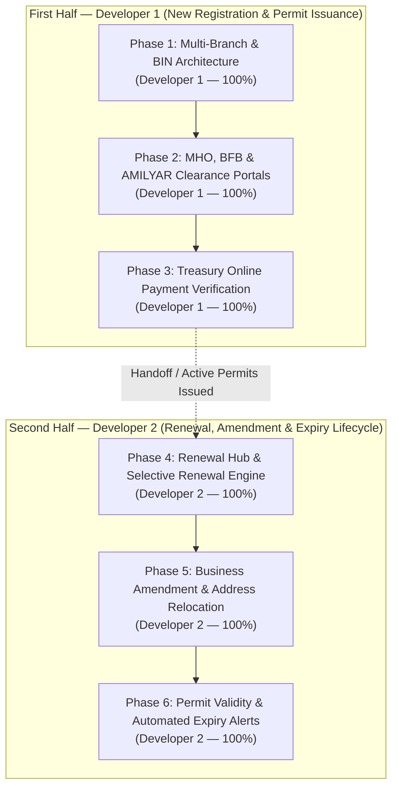

# eBPLS Main Technical Implementation Plan: 13 Core System Revisions

**Project:** Electronic Business Permits and Licensing System (eBPLS)  
**Deployment:** Municipality of Liliw, Laguna  
**Document Version:** 3.1 (Strict Sequential Two-Developer Halves Allocation)  
**Date:** November 19, 2026  
**Status:** Approved for Development  

---

## 1. Planning Basis

### 1.1 Source Documents & Requirements Baseline
* **Approved Client Revisions Specification:** [eBPLS Client Implementation Plan (13 Core Revisions)](file:///c:/projects/eBPLS/system-planning/eBPLS_Client_Implementation_Plan_13_Revisions.md)
* **System Architecture Baseline:** [eBPLS System Architecture](file:///c:/projects/eBPLS/system-planning/eBPLS_System_Architecture.md) & [eBPLS Software Design Document v3.0](file:///c:/projects/eBPLS/system-planning/eBPLS_SDD_v3.md)
* **Current Codebase State:**
  * **Database:** Supabase PostgreSQL. Current highest migration is `048_payment_proof_schema.sql`. Target migrations start at `049_multi_branch_and_bin_schema.sql`.
  * **Backend:** Express.js, Supabase JS Client (`supabaseAdmin`), Zod validation schemas, `pdf-lib` document engine, Nodemailer.
  * **Frontend:** React 18 (Vite), Tailwind CSS, Zustand state stores (`applicationStore`, `authStore`, `UIStore`, `notificationStore`), Lucide React icons.

### 1.2 Core Two-Developer Team Assignment Rule
As mandated by project governance:
1. **First Half is 100% Developer 1:** Developer 1 owns **Phases 1, 2, and 3** (50% of the project).
2. **Second Half is 100% Developer 2:** Developer 2 owns **Phases 4, 5, and 6** (50% of the project).
3. **Equal Full-Stack Scope:** Both developers have equal workloads covering **Database Migrations/Schemas, Backend Services/APIs, and Frontend Screens/Portals**.
4. **Strict 1 Phase = 1 Person Rule:** No single phase is split between developers. Each phase is an end-to-end, independently testable unit executed entirely by its designated developer.
5. **Strictly Chronological Sequence:** Phases proceed strictly in order (1 $\rightarrow$ 2 $\rightarrow$ 3 $\rightarrow$ 4 $\rightarrow$ 5 $\rightarrow$ 6) without circular or reverse dependencies.

---

## 2. Dependency & Execution Strategy

The implementation comprises **six (6) chronological, full-stack Agile phases**. Work is organized into two sequential tracks where Developer 1 builds the foundational registration, inter-agency inspection, and payment verification pipeline, after which Developer 2 receives the stable permit baseline to build the renewal hub, amendment engine, and automated expiry monitoring:



### Execution Strategy & Crash-Prevention Architecture
1. **Zero-Downtime Data Migration Strategy:** Existing single-address businesses in `businesses` table are automatically backfilled into `business_branches` as `is_main = true`. Existing drafts and historical permits retain full referential integrity.
2. **Explicit Foreign Key Sequence:** `business_branches` references `businesses(business_id)`. `application_activities` is updated to optionally reference `branch_id`, ensuring backwards compatibility for legacy applications.
3. **Strict RBAC Decoupling:** New roles (`MHO_Officer`, `BFB_Officer`, `Amilyar_Officer`) are seeded via migration `050` before backend middleware checks or frontend layout routes are mounted, preventing `403 Forbidden` deadlocks.
4. **Isolated Queue Routing:** Each regulatory department has its own isolated API router and frontend view. BPLO's verifier is converted into a non-blocking consumer of these clearance statuses.
5. **Double-Spend & Sequence Protection:** Cashier OR number generation uses atomic database transaction locks (`pg_advisory_xact_lock`) to eliminate duplicate OR sequence numbers.

---

## 3. Phase Overview

| Phase | Name | Objective | Dependencies | Major Deliverables | Assigned Developer |
|---|---|---|---|---|:---:|
| **1** | Multi-Branch, BIN & Address Architecture | Implement the permanent Business Identification Number (BIN) sequence, branch-level addresses, and property tenancy per line. Retire "Other Services". | Migrations 001–048 | Migration 049, `business_branches` table, modernized UAF Branch & Activity Builder. | **Developer 1** (100%) |
| **2** | Regulatory Inspection Portals (MHO, BFB, AMILYAR) | Seed new regulatory roles, deploy dedicated clearance verification queues, and shift BPLO to an oversight status tracker. | Phase 1 schema | Migration 050, MHO/BFB/AMILYAR routes & portals, updated BPLO Status Tracker. | **Developer 1** (100%) |
| **3** | Treasury Online Payment Verification Terminal | Add the dedicated Payment Verification page in Treasury, enable side-by-side GCash receipt auditing, and automate OR generation. | Phase 1 & 2 | Migration 051, Treasury verification queue UI & endpoint, atomic OR generation, verified badge sync. | **Developer 1** (100%) |
| **4** | Business Renewal Hub & Selective Renewal Engine | Launch "My Approved Businesses" Hub on the Applicant Dashboard and provide selective branch/line renewal with gross receipts assessment. | Phase 1, 2 & 3 | "My Approved Businesses" UI, interactive Renewal Checklist, renewal assessment engine. | **Developer 2** (100%) |
| **5** | Business Amendment & Address Relocation Engine | Build the BIN-linked Business Amendment workflow for branch relocations within Liliw, preventing duplicate business records. | Phase 1 & 4 | Migration 052, Amendment API & UI, dynamic premises clearance routing. | **Developer 2** (100%) |
| **6** | Permit Validity Transparency & Proactive Expiry Monitoring | Display prominent permit validity badges across all interfaces, implement automated 60/30/15-day expiry alerts, and conduct full QA hardening. | Phases 1 through 5 | Migration 053, validity badges, daily cron expiry service, end-to-end regression sign-off. | **Developer 2** (100%) |

---

## 4. Detailed Implementation Phases

---

### Phase 1 — Multi-Branch, BIN & Address Architecture
* **Assigned Developer:** **Developer 1 (100%)**
* **Addressed Revisions:** 1, 8, 10, 12
* **Objective:** Establish the database schema and application wizard components allowing a single registered legal business entity to operate multiple branches across different Liliw barangays, each with its own physical address, foot-traffic commercial zone, property tenancy, and unit declarations. Retire "Other Services" from active selection.
* **Scope:**
  * **Database (DB):**
    * Create Migration `049_multi_branch_and_bin_schema.sql`.
    * Add `bin VARCHAR(50) UNIQUE` to `public.businesses` with format `BIN-{YEAR}-{5-digit sequence}` (e.g. `BIN-2026-00001`). Backfill existing businesses with generated BINs.
    * Create `public.business_branches` table (`branch_id`, `business_id`, `branch_name`, `address_line1`, `barangay`, `zone_id`, `latitude`, `longitude`, `tenancy_type`, `stall_unit_numbers`, `is_main`, `is_active`).
    * Backfill: Insert one row into `business_branches` for each existing row in `businesses` using current `address_line1`, `barangay`, `tenancy_type`, and coordinates (`is_main = true`).
    * Add `branch_id UUID REFERENCES public.business_branches(branch_id)` to `public.application_activities`.
    * Update `public.business_activities`: Set `is_active = false` where `name = 'Other Services'`.
  * **Backend (BE):**
    * Update `submit_applicant_application` stored procedure to accept `branches` array in payload. Atomically commit business header, branch records, per-branch activities, and per-branch tenancy document requirements.
    * Update `requirement.service.js` to evaluate tenancy documents on a per-branch basis (e.g., Contract of Lease for rented branches, Building Permit for owned commercial branches).
    * Update `validators.js` to enforce branch-level address and line validations.
  * **Frontend (FE):**
    * Consolidate location and business activity declaration into a unified **Branch & Activity Manager** in `Step2_Location.jsx` and `Step3_Activities.jsx`.
    * Allow applicants to click `[+ Add Another Branch / Location]`.
    * For each branch: specify Branch Label, Street Address, Barangay dropdown (auto-pins centroid and identifies commercial zone), Tenancy selector (Rented, Owned Commercial, Owned Residential), and add covered Lines of Business.
    * Filter out "Other Services" from all business activity dropdowns.
* **Architecture Components:**
  * Database: Migration `049_multi_branch_and_bin_schema.sql`.
  * Backend: `ebpls-server/src/services/applicant-submission.service.js`, `ebpls-server/src/services/requirement.service.js`, `ebpls-server/src/utils/validators.js`.
  * Frontend: `ebpls-frontend/src/screens/applicant/uaf-steps/Step2_Location.jsx`, `Step3_Activities.jsx`, `Step4_Documents.jsx`, `Step5_Review.jsx`.
* **Dependencies:** Existing migrations 001–048.
* **Major Deliverables:**
  * Clean migration 049 establishing `business_branches` and `bin` columns.
  * Modernized UAF multi-branch input wizard.
  * Deactivated "Other Services" activity code.
* **Acceptance Criteria:**
  * [ ] Submitting an application with 2 branches (e.g., Branch 1 in Brgy. Rizal, Branch 2 in Brgy. Bayate) successfully saves both branch records linked to the same `business_id`.
  * [ ] Step 4 displays distinct document upload slots for each branch based on its tenancy (e.g., Lease Contract for Branch 1, Building Permit for Branch 2).
  * [ ] "Other Services" cannot be selected in any dropdown across the frontend.
  * [ ] Existing single-branch businesses remain 100% accessible and operable without SQL errors.
* **Risks / Notes:**  
  * Backward compatibility: Existing applications have `application_activities` without `branch_id`. Ensure queries use `LEFT JOIN business_branches` so historical applications continue to load.

---

### Phase 2 — Regulatory Inspection Portals (MHO, BFB, AMILYAR)
* **Assigned Developer:** **Developer 1 (100%)**
* **Addressed Revisions:** 3
* **Objective:** Create distinct, secure operational portals for the Municipal Health Office (MHO), Bureau of Fire Protection (BFB/BFP), and Municipal Assessor (AMILYAR), allowing each agency to verify document legitimacy and compliance. Shift BPLO from direct verification to an executive clearance status tracking role.
* **Scope:**
  * **Database (DB):**
    * Create Migration `050_regulatory_roles_and_clearances.sql`.
    * Insert new roles into `public.roles`: `('MHO_Officer')`, `('BFB_Officer')`, `('Amilyar_Officer')`.
    * Create `public.regulatory_clearances` table: `id`, `application_no`, `agency_code` ('MHO', 'BFB', 'AMILYAR'), `status` ('Pending', 'Verified', 'Returned', 'Not Needed'), `remarks`, `verified_by`, `verified_at`.
    * Add trigger to automatically create 3 `regulatory_clearances` rows (MHO, BFB, AMILYAR) in 'Pending' status whenever an application transitions to 'Pending' / 'Under Review'.
  * **Backend (BE):**
    * Add `ROLES.MHO_OFFICER`, `ROLES.BFB_OFFICER`, `ROLES.AMILYAR_OFFICER` to `constants.js` and `rbac.middleware.js`.
    * Create controllers and route modules: `regulatory.controller.js` and `regulatory.routes.js` mounted at `/api/regulatory`:
      * `GET /queue?agency=MHO|BFB|AMILYAR` (protected by agency role).
      * `PUT /:applicationNo/verify` (sets clearance status to 'Verified').
      * `PUT /:applicationNo/return` (requires remarks, sets status to 'Returned').
    * Update `bplo.controller.js`: When BPLO attempts to approve an application, query `regulatory_clearances` for `application_no`. If any agency clearance is not 'Verified' or 'Not Needed', reject approval with HTTP 400 (`All inter-agency regulatory clearances (MHO, BFB, AMILYAR) must be verified before BPLO approval.`).
  * **Frontend (FE):**
    * Create `MHOLayout.jsx`, `BFBLayout.jsx`, `AmilyarLayout.jsx` with department-branded top navigation and sidebar.
    * Build `RegulatoryQueue.jsx` reusable review terminal:
      * Displays applications pending that agency's clearance.
      * Side-by-side PDF/image document preview.
      * Action buttons: `[Approve / Issue Clearance]` and `[Return for Correction]`.
    * Update `SplitScreenVerifier.jsx` (BPLO View):
      * Remove BPLO direct verify buttons for Sanitary, Fire, and Property tax.
      * Replace with **"Inter-Agency Regulatory Clearance Tracker"**:
        * Displays live status cards for MHO, BFB, and AMILYAR with verifying officer's name and timestamp.
        * Disables BPLO final approval button until all 3 indicators turn green.
* **Architecture Components:**
  * Database: Migration `050_regulatory_roles_and_clearances.sql`.
  * Backend: `ebpls-server/src/routes/regulatory.routes.js`, `ebpls-server/src/controllers/regulatory.controller.js`, `ebpls-server/src/controllers/bplo.controller.js`.
  * Frontend: `ebpls-frontend/src/screens/regulatory/RegulatoryQueue.jsx`, `ebpls-frontend/src/layouts/RegulatoryLayout.jsx`, `ebpls-frontend/src/screens/bplo/SplitScreenVerifier.jsx`.
* **Dependencies:** Phase 1 (Schema & submissions).
* **Major Deliverables:**
  * 3 new functional agency roles with dedicated portals (`/mho`, `/bfb`, `/amilyar`).
  * Dedicated regulatory review terminal with document inspection.
  * Non-bypassable BPLO approval gate locked to inter-agency clearance completion.
* **Acceptance Criteria:**
  * [ ] Logging in as an MHO Officer directs user to `/mho/queue`, displaying only health and sanitary documents.
  * [ ] Clicking `[Approve]` in MHO sets MHO clearance to 'Verified' and records the officer's UUID.
  * [ ] BPLO SplitScreenVerifier instantly reflects MHO clearance as green while keeping BFB and AMILYAR pending.
  * [ ] BPLO cannot click `[Approve & Forward to Treasury]` if any of the three clearances are still pending or returned.
* **Risks / Notes:**  
  * Grant Admin users (`ROLES.ADMIN`) emergency view access across all three regulatory queues for audit and administrative oversight.

---

### Phase 3 — Treasury Online Payment Verification Terminal
* **Assigned Developer:** **Developer 1 (100%)**
* **Addressed Revisions:** 4, 9
* **Objective:** Deploy a dedicated, prominent Online Payment Verification page in the Treasury portal, resolve the issue where GCash/Bank payments remain indefinitely in "Pending" without a verification view, and automate sequence-locked Official Receipt (OR) generation upon cashier approval. Completes Developer 1's First Half scope.
* **Scope:**
  * **Database (DB):**
    * Migration `051_atomic_payment_verification.sql` adds the pending-proof index and payment decision functions.
    * Ensure `pg_advisory_xact_lock` sequence function exists for fiscal year OR numbers.
  * **Backend (BE):**
    * Build dedicated verification endpoint `GET /api/treasury/payments/pending-proofs` returning: application number, taxpayer name, business name, total assessed tax, payment reference number, declared payment date, and pre-signed storage URL for uploaded proof.
    * Harden `PUT /api/treasury/payments/:transactionId/verify-proof`:
      * Verify caller is authenticated as `Treasury_Officer` or `Admin`.
      * Execute atomic transaction:
        1. Set `transactions.verification_status = 'Verified'`.
        2. Acquire advisory lock on `ebpls.or.sequence` for current fiscal year.
        3. Generate next sequential Official Receipt number: `OR-{YEAR}-{NNNNNN}`.
        4. Transition application status: `PaymentVerificationPending` $\rightarrow$ `STATUSES.PAID` / `STATUSES.COMPLETED`.
        5. Trigger `pdfService.generatePermitPDF` and `pdfService.generateReceiptPDF`.
        6. Record `AUDIT_ACTIONS.PAYMENT_PROOF_VERIFIED` with cashier ID and timestamp.
    * Implement `PUT /api/treasury/payments/:transactionId/reject-proof`:
      * Accepts mandatory `rejection_reason`.
      * Sets `transactions.verification_status = 'Rejected'`.
      * Transitions application status back to `STATUSES.FOR_PAYMENT`.
      * Sends automated email and in-app alert to applicant explaining why the receipt was rejected.
  * **Frontend (FE):**
    * Update `TreasuryLayout.jsx`: Add **"Payment Verification"** to `TREASURY_NAV` with a dynamic badge showing the count of pending proofs.
    * Update `AssessmentQueue.jsx`: Add `PaymentVerificationPending` to status filter pills.
    * Build dedicated `OnlinePaymentVerification.jsx` screen:
      * Left pane: Transaction metadata (Taxpayer name, Business name, Assessed Tax Line Items, GCash reference number, Date).
      * Right pane: Zoomable, high-resolution document viewer for GCash screenshot / bank deposit slip.
      * Action buttons: `[Confirm Payment & Issue OR]` (green) and `[Reject Receipt with Remarks]` (red).
    * Status Synchronization: On verification, `StatusTracker.jsx` on the applicant side immediately reflects the green **"VERIFIED / PAID"** badge and unlocks the "Download E-Resibo" and "Download Business Permit" buttons.
* **Architecture Components:**
  * Backend: `ebpls-server/src/controllers/treasury.controller.js`, `ebpls-server/src/routes/treasury.routes.js`, `ebpls-server/src/services/pdf.service.js`.
  * Frontend: `ebpls-frontend/src/layouts/TreasuryLayout.jsx`, `ebpls-frontend/src/screens/treasury/OnlinePaymentVerification.jsx`, `ebpls-frontend/src/screens/treasury/AssessmentQueue.jsx`, `ebpls-frontend/src/screens/applicant/StatusTracker.jsx`.
* **Dependencies:** Phase 1 (Schema) and Phase 2 (Verified applications in For Payment status).
* **Major Deliverables:**
  * Dedicated "Payment Verification" navigation link and page in Treasury.
  * Side-by-side cashier receipt inspection interface.
  * Atomic, sequence-locked Official Receipt (OR) generation pipeline.
* **Acceptance Criteria:**
  * [ ] Treasury navigation prominently displays "Payment Verification" with a live count badge.
  * [ ] When an applicant uploads a GCash receipt, it appears immediately in the verification queue.
  * [ ] Cashier clicking `[Confirm Payment]` generates a unique OR number, marks the transaction as 'Verified', and updates application status to 'Paid'.
  * [ ] Applicant screen immediately displays the green 'VERIFIED' badge and unlocks PDF permit downloads.
  * [ ] Rejecting a proof transitions application back to 'For Payment' and transmits the cashier's remarks to the applicant.
* **Risks / Notes:**  
  * Use PostgreSQL sequence locking to prevent race conditions during peak hours when multiple Treasury cashiers verify payments simultaneously.

---

### Phase 4 — Business Renewal Hub & Selective Renewal Engine
* **Assigned Developer:** **Developer 2 (100%)**
* **Addressed Revisions:** 2, 7
* **Objective:** Initiates Developer 2's Second Half scope. Replace the blank renewal form with a dedicated "My Approved Businesses" Hub on the Applicant Dashboard. Enable business owners to view all active businesses and selectively choose which branches and lines of business to renew for the upcoming fiscal year.
* **Scope:**
  * **Database (DB):**
    * Update `applications` table views/indexes to optimize taxpayer queries join `businesses`, `permits`, and `business_branches`.
    * Verify renewal status state transitions in `constants.js` and enum.
  * **Backend (BE):**
    * Build `GET /api/applications/my-approved-businesses`:
      * Queries `businesses` join `permits` for the logged-in taxpayer where `is_retired = false`.
      * Returns legal name, BIN, active permit number, permit expiration date, and all registered branches with their declared lines of business.
    * Build `POST /api/applications/renew`:
      * Accepts `business_id`, array of selected `branch_ids`, and array of active `activity_ids` with preceding year gross sales.
      * Creates renewal application with `type_id = 2` linked to the existing `business_id` (zero duplicate businesses).
      * Flags unselected branches as "Not Renewed" (providing a one-click transition to business retirement).
    * Update `assessment.service.js` and `assessment-engine.js`:
      * Computes municipal taxes based on preceding year gross sales *only* for the specific lines of business and branches selected for renewal.
  * **Frontend (FE):**
    * Overhaul `ApplicantDashboard.jsx`:
      * Add **"My Approved Businesses"** section above historical applications.
      * Each approved business card displays: Business Name, BIN, Permit No., Validity Badge, and an action button: `[Renew Permit for 2027]`.
    * Build `RenewalWizard.jsx` (`/applicant/renew/:businessId`):
      * **Step 1 — Branch & Line Selector:** Interactive checklist tree displaying all registered branches and their lines of business. Checkbox for each branch/line (`[✓] Renew`).
      * **Step 2 — Gross Receipts Declaration:** For each renewed line, applicant inputs preceding year gross sales with helper text.
      * **Step 3 — Documentary Requirements:** Uploads previous year business permit and current barangay business clearance.
      * **Step 4 — Review & Submit:** Itemized preview of declared branches and sales figures.
* **Architecture Components:**
  * Backend: `ebpls-server/src/controllers/application.controller.js`, `ebpls-server/src/routes/application.routes.js`, `ebpls-server/src/services/assessment.service.js`.
  * Frontend: `ebpls-frontend/src/screens/applicant/Dashboard.jsx`, `ebpls-frontend/src/screens/applicant/RenewalWizard.jsx`.
* **Dependencies:** Phase 1 (Multi-branch schema), Phase 2 (Regulatory clearances), and Phase 3 (Active permits issued).
* **Major Deliverables:**
  * "My Approved Businesses" management hub.
  * Interactive multi-branch renewal selector.
  * Gross-sales renewal assessment engine supporting partial branch renewals.
* **Acceptance Criteria:**
  * [ ] Taxpayer logging into dashboard sees all approved businesses with their BIN and permit numbers.
  * [ ] Clicking "Renew Permit" opens the renewal selector showing all registered branches and lines of business.
  * [ ] If a business has 3 branches and the owner unchecks Branch 3, only Branches 1 and 2 are renewed and assessed for taxes.
  * [ ] Submitting renewal does NOT create a duplicate row in `businesses`; it creates a renewal application linked to the existing `business_id`.
* **Risks / Notes:**  
  * Prompt a clear warning dialog if an applicant unchecks a branch during renewal, informing them that operating an unrenewed branch is subject to LGU closure.

---

### Phase 5 — Business Amendment & Address Relocation Engine (Zero Duplicate BIN Policy)
* **Assigned Developer:** **Developer 2 (100%)**
* **Addressed Revisions:** 5, 13
* **Objective:** Implement a formal Business Amendment and Address Change transaction linked to the existing Business Identification Number (BIN). When a branch relocates within Liliw, ensure the applicant submits updated premises clearances (Zoning, Tenancy, Fire Safety) without creating a duplicate business record or triggering new-business capitalization tax rates.
* **Scope:**
  * **Database (DB):**
    * Create Migration `052_business_amendments.sql`.
    * Create `public.business_amendments` table:
      * `amendment_id UUID PRIMARY KEY DEFAULT gen_random_uuid()`
      * `business_id UUID NOT NULL REFERENCES public.businesses(business_id) ON DELETE RESTRICT`
      * `branch_id UUID REFERENCES public.business_branches(branch_id)`
      * `amendment_type VARCHAR(50) NOT NULL CHECK (amendment_type IN ('Change of Address', 'Change of Line', 'Change of Business Name'))`
      * `old_data JSONB NOT NULL`
      * `new_data JSONB NOT NULL`
      * `status VARCHAR(20) NOT NULL DEFAULT 'Pending' CHECK (status IN ('Pending', 'Approved', 'Rejected'))`
      * `review_remarks TEXT`
      * `reviewed_by UUID REFERENCES public.users(user_id)`
      * `submitted_at TIMESTAMPTZ DEFAULT NOW()`
      * `approved_at TIMESTAMPTZ`
  * **Backend (BE):**
    * Build `POST /api/applications/amend-location`:
      * Validates that the business has an active BIN and is owned by the authenticated taxpayer.
      * Records the relocation: old address vs. new address, new barangay centroid, and new tenancy type.
      * Automatically routes the new premises to MHO, BFB, and AMILYAR for physical inspection and clearance verification.
    * BPLO Approval Logic:
      * Upon BPLO approval, updates `business_branches` with the new street address, barangay, and coordinates.
      * Retains the existing `business_id`, `bin`, and tax history.
      * Transitions smoothly into the renewal step where taxes are calculated based on preceding year gross receipts (plus the standard LGU amendment fee).
    * Anti-Duplicate Guardrail: Block submission of "New Application" (`type_id = 1`) if the taxpayer's legal entity and DTI/SEC registration number are already registered in the system, redirecting them to the Amendment or Renewal portal.
  * **Frontend (FE):**
    * In "My Approved Businesses" Hub, add action button: `[Amend Business Information / Change Location]`.
    * Relocation form: select branch being moved, enter new street address, select new Liliw barangay, and specify new tenancy arrangement.
    * Dynamic document dropzone: prompt for updated Locational/Zoning Clearance, new Lease Contract / Building Permit, and new Fire Safety Clearance for the new building.
* **Architecture Components:**
  * Database: Migration `052_business_amendments.sql`.
  * Backend: `ebpls-server/src/controllers/application.controller.js`, `ebpls-server/src/controllers/bplo.controller.js`.
  * Frontend: `ebpls-frontend/src/screens/applicant/BusinessAmendmentForm.jsx`, `ebpls-frontend/src/screens/applicant/Dashboard.jsx`.
* **Dependencies:** Phase 1 (Branch schema), Phase 2 (Regulatory portals), and Phase 4 (Approved businesses hub).
* **Major Deliverables:**
  * Dedicated Business Amendment table and APIs.
  * Branch relocation form with dynamic premises clearance requirements.
  * Anti-duplicate validation preventing new-business filings for existing establishments.
* **Acceptance Criteria:**
  * [ ] Applicant can select an active business and file a "Change of Location" amendment for a branch.
  * [ ] Entering a new address prompts for new zoning, tenancy, and fire safety clearances for the new premises.
  * [ ] Approving the amendment updates the branch address without changing the BIN or creating a duplicate business row.
  * [ ] Subsequent renewal assessment computes taxes from gross receipts rather than initial capital.
* **Risks / Notes:**  
  * Moving outside the municipality (outside Liliw) is legally a retirement/cessation rather than an amendment; add a clear advisory note directing out-of-town relocations to the Retirement module.

---

### Phase 6 — Permit Validity Transparency, Proactive Expiry Monitoring & System Hardening
* **Assigned Developer:** **Developer 2 (100%)**
* **Addressed Revisions:** 6, 11
* **Objective:** Make permit validity dates prominently visible across all applicant and staff interfaces, implement an automated background notification service for expiring permits (60, 30, and 15 days), and execute full-system regression testing and hardening. Completes Developer 2's Second Half scope.
* **Scope:**
  * **Database (DB):**
    * Create Migration `053_expiry_notifications_and_audit.sql`.
    * Add new email triggers to `constants.js` and audit logs:
      * `EMAIL_TRIGGERS.PERMIT_EXPIRY_WARNING_60`
      * `EMAIL_TRIGGERS.PERMIT_EXPIRY_WARNING_30`
      * `EMAIL_TRIGGERS.PERMIT_EXPIRY_WARNING_15`
    * Create table `public.permit_expiry_logs` to prevent duplicate reminder notifications from being sent on the same day.
  * **Backend (BE):**
    * Build daily scheduled task (cron/service) in `expiry-monitor.service.js` running at 00:00:
      * Scans `permits` table for active permits expiring on December 31.
      * Calculates countdown to expiration.
      * At 60 days (November 1): Triggers early renewal prep advisory.
      * At 30 days (December 1): Triggers renewal portal alert with link to "My Approved Businesses".
      * At 15 days (December 16): Triggers urgent reminder regarding the January 20 statutory renewal surcharge deadline.
      * Delivers both in-app notification bell items and registered email notices.
  * **Frontend (FE):**
    * **Applicant Dashboard:** Each approved business card displays an active status pill:  
      `ACTIVE · Valid Until: December 31, 2027 (184 Days Remaining)`.
    * **StatusTracker:** Prominently render validity dates: `Valid: Jan 1, 2027 – Dec 31, 2027` directly beside the Permit Download button.
    * **BPLO Completed Queue & Admin Explorer:** Add filter pills: `Active Permits`, `Expiring Soon (< 30 Days)`, and `Expired Permits`.
  * **Full System Hardening & Regression Testing:**
    * Execute end-to-end testing of all 13 revisions across both developer tracks:
      1. New business registration with multi-branch addresses.
      2. MHO, BFB, and AMILYAR independent clearance sign-offs.
      3. BPLO verification tracking and approval gate.
      4. Treasury Cashier GCash receipt verification and instant OR release.
      5. Selective branch/line renewal from "My Approved Businesses".
      6. Address amendment on an existing BIN with new premises clearances.
      7. Automated expiry notification delivery.
    * Verify zero broken routes, zero 500 exceptions, and clean console logs across all 7 user roles.
* **Architecture Components:**
  * Database: Migration `053_expiry_notifications_and_audit.sql`.
  * Backend: `ebpls-server/src/services/expiry-monitor.service.js`, `ebpls-server/src/services/notification.service.js`, `ebpls-server/src/services/email.service.js`.
  * Frontend: `ebpls-frontend/src/screens/applicant/Dashboard.jsx`, `ebpls-frontend/src/screens/applicant/StatusTracker.jsx`, `ebpls-frontend/src/screens/bplo/CompletedQueue.jsx`.
* **Dependencies:** Phases 1 through 5.
* **Major Deliverables:**
  * Prominent validity date badges on all dashboards.
  * Automated 60/30/15-day background expiry notification engine.
  * Complete end-to-end regression QA sign-off across all modules.
* **Acceptance Criteria:**
  * [ ] Active permits display clear validity windows and remaining days across both applicant and staff screens.
  * [ ] Permits approaching December 31 trigger automated in-app and email notices at 60, 30, and 15 days without sending duplicates.
  * [ ] Clicking an expiry notification opens the pre-populated renewal screen with one click.
  * [ ] Full regression test suite passes with zero defects across all user roles.
* **Risks / Notes:**  
  * Ensure the daily expiry monitor service handles timezones correctly using `Asia/Manila` (`UTC+8`).

---

## 5. Cross-Phase Concerns

### 5.1 RBAC Security & Authorization Boundary
* Strictly enforce authentication and role guards across all API routes:
  * Applicant routes: `authorize(ROLES.APPLICANT, ROLES.ADMIN)`
  * BPLO routes: `authorize(ROLES.BPLO_OFFICER, ROLES.ADMIN)`
  * MHO routes: `authorize(ROLES.MHO_OFFICER, ROLES.ADMIN)`
  * BFB routes: `authorize(ROLES.BFB_OFFICER, ROLES.ADMIN)`
  * AMILYAR routes: `authorize(ROLES.AMILYAR_OFFICER, ROLES.ADMIN)`
  * Treasury routes: `authorize(ROLES.TREASURY_OFFICER, ROLES.ADMIN)`
* Regulatory officers cannot approve applications outside their designated agency scope.

### 5.2 Financial & Audit Data Integrity
* All fee calculations in `assessment.service.js` must adhere to standard municipal currency rounding: `Math.round(val * 100) / 100`.
* Official Receipt (OR) numbers must follow the canonical sequence `OR-{YEAR}-{NNNNNN}` protected by advisory transaction locking.
* Business Identification Numbers (BIN) are immutable and must never be duplicated across tax years.

### 5.3 Low-Bandwidth & Resilient Architecture
* All uploaded documents (proofs of payment, sanitary permits, fire certificates) are stored in secure Supabase Storage buckets with short-lived pre-signed URLs (15-minute expiry).
* Centroid coordinate caching eliminates repetitive GIS lookups.

---

## 6. Traceability Matrix

| # | Client Revision Item | Addressing Phase | Sole Developer | Primary Architectural Deliverables |
|---|---|:---:|:---:|---|
| **1** | **Combine address & lines of business** | **Phase 1** | **Dev 1** | Migration 049, `business_branches` table, Step 2/3 branch & activity wizard. |
| **2** | **View approved businesses & selective renewal** | **Phase 4** | **Dev 2** | "My Approved Businesses" Hub, `RenewalWizard.jsx` selective branch checklist. |
| **3** | **Additional roles: MHO, BFB, AMILYAR** | **Phase 2** | **Dev 1** | Migration 050, 3 new roles, 3 dedicated queues, BPLO clearance status tracker. |
| **4** | **Treasury verification for online payments** | **Phase 3** | **Dev 1** | Dedicated Payment Verification terminal, sequence-locked OR generation, verified badge. |
| **5** | **Address change via amendment during renewal** | **Phase 5** | **Dev 2** | Migration 052, `business_amendments` table, new premises clearance checklist. |
| **6** | **Visible permit validity** | **Phase 6** | **Dev 2** | Prominent validity date badges and countdown pills on dashboards and trackers. |
| **7** | **Each branch/line renewed individually** | **Phase 4** | **Dev 2** | Granular multi-branch renewal assessment based on active operational units. |
| **8** | **Remove "Other Services" from dropdown** | **Phase 1** | **Dev 1** | Set `is_active = false` on "Other Services", filter from frontend lookups. |
| **9** | **Dedicated Treasury GCash verification page** | **Phase 3** | **Dev 1** | Permanent sidebar navigation link to `/treasury/verify-payments`, side-by-side slip viewer. |
| **10** | **Address per line/branch not one for all** | **Phase 1** | **Dev 1** | Decentralized location model attaching address and coordinates to each branch. |
| **11** | **Advance permit expiry notification** | **Phase 6** | **Dev 2** | Daily background monitor service triggering multi-channel alerts at 60, 30, and 15 days. |
| **12** | **Location & tenancy per branch/line** | **Phase 1** | **Dev 1** | Branch-level tenancy type (Rented, Owned Commercial, Owned Residential) & stalls. |
| **13** | **Anti-duplicate BIN amendment policy** | **Phase 5** | **Dev 2** | Permanent BIN sequence, anti-duplicate validation blocking new filings for existing BINs. |

---

## 7. Execution Timeline & Developer Workload Summary

```
FIRST HALF: DEVELOPER 1 (50% Scope — New Registration, Agency Inspection & Payment Pipeline)
├─ SPRINT 1 (Days 1–3): Phase 1 — Multi-Branch, BIN & Address Architecture
│  ├─ Database: Migration 049 (business_branches, bin sequence, retire Other Services)
│  ├─ Backend: submit_applicant_application RPC update, multi-branch validators
│  └─ Frontend: Step 2 & 3 unified Branch & Activity Builder, per-branch tenancy selector
├─ SPRINT 2 (Days 4–6): Phase 2 — Regulatory Inspection Portals (MHO, BFB, AMILYAR)
│  ├─ Database: Migration 050 (3 new roles, regulatory_clearances table & auto-trigger)
│  ├─ Backend: /api/regulatory queue endpoints, verify/return logic, BPLO approval gate
│  └─ Frontend: MHO, BFB, AMILYAR portals & review queues, BPLO clearance status card
└─ SPRINT 3 (Days 7–9): Phase 3 — Treasury Online Payment Verification Terminal
   ├─ Database: Tuning indices for pending proofs & advisory locks
   ├─ Backend: /api/treasury/payments/pending-proofs, atomic sequential OR generation
   └─ Frontend: Treasury sidebar link, side-by-side slip inspection terminal, verified badge

SECOND HALF: DEVELOPER 2 (50% Scope — Renewal Hub, Amendment Engine & Expiry Lifecycle)
├─ SPRINT 4 (Days 10–12): Phase 4 — Business Renewal Hub & Selective Renewal Engine
│  ├─ Database: Optimize join indices for taxpayer businesses, branches, and permits
│  ├─ Backend: /api/applications/my-approved-businesses, selective renewal assessment
│  └─ Frontend: "My Approved Businesses" Hub, interactive Renewal Checklist wizard
├─ SPRINT 5 (Days 13–15): Phase 5 — Business Amendment & Address Relocation Engine
│  ├─ Database: Migration 052 (business_amendments table & review audit logs)
│  ├─ Backend: /api/applications/amend-location, anti-duplicate validation, new premises routing
│  └─ Frontend: Branch Relocation Form, new premises document dropzone (Zoning, Fire, Lease)
└─ SPRINT 6 (Days 16–18): Phase 6 — Permit Validity Transparency & Proactive Expiry Monitoring
   ├─ Database: Migration 053 (permit_expiry_logs, new notification email triggers)
   ├─ Backend: Daily cron expiry monitor service, 60/30/15-day multi-channel notification dispatcher
   └─ Frontend: Validity badges & countdowns, BPLO/Admin expiry filters, full E2E QA sign-off
```

### Summary of Developer Ownership:
* **Developer 1 (First Half):** 100% Owner of **Phases 1, 2, and 3** (3 Phases — Full Stack: DB, Backend, Frontend).
* **Developer 2 (Second Half):** 100% Owner of **Phases 4, 5, and 6** (3 Phases — Full Stack: DB, Backend, Frontend).
* **Result:** Perfectly chronological execution sequence with an equal division of full-stack engineering work.
