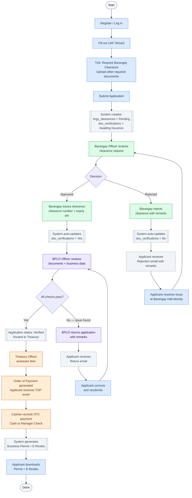
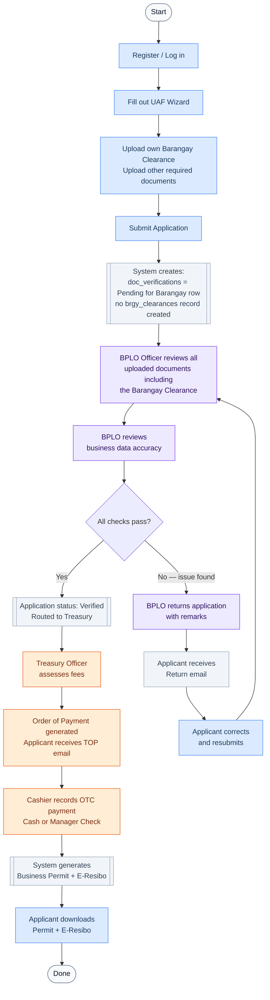
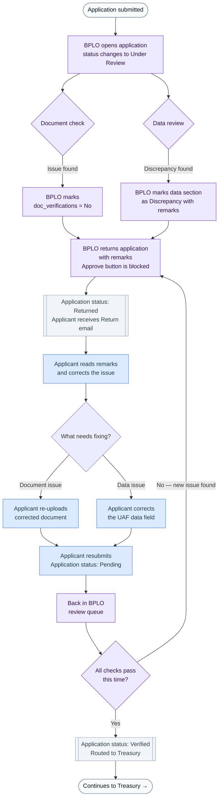
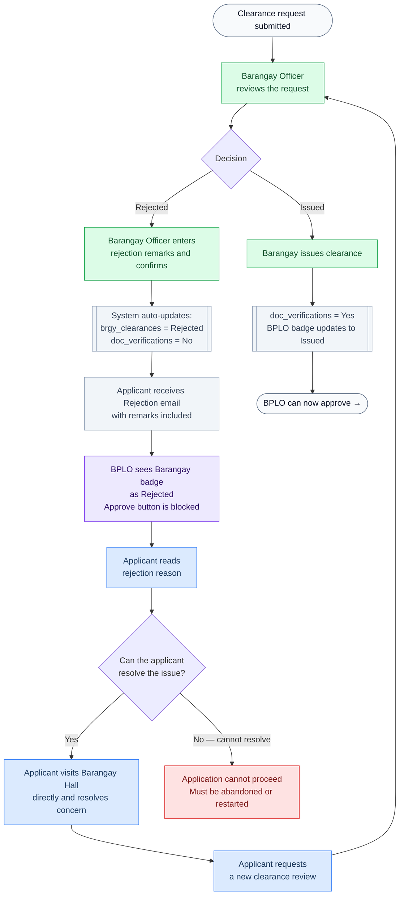
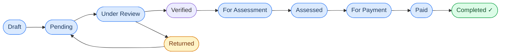

# eBPLS Application Process Flows

**Municipality of Liliw — All Scenarios**

> Color key used across all diagrams:
> - 🔵 **Blue** — Applicant action
> - 🟣 **Purple** — BPLO Officer action
> - 🟢 **Green** — Barangay Officer action
> - 🟠 **Orange** — Treasury action
> - ⬜ **Gray** — Automated system action

---

## Scenario 1 — New Application (with Barangay Clearance Request)

> Applicant ticks the "Request Barangay Clearance" checkbox on the UAF.
> The system requests clearance from     the Barangay before BPLO can approve.

---

## Scenario 2 — New Application (Applicant has own Barangay Clearance)

> Applicant does NOT tick the checkbox — they already hold a valid Barangay Clearance
> and upload it themselves. BPLO manually verifies the uploaded document.

---

## Scenario 3 — Application Returned (BPLO Finds Issues)

> BPLO finds problems with either the uploaded documents or the declared business data.
> The application is returned to the applicant for correction.

---

## Scenario 4 — Barangay Clearance Rejected

> Applicant requested a Barangay Clearance (checkbox ticked).
> The Barangay Officer reviews and rejects the request.
> BPLO is automatically blocked from approving the application.

---

## Scenario 5 — Business Retirement

> An existing business owner wants to formally close / retire their business.
> Uses a separate retirement flow but reuses the Treasury OTC payment step.

---

## Quick Reference — Who Does What

| Step | Actor | Action |
|---|---|---|
| Fill & submit UAF | **Applicant** | Completes wizard, uploads documents, submits |
| Request clearance | **Barangay Officer** | Reviews request, issues or rejects with remarks |
| Verify documents & data | **BPLO Officer** | Checks all docs + business data, approves or returns |
| Assess fees | **Treasury Officer** | Calculates fees, generates Order of Payment |
| Collect payment | **Treasury Cashier** | Records OTC cash or manager's check payment |
| Generate documents | **System (auto)** | Creates Permit, E-Resibo, TOP upon status change |
| Download documents | **Applicant** | Downloads permit and receipt from their dashboard |

---

## Application Status Lifecycle

---

*eBPLS Application Flow Reference — Municipality of Liliw*
