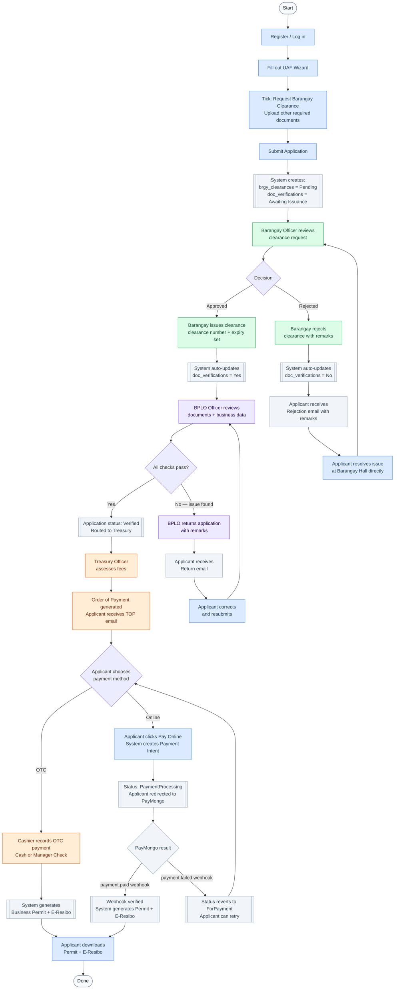
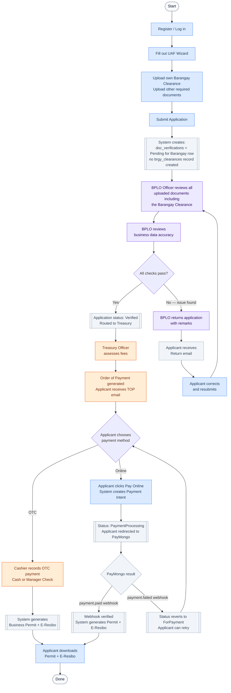
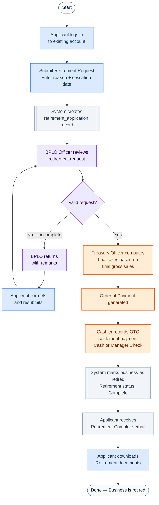
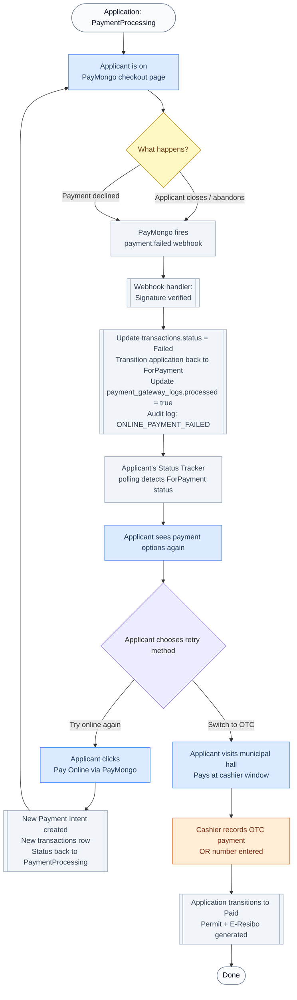
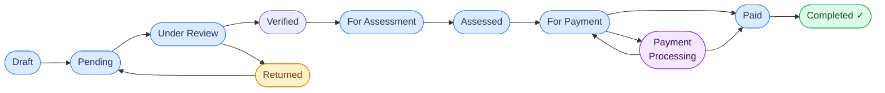

# eBPLS Application Process Flows

**Municipality of Liliw — All Scenarios**
**v2.0 — Updated with PayMongo Online Payment**

> Color key used across all diagrams:
> - 🔵 **Blue** — Applicant action
> - 🟣 **Purple** — BPLO Officer action
> - 🟢 **Green** — Barangay Officer action
> - 🟠 **Orange** — Treasury action
> - ⬜ **Gray** — Automated system action
> - 🔴 **Red** — Blocked / Failed state

---

## Scenario 1 — New Application (with Barangay Clearance Request)

> Applicant ticks the "Request Barangay Clearance" checkbox on the UAF.
> The system requests clearance from the Barangay before BPLO can approve.
> At payment, the applicant may choose OTC or online via PayMongo.

---

## Scenario 2 — New Application (Applicant has own Barangay Clearance)

> Applicant does NOT tick the checkbox — they already hold a valid Barangay Clearance
> and upload it themselves. BPLO manually verifies the uploaded document.
> At payment, the applicant may choose OTC or online via PayMongo.

---

## Scenario 3 — Application Returned (BPLO Finds Issues)

> BPLO finds problems with either the uploaded documents or the declared business data.
> The application is returned to the applicant for correction.

---

## Scenario 4 — Barangay Clearance Rejected

> Applicant requested a Barangay Clearance (checkbox ticked).
> The Barangay Officer reviews and rejects the request.
> BPLO is automatically blocked from approving the application.

---

## Scenario 5 — Business Retirement

> An existing business owner wants to formally close / retire their business.
> Uses a separate retirement flow but reuses the Treasury OTC payment step.
> **Online payment is not available for retirement — OTC only.**

---

## Scenario 6 — Online Payment via PayMongo (Happy Path) 🆕

> Applicant reaches ForPayment status and chooses to pay online instead of OTC.
> Payment is confirmed asynchronously via PayMongo's webhook callback.

```mermaid
flowchart TD
    A([Application: ForPayment]) --> B[Applicant opens Status Tracker\nSees total due + two payment options]

    B --> C[Applicant clicks\nPay Online via PayMongo]
    C --> D[Frontend calls\nPOST /api/treasury/payments/online]

    D --> E[[Backend creates Payment Intent\nvia PayMongo API\nTransactions row inserted with status = Pending\npaymongo_payment_intent_id stored]]

    E --> F[[Application status: PaymentProcessing\nAudit log: ONLINE_PAYMENT_INITIATED]]
    F --> G[Applicant redirected to\nPayMongo checkout page]

    G --> H[Applicant completes payment\nvia GCash or Card]
    H --> I[[PayMongo sends payment.paid\nwebhook to POST /api/webhooks/paymongo]]

    I --> J{Webhook handler:\nSignature valid?}
    J -->|No — invalid HMAC| K[[Reject 400\nLog incident\nNo state change]]

    J -->|Yes| L{Idempotency check:\nEvent ID already processed?}
    L -->|Yes — duplicate event| M[[Return 200 immediately\nNo further processing]]

    L -->|No — new event| N[[Insert into payment_gateway_logs\nprocessed = false]]
    N --> O[[Find transaction by\npaymongo_payment_intent_id\nUpdate: paymongo_payment_id\npayment_channel, paid_at]]

    O --> P[[Generate OR number\nPM-YYYYMMDD-000001]]
    P --> Q[[Transition application to Paid\nTrigger Permit + E-Resibo generation]]
    Q --> R[[Enqueue PAYMENT_RECORDED email\nUpdate payment_gateway_logs.processed = true\nAudit log: ONLINE_PAYMENT_CONFIRMED]]

    R --> S[Applicant's Status Tracker\nauto-updates to Completed]
    S --> T[Applicant downloads\nPermit + E-Resibo]
    T --> U([Done])

    classDef applicant fill:#dbeafe,stroke:#3b82f6,color:#1e3a5f
    classDef system fill:#f1f5f9,stroke:#94a3b8,color:#334155
    classDef terminal fill:#f8fafc,stroke:#64748b,color:#0f172a
    classDef blocked fill:#fee2e2,stroke:#dc2626,color:#7f1d1d
    classDef webhook fill:#fef9c3,stroke:#ca8a04,color:#713f12

    class A,U terminal
    class B,C,H,T applicant
    class D,E,F,G,I,L,M,N,O,P,Q,R,S system
    class J webhook
    class K blocked
```

---

## Scenario 7 — Online Payment Failed or Abandoned 🆕

> Applicant initiates PayMongo checkout but either abandons the page or the payment fails.
> The system safely reverts to ForPayment so the applicant can retry.

---

## Quick Reference — Who Does What

| Step | Actor | Action |
|---|---|---|
| Fill & submit UAF | **Applicant** | Completes wizard, uploads documents, submits |
| Request clearance | **Barangay Officer** | Reviews request, issues or rejects with remarks |
| Verify documents & data | **BPLO Officer** | Checks all docs + business data, approves or returns |
| Assess fees | **Treasury Officer** | Calculates fees, generates Order of Payment |
| Collect OTC payment | **Treasury Cashier** | Records cash or manager's check; enters OR number |
| **Initiate online payment** | **Applicant (or Treasury Officer)** | Clicks Pay Online; redirected to PayMongo checkout |
| **Confirm online payment** | **System (webhook)** | PayMongo fires webhook; backend verifies, records, and transitions status |
| Generate documents | **System (auto)** | Creates Permit, E-Resibo, TOP upon status change — triggered by both OTC and online payment |
| Download documents | **Applicant** | Downloads permit and receipt from their dashboard |

---

## Payment Channel Comparison

| Channel | Who Initiates | Path | OR Number Format | Confirmation |
|---|---|---|---|---|
| Cash (OTC) | Treasury Cashier | ForPayment → Paid | Manually entered by cashier | Synchronous (instant) |
| Manager Check (OTC) | Treasury Cashier | ForPayment → Paid | Manually entered by cashier | Synchronous (instant) |
| GCash (Online) | Applicant or Treasury | ForPayment → PaymentProcessing → Paid | `PM-{YYYYMMDD}-{seq}` | Asynchronous (webhook) |
| Card (Online) | Applicant or Treasury | ForPayment → PaymentProcessing → Paid | `PM-{YYYYMMDD}-{seq}` | Asynchronous (webhook) |
| PayMongo Link (Online) | Applicant or Treasury | ForPayment → PaymentProcessing → Paid | `PM-{YYYYMMDD}-{seq}` | Asynchronous (webhook) |

> **Retirement Module** uses OTC only. Online payment is not available for retirement settlements.

---

## Application Status Lifecycle

> `PaymentProcessing` (purple) is entered only via the online payment path. It is an intermediate state between `ForPayment` and `Paid`. If payment fails, the application reverts to `ForPayment` for retry.

---

*eBPLS Application Flow Reference v2.0 — Municipality of Liliw*
*Updated: Added Scenario 6 (Online Payment Happy Path), Scenario 7 (Online Payment Failed/Abandoned), PaymentProcessing state in the lifecycle diagram, and payment channel comparison table.*