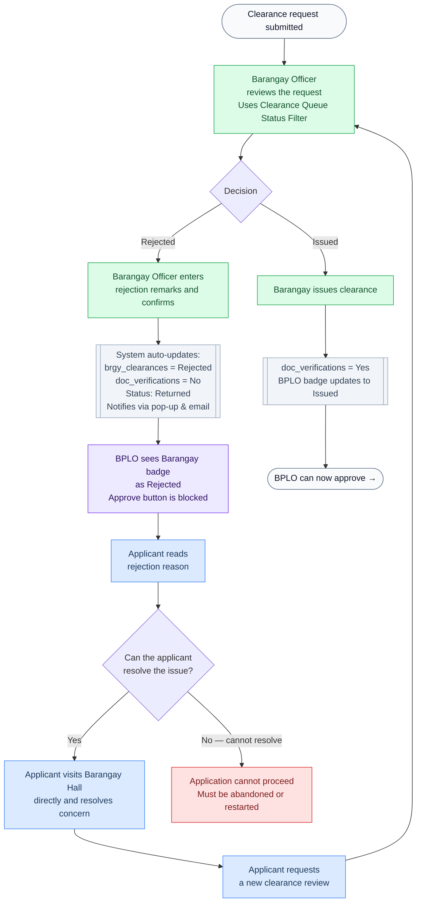
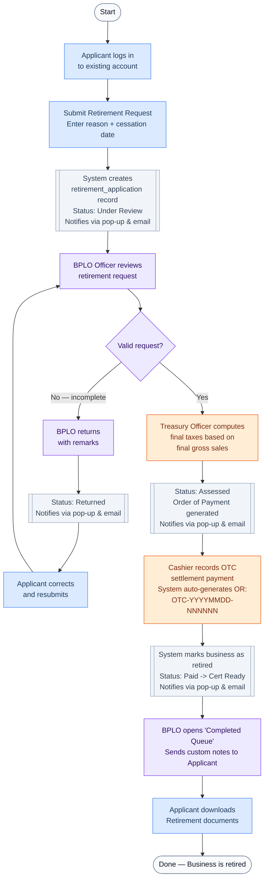
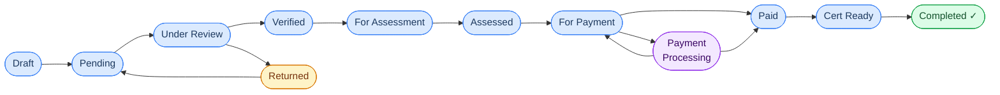

# eBPLS Application Process Flows

**Municipality of Liliw — All Scenarios**
**v3.0 — Updated with July 2026 Adviser Changes (Phase 1 to 6)**

> Color key used across all diagrams:
> - 🔵 **Blue** — Applicant action
> - 🟣 **Purple** — BPLO Officer action
> - 🟢 **Green** — Barangay Officer action
> - 🟠 **Orange** — Treasury action
> - ⬜ **Gray** — Automated system action
> - 🔴 **Red** — Blocked / Failed state
>
> 🔔 **Notification Standard (v3.0)**: ALL status transitions (Under Review, Verified, Assessed, Paid, Returned, Cert Ready) automatically trigger in-app pop-ups (with timespans) and emails (with timestamps) to the Applicant.

---

## Scenario 1 — New Application (with Barangay Clearance Request)

> Applicant ticks the "Request Barangay Clearance" checkbox on the UAF.
> **Step 3 (v3.0)**: UAF now asks for dynamic conditional inputs (e.g., number of heads/capacity) for tiered fee structures.
> The system requests clearance from the Barangay before BPLO can approve.
> At payment, the applicant sees a Fee Assessment Breakdown and may choose OTC (auto-generated OR) or online via PayMongo (with collapsible breakdown).
> When ready, BPLO uses the new Completed Queue to send custom notes.

```mermaid
flowchart TD
    A([Start]) --> B[Register / Log in]
    B --> C[Fill out UAF Wizard\nIncludes dynamic conditional inputs\nfor tiered fee structures]
    C --> D[Tick: Request Barangay Clearance\nUpload other required documents]
    D --> E[Submit Application]
    E --> F[[System creates:\nbrgy_clearances = Pending\nStatus: Under Review\nNotifies via pop-up & email]]

    F --> G[Barangay Officer reviews\nclearance request\nUses Clearance Queue Status Filter]
    G --> H{Decision}

    H -->|Approved| I[Barangay issues clearance\nclearance number + expiry set]
    I --> J[[System auto-updates\ndoc_verifications = Yes]]

    J --> K[BPLO Officer reviews\ndocuments + business data\nUses Dashboard Status Filter]
    K --> L{All checks pass?}
    L -->|Yes| M[[Application status: Verified\nRouted to Treasury\nNotifies via pop-up & email]]

    L -->|No — issue found| N[BPLO returns application\nwith remarks]
    N --> O[[Status: Returned\nNotifies via pop-up & email]]
    O --> P[Applicant corrects\nand resubmits]
    P --> K

    M --> Q[Treasury Officer\nassesses fees]
    Q --> R[[Status: Assessed\nOrder of Payment generated\nNotifies via pop-up & email]]
    
    R --> ST[Applicant views StatusTracker\nSees 'Fee Assessment Breakdown' card\n(Mayor's Permit + Other Municipal Fees)]
    ST --> PAY{Applicant chooses\npayment method}

    PAY -->|OTC| S[Cashier records OTC payment\nSystem auto-generates OR:\nOTC-YYYYMMDD-NNNNNN]
    S --> T[[Status: Paid\nSystem generates Permit + E-Resibo\nNotifies via pop-up & email]]

    PAY -->|Online| S2[Applicant views collapsible 'Fee Breakdown'\nClicks Pay Online\nSystem creates Payment Intent]
    S2 --> S3[[Status: PaymentProcessing\nApplicant redirected to PayMongo]]
    S3 --> S4{PayMongo result}
    S4 -->|payment.paid webhook| S5[[Webhook verified\nStatus: Paid\nSystem generates Permit + E-Resibo\nNotifies via pop-up & email]]
    S4 -->|payment.failed webhook| S6[[Status reverts to ForPayment\nApplicant can retry]]
    S6 --> PAY

    T --> CR[[Status: Cert Ready\nNotifies via pop-up & email]]
    S5 --> CR

    CR --> BPLO_CQ[BPLO opens 'Completed Queue'\nSends custom notes to Applicant]
    BPLO_CQ --> U[Applicant downloads\nPermit + E-Resibo]
    U --> V([Done])

    classDef applicant fill:#dbeafe,stroke:#3b82f6,color:#1e3a5f
    classDef bplo fill:#ede9fe,stroke:#7c3aed,color:#2e1065
    classDef barangay fill:#dcfce7,stroke:#16a34a,color:#14532d
    classDef treasury fill:#ffedd5,stroke:#ea580c,color:#7c2d12
    classDef system fill:#f1f5f9,stroke:#94a3b8,color:#334155
    classDef terminal fill:#f8fafc,stroke:#64748b,color:#0f172a
    classDef failed fill:#fee2e2,stroke:#dc2626,color:#7f1d1d

    class A,V terminal
    class B,C,D,E,P,U,Z,S2,ST applicant
    class G,I,W barangay
    class K,N,BPLO_CQ bplo
    class Q,S treasury
    class F,J,M,T,X,Y,O,S3,S5,S6,R,CR system
    class S4 system
```

---

## Scenario 2 — New Application (Applicant has own Barangay Clearance)

> Applicant does NOT tick the checkbox — they already hold a valid Barangay Clearance
> and upload it themselves. BPLO manually verifies the uploaded document.
> Incorporates v3.0 dynamic inputs, status tracking, and notification flows.

```mermaid
flowchart TD
    A([Start]) --> B[Register / Log in]
    B --> C[Fill out UAF Wizard\nIncludes dynamic conditional inputs\nfor tiered fee structures]
    C --> D[Upload own Barangay Clearance\nUpload other required documents]
    D --> E[Submit Application]
    E --> F[[System creates:\ndoc_verifications = Pending\nStatus: Under Review\nNotifies via pop-up & email]]

    F --> G[BPLO Officer reviews all documents\nUses Dashboard Status Filter]
    G --> H[BPLO reviews\nbusiness data accuracy]
    H --> I{All checks pass?}

    I -->|Yes| J[[Application status: Verified\nRouted to Treasury\nNotifies via pop-up & email]]

    I -->|No — issue found| K[BPLO returns application\nwith remarks]
    K --> L[[Status: Returned\nNotifies via pop-up & email]]
    L --> M[Applicant corrects\nand resubmits]
    M --> G

    J --> N[Treasury Officer\nassesses fees]
    N --> O[[Status: Assessed\nOrder of Payment generated\nNotifies via pop-up & email]]

    O --> ST[Applicant views StatusTracker\nSees 'Fee Assessment Breakdown' card\n(Mayor's Permit + Other Municipal Fees)]
    ST --> PAY{Applicant chooses\npayment method}

    PAY -->|OTC| P[Cashier records OTC payment\nSystem auto-generates OR:\nOTC-YYYYMMDD-NNNNNN]
    P --> Q[[Status: Paid\nSystem generates Permit + E-Resibo\nNotifies via pop-up & email]]

    PAY -->|Online| P2[Applicant views collapsible 'Fee Breakdown'\nClicks Pay Online\nSystem creates Payment Intent]
    P2 --> P3[[Status: PaymentProcessing\nApplicant redirected to PayMongo]]
    P3 --> P4{PayMongo result}
    P4 -->|payment.paid webhook| P5[[Webhook verified\nStatus: Paid\nSystem generates Permit + E-Resibo\nNotifies via pop-up & email]]
    P4 -->|payment.failed webhook| P6[[Status reverts to ForPayment\nApplicant can retry]]
    P6 --> PAY

    Q --> CR[[Status: Cert Ready\nNotifies via pop-up & email]]
    P5 --> CR

    CR --> BPLO_CQ[BPLO opens 'Completed Queue'\nSends custom notes to Applicant]
    BPLO_CQ --> R[Applicant downloads\nPermit + E-Resibo]
    R --> S([Done])

    classDef applicant fill:#dbeafe,stroke:#3b82f6,color:#1e3a5f
    classDef bplo fill:#ede9fe,stroke:#7c3aed,color:#2e1065
    classDef treasury fill:#ffedd5,stroke:#ea580c,color:#7c2d12
    classDef system fill:#f1f5f9,stroke:#94a3b8,color:#334155
    classDef terminal fill:#f8fafc,stroke:#64748b,color:#0f172a

    class A,S terminal
    class B,C,D,E,M,R,P2,ST applicant
    class G,H,K,BPLO_CQ bplo
    class N,P treasury
    class F,J,Q,L,P3,P4,P5,P6,O,CR system
```

---

## Scenario 3 — Application Returned (BPLO Finds Issues)

> BPLO finds problems with either the uploaded documents or the declared business data.
> The application is returned to the applicant for correction, triggering v3.0 notifications.

```mermaid
flowchart TD
    A([Application submitted]) --> B[BPLO opens application\nStatus: Under Review\nNotifies via pop-up & email]

    B --> C{Document check}
    C -->|Issue found| D[BPLO marks\ndoc_verifications = No]

    B --> E{Data review}
    E -->|Discrepancy found| F[BPLO marks data section\nas Discrepancy with remarks]

    D --> G[BPLO returns application\nwith remarks\nApprove button is blocked]
    F --> G

    G --> H[[Status: Returned\nNotifies via pop-up (with timespan)\n& email (with timestamp)]]
    H --> I[Applicant reads remarks\nand corrects the issue]

    I --> J{What needs fixing?}
    J -->|Document issue| K[Applicant re-uploads\ncorrected document]
    J -->|Data issue| L[Applicant corrects\nthe UAF data field]

    K --> M[Applicant resubmits\nApplication status: Pending]
    L --> M

    M --> N[Back in BPLO\nreview queue]
    N --> O{All checks pass\nthis time?}
    O -->|Yes| P[[Application status: Verified\nRouted to Treasury\nNotifies via pop-up & email]]
    O -->|No — new issue found| G

    P --> Q([Continues to Treasury →])

    classDef applicant fill:#dbeafe,stroke:#3b82f6,color:#1e3a5f
    classDef bplo fill:#ede9fe,stroke:#7c3aed,color:#2e1065
    classDef system fill:#f1f5f9,stroke:#94a3b8,color:#334155
    classDef terminal fill:#f8fafc,stroke:#64748b,color:#0f172a

    class A,Q terminal
    class I,K,L,M applicant
    class B,C,D,E,F,G,N,O bplo
    class H,P system
```

---

## Scenario 4 — Barangay Clearance Rejected

> Applicant requested a Barangay Clearance (checkbox ticked).
> The Barangay Officer reviews and rejects the request.
> BPLO is automatically blocked, and the applicant receives a Return notification.



---

## Scenario 5 — Business Retirement

> An existing business owner wants to formally close / retire their business.
> Uses a separate retirement flow but reuses the Treasury OTC payment step.
> **Online payment is not available for retirement — OTC only.** Auto-generates OR natively in v3.0.



---

## Scenario 6 — Online Payment via PayMongo (Happy Path) 🆕

> Applicant reaches ForPayment status and chooses to pay online instead of OTC.
> Payment is confirmed asynchronously via PayMongo's webhook callback.

```mermaid
flowchart TD
    A([Application: Assessed / ForPayment]) --> B[Applicant opens Status Tracker\nSees 'Fee Assessment Breakdown' card\nExpands collapsible 'Fee Breakdown'\nClicks Pay Online]

    B --> D[Frontend calls\nPOST /api/treasury/payments/online]

    D --> E[[Backend creates Payment Intent\nvia PayMongo API\nTransactions row inserted with status = Pending\npaymongo_payment_intent_id stored]]

    E --> F[[Application status: PaymentProcessing\nAudit log: ONLINE_PAYMENT_INITIATED]]
    F --> G[Applicant redirected to\nPayMongo checkout page]

    G --> H[Applicant completes payment\nvia GCash or Card]
    H --> I[[PayMongo sends payment.paid\nwebhook to POST /api/webhooks/paymongo]]

    I --> J{Webhook handler:\nSignature valid?}
    J -->|No — invalid HMAC| K[[Reject 400\nLog incident\nNo state change]]

    J -->|Yes| L{Idempotency check:\nEvent ID already processed?}
    L -->|Yes — duplicate event| M[[Return 200 immediately\nNo further processing]]

    L -->|No — new event| N[[Insert into payment_gateway_logs\nprocessed = false]]
    N --> O[[Find transaction by\npaymongo_payment_intent_id\nUpdate: paymongo_payment_id\npayment_channel, paid_at]]

    O --> P[[Generate OR number\nPM-YYYYMMDD-000001]]
    P --> Q[[Transition application to Paid\nTrigger Permit + E-Resibo generation\nNotifies: Paid (Pop-up & Email)]]
    Q --> R[[Enqueue PAYMENT_RECORDED email\nUpdate payment_gateway_logs.processed = true\nAudit log: ONLINE_PAYMENT_CONFIRMED]]

    R --> CR[[Status: Cert Ready\nNotifies: Cert Ready (Pop-up & Email)]]
    CR --> BPLO_CQ[BPLO uses 'Completed Queue'\nto send custom notes]
    BPLO_CQ --> S[Applicant's Status Tracker\nauto-updates to Completed]
    S --> T[Applicant downloads\nPermit + E-Resibo]
    T --> U([Done])

    classDef applicant fill:#dbeafe,stroke:#3b82f6,color:#1e3a5f
    classDef bplo fill:#ede9fe,stroke:#7c3aed,color:#2e1065
    classDef system fill:#f1f5f9,stroke:#94a3b8,color:#334155
    classDef terminal fill:#f8fafc,stroke:#64748b,color:#0f172a
    classDef blocked fill:#fee2e2,stroke:#dc2626,color:#7f1d1d
    classDef webhook fill:#fef9c3,stroke:#ca8a04,color:#713f12

    class A,U terminal
    class B,H,S,T applicant
    class BPLO_CQ bplo
    class D,E,F,G,I,L,M,N,O,P,Q,R,CR system
    class J webhook
    class K blocked
```

---

## Scenario 7 — Online Payment Failed or Abandoned 🆕

> Applicant initiates PayMongo checkout but either abandons the page or the payment fails.
> The system safely reverts to ForPayment so the applicant can retry.

```mermaid
flowchart TD
    A([Application: PaymentProcessing]) --> B[Applicant is on\nPayMongo checkout page]

    B --> C{What happens?}

    C -->|Applicant closes / abandons| D[PayMongo fires\npayment.failed webhook]
    C -->|Payment declined| D

    D --> E[[Webhook handler:\nSignature verified]]
    E --> F[[Update transactions.status = Failed\nTransition application back to ForPayment\nUpdate payment_gateway_logs.processed = true\nAudit log: ONLINE_PAYMENT_FAILED]]

    F --> G[Applicant's Status Tracker\npolling detects ForPayment status]
    G --> H[Applicant sees payment options again\n(with collapsible Fee Breakdown)]

    H --> I{Applicant chooses retry method}
    I -->|Try online again| J[Applicant clicks\nPay Online via PayMongo]
    J --> K[[New Payment Intent created\nNew transactions row\nStatus back to PaymentProcessing]]
    K --> B

    I -->|Switch to OTC| L[Applicant visits municipal hall\nPays at cashier window]
    L --> M[Cashier records OTC payment\nSystem auto-generates OR: OTC-YYYYMMDD-NNNNNN]
    M --> N[[Status: Paid\nPermit + E-Resibo generated\nNotifies via pop-up & email]]
    N --> CR[[Status: Cert Ready\nNotifies via pop-up & email]]
    CR --> O([Done])

    classDef applicant fill:#dbeafe,stroke:#3b82f6,color:#1e3a5f
    classDef treasury fill:#ffedd5,stroke:#ea580c,color:#7c2d12
    classDef system fill:#f1f5f9,stroke:#94a3b8,color:#334155
    classDef terminal fill:#f8fafc,stroke:#64748b,color:#0f172a
    classDef webhook fill:#fef9c3,stroke:#ca8a04,color:#713f12

    class A,O terminal
    class B,H,J,L applicant
    class M treasury
    class D,E,F,G,K,N,CR system
    class C webhook
```

---

## Quick Reference — Who Does What

| Step | Actor | Action |
|---|---|---|
| Fill & submit UAF | **Applicant** | Completes wizard, uploads documents, submits (v3.0 includes conditional inputs for tiered fees) |
| Request clearance | **Barangay Officer** | Uses Clearance Queue Status Filter to review request, issues or rejects with remarks |
| Verify documents & data | **BPLO Officer** | Uses Dashboard Status Filter to check docs + data, approves or returns |
| Assess fees | **Treasury Officer** | Calculates fees, generates Order of Payment (creates Itemized Fee Breakdown) |
| Collect OTC payment | **Treasury Cashier** | Records payment; system auto-generates `OTC-YYYYMMDD-NNNNNN` OR |
| **Initiate online payment** | **Applicant (or Treasury Officer)** | Expands collapsible Fee Breakdown, clicks Pay Online; redirected to PayMongo checkout |
| **Confirm online payment** | **System (webhook)** | PayMongo fires webhook; backend verifies, records, and transitions status |
| Generate documents | **System (auto)** | Creates Permit, E-Resibo, TOP upon status change; sends pop-up/email notifications |
| Complete Permit | **BPLO Officer** | Uses Completed Queue to send custom notes once permit is ready |
| Download documents | **Applicant** | Downloads permit and receipt from their dashboard |

---

## Payment Channel Comparison

| Channel | Who Initiates | Path | OR Number Format | Confirmation |
|---|---|---|---|---|
| Cash (OTC) | Treasury Cashier | Assessed/ForPayment → Paid | Auto: `OTC-{YYYYMMDD}-{seq}` | Synchronous (instant) |
| Manager Check (OTC) | Treasury Cashier | Assessed/ForPayment → Paid | Auto: `OTC-{YYYYMMDD}-{seq}` | Synchronous (instant) |
| GCash (Online) | Applicant or Treasury | ForPayment → PaymentProcessing → Paid | Auto: `PM-{YYYYMMDD}-{seq}` | Asynchronous (webhook) |
| Card (Online) | Applicant or Treasury | ForPayment → PaymentProcessing → Paid | Auto: `PM-{YYYYMMDD}-{seq}` | Asynchronous (webhook) |
| PayMongo Link (Online) | Applicant or Treasury | ForPayment → PaymentProcessing → Paid | Auto: `PM-{YYYYMMDD}-{seq}` | Asynchronous (webhook) |

> **Retirement Module** uses OTC only. Online payment is not available for retirement settlements.

---

## Application Status Lifecycle



> **v3.0 Notifications**: ALL status transitions (Under Review, Verified, Assessed, Paid, Returned, Cert Ready) issue an in-app pop-up (with timespan) and email (with timestamp).
> `PaymentProcessing` (purple) is entered only via the online payment path. It is an intermediate state between `ForPayment` and `Paid`. If payment fails, the application reverts to `ForPayment` for retry.

---

*eBPLS Application Flow Reference v3.0 — Municipality of Liliw*
*Updated: Incorporated July 2026 Adviser Changes (Phase 1 to 6) — dynamic conditional inputs, fee assessment breakdown, auto-generated OTC ORs, universal pop-up/email notifications, Completed Queue for BPLO notes, and Status Filters for BPLO/Barangay.*
