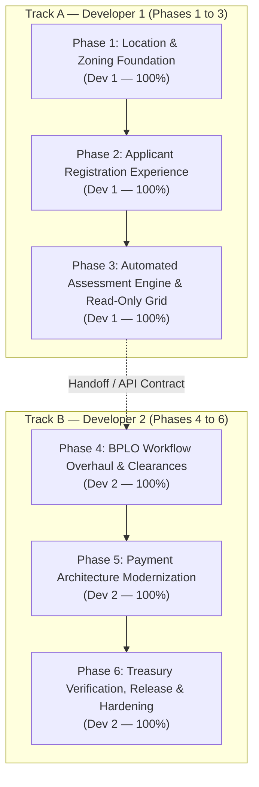

# eBPLS Main Implementation Plan: Approved 13 System Revisions

**Project:** Electronic Business Permits and Licensing System (eBPLS)  
**Deployment:** Municipality of Liliw, Laguna  
**Document Version:** 2.0 (Strict Single-Developer Phase Allocation)  
**Date:** November 5, 2026  

---

## 1. Planning Basis

### 1.1 Source Documents
* **Approved Technical Specification:** [eBPLS Approved Final System Revisions Specification v4.0](file:///c:/projects/eBPLS/system-planning/eBPLS_Suggested_Revisions_Proposal.md)
* **Architecture Baseline:** [eBPLS System Architecture](file:///c:/projects/eBPLS/system-planning/eBPLS_System_Architecture.md) & [eBPLS SDD v3.0](file:///c:/projects/eBPLS/system-planning/eBPLS_SDD_v3.md)
* **Codebase State:**
  * Backend: Express.js, Supabase PostgreSQL (Current highest migration: `043_location_mismatch.sql`), Zod, `pdf-lib`, Nodemailer.
  * Frontend: React.js (Vite), Tailwind CSS, Zustand, Lucide React.

### 1.2 Core Team Assignment Rule
As mandated, **every single phase is assigned 100% to ONE developer**. There is no split ownership or task-sharing within any single phase:
* **Developer 1 (Dev 1):** Owns **Phases 1, 2, and 3** (50% of the project) — Foundation, Zoning Master Data, Applicant UAF Wizard Modernization, and Background Fee Assessment Engine.
* **Developer 2 (Dev 2):** Owns **Phases 4, 5, and 6** (50% of the project) — BPLO Split-Screen Verifier Overhaul, Payment Modernization (PayMongo removal & proof upload), Treasury Cashier Verification, and End-to-End System Hardening.

---

## 2. Dependency & Execution Strategy

The implementation comprises **six (6) chronological, full-stack Agile phases**. Each phase is an end-to-end, independently testable unit of work executed entirely by its designated developer:



### Execution Logic
1. **Developer 1** establishes the foundation: DB schema migrations, centroid coordinates, dynamic tenancy rules, applicant wizard modernization, and the backend fee assessment engine.
2. **Developer 2** builds upon the foundation: BPLO verifier UI overhaul, removal of map and barangay blockers, PayMongo extraction, proof-of-payment cashier verification queue, instant document releases, and joint inspection reports.

---

## 3. Phase Overview

| Phase | Name | Objective | Dependencies | Deliverables | Assigned Developer |
|---|---|---|---|---|:---:|
| **1** | Location & Zoning Foundation | Create `location_zones` schema, seed 33 Liliw centroids, and build Admin Master Data zoning editor. | Migrations 001–043 | Migration 044, Seed data, Admin zoning CRUD & UI | **Developer 1** (100%) |
| **2** | Applicant Registration Experience | Modernize UAF wizard: hardcoded Liliw/Laguna, auto-pin centroid, 3-way tenancy, multi-stalls, and pure upload. | Phase 1 schema | UAF Steps 2, 3, 4, 5 & Dynamic Requirement Service | **Developer 1** (100%) |
| **3** | Automated Assessment Engine & Read-Only Grid | Calculate fees with zone multipliers, auto-trigger assessment on BPLO approval, and lock Treasury grid as read-only. | Phase 1 & 2 | Updated `assessment.service.js`, `AssessmentGrid.jsx` | **Developer 1** (100%) |
| **4** | BPLO Workflow Overhaul & Clearances | Remove Leaflet map, build Address & Zoning card, add Regulatory checklist, and retire Barangay Module. | Phase 1, 2 & 3 | Modernized `SplitScreenVerifier.jsx`, unblocked approval logic | **Developer 2** (100%) |
| **5** | Payment Modernization & Proof Upload | Completely remove PayMongo, add Bank/GCash proof upload in StatusTracker, and create payment proof schema. | Phase 4 | Next unused migration (currently 048), `StatusTracker.jsx` proof upload, PayMongo cleanup | **Developer 2** (100%) |
| **6** | Treasury POS Verification & System Hardening | Build Deposit Slip verification queue in Cashier POS, instant permit release, JIL export, and full QA regression. | Phase 4 & 5 | `CashierPOS.jsx` verification tab, JIL export, full QA sign-off | **Developer 2** (100%) |

---

## 4. Detailed Implementation Phases

---

### Phase 1 — Location & Zoning Foundation
* **Assigned Developer:** **Developer 1 (100%)**
* **Objective:** Establish the database schema, seed data, and administrative interface for foot-traffic commercial zoning and official barangay centroid coordinates.
* **Scope:**
  * Create `location_zones` table with columns: `id`, `name`, `foot_traffic_level`, `min_capital_floor`, `fee_multiplier`, `is_active`.
  * Add `zone_id`, `latitude`, and `longitude` to `barangays` table.
  * Seed official centroid coordinates for all 33 Liliw barangays and assign them across Zone 1 (Prime Commercial), Zone 2 (Sub-Commercial), and Zone 3 (Rural).
  * Build full-stack Admin Master Data management: backend CRUD in `admin.controller.js` and frontend UI in `MasterData.jsx` to allow Admins to adjust zone rates and reassign barangays anytime.
* **Architecture Components:**
  * Database: Migration `044_location_zones_and_centroids.sql`.
  * Backend: `admin.controller.js`, `admin.routes.js`, `application.controller.js` (`/api/applications/barangays`).
  * Frontend: `MasterData.jsx`.
* **Dependencies:** Existing migrations 001–043; Admin authentication.
* **Major Deliverables:**
  * Migration `044_location_zones_and_centroids.sql` applied cleanly.
  * Seed data for 33 Liliw barangay centroids and 3 foot-traffic zones.
  * Interactive Admin Master Data zoning editor.
* **Acceptance Criteria:**
  * [ ] Querying `SELECT * FROM location_zones` returns Zone 1 (₱50k min, 1.25x), Zone 2 (₱25k min, 1.00x), and Zone 3 (₱10k min, 0.80x).
  * [ ] Calling `GET /api/applications/barangays` returns all 33 barangays with valid `latitude`, `longitude`, and `zone_id`.
  * [ ] Admin can change a barangay's zone or edit the minimum capital floor in `MasterData.jsx` and changes persist.
* **Risks / Notes:**  
  * Centroid coordinates must accurately represent municipal centroids of Liliw to prevent rendering bugs.

---

### Phase 2 — Applicant Registration Experience
* **Assigned Developer:** **Developer 1 (100%)**
* **Objective:** Modernize the entire Unified Application Form (UAF) wizard to implement automated centroid coordinates, hardcoded municipal boundaries, dynamic tenancy documents, multi-stall declarations, and pure clearance upload.
* **Scope:**
  * Database: Migration `045_applicant_fields_and_tenancy.sql` adding `tenancy_type` and `stall_unit_numbers` to `businesses`. Update `requirement_types` condition check to include `'tenancy_type'`.
  * `Step2_Location.jsx`: Permanently lock City to "Liliw" and Province to "Laguna". Remove `InteractiveLocationPin` Leaflet component and Turf.js warnings. On Barangay selection, automatically set coordinates to that barangay's centroid. Add 3-way Property Tenancy selector (`Rented`, `Owned Commercial`, `Owned Residential`).
  * `Step3_Activities.jsx`: Add `[+ Add Unit / Stall Number]` input. Display dynamic zoning guidance banner showing the selected barangay's zone and recommended minimum capital floor.
  * `Step4_Documents.jsx`: Remove "Request via municipality" toggle. Make "Barangay Business Clearance" a standard mandatory document upload. Dynamically display required property documents based on tenancy (Contract of Lease if Rented; Building Permit if Owned Commercial; Zoning if Residential).
  * Backend: Update `application.controller.js`, `validators.js`, and `requirement.service.js` to process `tenancy_type`, `stall_unit_numbers`, and conditional uploads.
* **Architecture Components:**
  * Database: Migration `045_applicant_fields_and_tenancy.sql`.
  * Database permissions: Migration `046_applicant_submission_permissions.sql` restricts the atomic submission RPC to the backend service role. Phase 5 must use the next unused migration number (currently 048; Phase 3 consumed 047).
  * Backend: `application.controller.js`, `requirement.service.js`, `validators.js`.
  * Frontend: `Step2_Location.jsx`, `Step3_Activities.jsx`, `Step4_Documents.jsx`, `Step5_Review.jsx`.
* **Dependencies:** Phase 1 (Centroids and Zoning schema).
* **Major Deliverables:**
  * Modernized UAF wizard with automated centroid pinning and locked Liliw address.
  * Dynamic tenancy-based documentary requirement engine.
  * Pure document upload flow for Barangay Clearance.
* **Acceptance Criteria:**
  * [ ] Selecting a barangay in Step 2 automatically assigns coordinates without showing map or pin-dragging.
  * [ ] Selecting "Rented" requires Contract of Lease in Step 4; selecting "Owned Commercial" requires Building Permit.
  * [ ] Multi-stall entries (e.g. "Stalls 12, 13, 14") save to database and display in Step 5 Review.
  * [ ] Barangay Clearance dropzone accepts PDF/JPG/PNG like any standard requirement.
* **Risks / Notes:**  
  * Ensure existing draft applications in local storage are safely migrated with default `tenancy_type = 'Owned Commercial'`.

---

### Phase 3 — Automated Assessment Engine & Read-Only Grid
* **Assigned Developer:** **Developer 1 (100%)**
* **Objective:** Incorporate foot-traffic zoning into fee calculations, eliminate the manual "Run Assessment Engine" button by auto-triggering calculations on BPLO approval, and lock Treasury fee grid as strictly read-only.
* **Scope:**
  * Backend Engine (`assessment.service.js`): Fetch business barangay zone $\rightarrow$ apply `zone.fee_multiplier` to base regulatory fees $\rightarrow$ validate capital against `zone.min_capital_floor`.
  * BPLO Auto-Trigger (`bplo.controller.js`): In `verifyApplication`, immediately call `assessmentService.calculateFees(appNo)` and `createAssessment(...)`. Transition status directly to `STATUSES.ASSESSED`, eliminating manual Treasury initiation.
  * Treasury UI (`AssessmentGrid.jsx`): Completely remove the "Pending Initial Assessment" view and the "Run Assessment Engine" button. Render itemized Tax Order of Payment (TOP) immediately on load. Lock fee amounts as strictly read-only text mirroring the Revenue Code. Remove arbitrary price override inputs (`handleAmountChange`, `tempAmount`).
  * Statutory Exemptions: Implement formal BMBE tax exemption switch requiring uploaded DTI certificate with mandatory audit logging.
* **Architecture Components:**
  * Backend: `assessment.service.js`, `bplo.controller.js`, `treasury.controller.js`.
  * Database: `047_automatic_assessment.sql` — atomic approval, saved calculation context, audited BMBE changes, and service-only financial writes.
  * Frontend: `AssessmentGrid.jsx`.
* **Dependencies:** Phase 1 (Zoning Matrix) and Phase 2 (Applicant Activities & Capital).
* **Major Deliverables:**
  * Automated background fee calculation engine executed on BPLO approval.
  * 100% read-only, COA-compliant Treasury assessment grid.
  * BMBE statutory exemption toggle with audit trail.
* **Acceptance Criteria:**
  * [ ] Approving an application in BPLO automatically computes fees and creates the assessment record.
  * [ ] Opening `AssessmentGrid.jsx` displays the itemized bill immediately; no "Run Assessment" button exists.
  * [ ] Fee amounts cannot be edited or overridden with arbitrary numbers.
  * [ ] Businesses in Zone 1 (Market) vs Zone 3 (Rural) have their fees computed with the appropriate zone multiplier.
* **Risks / Notes:**  
  * Wrap `calculateFees` in an atomic database transaction to prevent orphaned assessment headers if line items fail.

---

### Phase 4 — BPLO Workflow Overhaul & Clearances
* **Assigned Developer:** **Developer 2 (100%)**
* **Objective:** Overhaul the BPLO Split-Screen Verifier by removing the Leaflet map, building a clean Address & Zoning card, integrating an inter-office regulatory checklist, retiring the Barangay Module, and providing binary review actions.
* **Scope:**
  * Barangay Module Retirement: Update `App.jsx` to remove `ClearanceQueue.jsx` and `ROLES.BARANGAY_OFFICER` routes. Remove `barangay.routes.js` and `barangay.controller.js` from `app.js`. In `bplo.controller.js`, delete lines 576–598 checking `barangay_clearances` table status.
  * Map Removal & Address Card: In `SplitScreenVerifier.jsx`, remove `react-leaflet`, `MapContainer`, `TileLayer`, `Marker`, and polygon mismatch checks. Build high-visibility **Address & Zoning Jurisdiction Card** displaying: Declared Address, Zone classification badge, Tenancy badge, and Covered Stalls list.
  * Regulatory Checklist: Add integrated verification checkboxes in `SplitScreenVerifier.jsx` for Sanitary / Health Clearance (MHO) and Fire Safety Inspection Certificate (FSIC / BFP).
  * Binary Action Buttons: Consolidate footer actions to two clear primary buttons:
    * `[Approve & Forward to Treasury]` (triggers automated assessment and locks record).
    * `[Disapprove / Return with Remarks]` (opens correction modal and sends remarks to applicant).
* **Architecture Components:**
  * Backend: `bplo.controller.js`, `bplo.routes.js`, `app.js`.
  * Frontend: `SplitScreenVerifier.jsx`, `App.jsx`, `Sidebar.jsx`.
* **Dependencies:** Phase 2 (Applicant submissions) and Phase 3 (Automated Assessment Trigger).
* **Major Deliverables:**
  * Fast-loading, map-free `SplitScreenVerifier.jsx` with Address & Zoning card.
  * Integrated regulatory clearances checklist for Sanitary and Fire sign-off.
  * Retirement of standalone Barangay Module and unblocked approval logic.
* **Acceptance Criteria:**
  * [ ] BPLO verifier loads in under 500ms without making any Leaflet CDN requests.
  * [ ] BPLO officer can view the applicant's formatted address, foot-traffic zone, and tenancy status.
  * [ ] BPLO can verify uploaded Barangay Clearance directly from the document checklist.
  * [ ] Clicking `[Approve & Forward to Treasury]` successfully verifies the application without requiring a `barangay_clearances` row.
* **Risks / Notes:**  
  * Verify that removing `ClearanceQueue.jsx` from `App.jsx` does not leave broken import references in navigation bars.

---

### Phase 5 — Payment Modernization & Proof Upload
* **Assigned Developer:** **Developer 2 (100%)**
* **Objective:** Completely decouple PayMongo from both backend and frontend, and implement a robust proof-of-payment upload pipeline for bank and GCash transfers alongside Cashier OTC.
* **Scope:**
  * PayMongo Extraction: Safely remove `paymongo.service.js`, `webhook.routes.js`, and `treasury.online.routes.js`. Remove webhook mounting from `app.js`.
  * Database: Migration `048_payment_proof_schema.sql` adding `proof_file_path`, `payment_reference_no`, `payment_date`, and `verification_status` (`'Pending'`, `'Verified'`, `'Rejected'`) to `transactions` table. Update `tendered_type` check constraint to: `('Cash', 'Manager Check', 'Bank Transfer', 'GCash')`.
  * Status Tracker UI (`StatusTracker.jsx`): Completely remove PayMongo checkout button, polling hooks, and payment gateway error alerts.
  * Proof-of-Payment Upload Form: Inside `StatusTracker.jsx`, add payment selection:
    * Channel 1: "Pay Over-The-Counter (Cashier POS) at Municipal Hall".
    * Channel 2: "Submit Bank Transfer / GCash Proof of Payment".
    * Form fields: Transaction Reference Number, Payment Date, and Deposit Slip / Receipt photo upload dropzone.
  * Backend Proof Endpoint: Build `POST /api/treasury/payments/proof` to receive and store deposit slip in Supabase Storage bucket `proof-of-payments` and transition status to `PaymentVerificationPending`.
* **Architecture Components:**
  * Database: Migration `048_payment_proof_schema.sql`.
  * Backend: `treasury.controller.js`, `app.js`.
  * Frontend: `StatusTracker.jsx`.
* **Dependencies:** Phase 3 (Assessed applications in For Payment status).
* **Major Deliverables:**
  * Cleaned codebase with zero PayMongo dependencies.
  * Applicant proof-of-payment upload interface.
  * Secure `proof-of-payments` storage integration.
* **Acceptance Criteria:**
  * [ ] All PayMongo endpoints, webhooks, and environment variable requirements are safely removed.
  * [ ] An applicant in "For Payment" status can enter a reference number and upload a deposit slip.
  * [ ] Uploaded deposit slips are stored securely in Supabase Storage with pre-signed URLs.
  * [ ] Submitting proof transitions status to "Payment Verification Pending" with clear status tracking.
* **Risks / Notes:**  
  * Validate allowed file types for proof uploads (`.pdf`, `.jpg`, `.png`) with a 5MB size limit.

---

### Phase 6 — Treasury POS Verification, Release & Hardening
* **Assigned Developer:** **Developer 2 (100%)**
* **Objective:** Build the Deposit Slip verification queue in Cashier POS, implement real-time status reflection with automatic permit/receipt releases, build the Joint Inspection List (JIL) export, and conduct full regression testing.
* **Scope:**
  * Cashier POS Verification (`CashierPOS.jsx`): Add a dedicated tab: **"Bank Transfer / GCash Proofs"**. Display list of pending proofs with application number, applicant name, and amount due. Provide side-by-side preview of the uploaded deposit slip image/PDF.
  * Backend Verification Endpoint: Build `PUT /api/treasury/payments/:id/verify-proof`:
    * Confirm payment $\rightarrow$ record transaction $\rightarrow$ auto-generate Official Receipt (OR) number $\rightarrow$ transition application to `STATUSES.COMPLETED` / `STATUSES.PAID`.
    * Call `pdfService.generatePermitPDF` and `pdfService.generateReceiptPDF` to release signed documents.
  * Real-Time Reflection: When payment is recorded (either via OTC cash or verified proof), `StatusTracker.jsx` instantly reflects the green `PAID / PERMIT READY` badge and unlocks download buttons for both E-Resibo and Business Permit.
  * Joint Inspection List (JIL): Build endpoint `GET /api/admin/reports/joint-inspection-list` and UI button in Admin/BPLO to generate a weekly printable PDF list of approved establishments for physical inspection by MHO (Sanitary) and BFP (Fire).
  * System Hardening: Conduct full regression testing of New Business, Renewal, Rented Commercial, Owned Property, Multi-Stall, BPLO Rejection, and Cashier OTC payment flows.
* **Architecture Components:**
  * Backend: `treasury.controller.js`, `admin.controller.js`, `pdf.service.js`.
  * Frontend: `CashierPOS.jsx`, `StatusTracker.jsx`, `AdminDashboard.jsx`.
* **Dependencies:** Phases 1 through 5.
* **Major Deliverables:**
  * Cashier POS deposit slip verification queue.
  * Instant digital E-Resibo and Business Permit release pipeline.
  * Joint Inspection List (JIL) export for MHO and BFP.
  * Complete end-to-end QA sign-off.
* **Acceptance Criteria:**
  * [ ] Cashier can inspect an uploaded GCash/Bank slip, click `[Confirm Payment]`, and system generates an OR number.
  * [ ] Status on applicant screen updates immediately to `PAID` without manual page reload.
  * [ ] Clicking "Download Permit" and "Download Official Receipt" returns valid, tamper-evident PDFs.
  * [ ] Joint Inspection List (JIL) downloads a clean report with business name, address, contact, and inspection flags.
  * [ ] Zero broken routes, console errors, or server 500 exceptions across all user roles.
* **Risks / Notes:**  
  * Use atomic PostgreSQL sequence locking during OR number generation to prevent duplicate receipt numbers during peak hours.

---

## 5. Cross-Phase Concerns

### 5.1 Security & RBAC Enforcement
* Maintain strict RBAC middleware: `authenticate` and `authorize(ROLES.APPLICANT, ROLES.BPLO_OFFICER, ROLES.TREASURY_OFFICER, ROLES.ADMIN)`.
* Completely purge `ROLES.BARANGAY_OFFICER` from active route guards.
* Enforce pre-signed URLs with 15-minute expiry for all deposit slips uploaded to `proof-of-payments`.

### 5.2 Financial Data Integrity
* Monetary calculations in `assessment.service.js` must use `Math.round(val * 100) / 100` to prevent floating-point rounding discrepancies.
* Official Receipt (OR) numbers must follow the canonical sequence `OTC-YYYYMMDD-XXXXXX`.

### 5.3 Offline & Low-Bandwidth Resilience
* Elimination of Leaflet.js map tiles from BPLO review and applicant centroid automation ensures the system functions smoothly even on limited municipal hall network bandwidth.

---

## 6. Traceability Matrix

| # | Approved Revision Item | Module | Addressing Phase | Sole Developer | Major Deliverables |
|---|---|---|:---:|:---:|---|
| 1 | **Barangay Module Removal** | Applicant / BPLO | **Phase 2, 4** | **Dev 1** (Step 4 upload) / **Dev 2** (BPLO & route cleanup) | Step 4 pure upload; BPLO verifier check removed; `ClearanceQueue.jsx` and routes purged. |
| 2 | **Automated Centroid Pinning** | Applicant | **Phase 1, 2** | **Dev 1** | Migration 044 seeding centroids; Step 2 auto-coordinates; Leaflet pin-dragging removed. |
| 3 | **Hardcoded City & Province** | Applicant | **Phase 2** | **Dev 1** | Step 2 locked inputs; schema default Laguna / Liliw. |
| 4 | **Dynamic Tenancy Documentation**| Applicant | **Phase 2** | **Dev 1** | `tenancy_type` column; Step 2 selector; `requirement.service.js` dynamic conditional checklist. |
| 5 | **Multi-Stall / Unit Declaration**| Applicant / Treasury | **Phase 2, 3** | **Dev 1** | `stall_unit_numbers` column; Step 3 multi-stall inputs; single consolidated permit output. |
| 6 | **Location-Based Capital Matrix** | Admin / Applicant | **Phase 1, 3** | **Dev 1** | `location_zones` table; Step 3 dynamic foot-traffic banner; MasterData admin editor. |
| 7 | **BPLO Binary Review Workflow** | BPLO | **Phase 4** | **Dev 2** | Streamlined two-button interface: `[Approve & Forward]` vs `[Return with Remarks]`. |
| 8 | **Address & Zoning Card UI** | BPLO | **Phase 4** | **Dev 2** | Leaflet completely removed from BPLO; replaced with structured Jurisdiction & Zoning Card. |
| 9 | **Inter-Office Regulatory Checklist**| BPLO | **Phase 4, 6** | **Dev 2** | Endorsement checklist for MHO Sanitary & BFP Fire; weekly Joint Inspection Report export. |
| 10 | **Automated Assessment Trigger** | Treasury / BPLO | **Phase 3** | **Dev 1** | BPLO approval calls `calculateFees` directly; "Run Assessment Engine" button removed. |
| 11 | **Fixed Standard Fees (Read-Only)**| Treasury | **Phase 3** | **Dev 1** | Read-only assessment grid; override inputs removed; BMBE exemption switch with audit log. |
| 12 | **Cashier OTC + Proof of Payment**| Treasury / Applicant| **Phase 5, 6** | **Dev 2** | PayMongo removed; StatusTracker proof upload; CashierPOS proof verification panel. |
| 13 | **Instant Status & Document Release**| Treasury / Applicant| **Phase 6** | **Dev 2** | Real-time status update to `Paid` / `Completed`; instant PDF permit and E-Resibo release. |

---

## 7. Execution Timeline & Developer Workload Summary

```
TRACK A: DEVELOPER 1 (50% of Scope — Foundation, Applicant UAF & Assessment Engine)
├─ Week 1 (Days 1–2): Phase 1 — Location & Zoning Foundation
│  └─ DB Migrations 044, Centroids Seed, Admin Zoning Matrix CRUD & UI
├─ Week 1 (Days 3–4): Phase 2 — Applicant Registration Experience
│  └─ Steps 2, 3, 4 UAF Overhaul, Dynamic Tenancy, Multi-Stalls, Centroid Auto-Pin
└─ Week 1 (Day 5): Phase 3 — Automated Assessment Engine & Read-Only Grid
   └─ Zone Multiplier Fee Logic, BPLO Approval Auto-Trigger, Read-Only Treasury Grid

TRACK B: DEVELOPER 2 (50% of Scope — Staff Workflows, Payments & Hardening)
├─ Week 2 (Days 6–7): Phase 4 — BPLO Workflow Overhaul & Clearances
│  └─ Remove Leaflet from BPLO, Address Card, Regulatory Checklist, Retire Barangay Module
├─ Week 2 (Days 8–9): Phase 5 — Payment Modernization & Proof Upload
│  └─ PayMongo Extraction, Migration 048, StatusTracker Proof Upload UI & Endpoint
└─ Week 2 (Day 10): Phase 6 — Treasury POS Verification, Release & Hardening
   └─ Cashier POS Proof Verification Queue, Instant Permit Release, JIL Export, E2E QA
```

### Summary of Developer Ownership:
* **Developer 1:** 100% Owner of **Phases 1, 2, and 3** (3 Phases)
* **Developer 2:** 100% Owner of **Phases 4, 5, and 6** (3 Phases)
* **Result:** Zero overlapping tasks within any phase; clean handoff via stable database schemas and API contracts.
