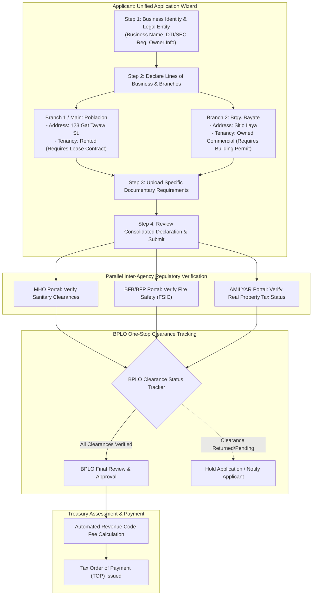
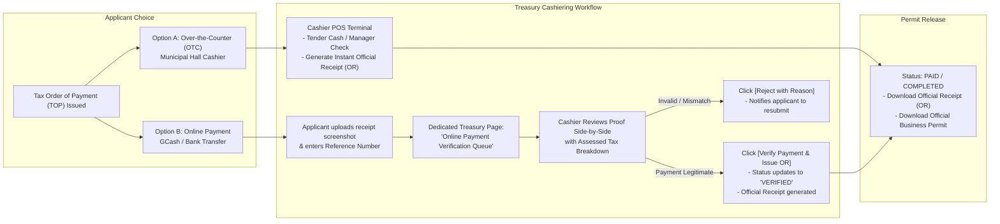
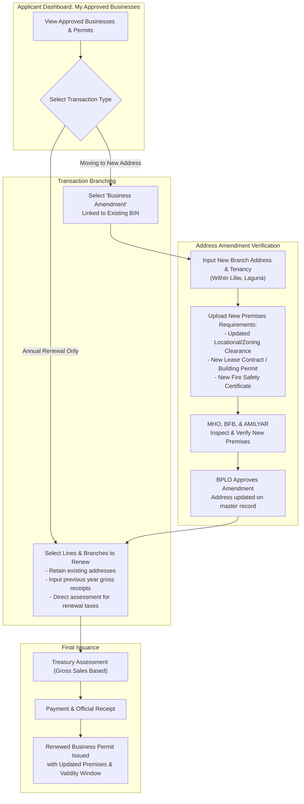
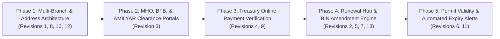

# eBPLS Client Implementation Plan: 13 Core System Revisions & Operational Modernization

**Project:** Electronic Business Permits and Licensing System (eBPLS)  
**Deployment:** Municipality of Liliw, Laguna  
**Target Audience:** LGU Executives, BPLO Chief, Municipal Treasurer, Department Heads (MHO, BFP, Assessor/Amilyar), System Administrators, and Business Stakeholders  
**Document Version:** 1.0 (Client & Executive Edition)  
**Date:** November 17, 2026  

---

## Executive Summary

The **Electronic Business Permits and Licensing System (eBPLS)** of the Municipality of Liliw is transitioning to a more robust, compliant, and user-friendly architecture. 

Based on operational feedback from municipal staff, business owners, and local executives, this implementation plan outlines **thirteen (13) key system revisions**. These enhancements eliminate duplicate business registrations, introduce multi-branch address structures, provide dedicated verification portals for regulatory agencies (**MHO**, **BFB/BFP**, and **AMILYAR**), establish a dedicated Treasury Cashier verification page for online/GCash payments, modernize the annual renewal experience, and guarantee complete transparency regarding business permit validity and expiry alerts.

This document is prepared specifically for **clients, department heads, and municipal stakeholders**. It explains the current process ("As-Is"), clearly details the proposed process ("To-Be"), highlights operational benefits, and presents an Agile implementation roadmap for municipal rollout.

---

## 1. Executive Comparison: Current Process vs. Proposed Process

The table below contrasts how each process currently behaves in eBPLS versus how it will function once the 13 revisions are completed.

| # | System Area | Current Process ("As-Is") | Proposed Process ("To-Be") | Primary Beneficiary |
|---|---|---|---|---|
| **1** | **Address & Line of Business Hierarchy** | Address and property tenancy are declared once for the entire business in Step 2. All declared lines of business (LOBs) are forced to share that single location. | Address and property tenancy are declared directly per line of business and branch. Each branch/line has its own distinct physical location and tenancy documents. | Applicants with multi-location businesses; Zoning & BPLO |
| **2** | **Permit Renewal Selection** | Renewal is just an option in a blank application form dropdown. Applicants must re-type business details manually, with no view of existing approved businesses. | A dedicated **"My Approved Businesses" Hub** displays all active businesses. Applicants select an existing business and pick exactly which branches and lines of business to renew. | Business Owners / Taxpayers |
| **3** | **Regulatory Clearance Verification** | BPLO officers review all clearances (Sanitary, Fire, Tenancy) directly in the BPLO screen. External offices have no system accounts or portals. | Dedicated inspection portals for **MHO (Health)**, **BFB (Fire)**, and **AMILYAR (Real Property Tax)**. BPLO only tracks their clearance statuses in real-time. | MHO, BFP, Assessor's Office, BPLO |
| **4 & 9** | **Treasury Online Payment Verification** | Applicants can upload GCash/Bank receipts, but Treasury has no dedicated verification page in the navigation. Receipts remain stuck in "Pending" without verification. | A dedicated **"Online Payment Verification" Portal** in Treasury displays uploaded GCash/Bank receipts side-by-side with bills, issues official receipts, and updates status to "Verified". | Municipal Treasury / Cashier, Applicants |
| **5 & 13** | **Business Address Amendment vs. New Filing** | When a business relocates within Liliw, applicants must file a "New Application", creating duplicate business records and triggering incorrect new-business tax rates. | Applicants link their existing **Business Identification Number (BIN)** and file a **"Business Amendment / Change of Location"**. Updates address, requires new premises clearances, and preserves tax history. | BPLO, Treasury, Business Owners |
| **6** | **Permit Validity Visibility** | Permit validity dates are only written in fine print on the generated PDF document. The web portal and dashboard do not prominently show when a permit expires. | Permit validity window (e.g., *Valid until: December 31, 2027*) and active status badges (*Active*, *Expiring Soon*, *Expired*) are prominently displayed across all applicant and staff dashboards. | Business Owners, LGU Inspectors |
| **7** | **Multi-Branch / Multi-Line Renewal** | Renewal does not differentiate between branches or specific lines of business; it treats the entire business as an all-or-nothing submission. | Granular renewal controls allow business owners to renew specific branches or active lines while retiring or omitting inactive ones. | Business Owners, Treasury |
| **8** | **Lines of Business Catalog Cleanup** | The catalog includes a vague "Other Services" option, causing categorization ambiguity and assessment discrepancies. | "Other Services" is retired from dropdowns. Applicants select only defined, categorized municipal business activities mapped to specific Revenue Code fees. | Treasury Assessment, BPLO |
| **10 & 12** | **Branch-Specific Property Tenancy & Location** | One property tenancy status (Rented, Owned Commercial, Owned Residential) applies to all activities, even if branches operate under different tenancy arrangements. | Property tenancy and location are attached to each branch. Branch A can be "Rented Commercial" while Branch B is "Owned Commercial", each requiring its own lease/building clearance. | BPLO, MHO, BFP, Building Official |
| **11** | **Proactive Permit Expiry Notifications** | No automated expiration alerts exist. Applicants must remember their renewal window or risk delinquency surcharges after January 20. | Automated multi-channel alerts (in-app notifications and email) trigger at 60 days, 30 days, and 15 days before permit expiration, prompting early renewal. | Business Owners, Municipal Revenue Office |

---

## 2. Visual Operational Workflows

### 2.1 The New Application & Multi-Branch Architecture Flow

The revised hierarchy ensures that one registered legal entity can operate multiple branches and lines of business across different barangays in Liliw, each with its own location and tenancy compliance.

---

### 2.2 Payment Verification: OTC Cashier vs. Online GCash Portal

This workflow eliminates the "Pending" limbo for online payments by providing Treasury with a dedicated side-by-side verification queue.

---

### 2.3 Renewal & Address Amendment Flow (Zero Duplicate BIN Policy)

This workflow prevents applicants from accidentally creating duplicate business records when changing address or renewing.

---

## 3. Detailed Operational Breakdown of the 13 Revisions

Below is a detailed analysis of all thirteen revisions requested by the client, explaining the motivation, current limitation, exact operational behavior, and stakeholder impact.

---

### Revision 1 & 10: Address Combined with Lines of Business and Branches
* **User Request:** *1. Applicant - Combine the address and lines of business (each line of business/branch have its own address). 10. address should now per line/branch not one address for all only.*
* **Current System Limitation:** The application form enforces a single business address in Step 2. If a merchant operates a bakery in Barangay Rizal and a warehouse or branch in Barangay Bayate under the same business, the system forces both to have the same address.
* **Proposed Operational Behavior:**
  1. Address entry is decentralized from the top-level business record down to the **Line of Business / Branch level**.
  2. For every declared line of business or branch, the applicant declares the physical location:
     - Building / Street Address Line.
     - Assigned Liliw Barangay (automatically linked to that barangay's centroid and commercial zone).
  3. Official records reflect the specific address for each operational branch.
* **Client Impact:** Guarantees geographic accuracy for barangay zoning, accurate fire safety inspections, and proper local taxation based on actual foot-traffic zones.

---

### Revision 2 & 7: Selective Renewal of Approved Businesses, Lines, and Branches
* **User Request:** *2. pag mag rerenew makikita mo lahat ng mga approve business mo and pwede kang pumili kung alin ang mga irerenew mo.(what line of businesses and what branches). 7. If the applicant have many branches/lines, each lines/branch should be renewed.*
* **Current System Limitation:** Renewal is currently just a selection in a form dropdown that presents a blank form. Applicants cannot see what businesses they already own, nor can they choose which branches or activities to continue.
* **Proposed Operational Behavior:**
  1. Inside the Applicant Portal, a dedicated tab named **"My Approved Businesses"** lists all currently permitted establishments under the taxpayer's account.
  2. Clicking **"Renew Permit"** on a business opens an interactive **Renewal Checklist**:
     - Displays all registered branches and lines of business.
     - Each item has an active checkbox (`[✓] Renew for 2027`).
     - Business owners can uncheck branches or activities that have ceased operations (directing them to retirement) while renewing active ones.
  3. Every branch and line selected for renewal is assessed based on its preceding year's gross sales.
* **Client Impact:** Prevents accidental assessment of closed branches, streamlines filing for large commercial owners, and ensures tax compliance for every active operational unit.

---

### Revision 3: Dedicated Verification Roles for MHO, BFB, and AMILYAR
* **User Request:** *3. Additional roles: MHO, BFB, and AMILYAR. each have their own page like what applicant, bplo, etc. have. They are the ones who will verify the permits' legitimacy, correctness, and if it is valid. For the BPLO, they can only track the status for MHO, BFB, and AMILYAR's permits and certificates.*
* **Current System Limitation:** BPLO staff currently bear the full burden of inspecting health, fire, and property documents inside BPLO's single screen. External agencies have no access, leading to bottlenecks and lack of direct regulatory accountability.
* **Proposed Operational Behavior:**
  1. Three new dedicated user roles and portal interfaces are established:
     - **MHO Portal (`/mho/queue`):** Municipal Health Officers inspect Sanitary Permit applications, health certificates, and food handler cards.
     - **BFB/BFP Portal (`/bfb/queue`):** Bureau of Fire Protection officers review premises fire safety compliance and verify Fire Safety Inspection Certificates (FSIC).
     - **AMILYAR Portal (`/amilyar/queue`):** Municipal Assessor / Land Tax officers verify Real Property Tax (RPT / Amilyar) payment status for the commercial property.
  2. Each agency has dedicated review tools:
     - Full PDF/image preview of submitted documents.
     - Regulatory action buttons: `[Verify & Endorse]` or `[Return with Correction Request]`.
  3. **BPLO Oversight:** The BPLO Split-Screen Verifier shifts to an executive **Clearance Status Dashboard**. BPLO officers see real-time status pills:
     - *MHO Sanitary Clearance:* `[✓ Verified by MHO Officer]`
     - *BFP Fire Safety Clearance:* `[✓ Verified by BFB Officer]`
     - *Amilyar Property Tax Clearance:* `[✓ Verified by Assessor]`
  4. BPLO cannot issue final verification until all three regulatory departments have marked their respective clearances as valid.
* **Client Impact:** Enforces true inter-agency accountability (One-Stop Shop compliance), eliminates forged clearance risks, and significantly reduces the operational burden on BPLO staff.

---

### Revision 4 & 9: Dedicated Treasury Online / GCash Payment Verification Page
* **User Request:** *4. For the treasury side, walang lumalabas na verified or walang way para ma-verify yung payment after mag upload ng receipt ng applicant (online payment). 9. ung sa payment naman walang page na pede iverify ung gcash payment kaya hanggang pending lang.*
* **Current System Limitation:** Applicants can upload a GCash receipt, but Treasury officers do not have a dedicated verification page in the navigation menu. Applications stay in "PaymentVerificationPending" indefinitely without anyone being able to confirm the money in the municipal account.
* **Proposed Operational Behavior:**
  1. A dedicated menu link named **"Online Payment Verification"** (`/treasury/verify-payments`) is permanently added to the Treasury Navigation Sidebar.
  2. The page features a real-time list of all applications awaiting payment confirmation.
  3. Clicking any transaction opens a split-screen cashier terminal:
     - **Left Side:** Application summary, taxpayer name, total tax assessed, GCash reference number, and payment date.
     - **Right Side:** High-resolution zoomable viewer showing the uploaded GCash transfer receipt or bank deposit slip.
  4. Cashier confirms the funds in the municipal bank/GCash merchant account and clicks `[Confirm Payment & Issue OR]`.
  5. The system immediately:
     - Generates the official sequential Official Receipt (OR) Number.
     - Promotes the application status to `PAID` / `COMPLETED`.
     - Displays a bright green **"VERIFIED PAYMENT"** badge.
     - Automatically notifies the applicant via email and in-app alert that their Official Receipt and Business Permit are ready for download.
* **Client Impact:** Solves the critical bottleneck where payments were stuck in "Pending". Guarantees zero unverified releases and ensures immediate municipal revenue auditing.

---

### Revision 5 & 13: Business Address Amendment vs. New Filing (Anti-Duplicate BIN Policy)
* **User Request:** *5. If the business' location is for renewal, the applicant can change the address. (Moving within the same LGU: amendment rather than a brand-new application... submit new clearances). 13. Do not file a New Application, as that will create a duplicate business record and trigger new-business tax assessments. Instead, link your existing Business Identification Number (BIN) and select Business Amendment...*
* **Current System Limitation:** If a business moves to a new street or barangay in Liliw during renewal, the applicant is forced to file a "New Application". This creates a duplicate business entity in the municipal database, severs historical compliance records, and triggers initial capital tax assessments instead of gross receipts renewal rates.
* **Proposed Operational Behavior:**
  1. The system introduces a formal **"Business Amendment / Change of Business Information"** transaction linked to the establishment's existing **Business Identification Number (BIN)**.
  2. Applicants select their existing approved business and choose **"Amend Business Information"**:
     - They select which branch or line of business has moved.
     - They enter the new address and select the new barangay in Liliw.
     - The system locks the business identity (preserving the BIN, legal name, and tax history).
  3. **New Premises Clearance Engine:** Because the physical location has changed, the system automatically marks premises-dependent clearances as requiring renewal:
     - New Locational / Zoning Clearance for the new site.
     - New Building Permit / Lease Contract for the new building.
     - New Fire Safety Inspection Certificate (BFP) and Sanitary Permit (MHO) for the new premises.
  4. Once regulatory offices confirm the new site, BPLO approves the amendment. The renewal transaction then proceeds smoothly using preceding year gross receipts, without creating duplicate database records.
* **Client Impact:** Fully compliant with DILG and ARTA standards. Eliminates duplicate business records, preserves municipal historical tax data, and ensures safety inspections on newly occupied commercial premises.

---

### Revision 6: Transparent Display of Business Permit Validity
* **User Request:** *6. the validity of the permit should be visible.*
* **Current System Limitation:** The permit expiration date is only embedded inside the PDF file. It is not shown on dashboard cards, summary tables, or status tracking screens.
* **Proposed Operational Behavior:**
  1. Permit validity is prominently displayed across all system views:
     - **Applicant Dashboard:** Each approved business card features a clear badge:  
       `Permit Status: ACTIVE · Valid Until: December 31, 2027 (184 Days Remaining)`
     - **Status Tracker:** Immediately adjacent to the "Download Business Permit" button, the system displays the full validity window: `Issued: Jan 15, 2027 · Expires: Dec 31, 2027`.
     - **BPLO & Admin Explorer:** Lists show permit expiry dates, enabling officers to immediately filter businesses by active, expiring, or expired permits.
* **Client Impact:** Total transparency for business owners and municipal inspection teams. Eliminates confusion over renewal deadlines.

---

### Revision 8: Catalog Sanitization (Removal of "Other Services")
* **User Request:** *8. in lines of businesses, remove the "other services" in the dropdown.*
* **Current System Limitation:** "Other Services" is selectable in the Line of Business dropdown. Because it lacks a specific fee schedule tier or regulatory category, it creates assessment ambiguities.
* **Proposed Operational Behavior:**
  1. "Other Services" is retired from the active `business_activities` catalog and removed from all frontend dropdowns.
  2. Applicants must select from specific, defined municipal categories (e.g., *General Merchandise*, *Food and Beverage*, *Personal Services*, *Wholesale Trade*, etc.).
  3. Historical records that previously utilized the code remain intact for auditing purposes, but no new filings can select it.
* **Client Impact:** Ensures 100% automated and standardized fee assessments based on the Liliw Municipal Revenue Code.

---

### Revision 11: Automated Advance Expiry Notifications
* **User Request:** *11. advance notif if the expiry of business permit is close.*
* **Current System Limitation:** The system does not monitor permit expiration dates. Taxpayers only discover their permit has expired when they check manually or receive a municipal notice/surcharge.
* **Proposed Operational Behavior:**
  1. An automated daily background monitoring service inspects all active permits against the municipal calendar.
  2. When a permit approaches its expiration date (December 31 of the calendar year), the system triggers proactive notifications:
     - **60 Days Before Expiry (November 1):** Early advisory encouraging taxpayers to prepare financial statements and barangay clearances.
     - **30 Days Before Expiry (December 1):** Renewal alert with instructions on logging in and using the one-click renewal selector.
     - **15 Days Before Expiry (December 16):** Final reminder emphasizing the January 20 statutory renewal deadline to avoid 25% surcharges.
  3. Notifications are delivered via both **in-app bell notifications** and **registered email addresses**.
* **Client Impact:** Maximizes on-time renewal collections for the Municipal Treasury and protects local business owners from avoidable penalties.

---

### Revision 12: Branch-Level Location and Tenancy Declaration
* **User Request:** *12. per line of business, applicant can add branch and per branch they have their own location.( ung address at property tenancy ay per line of businesses at branch para if ever mag kakaiba ng address.)*
* **Current System Limitation:** Property tenancy (Rented, Owned Commercial, Owned Residential) and unit/stall declarations are currently captured globally in Step 2.
* **Proposed Operational Behavior:**
  1. In the modernized wizard, when an applicant adds a branch or line of business, they are prompted for:
     - **Branch Name / Label** (e.g., *Main Branch - Rizal*, *Warehouse / Extension - Bubukal*).
     - **Specific Address & Barangay** in Liliw.
     - **Property Tenancy Type:**
       - If **Rented:** Requires Contract of Lease and Lessor information for that specific branch.
       - If **Owned Commercial:** Requires Building Permit / Property Tax Declaration.
       - If **Owned Residential:** Requires Locational Clearance for home-based commercial use.
     - **Covered Stall / Unit Numbers** specific to that location.
* **Client Impact:** Aligns the digital system with real-world Philippine business practices where enterprises operate a retail front in town and storage/logistics in another barangay under different lease terms.

---

## 4. Phased Agile Implementation Roadmap

To ensure a smooth transition with zero municipal service disruption, the 13 revisions are organized into **five (5) chronological Agile phases**. Each phase delivers an independently testable, user-facing enhancement.

---

### Phase 1: Multi-Branch & Address Architecture
* **Addressed Revisions:** 1, 8, 10, 12
* **Objective:** Restructure the business data model to allow multiple branches and lines of business, each with its own physical address and property tenancy. Clean up the business activity catalog.
* **Scope & Deliverables:**
  - Modernize the Unified Application Form (UAF) wizard to declare branches under each business line.
  - Attach address lines, barangay selection, and property tenancy (Rented, Owned Commercial, Owned Residential) directly to each branch.
  - Retire "Other Services" from the active business catalog.
* **Client Acceptance Criteria:**
  - [ ] An applicant can add Branch 1 in Brgy. Rizal (Rented, Contract of Lease) and Branch 2 in Brgy. Bayate (Owned Commercial, Building Permit).
  - [ ] "Other Services" no longer appears in any business activity selection list.
  - [ ] Step 4 dynamic document checklist prompts for distinct tenancy documents for each declared branch.

---

### Phase 2: Inter-Agency Clearance Portals (MHO, BFB, & AMILYAR)
* **Addressed Revisions:** 3
* **Objective:** Establish dedicated, secure inspection portals for the Municipal Health Office, Bureau of Fire Protection, and Municipal Assessor (Amilyar), while shifting BPLO to an oversight status tracker.
* **Scope & Deliverables:**
  - Create MHO, BFB, and AMILYAR user accounts and navigation layouts.
  - Build specialized review queues with side-by-side document inspection and one-click endorsement.
  - Overhaul BPLO's verifier to display a live, read-only Clearance Status Card tracking all three agencies.
* **Client Acceptance Criteria:**
  - [ ] MHO staff can log in, view Sanitary Permit uploads, and click `[Verify Sanitary Clearance]`.
  - [ ] BFP staff can log in, inspect fire safety documents, and click `[Verify Fire Safety]`.
  - [ ] Assessor staff can log in, check Real Property Tax standing, and click `[Verify Amilyar]`.
  - [ ] BPLO verifier shows real-time status badges for MHO, BFP, and AMILYAR, and prevents final approval until all three are verified.

---

### Phase 3: Treasury Online Payment Verification Terminal
* **Addressed Revisions:** 4, 9
* **Objective:** Deploy a dedicated Online Payment Verification page in Treasury to review and approve uploaded GCash and bank transfer receipts.
* **Scope & Deliverables:**
  - Add "Online Payment Verification" directly to the Treasury navigation sidebar.
  - Build a dual-pane verification terminal showing application tax breakdowns alongside uploaded receipt screenshots.
  - Implement automated Official Receipt (OR) generation upon cashier verification, updating the application status to `PAID`.
* **Client Acceptance Criteria:**
  - [ ] All uploaded GCash payments appear immediately in Treasury's new Online Payment Verification queue.
  - [ ] Cashier can inspect the receipt image, compare the reference number, and click `[Confirm Payment]`.
  - [ ] System generates an official sequence-locked OR number and changes status to `PAID` / `COMPLETED`.
  - [ ] Applicant immediately sees the green "VERIFIED" badge and can download their official E-Resibo.

---

### Phase 4: Renewal Hub & BIN Amendment Engine
* **Addressed Revisions:** 2, 5, 7, 13
* **Objective:** Launch the "My Approved Businesses" Hub, the selective branch/line renewal checklist, and the Business Amendment workflow to eliminate duplicate business records.
* **Scope & Deliverables:**
  - Build the "My Approved Businesses" portal on the Applicant Dashboard.
  - Create the interactive Renewal Checklist allowing applicants to pick specific branches and lines to renew.
  - Build the **"Business Amendment / Change of Location"** feature linked to the existing Business Identification Number (BIN).
  - Configure the dynamic requirement engine to demand updated premises clearances (Zoning, Fire, Health, Lease) only when a branch location changes.
* **Client Acceptance Criteria:**
  - [ ] Applicants see a list of their approved businesses with BINs and permit numbers.
  - [ ] Clicking "Renew" displays all branches with checkboxes, assessing renewal taxes only for selected units.
  - [ ] An applicant relocating a branch can select "Change Location / Amendment", enter the new address, and upload new premises clearances without creating a duplicate business.
  - [ ] Treasury assesses renewal fees based on gross receipts rather than initial capital.

---

### Phase 5: Permit Validity Transparency & Automated Expiry Alerts
* **Addressed Revisions:** 6, 11
* **Objective:** Make permit validity dates prominently visible across all interfaces and deploy an automated background notification service for expiring permits.
* **Scope & Deliverables:**
  - Add high-visibility validity badges and countdowns to the Applicant Dashboard, Status Tracker, and Staff Explorers.
  - Implement a daily scheduled background job that checks active permits against the expiration calendar.
  - Configure multi-channel notification triggers at 60, 30, and 15 days before permit expiry.
* **Client Acceptance Criteria:**
  - [ ] Applicant Dashboard and Status Tracker clearly display "Valid Until: Dec 31, 2027" with active countdown pills.
  - [ ] Permits nearing expiration automatically receive in-app alerts and email reminders at 60, 30, and 15 days.
  - [ ] Clicking an expiration reminder opens the pre-populated Renewal Selector with one click.

---

## 5. Organizational RACI Governance Matrix

This matrix outlines the roles and responsibilities across municipal departments under the modernized eBPLS.

| Stakeholder Role | Function & Responsibilities | Key System Touchpoints |
|---|---|---|
| **Applicant / Taxpayer** | Declares business identity, adds branches, declares addresses/tenancy, selects renewal lines, and submits GCash receipts. | Applicant Dashboard, Multi-Branch Wizard, Renewal Selector, Status Tracker |
| **MHO Officer** | Inspects sanitation standards, food handler certificates, and health clearances. Directly approves or returns sanitary records. | MHO Inspection Portal (`/mho/queue`) |
| **BFB / BFP Officer** | Inspects fire safety measures and verifies Fire Safety Inspection Certificates (FSIC) per branch. | BFB/BFP Inspection Portal (`/bfb/queue`) |
| **AMILYAR Officer** | Verifies Real Property Tax (RPT) compliance and property ownership documents for the declared business premises. | AMILYAR Portal (`/amilyar/queue`) |
| **BPLO Officer** | Oversees regulatory clearance progress, verifies standard legal identity (DTI/SEC, valid IDs), and grants final permit approval. | BPLO Dashboard, Split-Screen Verifier, Status Oversight |
| **Treasury Officer** | Audits automated tax assessments, verifies uploaded GCash/Bank receipts, issues Official Receipts, and manages OTC Cashier POS. | Assessment Queue, Online Payment Verification Terminal, Cashier POS |
| **System Administrator** | Manages municipal user accounts, oversees Revenue Code fee schedules, and monitors automated notification logs. | Admin Dashboard, Master Data, Audit Logs |

---

## 6. Client FAQ & Policy Safeguards

### Q1: Why can't an applicant just file a "New Application" if their business address changed?
**Answer:** In Philippine municipal administration, every registered enterprise has a permanent Business Identification Number (BIN). Filing a "New Application" creates a second, duplicate business record in the municipal database. This corrupts historical tax ledgers, triggers incorrect "New Business" capital tax assessments (which are often higher or lower than actual gross sales assessments), and confuses national auditing agencies (COA). Moving within the same municipality is legally classified as an **Amendment to Business Information / Change of Location**, which updates the premises on the existing BIN and ensures that safety inspections are conducted at the new address.

### Q2: What happens if an applicant does not want to renew one of their branches?
**Answer:** The new **Renewal Selector** allows the business owner to simply uncheck the branch they wish to close. That branch will not be assessed renewal taxes for the new year. The system prompts the applicant to formally file for business retirement for that branch so that municipal records reflect that operations have officially ceased.

### Q3: How does the Cashier know a GCash payment is genuine?
**Answer:** The dedicated **Online Payment Verification Terminal** allows the Cashier to view the uploaded receipt screenshot side-by-side with the declared reference number, payment date, and total tax due. The cashier verifies that the reference number matches the bank/GCash merchant account deposit before clicking `[Verify Payment]`. The system sequence-locks the Official Receipt number, ensuring that no payment can be verified twice.

---

## 7. Conclusion & Next Steps

This Implementation Plan provides a complete, client-focused blueprint for modernizing the eBPLS platform for the Municipality of Liliw. By addressing all 13 core revisions across five structured Agile phases, the system will deliver:
1. **Accurate multi-branch address tracking** with proper commercial zoning.
2. **True inter-agency governance** empowering MHO, BFP, and Assessor teams.
3. **Transparent payment processing** eliminating GCash verification delays.
4. **Frictionless renewals** that safeguard against duplicate BIN creation.
5. **Proactive expiration management** protecting local taxpayers from late surcharges.

Upon client review and formal sign-off on this document, implementation will proceed according to the scheduled Agile sequence.
