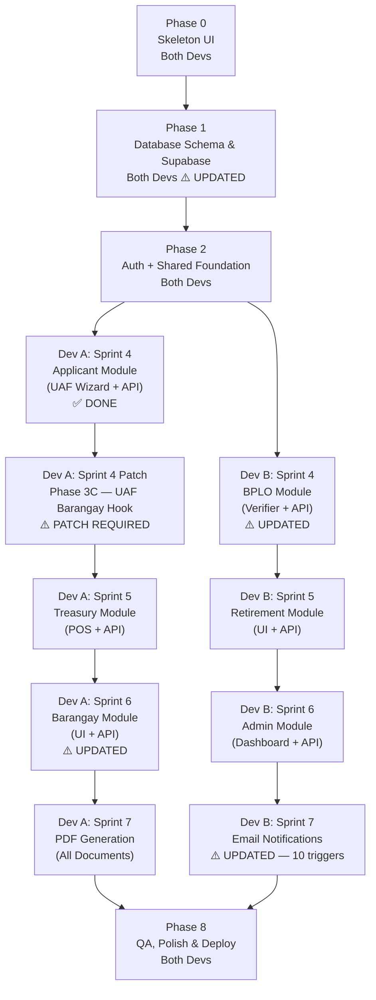

# eBPLS Agile Implementation Plan

**Electronic Business Permits and Licensing System — BOSS & E-Resibo**
Municipality of Liliw | **v2.1 — Updated for Design Fixes**

---

> [!NOTE]
> **What changed in v2.1**
> Two design gaps were identified after Phase 3 was completed and have been patched into the plan:
>
> 1. **BPLO Full Application Review** — BPLO must now cross-check business data accuracy (not just documents) before routing to Treasury. This adds a new `application_data_reviews` table and a data review panel to the BPLO verifier.
> 2. **Barangay Clearance Feedback Loop** — The Barangay module result must now automatically feed back into the BPLO verification checklist. The clearance outcome is no longer a dead end.
>
> **Phases affected:** 1, 3B (patch), 4A, 4B, 6, 9
> **Phase 3A (Applicant UI) — no changes required.**

---

## Current Progress (Completed)

| Item | Status |
|---|---|
| System Architecture (README.md) | ✅ Done |
| File Structure Documentation | ✅ Done |
| Backend: `npm init`, dependencies installed | ✅ Done |
| Backend: `server.js`, `src/app.js` (Express base) | ✅ Done |
| Backend: `src/config/env.js` (Zod validation) | ✅ Done |
| Backend: `src/config/supabase.js` (Admin client) | ✅ Done |
| Backend: `src/config/mailer.js` (Optional SMTP) | ✅ Done |
| Frontend: Vite + React initialized | ✅ Done |
| Frontend: Tailwind CSS + PostCSS configured | ✅ Done |
| Frontend: Global CSS token system (`index.css`) | ✅ Done |
| Frontend: All folder structure created | ✅ Done |
| `.env.example` and `.gitignore` | ✅ Done |
| Phase 3A: Applicant Module (Frontend — UAF Wizard) | ✅ Done |
| Phase 3B: Application Module API (Backend) | ✅ Done — **patch required, see Phase 3C** |

---

## Phase Overview & Dependency Map

---

## Full-Stack Parallel Development Guide

### Module Ownership

| Module | Dev A | Dev B |
|---|:---:|:---:|
| Database Schema (Phase 1) | ✅ Collab | ✅ Collab |
| Auth + Shared Middleware (Phase 2) | ✅ Collab | ✅ Collab |
| Applicant Module (UAF Wizard) | ✅ Done | |
| UAF Barangay Hook Patch (Phase 3C) | ✅ Owner | |
| BPLO Module (Verify & Process) | | ✅ Owner |
| Treasury Module (Assess & POS) | ✅ Owner | |
| Business Retirement Module | | ✅ Owner |
| Barangay Clearance Module | ✅ Owner | |
| Admin Module | | ✅ Owner |
| PDF Generation (all documents) | ✅ Owner | |
| Email Notifications (all triggers) | | ✅ Owner |

### Week-by-Week Sprint Schedule

| Week | Dev A (Full-Stack) | Dev B (Full-Stack) |
|:---:|---|---|
| **1** | Phase 0: Skeleton UI — Layouts, Router, Placeholder Screens (collab) | Phase 0: Skeleton UI — UI Components, Stores, Hooks (collab) |
| **2** | Phase 1: DB Schema, RLS, Seed (collab) | Phase 1: DB Schema, RLS, Seed (collab) |
| **3** | Phase 2: Auth UI + API + Shared Middleware (collab) | Phase 2: Auth UI + API + Shared Middleware (collab) |
| **4** | ~~Applicant Module~~ ✅ Done + **Phase 3C Patch** | BPLO Module: Dashboard, Split-Screen Verifier + Data Review Panel, Verify/Return/Review API |
| **5** | Treasury Module: Assessment Grid, Cashier POS, Fee Calc API, OTC API | Retirement Module: Retirement UI, Submit/Assess/Complete API |
| **6** | Barangay Module: Clearance Queue UI, Issue/Reject API + **doc_verifications auto-update** | Admin Module: Master Data, Audit Logs, Document Builder, Admin API |
| **7** | PDF Generation: Permit, E-Resibo, TOP, Clearance PDFs | Email Notifications: Wire all **10** triggers across controllers |
| **8-9** | QA: Applicant + Treasury + Barangay + PDF flows | QA: BPLO + Retirement + Admin + Email flows |

---

## Phase 0: Skeleton UI (Both Devs)

> No changes from v2.0.

**Goal:** Build the entire navigation shell — all layouts, routes, and empty placeholder screens.

### Tasks

| # | Task | File / Location | Owner |
|---|---|---|---|
| 0.1 | Set up React Router in `App.jsx` with route groups: public, auth, applicant, bplo, treasury, barangay, admin | `src/App.jsx` | Both |
| 0.2 | Build reusable UI component library: Button, Input, Modal, Badge, Card | `src/components/ui/` | Dev B |
| 0.3 | Build layout shell components: Navbar, Sidebar, Footer | `src/components/layout/` | Dev A |
| 0.4 | Build `ApplicantLayout.jsx` — mobile-first with bottom nav | `src/layouts/` | Dev A |
| 0.5 | Build `BPLOLayout.jsx` — desktop sidebar layout | `src/layouts/` | Dev A |
| 0.6 | Build `TreasuryLayout.jsx` — POS-style layout | `src/layouts/` | Dev A |
| 0.7 | Build `BarangayLayout.jsx` — desktop layout | `src/layouts/` | Dev B |
| 0.8 | Build `AdminLayout.jsx` — utilitarian dashboard layout | `src/layouts/` | Dev B |
| 0.9 | Build `AuthLayout.jsx` — centered card layout for login/register | `src/layouts/` | Dev B |
| 0.10 | Create placeholder `LandingPage.jsx` | `src/screens/public/` | Dev A |
| 0.11 | Create placeholder screens for Auth: Login, Register, ForgotPassword | `src/screens/auth/` | Dev B |
| 0.12 | Create placeholder screens for Applicant: Dashboard, UAFWizard, StatusTracker | `src/screens/applicant/` | Dev A |
| 0.13 | Create placeholder screens for BPLO: Dashboard, SplitScreenVerifier | `src/screens/bplo/` | Dev B |
| 0.14 | Create placeholder screens for Treasury: AssessmentGrid, CashierPOS | `src/screens/treasury/` | Dev A |
| 0.15 | Create placeholder screen for Barangay: ClearanceQueue | `src/screens/barangay/` | Dev B |
| 0.16 | Create placeholder screens for Admin: MasterData, DocumentBuilder, AuditLogs | `src/screens/admin/` | Dev B |
| 0.17 | Create `UIStore.js` (Zustand) for sidebar/modal/toast state | `src/store/` | Dev A |
| 0.18 | Create `constants.js` with API base URL and role enums | `src/utils/` | Dev A |
| 0.19 | Create `apiClient.js` — Fetch/Axios wrapper with JWT injection stub | `src/utils/` | Dev B |

### Definition of Done
- [ ] Every route in the system is navigable in the browser
- [ ] All 6 layouts render with proper navigation
- [ ] Placeholder screens show page title and "Under Construction" message
- [ ] Reusable UI components follow the design token system

---

## Phase 1: Database Schema & Supabase Setup ⚠️ UPDATED

**Goal:** Create the entire normalized database schema in Supabase and enable Row Level Security.

**Priority:** 🔴 Critical Path — blocks everything else.

**What changed:** Added migration for `application_data_reviews` table (new). Updated `doc_verifications` status ENUM to include `Awaiting Issuance`. Added FK relationship note between `barangay_clearances` and `doc_verifications`.

### Tasks

| # | Task | File / Location | Owner | Changed? |
|---|---|---|---|---|
| 1.1 | Create migration: `roles` table (seed 5 roles) | `supabase/migrations/001_roles.sql` | Backend | — |
| 1.2 | Create migration: `users` table with FK to `roles`, bcrypt hash column | `supabase/migrations/002_users.sql` | Backend | — |
| 1.3 | Create migration: `taxpayers` table (1:1 with users) | `supabase/migrations/003_taxpayers.sql` | Backend | — |
| 1.4 | Create migration: `businesses`, `organization_types` | `supabase/migrations/004_businesses.sql` | Backend | — |
| 1.5 | Create migration: `applications`, `application_drafts`, `application_types`, `payment_modes` | `supabase/migrations/005_applications.sql` | Backend | — |
| 1.6 | Create migration: `doc_verifications`, `clearance_types` (patched later by `015_design_gaps_fix.sql` to add `'Yes'`, `'No'`, `'Awaiting Issuance'`) | `supabase/migrations/006_verifications.sql` | Backend | ⚠️ Patched |
| 1.7 | Create migration: `barangay_clearances` — note: this table is linked to `doc_verifications` via `application_no`; no hard FK needed but the relationship is enforced at the service layer | `supabase/migrations/007_barangay.sql` | Backend | ⚠️ Updated |
| 1.8 | Create migration: `assessments`, `assessment_line_items`, `fee_types`, `transactions` | `supabase/migrations/008_treasury.sql` | Backend | — |
| 1.9 | Create migration: `retirement_applications` | `supabase/migrations/009_retirements.sql` | Backend | — |
| 1.10 | Create migration: `permits`, `permit_line_items`, `business_activities` | `supabase/migrations/010_permits.sql` | Backend | — |
| 1.11 | Create migration: `audit_logs` | `supabase/migrations/011_audit_logs.sql` | Backend | — |
| 1.12 | Create migration: `email_notifications` (patched later by `015_design_gaps_fix.sql` to add `BARANGAY_CLEARANCE_REJECTED`) | `supabase/migrations/012_email_notifications.sql` | Backend | ⚠️ Patched |
| 1.13 | Enable RLS on all base tables; write initial policies (patched later by `015_design_gaps_fix.sql` for `application_data_reviews` RLS) | `supabase/migrations/013_rls_policies.sql` | Backend | ⚠️ Patched |
| 1.14 | Seed lookup tables: roles, application_types, payment_modes, clearance_types, fee_types, organization_types | `supabase/seed.sql` | Backend | — |
| **1.15** | **Migrations `015` & `016` — adds `application_data_reviews` table, updates `doc_verifications` status constraint (`Yes`/`No`/`Awaiting Issuance`), and adds `BARANGAY_CLEARANCE_REJECTED` trigger** | **`supabase/migrations/`** | **Backend** | **🆕 New** |

### Definition of Done
- [ ] All tables exist in Supabase with correct constraints, FKs, and enums
- [ ] `doc_verifications.status` ENUM includes `'Awaiting Issuance'`
- [ ] `application_data_reviews` table exists with correct columns and RLS enabled
- [ ] RLS is enabled on every table
- [ ] Seed data populated for all lookup tables

---

## Phase 2A: Frontend — Public Pages & Auth UI

> No changes from v2.0.

### Tasks

| # | Task | File / Location |
|---|---|---|
| 2A.1 | Create reusable UI components: Button, Input, Modal, Badge | `src/components/ui/` |
| 2A.2 | Create `AuthLayout.jsx` | `src/layouts/` |
| 2A.3 | Set up React Router in `App.jsx` | `src/App.jsx` |
| 2A.4 | Build `LandingPage.jsx` | `src/screens/public/` |
| 2A.5 | Build `Login.jsx` | `src/screens/auth/` |
| 2A.6 | Build `Register.jsx` | `src/screens/auth/` |
| 2A.7 | Build `ForgotPassword.jsx` | `src/screens/auth/` |
| 2A.8 | Create `authStore.js` (Zustand) | `src/store/` |
| 2A.9 | Create `apiClient.js` | `src/utils/` |
| 2A.10 | Create `useAuth.js` hook | `src/hooks/` |
| 2A.11 | Create `constants.js` | `src/utils/` |
| 2A.12 | Implement Protected Route wrapper | `src/components/shared/` |

### Definition of Done
- [ ] Landing page renders with navigation to Login/Register
- [ ] Protected routes redirect unauthenticated users
- [ ] Zustand auth store persists session in localStorage

---

## Phase 2B: Backend — Auth API, Middleware & Shared Utilities

> No changes from v2.0.

### Tasks

| # | Task | File / Location |
|---|---|---|
| 2B.1 | Create `constants.js` with role enums, valid status transitions, error codes | `src/utils/constants.js` |
| 2B.2 | Create `helpers.js` with UUID generator, date formatters | `src/utils/helpers.js` |
| 2B.3 | Build `auth.middleware.js` | `src/middlewares/` |
| 2B.4 | Build `rbac.middleware.js` | `src/middlewares/` |
| 2B.5 | Build `audit.middleware.js` | `src/middlewares/` |
| 2B.6 | Build `error.middleware.js` | `src/middlewares/` |
| 2B.7 | Create `auth.controller.js` | `src/controllers/` |
| 2B.8 | Create `auth.routes.js` | `src/routes/` |
| 2B.9 | Create `audit.service.js` | `src/services/` |
| 2B.10 | Mount auth routes in `app.js` | `src/app.js` |

### Definition of Done
- [ ] `POST /api/auth/register` creates user with bcrypt hash (cost 12+)
- [ ] `POST /api/auth/login` returns JWT with user role
- [ ] All protected routes reject requests without valid JWT
- [ ] RBAC middleware blocks unauthorized roles

---

## Phase 3A: Frontend — Applicant Module ✅ DONE

> Completed. No changes to this phase. See Phase 3C for the backend patch required.

---

## Phase 3B: Backend — Application Module API ✅ DONE (with patch)

> Completed. **One behaviour must be patched via Phase 3C** — the UAF submission handler does not yet create the linked `doc_verifications` record for the Barangay clearance. Everything else in Phase 3B stands as-is.

---

## Phase 3C: Backend Patch — UAF Barangay Clearance Hook ⚠️ NEW PATCH

**Goal:** Fix the gap in the completed UAF submission flow where ticking the Barangay Clearance checkbox creates a `brgy_clearances` record but does NOT create the corresponding `doc_verifications` record. Without this patch, the BPLO module cannot track or enforce the clearance outcome.

**Owner:** Dev A
**Depends on:** Phase 1 (schema must include `Awaiting Issuance` ENUM value)
**Must be completed before:** Phase 4B (BPLO API) is tested end-to-end

### Tasks

| # | Task | File / Location |
|---|---|---|
| 3C.1 | Open `application.service.js` — locate the UAF final submission handler (`POST /api/applications/uaf`) | `src/services/application.service.js` |
| 3C.2 | Add logic: after `brgy_clearances` record is created with `status = 'Pending'`, immediately insert a corresponding `doc_verifications` record for that `application_no` where `clearance_type` = Barangay and `status = 'Awaiting Issuance'` | `src/services/application.service.js` |
| 3C.3 | Wrap both inserts (`brgy_clearances` + `doc_verifications`) in a single database transaction so they succeed or fail together — no orphaned records | `src/services/application.service.js` |
| 3C.4 | Add logic: if the applicant does NOT tick the checkbox, insert the Barangay `doc_verifications` row with `status = 'Pending'` — this requires the applicant to upload their existing clearance for manual BPLO verification | `src/services/application.service.js` |
| 3C.5 | Update `constants.js` — add `AWAITING_ISSUANCE` to the `DOC_VERIFICATION_STATUS` enum object | `src/utils/constants.js` |
| 3C.6 | Write a manual test: submit UAF with checkbox ticked → confirm both `brgy_clearances` (Pending) and `doc_verifications` (Awaiting Issuance) rows exist in Supabase | Postman / Thunder Client |
| 3C.7 | Write a manual test: submit UAF without checkbox → confirm `doc_verifications` row for Barangay exists with `status = 'Pending'` | Postman / Thunder Client |

### Definition of Done
- [ ] Ticking the checkbox on UAF creates both a `brgy_clearances` record (`Pending`) and a `doc_verifications` record (`Awaiting Issuance`) atomically
- [ ] Not ticking the checkbox creates a `doc_verifications` record (`Pending`) for Barangay — no `brgy_clearances` record is created
- [ ] Both paths are verified in Supabase directly
- [ ] No orphaned `brgy_clearances` records exist without a corresponding `doc_verifications` row

---

## Phase 4A: Frontend — BPLO Module ⚠️ UPDATED

**Goal:** Build the BPLO officer's desktop-first dashboard, split-screen document verification panel, and the **new application data review panel**.

**What changed:** `SplitScreenVerifier.jsx` now has a third section for cross-checking business data. A new `DataReviewPanel.jsx` component is added. The Approve button guard now checks both document verifications and data reviews.

### Tasks

| # | Task | File / Location | Changed? |
|---|---|---|---|
| 4A.1 | Create `BPLOLayout.jsx` (desktop sidebar, header with user info) | `src/layouts/` | — |
| 4A.2 | Build `Dashboard.jsx` — sortable data table with SLA urgency indicators | `src/screens/bplo/` | — |
| 4A.3 | Build `SplitScreenVerifier.jsx` — **three-panel layout: left pane (document viewer with zoom), top-right pane (document verification checklist), bottom-right pane (application data review panel)** | `src/screens/bplo/` | ⚠️ Updated |
| **4A.4** | **Build `DataReviewPanel.jsx` — displays four review sections: Business Details, Location, Business Activities, Financial Declaration. Each section shows the declared value alongside the supporting document for cross-checking. BPLO marks each section as `Verified` or `Discrepancy` with a required remarks field on Discrepancy** | **`src/components/bplo/`** | **🆕 New** |
| **4A.5** | **Update Approve/Return footer logic in `SplitScreenVerifier.jsx`: the Approve button must be disabled until ALL `doc_verifications` rows = `'Yes'` or `'Not Needed'` AND ALL `application_data_reviews` rows = `'Verified'`. If a `brgy_clearances` record exists for the application, also check that `brgy_clearances.status = 'Issued'` before enabling Approve** | **`src/screens/bplo/`** | **🆕 New** |
| **4A.6** | **Add a Barangay Clearance status indicator to `SplitScreenVerifier.jsx`: if the checkbox was ticked, show a read-only badge displaying the current `brgy_clearances.status` (Pending / Issued / Rejected) so the BPLO officer knows whether to wait before approving** | **`src/screens/bplo/`** | **🆕 New** |

### Definition of Done
- [ ] Dashboard shows pending applications sorted by submission date
- [ ] Split-screen verifier loads uploaded documents via pre-signed URLs
- [ ] Document verification checklist (Yes / No / Not Needed / Awaiting Issuance) renders correctly
- [ ] Data review panel shows all four sections with declared vs. document values
- [ ] Approve button is disabled if any data review section is unreviewed or marked Discrepancy
- [ ] Approve button is disabled if `brgy_clearances.status` is not `Issued` (when applicable)
- [ ] Return requires non-empty remarks field

---

## Phase 4B: Backend — BPLO Module API ⚠️ UPDATED

**Goal:** Build the verification endpoints for BPLO officers, including the new application data review endpoint and the updated state machine guard.

**What changed:** Added `PUT /api/bplo/applications/review/:app_no` endpoint. Updated the `Verified` transition guard to require both document verifications AND data reviews to pass, plus a barangay clearance status check.

### Tasks

| # | Task | File / Location | Changed? |
|---|---|---|---|
| 4B.1 | Build `bplo.controller.js` — pending queue, detail view, verify, return | `src/controllers/bplo.controller.js` | ⚠️ Updated |
| **4B.1a** | **Add `reviewApplication` handler to `bplo.controller.js`: accepts an array of section reviews `[{ section, status, remarks }]` for a given `application_no`. Inserts or updates rows in `application_data_reviews`. Remarks field is mandatory when `status = 'Discrepancy'`** | **`src/controllers/bplo.controller.js`** | **🆕 New** |
| 4B.2 | Build `bplo.routes.js` — all Module B endpoints, RBAC protected | `src/routes/bplo.routes.js` | ⚠️ Updated |
| **4B.2a** | **Add route: `PUT /api/bplo/applications/review/:app_no` → `bplo.controller.reviewApplication`, RBAC locked to `BPLO_Officer`** | **`src/routes/bplo.routes.js`** | **🆕 New** |
| **4B.3** | **Update the state machine guard for the `Under Review → Verified` transition in `application.service.js` (or `stateMachine.js` if separated): transition is only allowed when ALL three conditions are true: (1) all `doc_verifications` rows for this `application_no` = `'Yes'` or `'Not Needed'`, (2) all `application_data_reviews` rows = `'Verified'`, (3) if a `brgy_clearances` record exists for this `application_no`, its `status` must = `'Issued'`** | **`src/services/application.service.js`** | **🆕 New** |
| 4B.4 | Mount BPLO routes in `app.js` | `src/app.js` | — |

### Definition of Done
- [ ] `GET /api/bplo/applications/pending` returns only `Pending` and `Under Review` applications
- [ ] `PUT /api/bplo/applications/review/:app_no` inserts/updates `application_data_reviews` rows correctly
- [ ] `PUT /api/bplo/applications/verify/:app_no` returns `403` if any data review section is missing or has `status = 'Discrepancy'`
- [ ] `PUT /api/bplo/applications/verify/:app_no` returns `403` if `brgy_clearances` record exists and its status is not `'Issued'`
- [ ] `PUT /api/bplo/applications/return/:app_no` requires remarks and transitions to `Returned`
- [ ] All actions RBAC-locked to `BPLO_Officer` role
- [ ] All verify/return/review actions logged in `audit_logs`

---

## Phase 5A: Frontend — Treasury Module (Assess & Pay)

> No changes from v2.0.

### Tasks

| # | Task | File / Location |
|---|---|---|
| 5A.1 | Create `TreasuryLayout.jsx` | `src/layouts/` |
| 5A.2 | Build `AssessmentGrid.jsx` — spreadsheet-style fee view, override fields in yellow | `src/screens/treasury/` |
| 5A.3 | Build `CashierPOS.jsx` — high-contrast, large typography, amount tendered, OR number | `src/screens/treasury/` |

### Definition of Done
- [ ] Assessment grid auto-calculates fees and allows overrides
- [ ] Cashier POS records OTC payment with Cash/Manager Check selector
- [ ] Change is computed and displayed automatically
- [ ] Confirm Payment button is prominent and accessible

---

## Phase 5B: Backend — Treasury Module API

> No changes from v2.0.

### Tasks

| # | Task | File / Location |
|---|---|---|
| 5B.1 | Build `assessment.service.js` — fee calculation with Mayor's Permit + 10% Fire Safety rule | `src/services/` |
| 5B.2 | Build `treasury.controller.js` — assess, override, record OTC payment | `src/controllers/` |
| 5B.3 | Build `treasury.routes.js` — all Module C endpoints, RBAC protected | `src/routes/` |
| 5B.4 | Mount Treasury routes in `app.js` | `src/app.js` |

### Definition of Done
- [ ] `POST /api/treasury/assess` auto-calculates fees per revenue code
- [ ] Fire Safety = exactly 10% of applicable LGU fees
- [ ] `POST /api/treasury/payments/otc` only accepts `Cash` or `Manager Check`
- [ ] Overrides logged in `audit_logs`
- [ ] State transitions: `For Assessment` → `Assessed` → `For Payment` → `Paid`

---

## Phase 6: Barangay Clearance Module ⚠️ UPDATED

**Goal:** Build the integrated Barangay Clearance processing (frontend + backend) with the fix that makes the clearance outcome automatically update the BPLO verification checklist.

**What changed:** The Issue and Reject handlers now auto-update the corresponding `doc_verifications` row. The Reject action also triggers a `BARANGAY_CLEARANCE_REJECTED` email. These are the two changes that close the dead-end loop identified in the architecture review.

### Tasks

| # | Task | File / Location | Changed? |
|---|---|---|---|
| 6.1 | Create `BarangayLayout.jsx` | `src/layouts/` (Frontend) | — |
| 6.2 | Build `ClearanceQueue.jsx` — pending clearance requests with issue/reject actions and remarks field | `src/screens/barangay/` (Frontend) | — |
| 6.3 | Build `barangay.controller.js` — pending queue, issue, reject | `src/controllers/` (Backend) | ⚠️ Updated |
| **6.3a** | **In the `issueClearance` handler: after setting `brgy_clearances.status = 'Issued'`, find the `doc_verifications` row for this `application_no` where `clearance_type` = Barangay, and update its `status` to `'Yes'`. Both updates must be in a single transaction** | **`src/controllers/barangay.controller.js`** | **🆕 New** |
| **6.3b** | **In the `rejectClearance` handler: after setting `brgy_clearances.status = 'Rejected'`, update the corresponding `doc_verifications` row to `status = 'No'`. Remarks are mandatory. After the transaction, enqueue a `BARANGAY_CLEARANCE_REJECTED` email notification to the applicant** | **`src/controllers/barangay.controller.js`** | **🆕 New** |
| 6.4 | Build `barangay.routes.js` — RBAC locked to `Barangay_Officer` | `src/routes/` (Backend) | — |
| 6.5 | Mount Barangay routes in `app.js` | (Backend) | — |

### Definition of Done
- [ ] Barangay Officer can view pending clearance requests
- [ ] Issue action sets clearance number, expiration date, and **automatically updates `doc_verifications` row to `'Yes'`**
- [ ] Reject action requires remarks, **automatically updates `doc_verifications` row to `'No'`**, and **enqueues `BARANGAY_CLEARANCE_REJECTED` email**
- [ ] After Issue: BPLO can now see the Barangay row in their checklist showing `'Yes'`
- [ ] After Reject: BPLO sees `'No'` and cannot approve the application until resolved
- [ ] RBAC restricts access to `Barangay_Officer` role only
- [ ] All actions logged in `audit_logs`

---

## Phase 7: Business Retirement Module

> No changes from v2.0.

### Tasks

| # | Task | File / Location |
|---|---|---|
| 7.1 | Add Retirement screens to Applicant and BPLO dashboards | Frontend |
| 7.2 | Build `retirement.controller.js` — submit, pending, assess, complete | `src/controllers/` (Backend) |
| 7.3 | Build `retirement.routes.js` | `src/routes/` (Backend) |
| 7.4 | Mount Retirement routes in `app.js` | (Backend) |

### Definition of Done
- [ ] Applicant can submit retirement with reason and cessation date
- [ ] Treasury can compute final taxes based on `final_gross_sales`
- [ ] Completion sets `businesses.is_retired = true`
- [ ] Reuses `POST /api/treasury/payments/otc` for settlement

---

## Phase 8: Document Generation (PDF)

> No changes from v2.0.

### Tasks

| # | Task | File / Location |
|---|---|---|
| 8.1 | Build `pdf.service.js` — core template engine with `{{placeholder}}` mapping | `src/services/` (Backend) |
| 8.2 | Build `document.controller.js` — permit, E-Resibo, TOP, clearance endpoints | `src/controllers/` (Backend) |
| 8.3 | Build `document.routes.js` — all Module F endpoints | `src/routes/` (Backend) |
| 8.4 | Create PDF templates for: Business Permit, E-Resibo, TOP, Barangay Clearance | Backend |
| 8.5 | Add download buttons to Applicant Dashboard (Frontend) | Frontend |

### Definition of Done
- [ ] `GET /api/documents/permit/:app_no` returns a valid Business Permit PDF
- [ ] Per-line-of-business permits work via `?lob=:activity_id`
- [ ] `GET /api/documents/eresibo/:transaction_id` returns Official Receipt PDF
- [ ] `GET /api/documents/top/:app_no` returns TOP PDF
- [ ] `GET /api/documents/barangay-clearance/:id` returns clearance PDF

---

## Phase 9: Email Notifications ⚠️ UPDATED

**Goal:** Wire up the **10** transactional email triggers (previously 9 — one new trigger added for Barangay rejection).

**What changed:** Added task 9.11 for the new `BARANGAY_CLEARANCE_REJECTED` trigger. This is wired in the Barangay controller, not a separate service call — it is triggered inside the `rejectClearance` handler completed in Phase 6.

### Tasks

| # | Task | File / Location | Changed? |
|---|---|---|---|
| 9.1 | Build `email.service.js` — template builder for each trigger event | `src/services/` (Backend) | ⚠️ Updated |
| 9.2 | Wire `APPLICATION_SUBMITTED` trigger in application controller | Backend | — |
| 9.3 | Wire `APPLICATION_RETURNED` trigger in BPLO controller | Backend | — |
| 9.4 | Wire `APPLICATION_VERIFIED` trigger in BPLO controller | Backend | — |
| 9.5 | Wire `TOP_GENERATED` trigger in treasury controller (attach TOP PDF) | Backend | — |
| 9.6 | Wire `PAYMENT_RECORDED` trigger in treasury controller | Backend | — |
| 9.7 | Wire `PERMIT_READY` trigger in document controller | Backend | — |
| 9.8 | Wire `RETIREMENT_COMPLETE` trigger in retirement controller | Backend | — |
| 9.9 | Wire `ACCOUNT_CREATED` trigger in auth controller | Backend | — |
| 9.10 | Wire `PASSWORD_RESET` trigger in auth controller | Backend | — |
| **9.11** | **Wire `BARANGAY_CLEARANCE_REJECTED` trigger: this is already called inside `barangay.controller.rejectClearance` (Phase 6.3b). Verify the `email.service.js` template exists for this trigger — recipient: Applicant, content: rejection remarks + instructions to re-apply for clearance at barangay hall** | **Backend** | **🆕 New** |

### Definition of Done
- [ ] All **10** triggers send the correct email to the correct recipient
- [ ] `BARANGAY_CLEARANCE_REJECTED` email includes the rejection remarks in the body
- [ ] In dev mode, emails are logged to console (not sent)
- [ ] `email_notifications` table tracks every email with status

---

## Phase 10: Admin Module

> No changes from v2.0.

### Tasks

| # | Task | File / Location |
|---|---|---|
| 10.1 | Create `AdminLayout.jsx` | `src/layouts/` (Frontend) |
| 10.2 | Build `MasterData.jsx` — CRUD for fee types, clearance types, org types | `src/screens/admin/` (Frontend) |
| 10.3 | Build `DocumentBuilder.jsx` | `src/screens/admin/` (Frontend) |
| 10.4 | Build `AuditLogs.jsx` — filterable viewer for DPA compliance | `src/screens/admin/` (Frontend) |
| 10.5 | Build admin API endpoints for user management, lookup tables | Backend |

### Definition of Done
- [ ] Admin can manage users and toggle `is_active`
- [ ] Admin can update lookup table values
- [ ] Audit log viewer filters by user, action, date, entity
- [ ] Document Builder allows template upload and placeholder mapping
- [ ] RBAC restricts all admin routes to `Admin` role

---

## Phase 11: QA, Polish & Deployment

**What changed:** End-to-end test 11.1 now explicitly covers the barangay clearance feedback path. Test 11.12 added for the data review flow.

### Tasks

| # | Task | Changed? |
|---|---|---|
| 11.1 | Full end-to-end flow test: Register → Submit UAF (with Barangay checkbox) → Barangay Officer Issues Clearance → BPLO Data Review + Doc Verify → Treasury Assess → OTC Pay → Download Permit | ⚠️ Updated |
| 11.2 | Full end-to-end flow test: Register → Submit UAF (without Barangay checkbox) → BPLO Data Review + Doc Verify → Treasury Assess → OTC Pay → Download Permit | ⚠️ Updated |
| 11.3 | Test: Barangay Officer rejects clearance → verify `doc_verifications` row = `'No'` → verify BPLO cannot approve → verify applicant receives rejection email | 🆕 New |
| **11.4** | **Test: BPLO marks a data section as Discrepancy → verify Approve is blocked → BPLO returns application → applicant resubmits → BPLO re-reviews data → all sections Verified → Approve succeeds** | **🆕 New** |
| 11.5 | Test Retirement flow end-to-end | — |
| 11.6 | Cross-browser testing (Chrome, Firefox, Safari) | — |
| 11.7 | Mobile responsiveness audit for Applicant portal | — |
| 11.8 | Security audit: RBAC bypass attempts, SQL injection, XSS | — |
| 11.9 | Performance: API response < 2s, January renewal spike simulation | — |
| 11.10 | Configure Brevo SMTP with real credentials | — |
| 11.11 | Production build and deployment | — |
| 11.12 | Final DPA compliance review of audit logs | — |

### Definition of Done
- [ ] All state machine transitions tested including barangay clearance guard
- [ ] BPLO data review blocks Verified transition when discrepancies exist
- [ ] No RBAC bypass vulnerabilities found
- [ ] Applicant portal works on mobile devices
- [ ] API response time < 2 seconds under normal load
- [ ] 99.5% uptime target verified

---

## Sprint Summary (2 Full-Stack Developers)

| Sprint | Duration | Dev A (Full-Stack) | Dev B (Full-Stack) |
|:---:|---|---|---|
| **1** | 1 week | Skeleton UI: Layouts, Router, Placeholders (collab) | Skeleton UI: UI Components, Stores, Hooks (collab) |
| **2** | 1 week | DB Schema + RLS (collab) | DB Schema + Seed (collab) |
| **3** | 1 week | Auth + Shared Foundation (collab) | Auth + Shared Foundation (collab) |
| **4** | 1.5 weeks | ✅ Applicant Module done + **Phase 3C Patch** | BPLO Module full-stack (with data review panel + updated guard) |
| **5** | 1.5 weeks | Treasury Module (full-stack) | Retirement Module (full-stack) |
| **6** | 1 week | Barangay Module full-stack (**with doc_verifications auto-update**) | Admin Module (full-stack) |
| **7** | 1 week | PDF Generation (all documents) | Email Notifications (all **10** triggers) |
| **8-9** | 2 weeks | QA + Polish (own modules) | QA + Polish (own modules) |
| | **Total: ~8-9 weeks** | | |

> [!IMPORTANT]
> **Phase 3C must be completed before Phase 4B is tested end-to-end.** The BPLO state machine guard introduced in Phase 4B depends on the `doc_verifications` row being created correctly by the UAF submission — which is exactly what Phase 3C fixes. Running Phase 4B tests without Phase 3C in place will produce false positives.

---

*eBPLS Implementation Plan v2.1 — Municipality of Liliw*
*Updated to reflect BPLO full application review and Barangay Clearance feedback loop design fixes*