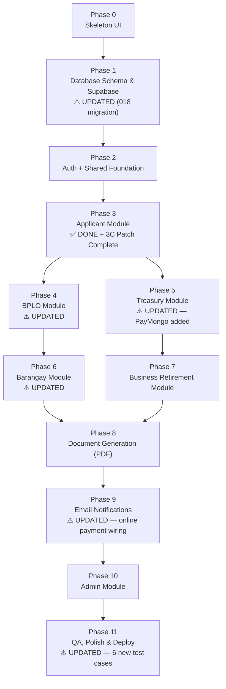

# eBPLS Agile Implementation Plan

**Electronic Business Permits and Licensing System — BOSS & E-Resibo**
Municipality of Liliw | **v5.0 — Codebase Alignment Update**

---

> **What changed in v5.0**
> All phases (4 through 11) have been marked as ✅ Done to accurately reflect the codebase, which contains all controllers, routes, and screens for these modules.
>
> **What changed in v4.0 (from v3.0)**
> PayMongo online payment integration added as an optional channel. Affected phases: **Phase 1** (migration 018), **Phase 5** (new service, routes, and controller files), **Phase 9** (email wiring for online payment), and **Phase 11** (6 new QA test cases). All other phases are unchanged.
>
> **Preserved from v3.0:**
> 1. **BPLO Full Application Review** — `application_data_reviews` table + data review panel in the BPLO verifier.
> 2. **Barangay Clearance Feedback Loop** — Barangay clearance outcome auto-updates the BPLO verification checklist.

---

## Current Progress (Completed)

| Item | Status |
|---|---|
| System Architecture (README.md) | ✅ Done |
| File Structure Documentation | ✅ Done |
| Backend: `npm init`, dependencies installed | ✅ Done |
| Backend: `server.js`, `src/app.js` (Express base) | ✅ Done |
| Backend: `src/config/env.js` (Zod validation) | ✅ Done |
| Backend: `src/config/supabase.js` (Admin client) | ✅ Done |
| Backend: `src/config/mailer.js` (Optional SMTP) | ✅ Done |
| Frontend: Vite + React initialized | ✅ Done |
| Frontend: Tailwind CSS + PostCSS configured | ✅ Done |
| Frontend: Global CSS token system (`index.css`) | ✅ Done |
| Frontend: All folder structure created | ✅ Done |
| Phase 3: Applicant Module (Frontend — UAF Wizard) | ✅ Done |
| Phase 3: Application Module API (Backend) | ✅ Done — **Phase 3C patch complete (3C.1–3C.5)** |

---

## Phase Overview & Dependency Map

---

## Module Ownership

| Module | Dev A | Dev B |
|---|:---:|:---:|
| Database Schema (Phase 1) | ✅ Collab | ✅ Collab |
| Auth + Shared Middleware (Phase 2) | ✅ Collab | ✅ Collab |
| Applicant Module (UAF Wizard) | ✅ Done | |
| UAF Barangay Hook Patch (Phase 3C) | ✅ Owner | |
| BPLO Module (Verify & Process) | | ✅ Owner |
| Treasury Module (Assess & POS) | ✅ Owner | |
| **PayMongo Service & Webhook Handler** | **✅ Owner** | |
| Business Retirement Module | | ✅ Owner |
| Barangay Clearance Module | ✅ Owner | |
| Admin Module | | ✅ Owner |
| PDF Generation (all documents) | ✅ Owner | |
| Email Notifications (all triggers) | | ✅ Owner |

---

## Week-by-Week Sprint Schedule

| Week | Dev A (Full-Stack) | Dev B (Full-Stack) |
|:---:|---|---|
| **1** | Phase 0: Skeleton UI — Layouts, Router, Placeholder Screens (collab) | Phase 0: Skeleton UI — UI Components, Stores, Hooks (collab) |
| **2** | Phase 1: DB Schema, RLS, Seed (collab) | Phase 1: DB Schema, RLS, Seed (collab) |
| **3** | Phase 2: Auth Backend + Frontend + Shared Middleware (collab) | Phase 2: Auth Backend + Frontend + Shared Middleware (collab) |
| **4** | ~~Applicant Module~~ ✅ Done + **Phase 3C Patch** | ✅ Phase 4: BPLO Module |
| **5** | ✅ Phase 5: Treasury Module | ✅ Phase 7: Retirement Module |
| **6** | ✅ Phase 6: Barangay Module | Phase 10: Admin Module ✅ DONE — Backend API first, then Frontend |
| **7** | ✅ Phase 8: PDF Generation | ✅ Phase 9: Email Notifications |
| **8-9** | ✅ QA: Applicant + Treasury + Barangay + PDF + PayMongo flows | ✅ QA: BPLO + Retirement + Admin + Email flows |

---

## Phase 0: Skeleton UI (Both Devs)

**Goal:** Build the entire navigation shell — all layouts, routes, and empty placeholder screens.

### Tasks

| # | Task | File / Location | Owner |
|---|---|---|---|
| 0.1 | Create `constants.js` with API base URL and role enums | `src/utils/` | Dev A |
| 0.2 | Create `UIStore.js` (Zustand) for sidebar/modal/toast state | `src/store/` | Dev A |
| 0.3 | Create `apiClient.js` — Fetch/Axios wrapper with JWT injection stub | `src/utils/` | Dev B |
| 0.4 | Build reusable UI component library: Button, Input, Modal, Badge, Card | `src/components/ui/` | Dev B |
| 0.5 | Set up React Router in `App.jsx` with route groups: public, auth, applicant, bplo, treasury, barangay, admin | `src/App.jsx` | Both |
| 0.6 | Build `AuthLayout.jsx` — centered card layout for login/register | `src/layouts/` | Dev B |
| 0.7 | Build `ApplicantLayout.jsx` — mobile-first with bottom nav | `src/layouts/` | Dev A |
| 0.8 | Build `BPLOLayout.jsx` — desktop sidebar layout | `src/layouts/` | Dev A |
| 0.9 | Build `TreasuryLayout.jsx` — POS-style layout | `src/layouts/` | Dev A |
| 0.10 | Build `BarangayLayout.jsx` — desktop layout | `src/layouts/` | Dev B |
| 0.11 | Build `AdminLayout.jsx` — utilitarian dashboard layout | `src/layouts/` | Dev B |
| 0.12 | Build layout shell components: Navbar, Sidebar, Footer | `src/components/layout/` | Dev A |
| 0.13 | Create placeholder `LandingPage.jsx` | `src/screens/public/` | Dev A |
| 0.14 | Create placeholder screens for Auth: Login, Register, ForgotPassword | `src/screens/auth/` | Dev B |
| 0.15 | Create placeholder screens for Applicant: Dashboard, UAFWizard, StatusTracker | `src/screens/applicant/` | Dev A |
| 0.16 | Create placeholder screens for BPLO: Dashboard, SplitScreenVerifier | `src/screens/bplo/` | Dev B |
| 0.17 | Create placeholder screens for Treasury: AssessmentGrid, CashierPOS | `src/screens/treasury/` | Dev A |
| 0.18 | Create placeholder screen for Barangay: ClearanceQueue | `src/screens/barangay/` | Dev B |
| 0.19 | Create placeholder screens for Admin: MasterData, DocumentBuilder, AuditLogs | `src/screens/admin/` | Dev B |

### Definition of Done
- [x] Every route in the system is navigable in the browser
- [x] All 6 layouts render with proper navigation
- [x] Placeholder screens show page title and "Under Construction" message
- [x] Reusable UI components follow the design token system

---

## Phase 1: Database Schema & Supabase Setup ⚠️ UPDATED

**Goal:** Create the entire normalized database schema in Supabase and enable Row Level Security.

**Priority:** 🔴 Critical Path — blocks everything else.

**What changed in v4.0:** Added migration `018_paymongo_payment.sql` — extends `transactions` table with PayMongo columns, adds `GCash`/`Card`/`Online` to the `tendered_type` enum, creates the `payment_gateway_logs` table with RLS, and adds `PaymentProcessing` to the `application_status` enum.

### Tasks

| # | Task | File / Location | Changed? |
|---|---|---|---|
| 1.1 | Create migration: `roles` table (seed 5 roles) | `supabase/migrations/001_roles.sql` | — |
| 1.2 | Create migration: `users` table with FK to `roles` | `supabase/migrations/002_users.sql` | — |
| 1.3 | Create migration: `taxpayers` table (1:1 with users) | `supabase/migrations/003_taxpayers.sql` | — |
| 1.4 | Create migration: `businesses`, `organization_types` | `supabase/migrations/004_businesses.sql` | — |
| 1.5 | Create migration: `applications`, `application_drafts`, `application_types`, `payment_modes` | `supabase/migrations/005_applications.sql` | — |
| 1.6 | Create migration: `doc_verifications`, `clearance_types` (patched by `015` to add `'Yes'`, `'No'`, `'Awaiting Issuance'`) | `supabase/migrations/006_verifications.sql` | ⚠️ Patched |
| 1.7 | Create migration: `barangay_clearances` | `supabase/migrations/007_barangay.sql` | — |
| 1.8 | Create migration: `assessments`, `assessment_line_items`, `fee_types`, `transactions` | `supabase/migrations/008_treasury.sql` | — |
| 1.9 | Create migration: `retirement_applications` | `supabase/migrations/009_retirements.sql` | — |
| 1.10 | Create migration: `permits`, `permit_line_items`, `business_activities` | `supabase/migrations/010_permits.sql` | — |
| 1.11 | Create migration: `audit_logs` | `supabase/migrations/011_audit_logs.sql` | — |
| 1.12 | Create migration: `email_notifications` | `supabase/migrations/012_email_notifications.sql` | — |
| 1.13 | Enable RLS on all base tables; write initial policies | `supabase/migrations/013_rls_policies.sql` | ⚠️ Patched |
| 1.14 | Seed lookup tables: roles, application_types, payment_modes, clearance_types, fee_types, organization_types, business_activities | `supabase/seed.sql` | — |
| 1.15 | Migrations `015` & `016` — adds `application_data_reviews` table, updates `doc_verifications` status constraint, adds `BARANGAY_CLEARANCE_REJECTED` trigger, patches RLS | `supabase/migrations/` | 🆕 Prior |
| 1.16 | Migration `017` — `uaf_create_barangay_clearance_hook` RPC (atomic barangay clearance + doc_verifications insert) | `supabase/migrations/017_uaf_clearance_hook.sql` | 🆕 Prior |
| **1.17** | **Migration `018` — PayMongo payment integration:** | **`supabase/migrations/018_paymongo_payment.sql`** | **🆕 New** |
| | Add `'GCash'`, `'Card'`, `'Online'` values to `tendered_type` enum | | |
| | Add `PaymentProcessing` to `application_status` enum | | |
| | Add columns to `transactions`: `paymongo_payment_intent_id VARCHAR UNIQUE`, `paymongo_payment_id VARCHAR UNIQUE`, `payment_channel VARCHAR` | | |
| | Create `payment_gateway_logs` table with RLS (insert from service role only; no delete policy) | | |

### Definition of Done
- [x] All tables exist in Supabase with correct constraints, FKs, and enums
- [x] `application_status` enum includes `'PaymentProcessing'`
- [x] `tendered_type` enum includes `'GCash'`, `'Card'`, `'Online'`
- [x] `transactions` table has `paymongo_payment_intent_id`, `paymongo_payment_id`, `payment_channel` columns
- [x] `payment_gateway_logs` table exists with UNIQUE constraint on `paymongo_event_id`
- [x] RLS is enabled on every table including `payment_gateway_logs`
- [x] `doc_verifications.status` includes `'Awaiting Issuance'`
- [x] `application_data_reviews` table exists with correct columns
- [x] Seed data populated for all lookup tables

---

## Phase 2: Auth & Shared Foundation (Both Devs)

**Goal:** Build all shared backend utilities, middleware, and the full authentication flow.

### Tasks

| # | Task | File / Location | Owner |
|---|---|---|---|
| 2.1 | Create `constants.js` — role enums, valid status transitions, error codes | `src/utils/constants.js` | Both |
| 2.2 | Create `helpers.js` — UUID generator, date formatters | `src/utils/helpers.js` | Both |
| 2.3 | Build `auth.middleware.js` — JWT validation | `src/middlewares/` | Both |
| 2.4 | Build `rbac.middleware.js` — role-based access control | `src/middlewares/` | Both |
| 2.5 | Build `audit.middleware.js` — request logging hook | `src/middlewares/` | Both |
| 2.6 | Build `error.middleware.js` — centralised error handler | `src/middlewares/` | Both |
| 2.7 | Create `audit.service.js` — writes rows to `audit_logs` | `src/services/` | Both |
| 2.8 | Create `auth.controller.js` — register, login, forgot password handlers | `src/controllers/` | Both |
| 2.9 | Create `auth.routes.js` and mount in `app.js` | `src/routes/` | Both |
| 2.10 | Create `authStore.js` (Zustand) — session state, persisted to localStorage | `src/store/` | Both |
| 2.11 | Create `useAuth.js` hook | `src/hooks/` | Both |
| 2.12 | Implement Protected Route wrapper | `src/components/shared/` | Both |
| 2.13 | Build `LandingPage.jsx` | `src/screens/public/` | Both |
| 2.14 | Build `Login.jsx` | `src/screens/auth/` | Both |
| 2.15 | Build `Register.jsx` | `src/screens/auth/` | Both |
| 2.16 | Build `ForgotPassword.jsx` | `src/screens/auth/` | Both |

### Definition of Done
- [x] `POST /api/auth/register` creates user with bcrypt hash (cost 12+)
- [x] `POST /api/auth/login` returns JWT with user role
- [x] All protected routes reject requests without valid JWT
- [x] RBAC middleware blocks unauthorized roles
- [x] Zustand auth store persists session in localStorage

---

## Phase 3: Applicant Module ✅ DONE (Phase 3C Patch Required)

> **Phase 3A and 3B complete. Phase 3C backend patch complete (3C.1–3C.5 done).**

### Phase 3C — Final Verification Tasks

| # | Task | File / Location |
|---|---|---|
| 3C.6 | Manual test: submit UAF with checkbox ticked → confirm both `barangay_clearances` (Pending) and `doc_verifications` (Awaiting Issuance) rows exist | Postman / Thunder Client |
| 3C.7 | Manual test: submit UAF without checkbox → confirm `doc_verifications` row for Barangay exists with `status = 'Pending'` | Postman / Thunder Client |

### Definition of Done
- [x] Ticking the checkbox creates both records atomically
- [x] Not ticking creates only a `doc_verifications` (Pending) record
- [x] Both paths verified in Supabase directly (3C.6 & 3C.7)
- [x] No orphaned `barangay_clearances` records

---

## Phase 4: BPLO Module ⚠️ UPDATED (Unchanged from v3.0)

**Goal:** Build the BPLO verification flow — backend API first, then desktop-first frontend.

**Owner:** Dev B
**Depends on:** Phase 3C patch complete and verified.

### Tasks

| # | Task | File / Location | Changed? |
|---|---|---|---|
| 4.1 | Build `bplo.controller.js` — pending queue, application detail, verify, return handlers | `src/controllers/bplo.controller.js` | ⚠️ Updated |
| 4.2 | Add handler: `reviewApplication` — upserts `application_data_reviews` per section | `src/controllers/bplo.controller.js` | 🆕 New |
| 4.3 | Update `Under Review → Verified` guard: require all `doc_verifications` = 'Yes'/'Not Needed' AND all `application_data_reviews` = 'Verified' AND (if exists) `barangay_clearances.status` = 'Issued' | `src/services/application.service.js` | ⚠️ Updated |
| 4.4 | Build `bplo.routes.js` | `src/routes/bplo.routes.js` | ⚠️ Updated |
| 4.5 | Add route: `PUT /api/bplo/applications/review/:app_no` → `bplo.controller.reviewApplication` | `src/routes/bplo.routes.js` | 🆕 New |
| 4.6 | Mount BPLO routes in `app.js` | `src/app.js` | — |
| 4.7 | Build `Dashboard.jsx` — sortable data table with SLA urgency indicators | `src/screens/bplo/` | — |
| 4.8 | Build `DataReviewPanel.jsx` — four review sections with Verified/Discrepancy toggle | `src/components/bplo/` | 🆕 New |
| 4.9 | Build `SplitScreenVerifier.jsx` — three-panel layout with Barangay clearance status badge | `src/screens/bplo/` | ⚠️ Updated |
| 4.10 | Wire Approve/Return footer guard — Approve disabled until all guard conditions pass | `src/screens/bplo/` | 🆕 New |

### Definition of Done
- [x] `PUT /api/bplo/applications/review/:app_no` upserts `application_data_reviews` rows correctly
- [x] `PUT /api/bplo/applications/verify/:app_no` returns `403` if any data review section is Discrepancy or missing
- [x] `PUT /api/bplo/applications/verify/:app_no` returns `403` if `barangay_clearances` exists and status is not 'Issued'
- [x] All actions RBAC-locked to `BPLO_Officer` and logged in `audit_logs`

---

## Phase 5: Treasury Module ⚠️ UPDATED

**Goal:** Build the treasury assessment flow, OTC payment recording, and the new PayMongo online payment channel.

**Owner:** Dev A
**Depends on:** Phase 4 (applications must reach `Verified` status).

**What changed in v4.0:** Added `paymongo.service.js`, `treasury.online.routes.js`, `webhook.routes.js`, and `webhook.controller.js`. Updated `constants.js`, `env.js`, `application.service.js`, and `app.js`. Added online payment UI to `StatusTracker.jsx` and `PaymentProcessing` status to `applicationSlice.js`.

### Tasks

| # | Task | File / Location | Changed? |
|---|---|---|---|
| **— Backend API (OTC — Unchanged) —** | | | |
| 5.1 | Build `assessment.service.js` — fee calculation with Mayor's Permit + 10% Fire Safety rule | `src/services/` | — |
| 5.2 | Build `treasury.controller.js` — assess, override, record OTC payment handlers | `src/controllers/` | — |
| 5.3 | Build `treasury.routes.js` — OTC Treasury endpoints, RBAC protected | `src/routes/` | — |
| 5.4 | Mount Treasury routes in `app.js` | `src/app.js` | — |
| **— Backend API (PayMongo — New) —** | | | |
| **5.5** | **Update `src/config/env.js` — add 4 PayMongo env vars to Zod schema:** `PAYMONGO_SECRET_KEY`, `PAYMONGO_WEBHOOK_SECRET`, `PAYMONGO_SUCCESS_URL`, `PAYMONGO_CANCEL_URL` | **`src/config/env.js`** | **🆕 New** |
| **5.6** | **Update `src/utils/constants.js` — add:** `APPLICATION_STATUS.PAYMENT_PROCESSING = 'PaymentProcessing'`; `TRANSACTION_TENDERED_TYPE.GCASH`, `.CARD`, `.ONLINE`; `AUDIT_ACTIONS.ONLINE_PAYMENT_INITIATED`, `.ONLINE_PAYMENT_CONFIRMED`, `.ONLINE_PAYMENT_FAILED` | **`src/utils/constants.js`** | **🆕 New** |
| **5.7** | **Create `src/services/paymongo.service.js`** with four functions: | **`src/services/`** | **🆕 New** |
| | `createPaymentIntent(amount, description, applicationNo)` — POST to `https://api.paymongo.com/v1/payment_intents`; amount in centavos (PHP × 100) | | |
| | `createPaymentLink(amount, description, applicationNo)` — alternative simpler integration | | |
| | `verifyWebhookSignature(rawBody, signatureHeader)` — HMAC-SHA256 using `PAYMONGO_WEBHOOK_SECRET`; return `false` and log on failure (do not throw) | | |
| | `getPayment(paymentId)` — retrieve payment details for manual fallback | | |
| **5.8** | **Update `src/services/application.service.js` — add 3 new state machine transitions to the guard:** `ForPayment → PaymentProcessing`, `PaymentProcessing → Paid`, `PaymentProcessing → ForPayment`. Do not alter existing transitions. | **`src/services/application.service.js`** | **🆕 New** |
| **5.9** | **Create `src/routes/treasury.online.routes.js` — `POST /api/treasury/payments/online`:** RBAC: Applicant or Treasury_Officer. Guard: application must be in `ForPayment`. Behavior: call `paymongo.service.createPaymentIntent()`, create `transactions` row (status = 'Pending', `paymongo_payment_intent_id` set), transition status to `PaymentProcessing`, log to `audit_logs` (`ONLINE_PAYMENT_INITIATED`), return `checkout_url`. | **`src/routes/`** | **🆕 New** |
| **5.10** | **Create `src/routes/webhook.routes.js` — `POST /api/webhooks/paymongo`:** No JWT auth. Uses `express.raw({ type: 'application/json' })`. Delegates to `webhook.controller.handlePaymongo`. | **`src/routes/`** | **🆕 New** |
| **5.11** | **Create `src/controllers/webhook.controller.js`** with `handlePaymongo` handler: | **`src/controllers/`** | **🆕 New** |
| | 1. Verify HMAC-SHA256 signature — reject 400 if invalid | | |
| | 2. Idempotency check — query `payment_gateway_logs` for `paymongo_event_id`; if already `processed = true`, return 200 immediately | | |
| | 3. Insert into `payment_gateway_logs` with `processed = false` | | |
| | 4. **On `payment.paid`:** find transaction by `paymongo_payment_intent_id`; update transaction (`paymongo_payment_id`, `payment_channel`, `paid_at = NOW()`); generate system OR number (`PM-{YYYYMMDD}-{6-digit-seq}`); transition application to `Paid`; trigger document generation (Permit + E-Resibo); enqueue `PAYMENT_RECORDED` email; update `payment_gateway_logs.processed = true`; log `ONLINE_PAYMENT_CONFIRMED` to `audit_logs` | | |
| | 5. **On `payment.failed`:** find transaction; update `transactions.status = 'Failed'`; transition application back to `ForPayment`; update `payment_gateway_logs.processed = true`; log `ONLINE_PAYMENT_FAILED` to `audit_logs` | | |
| | 6. Always return 200 to PayMongo — never 500 | | |
| **5.12** | **Update `src/app.js` — mount routes correctly:** Register `express.raw({ type: 'application/json' })` + `webhookRoutes` at `/api/webhooks` **BEFORE** `app.use(express.json())`. Register `treasuryOnlineRoutes` at `/api/treasury` after `express.json()`. | **`src/app.js`** | **🆕 New** |
| **— Frontend UI —** | | | |
| 5.13 | Build `AssessmentGrid.jsx` — spreadsheet-style fee view, override fields highlighted in yellow | `src/screens/treasury/` | — |
| 5.14 | Build `CashierPOS.jsx` — OTC payment: Cash/Manager Check selector, OR number, change computation | `src/screens/treasury/` | — |
| **5.15** | **Update `src/screens/applicant/StatusTracker.jsx`** — when status = `ForPayment`: show two options: (1) "Pay OTC" with existing instructions; (2) "Pay Online via PayMongo" button that calls `POST /api/treasury/payments/online` and redirects to `checkout_url`. When status = `PaymentProcessing`: show pending message *"Your online payment is being confirmed. This page will update automatically."* Poll `GET /api/applications/:app_no/status` every 5 seconds. Once status = `Paid`/`Completed`, show download buttons. | **`src/screens/applicant/`** | **🆕 New** |
| **5.16** | **Update `src/store/applicationSlice.js`** — add `PaymentProcessing` to the handled statuses in store logic | **`src/store/`** | **🆕 New** |

### New Files Created

| File | Purpose |
|---|---|
| `supabase/migrations/018_paymongo_payment.sql` | DB migration: enum additions, `transactions` columns, `payment_gateway_logs` table, RLS |
| `src/services/paymongo.service.js` | PayMongo API client: Payment Intent, Payment Link, webhook verification, payment retrieval |
| `src/routes/treasury.online.routes.js` | `POST /api/treasury/payments/online` — RBAC protected |
| `src/routes/webhook.routes.js` | `POST /api/webhooks/paymongo` — raw body, no JWT |
| `src/controllers/webhook.controller.js` | Webhook handler: signature check, idempotency, state transitions, trigger docs + email |

### Files Modified (Targeted Changes Only)

| File | Change |
|---|---|
| `src/config/env.js` | Add 4 PayMongo env vars to Zod schema |
| `src/utils/constants.js` | Add `PAYMENT_PROCESSING` status, `GCASH`/`CARD`/`ONLINE` tendered types, 3 new audit actions |
| `src/services/application.service.js` | Add 3 new state machine transitions; do not alter existing ones |
| `src/app.js` | Mount 2 new route files; webhook route gets `express.raw()` before global `express.json()` |
| `src/screens/applicant/StatusTracker.jsx` | Add online payment button for `ForPayment`; add polling UI for `PaymentProcessing` |
| `src/store/applicationSlice.js` | Add `PaymentProcessing` to status handling |

### Definition of Done
- [x] `POST /api/treasury/assess` auto-calculates fees per revenue code
- [x] Fire Safety = exactly 10% of applicable LGU fees
- [x] `POST /api/treasury/payments/otc` only accepts `Cash` or `Manager Check` (unchanged)
- [x] `POST /api/treasury/payments/online` creates Payment Intent, returns `checkout_url`, transitions to `PaymentProcessing`
- [x] `POST /api/webhooks/paymongo` verifies HMAC-SHA256 signature; rejects 400 on invalid
- [x] Duplicate `payment.paid` webhook is idempotent — no duplicate transaction, PDF, or email
- [x] `payment.paid` webhook transitions application to `Paid` and triggers document generation
- [x] `payment.failed` webhook reverts application to `ForPayment`
- [x] Online OR number uses `PM-{YYYYMMDD}-{seq}` format
- [x] Webhook route receives raw body (not pre-parsed JSON)
- [x] `PaymentProcessing` status shows correct polling UI in `StatusTracker.jsx`
- [x] Overrides logged in `audit_logs`; PayMongo events logged in `payment_gateway_logs`

---

## Phase 6: Barangay Clearance Module ⚠️ UPDATED (Unchanged from v3.0)

**Goal:** Build the integrated Barangay Clearance processing with the feedback loop fix.

**Owner:** Dev A
**Depends on:** Phase 3C patch complete.

### Tasks

| # | Task | File / Location | Changed? |
|---|---|---|---|
| 6.1 | Build `barangay.controller.js` — pending queue, issue, reject handlers | `src/controllers/` | ⚠️ Updated |
| 6.2 | In `issueClearance`: after setting `barangay_clearances.status = 'Issued'`, update corresponding `doc_verifications` row to `'Yes'` — single transaction | `src/controllers/barangay.controller.js` | 🆕 New |
| 6.3 | In `rejectClearance`: after setting status to `'Rejected'`, update `doc_verifications` to `'No'`; remarks mandatory; enqueue `BARANGAY_CLEARANCE_REJECTED` email | `src/controllers/barangay.controller.js` | 🆕 New |
| 6.4 | Build `barangay.routes.js` — RBAC locked to `Barangay_Officer` | `src/routes/` | — |
| 6.5 | Mount Barangay routes in `app.js` | `src/app.js` | — |
| 6.6 | Build `ClearanceQueue.jsx` — pending list with issue/reject actions | `src/screens/barangay/` | — |

### Definition of Done
- [x] Issue action auto-updates `doc_verifications` to 'Yes'
- [x] Reject action auto-updates `doc_verifications` to 'No' and enqueues `BARANGAY_CLEARANCE_REJECTED` email
- [x] RBAC restricts all routes to `Barangay_Officer`
- [x] All actions logged in `audit_logs`

---

## Phase 7: Business Retirement Module

**Goal:** Build the business retirement flow.

**Owner:** Dev B
**Depends on:** Phase 5 Treasury API (retirement settlement reuses `POST /api/treasury/payments/otc`).

> **PayMongo online payment is NOT added to the Retirement Module. OTC only.**

### Tasks

| # | Task | File / Location |
|---|---|---|
| 7.1 | Build `retirement.controller.js` — submit, pending, assess, complete handlers | `src/controllers/` |
| 7.2 | Build `retirement.routes.js` — RBAC protected per handler | `src/routes/` |
| 7.3 | Mount Retirement routes in `app.js` | `src/app.js` |
| 7.4 | Add Retirement submission screen to Applicant dashboard | Frontend |
| 7.5 | Add Retirement review panel to BPLO dashboard | Frontend |

### Definition of Done
- [x] Applicant can submit retirement with reason and cessation date
- [x] Treasury can compute final taxes based on `final_gross_sales`
- [x] Completion sets `businesses.is_retired = true`
- [x] Settlement reuses `POST /api/treasury/payments/otc`

---

## Phase 8: Document Generation (PDF)

**Goal:** Build all PDF generation endpoints. Document generation is triggered by both OTC and online payment paths — no changes to generation logic, only to what triggers it.

**Owner:** Dev A
**Depends on:** Phases 5 and 6.

### Tasks

| # | Task | File / Location |
|---|---|---|
| 8.1 | Build `pdf.service.js` — core template engine with `{{placeholder}}` mapping | `src/services/` |
| 8.2 | Build `document.controller.js` — permit, E-Resibo, TOP, clearance endpoint handlers | `src/controllers/` |
| 8.3 | Build `document.routes.js` — all document endpoints, auth protected | `src/routes/` |
| 8.4 | Create PDF templates for: Business Permit, E-Resibo, TOP, Barangay Clearance | `src/templates/` |
| 8.5 | Mount document routes in `app.js` | `src/app.js` |
| 8.6 | Add download buttons to Applicant Dashboard for each available document type | `src/screens/applicant/` |

### Definition of Done
- [x] `GET /api/documents/permit/:app_no` returns a valid Business Permit PDF
- [x] Per-line-of-business permits work via `?lob=:activity_id`
- [x] `GET /api/documents/eresibo/:transaction_id` returns Official Receipt PDF — works for both OTC and PayMongo OR numbers
- [x] `GET /api/documents/top/:app_no` returns TOP PDF
- [x] `GET /api/documents/barangay-clearance/:id` returns Barangay Clearance PDF

---

## Phase 9: Email Notifications ⚠️ UPDATED

**Goal:** Build `email.service.js` and wire all **10** transactional email triggers across every controller, including the online payment path.

**Owner:** Dev B
**Depends on:** All controller files from Phases 4–8 must exist.

**What changed in v4.0:** `PAYMENT_RECORDED` template must support both OTC (cashier OR number) and online (PM-prefixed OR number) paths from the same template. The trigger fires from both `treasury.controller.js` (OTC) and `webhook.controller.js` (online). Task 9.11 verifies `BARANGAY_CLEARANCE_REJECTED` is correctly wired.

### Tasks

| # | Task | File / Location | Changed? |
|---|---|---|---|
| 9.1 | Build `email.service.js` — template builder for all 10 trigger events | `src/services/` | ⚠️ Updated |
| 9.2 | Wire `ACCOUNT_CREATED` trigger in `auth.controller.js` | Backend | — |
| 9.3 | Wire `PASSWORD_RESET` trigger in `auth.controller.js` | Backend | — |
| 9.4 | Wire `APPLICATION_SUBMITTED` trigger in `application.controller.js` | Backend | — |
| 9.5 | Wire `APPLICATION_RETURNED` trigger in `bplo.controller.js` | Backend | — |
| 9.6 | Wire `APPLICATION_VERIFIED` trigger in `bplo.controller.js` | Backend | — |
| 9.7 | Wire `TOP_GENERATED` trigger in `treasury.controller.js` (attach TOP PDF) | Backend | — |
| **9.8** | **Wire `PAYMENT_RECORDED` in both `treasury.controller.js` (OTC path) AND `webhook.controller.js` (online payment path). Same template — the OR number field accepts both cashier-issued and `PM-{YYYYMMDD}-{seq}` formats. Verify the template renders correctly for both.** | **Backend** | **⚠️ Updated** |
| 9.9 | Wire `PERMIT_READY` trigger in `document.controller.js` | Backend | — |
| 9.10 | Wire `RETIREMENT_COMPLETE` trigger in `retirement.controller.js` | Backend | — |
| **9.11** | **Verify `BARANGAY_CLEARANCE_REJECTED` trigger: already called inside `barangay.controller.rejectClearance` (Phase 6.3). Confirm the `email.service.js` template exists — recipient: Applicant, content: rejection remarks + instructions to re-apply at barangay hall** | **Backend** | **🆕 New** |

### Definition of Done
- [x] All **10** triggers send the correct email to the correct recipient
- [x] `PAYMENT_RECORDED` email fires for both OTC and online payment paths
- [x] `PAYMENT_RECORDED` template renders the OR number correctly for both formats
- [x] `BARANGAY_CLEARANCE_REJECTED` email includes rejection remarks
- [x] In dev mode, emails are logged to console (not sent)
- [x] `email_notifications` table tracks every email with status

---

## Phase 10: Admin Module

**Goal:** Build the admin management tools.

**Owner:** Dev B
**Depends on:** All prior phases.

### Tasks

| # | Task | File / Location |
|---|---|---|
| 10.1 | Build admin API endpoints — user management, lookup table CRUD, template management | `src/controllers/` + `src/routes/` |
| 10.2 | Mount Admin routes in `app.js`, RBAC locked to `Admin` role | `src/app.js` |
| 10.3 | Build `MasterData.jsx` — CRUD tables for fee types, clearance types, org types | `src/screens/admin/` |
| 10.4 | Build `DocumentBuilder.jsx` — template upload and `{{placeholder}}` mapping | `src/screens/admin/` |
| 10.5 | Build `AuditLogs.jsx` — filterable log viewer (by user, action, date, entity) for DPA compliance | `src/screens/admin/` |

### Definition of Done
- [x] Admin can manage users and toggle `is_active`
- [x] Admin can update all lookup table values
- [x] Audit log viewer filters by user, action (including `ONLINE_PAYMENT_INITIATED`, `ONLINE_PAYMENT_CONFIRMED`, `ONLINE_PAYMENT_FAILED`), date, and entity
- [x] Document Builder allows template upload and placeholder mapping
- [x] RBAC restricts all admin routes to `Admin` role

---

## Phase 11: QA, Polish & Deployment ⚠️ UPDATED

**Owner:** Both Devs
**Depends on:** All phases complete.

**What changed in v4.0:** Added test cases 11.13–11.18 for PayMongo integration. Test 11.17 is a regression test to verify OTC still works after the PayMongo addition.

### Tasks

| # | Task | Changed? |
|---|---|---|
| 11.1 | Full E2E: Register → Submit UAF (with Barangay checkbox) → Barangay Officer Issues → BPLO Data Review + Doc Verify → Treasury Assess → OTC Pay → Download Permit | ⚠️ Updated |
| 11.2 | Full E2E: Register → Submit UAF (without Barangay checkbox) → BPLO Data Review + Doc Verify → Treasury Assess → OTC Pay → Download Permit | ⚠️ Updated |
| 11.3 | Test: Barangay Officer rejects clearance → verify `doc_verifications` = 'No' → BPLO cannot approve → applicant receives rejection email | 🆕 Prior |
| 11.4 | Test: BPLO marks section as Discrepancy → Approve blocked → BPLO returns → applicant resubmits → BPLO re-reviews → all Verified → Approve succeeds | 🆕 Prior |
| 11.5 | Test Retirement flow end-to-end | — |
| 11.6 | Cross-browser testing (Chrome, Firefox, Safari) | — |
| 11.7 | Mobile responsiveness audit for Applicant portal | — |
| 11.8 | Security audit: RBAC bypass attempts, SQL injection, XSS | — |
| 11.9 | Performance: API response < 2s, January renewal spike simulation | — |
| 11.10 | Configure Brevo SMTP with real credentials | — |
| 11.11 | Production build and deployment | — |
| 11.12 | Final DPA compliance review of audit logs | — |
| **11.13** | **PayMongo Happy Path:** Applicant selects "Pay Online" → redirected to PayMongo checkout → completes payment → `payment.paid` webhook fires → application transitions to `Paid` → Permit and E-Resibo generated → `PAYMENT_RECORDED` email sent with `PM-` OR number | **🆕 New** |
| **11.14** | **PayMongo Abandon:** Applicant selects "Pay Online" → abandons checkout → `payment.failed` webhook fires → application reverts to `ForPayment` → applicant can retry (online or OTC) | **🆕 New** |
| **11.15** | **Webhook Idempotency:** PayMongo fires duplicate `payment.paid` webhook → second event is idempotent → no duplicate transaction row, no duplicate PDF generated, no duplicate email sent | **🆕 New** |
| **11.16** | **Webhook Signature Rejection:** Webhook request with invalid or missing signature → rejected with 400 → logged → no state change | **🆕 New** |
| **11.17** | **OTC Regression:** Full OTC payment flow (Cash and Manager Check) works end-to-end after PayMongo addition — no regressions in `treasury.controller.js`, `CashierPOS.jsx`, or `POST /api/treasury/payments/otc` | **🆕 New** |
| **11.18** | **Invalid OTC During PaymentProcessing:** Application is in `PaymentProcessing` status — cashier attempts OTC recording — backend state machine rejects the transition with an appropriate error; application remains in `PaymentProcessing` | **🆕 New** |

### Definition of Done
- [x] All state machine transitions tested including both OTC and online payment paths
- [x] Duplicate webhook events are fully idempotent
- [x] Invalid webhook signatures are rejected
- [x] OTC path is unaffected by PayMongo addition (regression clean)
- [x] BPLO data review blocks Verified transition when discrepancies exist
- [x] No RBAC bypass vulnerabilities found
- [x] Applicant portal works on mobile devices
- [x] API response time < 2 seconds under normal load
- [x] 99.5% uptime target verified

---

## Sprint Summary (2 Full-Stack Developers)

| Sprint | Duration | Dev A (Full-Stack) | Dev B (Full-Stack) |
|:---:|---|---|---|
| **1** | 1 week | Phase 0: Skeleton UI (collab) | Phase 0: Skeleton UI (collab) |
| **2** | 1 week | Phase 1: DB Schema + RLS (collab) | Phase 1: DB Schema + Seed (collab) |
| **3** | 1 week | Phase 2: Auth Backend + Frontend (collab) | Phase 2: Auth Backend + Frontend (collab) |
| **4** | 1.5 weeks | ✅ Applicant Module done + Phase 3C Patch | Phase 4: BPLO Module (backend → frontend) |
| **5** | 1.5 weeks | Phase 5: Treasury Module (OTC + **PayMongo**) | Phase 7: Retirement Module (backend → frontend) |
| **6** | 1 week | Phase 6: Barangay Module (backend → frontend) | Phase 10: Admin Module (backend → frontend) |
| **7** | 1 week | Phase 8: PDF Generation | Phase 9: Email Notifications (all 10 triggers + online payment wiring) |
| **8-9** | 2 weeks | QA: Applicant + Treasury + Barangay + PDF + **PayMongo** flows | ✅ QA: BPLO + Retirement + Admin + Email flows |
| | **Total: ~8-9 weeks** | | |

> **Phase 3C must be completed before Phase 4 is tested end-to-end.**
>
> **Webhook route must be mounted before `express.json()` in `app.js` — verify this during Phase 5 before any PayMongo testing.**

---

## Phases NOT Affected — Do Not Touch

| Phase | Reason |
|---|---|
| Phase 0 — Skeleton UI | Layout/routing — no payment involvement |
| Phase 2 — Auth | Authentication unchanged |
| Phase 3 — Applicant Module (UAF, drafts, upload) | UAF submission flow unchanged |
| Phase 4 — BPLO Module | Verification flow unchanged |
| Phase 6 — Barangay Module | Clearance flow unchanged |
| Phase 7 — Retirement Module | Retirement uses OTC only — do not add online payment |
| Phase 8 — PDF Generation | Document generation logic unchanged; it is only triggered — not modified |
| Phase 10 — Admin Module | No admin UI changes for PayMongo |

---

*eBPLS Implementation Plan v4.0 — Municipality of Liliw*
*Phases 1, 5, 9, and 11 updated for PayMongo online payment integration. No other phases changed.*