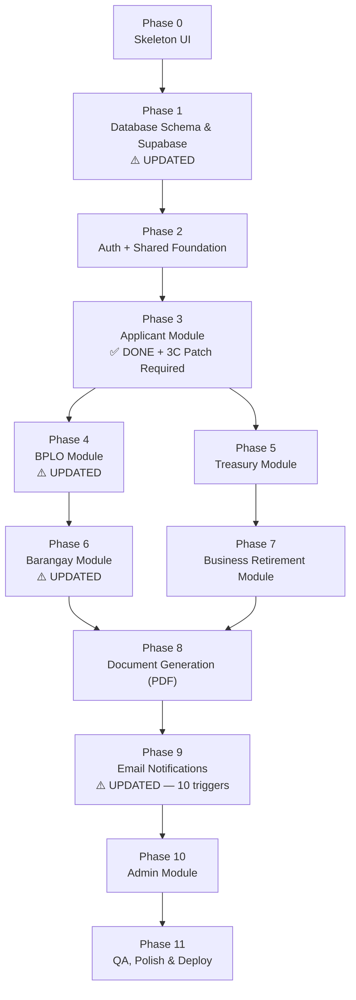

# eBPLS Agile Implementation Plan

**Electronic Business Permits and Licensing System — BOSS & E-Resibo**
Municipality of Liliw | **v3.0 — Phases Consolidated & Chronological**

---

> [!NOTE]
> **What changed in v3.0 (from v2.1)**
> All A/B phase splits have been merged into single phases. Tasks within each phase are now ordered chronologically — backend foundation first, then frontend — so each layer has what it needs before the next begins. No functional scope was changed; this is a structural reorganization only.
>
> **Design fixes carried over from v2.1:**
> 1. **BPLO Full Application Review** — `application_data_reviews` table + data review panel in the BPLO verifier.
> 2. **Barangay Clearance Feedback Loop** — Barangay clearance outcome auto-updates the BPLO verification checklist.

---

## Current Progress (Completed)

| Item | Status |
|---|---|
| System Architecture (README.md) | ✅ Done |
| File Structure Documentation | ✅ Done |
| Backend: `npm init`, dependencies installed | ✅ Done |
| Backend: `server.js`, `src/app.js` (Express base) | ✅ Done |
| Backend: `src/config/env.js` (Zod validation) | ✅ Done |
| Backend: `src/config/supabase.js` (Admin client) | ✅ Done |
| Backend: `src/config/mailer.js` (Optional SMTP) | ✅ Done |
| Frontend: Vite + React initialized | ✅ Done |
| Frontend: Tailwind CSS + PostCSS configured | ✅ Done |
| Frontend: Global CSS token system (`index.css`) | ✅ Done |
| Frontend: All folder structure created | ✅ Done |
| Phase 3: Applicant Module (Frontend — UAF Wizard) | ✅ Done |
| Phase 3: Application Module API (Backend) | ✅ Done — **Phase 3C patch complete (3C.1–3C.5)** |

---

## Phase Overview & Dependency Map

---

## Module Ownership

| Module | Dev A | Dev B |
|---|:---:|:---:|
| Database Schema (Phase 1) | ✅ Collab | ✅ Collab |
| Auth + Shared Middleware (Phase 2) | ✅ Collab | ✅ Collab |
| Applicant Module (UAF Wizard) | ✅ Done | |
| UAF Barangay Hook Patch (Phase 3C) | ✅ Owner | |
| BPLO Module (Verify & Process) | | ✅ Owner |
| Treasury Module (Assess & POS) | ✅ Owner | |
| Business Retirement Module | | ✅ Owner |
| Barangay Clearance Module | ✅ Owner | |
| Admin Module | | ✅ Owner |
| PDF Generation (all documents) | ✅ Owner | |
| Email Notifications (all triggers) | | ✅ Owner |

---

## Week-by-Week Sprint Schedule

| Week | Dev A (Full-Stack) | Dev B (Full-Stack) |
|:---:|---|---|
| **1** | Phase 0: Skeleton UI — Layouts, Router, Placeholder Screens (collab) | Phase 0: Skeleton UI — UI Components, Stores, Hooks (collab) |
| **2** | Phase 1: DB Schema, RLS, Seed (collab) | Phase 1: DB Schema, RLS, Seed (collab) |
| **3** | Phase 2: Auth Backend + Frontend + Shared Middleware (collab) | Phase 2: Auth Backend + Frontend + Shared Middleware (collab) |
| **4** | ~~Applicant Module~~ ✅ Done + **Phase 3C Patch** | Phase 4: BPLO Module — Backend API first, then Frontend |
| **5** | Phase 5: Treasury Module — Backend API first, then Frontend | Phase 7: Retirement Module — Backend API first, then Frontend |
| **6** | Phase 6: Barangay Module — Backend API first, then Frontend + **doc_verifications auto-update** | Phase 10: Admin Module — Backend API first, then Frontend |
| **7** | Phase 8: PDF Generation (all documents) | Phase 9: Email Notifications (all **10** triggers) |
| **8-9** | QA: Applicant + Treasury + Barangay + PDF flows | QA: BPLO + Retirement + Admin + Email flows |

---

## Phase 0: Skeleton UI (Both Devs)

**Goal:** Build the entire navigation shell — all layouts, routes, and empty placeholder screens.

### Tasks

| # | Task | File / Location | Owner |
|---|---|---|---|
| 0.1 | Create `constants.js` with API base URL and role enums | `src/utils/` | Dev A |
| 0.2 | Create `UIStore.js` (Zustand) for sidebar/modal/toast state | `src/store/` | Dev A |
| 0.3 | Create `apiClient.js` — Fetch/Axios wrapper with JWT injection stub | `src/utils/` | Dev B |
| 0.4 | Build reusable UI component library: Button, Input, Modal, Badge, Card | `src/components/ui/` | Dev B |
| 0.5 | Set up React Router in `App.jsx` with route groups: public, auth, applicant, bplo, treasury, barangay, admin | `src/App.jsx` | Both |
| 0.6 | Build `AuthLayout.jsx` — centered card layout for login/register | `src/layouts/` | Dev B |
| 0.7 | Build `ApplicantLayout.jsx` — mobile-first with bottom nav | `src/layouts/` | Dev A |
| 0.8 | Build `BPLOLayout.jsx` — desktop sidebar layout | `src/layouts/` | Dev A |
| 0.9 | Build `TreasuryLayout.jsx` — POS-style layout | `src/layouts/` | Dev A |
| 0.10 | Build `BarangayLayout.jsx` — desktop layout | `src/layouts/` | Dev B |
| 0.11 | Build `AdminLayout.jsx` — utilitarian dashboard layout | `src/layouts/` | Dev B |
| 0.12 | Build layout shell components: Navbar, Sidebar, Footer | `src/components/layout/` | Dev A |
| 0.13 | Create placeholder `LandingPage.jsx` | `src/screens/public/` | Dev A |
| 0.14 | Create placeholder screens for Auth: Login, Register, ForgotPassword | `src/screens/auth/` | Dev B |
| 0.15 | Create placeholder screens for Applicant: Dashboard, UAFWizard, StatusTracker | `src/screens/applicant/` | Dev A |
| 0.16 | Create placeholder screens for BPLO: Dashboard, SplitScreenVerifier | `src/screens/bplo/` | Dev B |
| 0.17 | Create placeholder screens for Treasury: AssessmentGrid, CashierPOS | `src/screens/treasury/` | Dev A |
| 0.18 | Create placeholder screen for Barangay: ClearanceQueue | `src/screens/barangay/` | Dev B |
| 0.19 | Create placeholder screens for Admin: MasterData, DocumentBuilder, AuditLogs | `src/screens/admin/` | Dev B |

### Definition of Done
- [ ] Every route in the system is navigable in the browser
- [ ] All 6 layouts render with proper navigation
- [ ] Placeholder screens show page title and "Under Construction" message
- [ ] Reusable UI components follow the design token system

---

## Phase 1: Database Schema & Supabase Setup ⚠️ UPDATED

**Goal:** Create the entire normalized database schema in Supabase and enable Row Level Security.

**Priority:** 🔴 Critical Path — blocks everything else.

**What changed:** Added migration for `application_data_reviews` table (new). Updated `doc_verifications` status ENUM to include `Awaiting Issuance`. Added FK relationship note between `barangay_clearances` and `doc_verifications`.

### Tasks

| # | Task | File / Location | Changed? |
|---|---|---|---|
| 1.1 | Create migration: `roles` table (seed 5 roles) | `supabase/migrations/001_roles.sql` | — |
| 1.2 | Create migration: `users` table with FK to `roles`, bcrypt hash column | `supabase/migrations/002_users.sql` | — |
| 1.3 | Create migration: `taxpayers` table (1:1 with users) | `supabase/migrations/003_taxpayers.sql` | — |
| 1.4 | Create migration: `businesses`, `organization_types` | `supabase/migrations/004_businesses.sql` | — |
| 1.5 | Create migration: `applications`, `application_drafts`, `application_types`, `payment_modes` | `supabase/migrations/005_applications.sql` | — |
| 1.6 | Create migration: `doc_verifications`, `clearance_types` (patched by `015_design_gaps_fix.sql` to add `'Yes'`, `'No'`, `'Awaiting Issuance'`) | `supabase/migrations/006_verifications.sql` | ⚠️ Patched |
| 1.7 | Create migration: `barangay_clearances` — linked to `doc_verifications` via `application_no`; no hard FK but relationship enforced at the service layer | `supabase/migrations/007_barangay.sql` | ⚠️ Updated |
| 1.8 | Create migration: `assessments`, `assessment_line_items`, `fee_types`, `transactions` | `supabase/migrations/008_treasury.sql` | — |
| 1.9 | Create migration: `retirement_applications` | `supabase/migrations/009_retirements.sql` | — |
| 1.10 | Create migration: `permits`, `permit_line_items`, `business_activities` | `supabase/migrations/010_permits.sql` | — |
| 1.11 | Create migration: `audit_logs` | `supabase/migrations/011_audit_logs.sql` | — |
| 1.12 | Create migration: `email_notifications` (patched by `015_design_gaps_fix.sql` to add `BARANGAY_CLEARANCE_REJECTED`) | `supabase/migrations/012_email_notifications.sql` | ⚠️ Patched |
| 1.13 | Enable RLS on all base tables; write initial policies (patched by `015_design_gaps_fix.sql` for `application_data_reviews` RLS) | `supabase/migrations/013_rls_policies.sql` | ⚠️ Patched |
| 1.14 | Seed lookup tables: roles, application_types, payment_modes, clearance_types, fee_types, organization_types | `supabase/seed.sql` | — |
| **1.15** | **Migrations `015` & `016` — adds `application_data_reviews` table, updates `doc_verifications` status constraint (`Yes`/`No`/`Awaiting Issuance`), adds `BARANGAY_CLEARANCE_REJECTED` trigger, and patches RLS policies** | **`supabase/migrations/`** | **🆕 New** |

### Definition of Done
- [ ] All tables exist in Supabase with correct constraints, FKs, and enums
- [ ] `doc_verifications.status` ENUM includes `'Awaiting Issuance'`
- [ ] `application_data_reviews` table exists with correct columns and RLS enabled
- [ ] RLS is enabled on every table
- [ ] Seed data populated for all lookup tables

---

## Phase 2: Auth & Shared Foundation (Both Devs)

**Goal:** Build all shared backend utilities, middleware, and the full authentication flow (backend + frontend).

**Order:** Backend utilities and middleware are built first so the frontend auth store and protected routes have a working API to connect to.

### Tasks

| # | Task | File / Location | Owner |
|---|---|---|---|
| **— Backend Foundation —** | | | |
| 2.1 | Create `constants.js` — role enums, valid status transitions, error codes | `src/utils/constants.js` | Both |
| 2.2 | Create `helpers.js` — UUID generator, date formatters | `src/utils/helpers.js` | Both |
| 2.3 | Build `auth.middleware.js` — JWT validation | `src/middlewares/` | Both |
| 2.4 | Build `rbac.middleware.js` — role-based access control | `src/middlewares/` | Both |
| 2.5 | Build `audit.middleware.js` — request logging hook | `src/middlewares/` | Both |
| 2.6 | Build `error.middleware.js` — centralised error handler | `src/middlewares/` | Both |
| 2.7 | Create `audit.service.js` — writes rows to `audit_logs` | `src/services/` | Both |
| 2.8 | Create `auth.controller.js` — register, login, forgot password handlers | `src/controllers/` | Both |
| 2.9 | Create `auth.routes.js` and mount in `app.js` | `src/routes/` | Both |
| **— Frontend Auth —** | | | |
| 2.10 | Create `authStore.js` (Zustand) — session state, persisted to localStorage | `src/store/` | Both |
| 2.11 | Create `useAuth.js` hook — wraps authStore with convenience selectors | `src/hooks/` | Both |
| 2.12 | Implement Protected Route wrapper — redirects unauthenticated users | `src/components/shared/` | Both |
| 2.13 | Build `LandingPage.jsx` — public landing with navigation to Login/Register | `src/screens/public/` | Both |
| 2.14 | Build `Login.jsx` — connects to `POST /api/auth/login`, stores JWT in authStore | `src/screens/auth/` | Both |
| 2.15 | Build `Register.jsx` — connects to `POST /api/auth/register` | `src/screens/auth/` | Both |
| 2.16 | Build `ForgotPassword.jsx` — connects to password reset flow | `src/screens/auth/` | Both |

### Definition of Done
- [ ] `POST /api/auth/register` creates user with bcrypt hash (cost 12+)
- [ ] `POST /api/auth/login` returns JWT with user role
- [ ] All protected routes reject requests without valid JWT
- [ ] RBAC middleware blocks unauthorized roles
- [ ] Landing page renders with navigation to Login/Register
- [ ] Protected routes redirect unauthenticated users
- [ ] Zustand auth store persists session in localStorage

---

## Phase 3: Applicant Module ✅ DONE (Phase 3C Patch Required)

> **Phase 3A (Frontend — UAF Wizard) and Phase 3B (Backend — Application API) are complete.**
> One backend behaviour must be patched via **Phase 3C** before Phase 4 can be tested end-to-end.

### Phase 3C: Backend Patch — UAF Barangay Clearance Hook ⚠️ REQUIRED

**Goal:** Fix the gap where ticking the Barangay Clearance checkbox creates a `brgy_clearances` record but does NOT create the corresponding `doc_verifications` record. Without this patch, the BPLO module cannot track or enforce the clearance outcome.

**Owner:** Dev A
**Depends on:** Phase 1 schema must include `'Awaiting Issuance'` ENUM value.
**Must complete before:** Phase 4 is tested end-to-end.

| # | Task | File / Location |
|---|---|---|
| ~~3C.1~~ | ~~Open `application.service.js` — locate the UAF final submission handler (`POST /api/applications/uaf`)~~ | ✅ Done |
| ~~3C.2~~ | ~~Add logic: after `brgy_clearances` record is created with `status = 'Pending'`, immediately insert a corresponding `doc_verifications` record for that `application_no` where `clearance_type` = Barangay and `status = 'Awaiting Issuance'`~~ | ✅ Done — via `uaf_create_barangay_clearance_hook` RPC |
| ~~3C.3~~ | ~~Wrap both inserts (`brgy_clearances` + `doc_verifications`) in a single database transaction so they succeed or fail together — no orphaned records~~ | ✅ Done — atomic Postgres function in `017_uaf_clearance_hook.sql` |
| ~~3C.4~~ | ~~Add logic: if the applicant does NOT tick the checkbox, insert the Barangay `doc_verifications` row with `status = 'Pending'`~~ | ✅ Done — PATH B in RPC |
| ~~3C.5~~ | ~~Update `constants.js` — add `AWAITING_ISSUANCE` to the `DOC_VERIFICATION_STATUS` enum object~~ | ✅ Done |
| 3C.6 | Manual test: submit UAF with checkbox ticked → confirm both `brgy_clearances` (Pending) and `doc_verifications` (Awaiting Issuance) rows exist in Supabase | Postman / Thunder Client |
| 3C.7 | Manual test: submit UAF without checkbox → confirm `doc_verifications` row for Barangay exists with `status = 'Pending'` | Postman / Thunder Client |

### Definition of Done
- [x] Ticking the checkbox creates both a `brgy_clearances` record (`Pending`) and a `doc_verifications` record (`Awaiting Issuance`) atomically
- [x] Not ticking the checkbox creates a `doc_verifications` record (`Pending`) for Barangay — no `brgy_clearances` record is created
- [ ] Both paths verified in Supabase directly (manual test 3C.6 & 3C.7)
- [x] No orphaned `brgy_clearances` records exist without a corresponding `doc_verifications` row

---

## Phase 4: BPLO Module ⚠️ UPDATED

**Goal:** Build the BPLO verification flow — backend API first (state machine, data review endpoint, guard logic), then the desktop-first frontend (split-screen verifier, data review panel, clearance status badge).

**Owner:** Dev B
**Depends on:** Phase 3C patch complete and verified.

**What changed:** Added `PUT /api/bplo/applications/review/:app_no` endpoint and `application_data_reviews` upsert logic. Updated the `Under Review → Verified` state machine guard to require all three conditions. Added `DataReviewPanel.jsx` component and Barangay clearance status badge to the verifier.

### Tasks

| # | Task | File / Location | Changed? |
|---|---|---|---|
| **— Backend API —** | | | |
| 4.1 | Build `bplo.controller.js` — pending queue handler, application detail view, verify handler, return handler | `src/controllers/bplo.controller.js` | ⚠️ Updated |
| **4.2** | **Add `reviewApplication` handler to `bplo.controller.js`: accepts an array of section reviews `[{ section, status, remarks }]` for a given `application_no`. Upserts rows in `application_data_reviews`. Remarks field is mandatory when `status = 'Discrepancy'`** | **`src/controllers/bplo.controller.js`** | **🆕 New** |
| **4.3** | **Update the `Under Review → Verified` state machine guard in `application.service.js`: transition only allowed when ALL three conditions pass — (1) all `doc_verifications` rows for the `application_no` are `'Yes'` or `'Not Needed'`; (2) all `application_data_reviews` rows are `'Verified'`; (3) if a `brgy_clearances` record exists for this `application_no`, its `status` must be `'Issued'`** | **`src/services/application.service.js`** | **🆕 New** |
| 4.4 | Build `bplo.routes.js` — all BPLO endpoints, RBAC locked to `BPLO_Officer` | `src/routes/bplo.routes.js` | ⚠️ Updated |
| **4.5** | **Add route: `PUT /api/bplo/applications/review/:app_no` → `bplo.controller.reviewApplication`, RBAC locked to `BPLO_Officer`** | **`src/routes/bplo.routes.js`** | **🆕 New** |
| 4.6 | Mount BPLO routes in `app.js` | `src/app.js` | — |
| **— Frontend UI —** | | | |
| 4.7 | Build `Dashboard.jsx` — sortable data table with SLA urgency indicators | `src/screens/bplo/` | — |
| **4.8** | **Build `DataReviewPanel.jsx` — four review sections: Business Details, Location, Business Activities, Financial Declaration. Each section shows the declared value alongside the supporting document for cross-checking. BPLO marks each section as `Verified` or `Discrepancy` with a required remarks field on Discrepancy. Calls `PUT /api/bplo/applications/review/:app_no` on submit** | **`src/components/bplo/`** | **🆕 New** |
| **4.9** | **Build `SplitScreenVerifier.jsx` — three-panel layout: left pane (document viewer with zoom), top-right pane (document verification checklist), bottom-right pane (`DataReviewPanel`). Add Barangay Clearance status indicator: if a `brgy_clearances` record exists, show a read-only badge displaying current status (Pending / Issued / Rejected)** | **`src/screens/bplo/`** | **⚠️ Updated** |
| **4.10** | **Wire Approve/Return footer guard in `SplitScreenVerifier.jsx`: Approve button is disabled until ALL `doc_verifications` rows = `'Yes'` or `'Not Needed'` AND ALL `application_data_reviews` rows = `'Verified'` AND (if applicable) `brgy_clearances.status = 'Issued'`** | **`src/screens/bplo/`** | **🆕 New** |

### Definition of Done
- [ ] `GET /api/bplo/applications/pending` returns only `Pending` and `Under Review` applications
- [ ] `PUT /api/bplo/applications/review/:app_no` upserts `application_data_reviews` rows correctly
- [ ] `PUT /api/bplo/applications/verify/:app_no` returns `403` if any data review section is missing or `Discrepancy`
- [ ] `PUT /api/bplo/applications/verify/:app_no` returns `403` if `brgy_clearances` record exists and status is not `'Issued'`
- [ ] `PUT /api/bplo/applications/return/:app_no` requires remarks and transitions to `Returned`
- [ ] Dashboard shows pending applications sorted by submission date
- [ ] Split-screen verifier loads uploaded documents via pre-signed URLs
- [ ] Document verification checklist (Yes / No / Not Needed / Awaiting Issuance) renders correctly
- [ ] Data review panel shows all four sections with declared vs. document values
- [ ] Approve button is disabled when any guard condition fails
- [ ] All actions RBAC-locked to `BPLO_Officer` role and logged in `audit_logs`

---

## Phase 5: Treasury Module

**Goal:** Build the treasury assessment and OTC payment flow — fee calculation service and API first, then the assessment grid and cashier POS frontend.

**Owner:** Dev A
**Depends on:** Phase 4 (applications must reach `Verified` status before Treasury can assess).

### Tasks

| # | Task | File / Location |
|---|---|---|
| **— Backend API —** | | |
| 5.1 | Build `assessment.service.js` — fee calculation with Mayor's Permit + 10% Fire Safety rule | `src/services/` |
| 5.2 | Build `treasury.controller.js` — assess, override, record OTC payment handlers | `src/controllers/` |
| 5.3 | Build `treasury.routes.js` — all Treasury endpoints, RBAC protected | `src/routes/` |
| 5.4 | Mount Treasury routes in `app.js` | `src/app.js` |
| **— Frontend UI —** | | |
| 5.5 | Build `AssessmentGrid.jsx` — spreadsheet-style fee view, override fields highlighted in yellow | `src/screens/treasury/` |
| 5.6 | Build `CashierPOS.jsx` — high-contrast, large typography, amount tendered, OR number input, change computation | `src/screens/treasury/` |

### Definition of Done
- [ ] `POST /api/treasury/assess` auto-calculates fees per revenue code
- [ ] Fire Safety = exactly 10% of applicable LGU fees
- [ ] `POST /api/treasury/payments/otc` only accepts `Cash` or `Manager Check`
- [ ] Overrides logged in `audit_logs`
- [ ] State transitions: `For Assessment` → `Assessed` → `For Payment` → `Paid`
- [ ] Assessment grid auto-calculates fees and allows overrides
- [ ] Cashier POS records OTC payment with Cash/Manager Check selector
- [ ] Change is computed and displayed automatically
- [ ] Confirm Payment button is prominent and accessible

---

## Phase 6: Barangay Clearance Module ⚠️ UPDATED

**Goal:** Build the integrated Barangay Clearance processing — backend handlers with the feedback loop fix first, then the clearance queue frontend.

**Owner:** Dev A
**Depends on:** Phase 3C (the `doc_verifications` row created on UAF submission is what the Issue/Reject handlers update here).

**What changed:** The `issueClearance` and `rejectClearance` handlers now auto-update the corresponding `doc_verifications` row in a single transaction. Reject also enqueues a `BARANGAY_CLEARANCE_REJECTED` email.

### Tasks

| # | Task | File / Location | Changed? |
|---|---|---|---|
| **— Backend API —** | | | |
| 6.1 | Build `barangay.controller.js` — pending queue handler, issue handler, reject handler | `src/controllers/` | ⚠️ Updated |
| **6.2** | **In `issueClearance` handler: after setting `brgy_clearances.status = 'Issued'`, find the `doc_verifications` row for this `application_no` where `clearance_type` = Barangay, and update its `status` to `'Yes'`. Both updates must be in a single transaction** | **`src/controllers/barangay.controller.js`** | **🆕 New** |
| **6.3** | **In `rejectClearance` handler: after setting `brgy_clearances.status = 'Rejected'`, update the corresponding `doc_verifications` row to `status = 'No'`. Remarks are mandatory. After the transaction, enqueue a `BARANGAY_CLEARANCE_REJECTED` email notification to the applicant** | **`src/controllers/barangay.controller.js`** | **🆕 New** |
| 6.4 | Build `barangay.routes.js` — RBAC locked to `Barangay_Officer` | `src/routes/` | — |
| 6.5 | Mount Barangay routes in `app.js` | `src/app.js` | — |
| **— Frontend UI —** | | | |
| 6.6 | Build `ClearanceQueue.jsx` — pending clearance requests list with issue/reject actions and a mandatory remarks field | `src/screens/barangay/` | — |

### Definition of Done
- [ ] Barangay Officer can view pending clearance requests
- [ ] Issue action sets clearance number, expiration date, and **automatically updates `doc_verifications` row to `'Yes'`**
- [ ] Reject action requires remarks, **automatically updates `doc_verifications` row to `'No'`**, and **enqueues `BARANGAY_CLEARANCE_REJECTED` email**
- [ ] After Issue: BPLO sees the Barangay row in their checklist as `'Yes'`
- [ ] After Reject: BPLO sees `'No'` and cannot approve until resolved
- [ ] RBAC restricts all routes to `Barangay_Officer` role
- [ ] All actions logged in `audit_logs`

---

## Phase 7: Business Retirement Module

**Goal:** Build the business retirement flow — backend API first, then retirement screens in the Applicant and BPLO dashboards.

**Owner:** Dev B
**Depends on:** Phase 5 Treasury API (retirement settlement reuses `POST /api/treasury/payments/otc`).

### Tasks

| # | Task | File / Location |
|---|---|---|
| **— Backend API —** | | |
| 7.1 | Build `retirement.controller.js` — submit, pending, assess, complete handlers | `src/controllers/` |
| 7.2 | Build `retirement.routes.js` — RBAC protected per handler | `src/routes/` |
| 7.3 | Mount Retirement routes in `app.js` | `src/app.js` |
| **— Frontend UI —** | | |
| 7.4 | Add Retirement submission screen to Applicant dashboard | Frontend |
| 7.5 | Add Retirement review panel to BPLO dashboard | Frontend |

### Definition of Done
- [ ] Applicant can submit retirement with reason and cessation date
- [ ] Treasury can compute final taxes based on `final_gross_sales`
- [ ] Completion sets `businesses.is_retired = true`
- [ ] Settlement reuses `POST /api/treasury/payments/otc`

---

## Phase 8: Document Generation (PDF)

**Goal:** Build all PDF generation endpoints and wire download buttons to the Applicant dashboard.

**Owner:** Dev A
**Depends on:** Phases 5 and 6 (permits and clearances must exist before they can be generated).

### Tasks

| # | Task | File / Location |
|---|---|---|
| **— Backend —** | | |
| 8.1 | Build `pdf.service.js` — core template engine with `{{placeholder}}` mapping | `src/services/` |
| 8.2 | Build `document.controller.js` — permit, E-Resibo, TOP, clearance endpoint handlers | `src/controllers/` |
| 8.3 | Build `document.routes.js` — all document endpoints, auth protected | `src/routes/` |
| 8.4 | Create PDF templates for: Business Permit, E-Resibo, TOP, Barangay Clearance | `src/templates/` |
| 8.5 | Mount document routes in `app.js` | `src/app.js` |
| **— Frontend —** | | |
| 8.6 | Add download buttons to Applicant Dashboard for each available document type | `src/screens/applicant/` |

### Definition of Done
- [ ] `GET /api/documents/permit/:app_no` returns a valid Business Permit PDF
- [ ] Per-line-of-business permits work via `?lob=:activity_id`
- [ ] `GET /api/documents/eresibo/:transaction_id` returns Official Receipt PDF
- [ ] `GET /api/documents/top/:app_no` returns TOP PDF
- [ ] `GET /api/documents/barangay-clearance/:id` returns Barangay Clearance PDF

---

## Phase 9: Email Notifications ⚠️ UPDATED

**Goal:** Build `email.service.js` and wire all **10** transactional email triggers across every controller.

**Owner:** Dev B
**Depends on:** All controller files from Phases 4–8 must exist so triggers can be wired in.

**What changed:** Added task 9.11 for the new `BARANGAY_CLEARANCE_REJECTED` trigger (already called inside `barangay.controller.rejectClearance` from Phase 6.3 — this task verifies the template exists and the service is wired correctly).

### Tasks

| # | Task | File / Location | Changed? |
|---|---|---|---|
| 9.1 | Build `email.service.js` — template builder for all 10 trigger events | `src/services/` | ⚠️ Updated |
| 9.2 | Wire `ACCOUNT_CREATED` trigger in `auth.controller.js` | Backend | — |
| 9.3 | Wire `PASSWORD_RESET` trigger in `auth.controller.js` | Backend | — |
| 9.4 | Wire `APPLICATION_SUBMITTED` trigger in `application.controller.js` | Backend | — |
| 9.5 | Wire `APPLICATION_RETURNED` trigger in `bplo.controller.js` | Backend | — |
| 9.6 | Wire `APPLICATION_VERIFIED` trigger in `bplo.controller.js` | Backend | — |
| 9.7 | Wire `TOP_GENERATED` trigger in `treasury.controller.js` (attach TOP PDF) | Backend | — |
| 9.8 | Wire `PAYMENT_RECORDED` trigger in `treasury.controller.js` | Backend | — |
| 9.9 | Wire `PERMIT_READY` trigger in `document.controller.js` | Backend | — |
| 9.10 | Wire `RETIREMENT_COMPLETE` trigger in `retirement.controller.js` | Backend | — |
| **9.11** | **Verify `BARANGAY_CLEARANCE_REJECTED` trigger: already called inside `barangay.controller.rejectClearance` (Phase 6.3). Confirm the `email.service.js` template exists — recipient: Applicant, content: rejection remarks + instructions to re-apply at barangay hall** | **Backend** | **🆕 New** |

### Definition of Done
- [ ] All **10** triggers send the correct email to the correct recipient
- [ ] `BARANGAY_CLEARANCE_REJECTED` email includes the rejection remarks in the body
- [ ] In dev mode, emails are logged to console (not sent)
- [ ] `email_notifications` table tracks every email with status

---

## Phase 10: Admin Module

**Goal:** Build the admin management tools — backend CRUD endpoints first, then admin frontend screens.

**Owner:** Dev B
**Depends on:** All prior phases (admin manages lookup data and users used across the system).

### Tasks

| # | Task | File / Location |
|---|---|---|
| **— Backend API —** | | |
| 10.1 | Build admin API endpoints — user management (toggle `is_active`), lookup table CRUD, template management | `src/controllers/` + `src/routes/` |
| 10.2 | Mount Admin routes in `app.js`, RBAC locked to `Admin` role | `src/app.js` |
| **— Frontend UI —** | | |
| 10.3 | Build `MasterData.jsx` — CRUD tables for fee types, clearance types, org types | `src/screens/admin/` |
| 10.4 | Build `DocumentBuilder.jsx` — template upload and placeholder mapping | `src/screens/admin/` |
| 10.5 | Build `AuditLogs.jsx` — filterable log viewer (by user, action, date, entity) for DPA compliance | `src/screens/admin/` |

### Definition of Done
- [ ] Admin can manage users and toggle `is_active`
- [ ] Admin can update all lookup table values
- [ ] Audit log viewer filters by user, action, date, and entity
- [ ] Document Builder allows template upload and placeholder mapping
- [ ] RBAC restricts all admin routes to `Admin` role

---

## Phase 11: QA, Polish & Deployment

**Owner:** Both Devs
**Depends on:** All phases complete.

**What changed:** End-to-end tests updated to cover the barangay clearance feedback path (11.1, 11.2) and the data review flow (11.4).

### Tasks

| # | Task | Changed? |
|---|---|---|
| 11.1 | Full end-to-end flow: Register → Submit UAF (with Barangay checkbox) → Barangay Officer Issues Clearance → BPLO Data Review + Doc Verify → Treasury Assess → OTC Pay → Download Permit | ⚠️ Updated |
| 11.2 | Full end-to-end flow: Register → Submit UAF (without Barangay checkbox) → BPLO Data Review + Doc Verify → Treasury Assess → OTC Pay → Download Permit | ⚠️ Updated |
| 11.3 | Test: Barangay Officer rejects clearance → verify `doc_verifications` row = `'No'` → verify BPLO cannot approve → verify applicant receives rejection email | 🆕 New |
| **11.4** | **Test: BPLO marks a data section as Discrepancy → verify Approve is blocked → BPLO returns application → applicant resubmits → BPLO re-reviews → all sections Verified → Approve succeeds** | **🆕 New** |
| 11.5 | Test Retirement flow end-to-end | — |
| 11.6 | Cross-browser testing (Chrome, Firefox, Safari) | — |
| 11.7 | Mobile responsiveness audit for Applicant portal | — |
| 11.8 | Security audit: RBAC bypass attempts, SQL injection, XSS | — |
| 11.9 | Performance: API response < 2s, January renewal spike simulation | — |
| 11.10 | Configure Brevo SMTP with real credentials | — |
| 11.11 | Production build and deployment | — |
| 11.12 | Final DPA compliance review of audit logs | — |

### Definition of Done
- [ ] All state machine transitions tested including barangay clearance guard
- [ ] BPLO data review blocks Verified transition when discrepancies exist
- [ ] No RBAC bypass vulnerabilities found
- [ ] Applicant portal works on mobile devices
- [ ] API response time < 2 seconds under normal load
- [ ] 99.5% uptime target verified

---

## Sprint Summary (2 Full-Stack Developers)

| Sprint | Duration | Dev A (Full-Stack) | Dev B (Full-Stack) |
|:---:|---|---|---|
| **1** | 1 week | Phase 0: Skeleton UI (collab) | Phase 0: Skeleton UI (collab) |
| **2** | 1 week | Phase 1: DB Schema + RLS (collab) | Phase 1: DB Schema + Seed (collab) |
| **3** | 1 week | Phase 2: Auth Backend + Frontend (collab) | Phase 2: Auth Backend + Frontend (collab) |
| **4** | 1.5 weeks | ✅ Applicant Module done + **Phase 3C Patch** | Phase 4: BPLO Module (backend → frontend, with data review + guard) |
| **5** | 1.5 weeks | Phase 5: Treasury Module (backend → frontend) | Phase 7: Retirement Module (backend → frontend) |
| **6** | 1 week | Phase 6: Barangay Module (backend → frontend, **with doc_verifications auto-update**) | Phase 10: Admin Module (backend → frontend) |
| **7** | 1 week | Phase 8: PDF Generation | Phase 9: Email Notifications (all **10** triggers) |
| **8-9** | 2 weeks | QA: Applicant + Treasury + Barangay + PDF flows | QA: BPLO + Retirement + Admin + Email flows |
| | **Total: ~8-9 weeks** | | |

> [!IMPORTANT]
> **Phase 3C must be completed before Phase 4 is tested end-to-end.** The BPLO state machine guard (Phase 4) depends on the `doc_verifications` row being created correctly by the UAF submission — which is exactly what Phase 3C fixes. Running Phase 4 tests without Phase 3C in place will produce false positives.

---

*eBPLS Implementation Plan v3.0 — Municipality of Liliw*
*Phases consolidated and ordered chronologically. No functional scope changes from v2.1.*