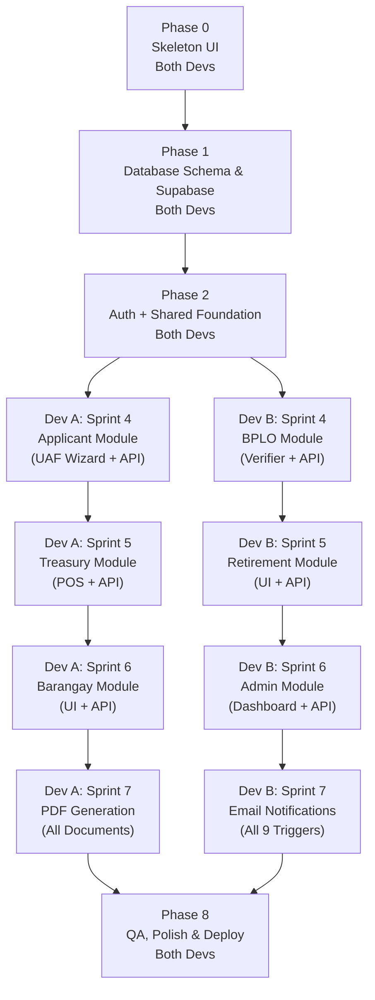

# eBPLS Agile Implementation Plan

**Electronic Business Permits and Licensing System — BOSS & E-Resibo**
Municipality of Liliw

---

## Current Progress (Completed)

| Item | Status |
|---|---|
| System Architecture (README.md) | ✅ Done |
| File Structure Documentation | ✅ Done |
| Backend: `npm init`, dependencies installed | ✅ Done |
| Backend: `server.js`, `src/app.js` (Express base) | ✅ Done |
| Backend: `src/config/env.js` (Zod validation) | ✅ Done |
| Backend: `src/config/supabase.js` (Admin client) | ✅ Done |
| Backend: `src/config/mailer.js` (Optional SMTP) | ✅ Done |
| Frontend: Vite + React initialized | ✅ Done |
| Frontend: Tailwind CSS + PostCSS configured | ✅ Done |
| Frontend: Global CSS token system (`index.css`) | ✅ Done |
| Frontend: All folder structure created | ✅ Done |
| `.env.example` and `.gitignore` | ✅ Done |

---

## Phase Overview & Dependency Map

The following diagram shows module ownership and dependencies using a **vertical slicing** approach — each developer builds both the frontend and backend of their assigned modules.

---

## Full-Stack Parallel Development Guide

> [!TIP]
> Both developers are **full-stack**. Each one owns complete vertical slices (frontend + backend) of their assigned modules. After the shared foundation, they never need to wait on each other.

### Module Ownership

| Module | Dev A | Dev B |
|---|:---:|:---:|
| Database Schema (Phase 1) | ✅ Collab | ✅ Collab |
| Auth + Shared Middleware (Phase 2) | ✅ Collab | ✅ Collab |
| Applicant Module (UAF Wizard) | ✅ Owner | |
| BPLO Module (Verify & Process) | | ✅ Owner |
| Treasury Module (Assess & POS) | ✅ Owner | |
| Business Retirement Module | | ✅ Owner |
| Barangay Clearance Module | ✅ Owner | |
| Admin Module | | ✅ Owner |
| PDF Generation (all documents) | ✅ Owner | |
| Email Notifications (all triggers) | | ✅ Owner |

### Week-by-Week Sprint Schedule

| Week | Dev A (Full-Stack) | Dev B (Full-Stack) |
|:---:|---|---|
| **1** | Phase 0: Skeleton UI — Layouts, Router, Placeholder Screens (collab) | Phase 0: Skeleton UI — UI Components, Stores, Hooks (collab) |
| **2** | Phase 1: DB Schema, RLS, Seed (collab) | Phase 1: DB Schema, RLS, Seed (collab) |
| **3** | Phase 2: Auth UI + API + Shared Middleware (collab) | Phase 2: Auth UI + API + Shared Middleware (collab) |
| **4** | Applicant Module: Dashboard, UAF Wizard, Drafts API, Upload API | BPLO Module: Dashboard, Split-Screen Verifier, Verify/Return API |
| **5** | Treasury Module: Assessment Grid, Cashier POS, Fee Calc API, OTC API | Retirement Module: Retirement UI, Submit/Assess/Complete API |
| **6** | Barangay Module: Clearance Queue UI, Issue/Reject API | Admin Module: Master Data, Audit Logs, Document Builder, Admin API |
| **7** | PDF Generation: Permit, E-Resibo, TOP, Clearance PDFs | Email Notifications: Wire all 9 triggers across controllers |
| **8-9** | QA: Applicant + Treasury + Barangay + PDF flows | QA: BPLO + Retirement + Admin + Email flows |

### Why This Split is Balanced

| Metric | Dev A | Dev B |
|---|---|---|
| **Screens** | 5 (Landing, Dashboard, UAF, Assessment, CashierPOS, ClearanceQueue) | 5 (Login, Register, BPLO Dash, Verifier, Retirement, Admin x3) |
| **API Modules** | 3 (Application, Treasury, Barangay) | 3 (BPLO, Retirement, Admin) |
| **Services** | 3 (Application, Assessment, PDF, Storage) | 3 (Audit, Email, Admin) |
| **Complexity** | High (UAF wizard is the most complex UI) | High (Admin + Email has the most integration points) |

> [!IMPORTANT]
> **Phases 1 & 2 are the critical path.** Both developers must complete the database schema and auth/middleware foundation together before splitting into independent module tracks.

---

## Phase 0: Skeleton UI (Both Devs)

**Goal:** Build the entire navigation shell of the application — all layouts, routes, and empty placeholder screens — so the full system structure is visible and navigable before any real logic is added.

**Priority:** 🟡 Foundation — sets the visual structure for everything.

### Tasks

| # | Task | File / Location | Owner |
|---|---|---|---|
| 0.1 | Set up React Router in `App.jsx` with route groups: public, auth, applicant, bplo, treasury, barangay, admin | `src/App.jsx` | Both |
| 0.2 | Build reusable UI component library: Button, Input, Modal, Badge, Card | `src/components/ui/` | Dev B |
| 0.3 | Build layout shell components: Navbar, Sidebar, Footer | `src/components/layout/` | Dev A |
| 0.4 | Build `ApplicantLayout.jsx` — mobile-first with bottom nav | `src/layouts/` | Dev A |
| 0.5 | Build `BPLOLayout.jsx` — desktop sidebar layout | `src/layouts/` | Dev A |
| 0.6 | Build `TreasuryLayout.jsx` — POS-style layout | `src/layouts/` | Dev A |
| 0.7 | Build `BarangayLayout.jsx` — desktop layout | `src/layouts/` | Dev B |
| 0.8 | Build `AdminLayout.jsx` — utilitarian dashboard layout | `src/layouts/` | Dev B |
| 0.9 | Build `AuthLayout.jsx` — centered card layout for login/register | `src/layouts/` | Dev B |
| 0.10 | Create placeholder `LandingPage.jsx` with "Coming Soon" content | `src/screens/public/` | Dev A |
| 0.11 | Create placeholder screens for Auth: Login, Register, ForgotPassword | `src/screens/auth/` | Dev B |
| 0.12 | Create placeholder screens for Applicant: Dashboard, UAFWizard, StatusTracker | `src/screens/applicant/` | Dev A |
| 0.13 | Create placeholder screens for BPLO: Dashboard, SplitScreenVerifier | `src/screens/bplo/` | Dev B |
| 0.14 | Create placeholder screens for Treasury: AssessmentGrid, CashierPOS | `src/screens/treasury/` | Dev A |
| 0.15 | Create placeholder screen for Barangay: ClearanceQueue | `src/screens/barangay/` | Dev B |
| 0.16 | Create placeholder screens for Admin: MasterData, DocumentBuilder, AuditLogs | `src/screens/admin/` | Dev B |
| 0.17 | Create `UIStore.js` (Zustand) for sidebar/modal/toast state | `src/store/` | Dev A |
| 0.18 | Create `constants.js` with API base URL and role enums | `src/utils/` | Dev A |
| 0.19 | Create `apiClient.js` — Fetch/Axios wrapper with JWT injection stub | `src/utils/` | Dev B |

### Definition of Done
- [ ] Every route in the system is navigable in the browser
- [ ] All 6 layouts render with proper navigation (sidebar, navbar, bottom nav)
- [ ] Placeholder screens show the page title and a "Under Construction" message
- [ ] Reusable UI components (Button, Input, Modal, Badge) exist and follow the design token system
- [ ] Switching between routes preserves layout context

---

## Phase 1: Database Schema & Supabase Setup

**Goal:** Create the entire normalized database schema in Supabase and enable Row Level Security.

**Priority:** 🔴 Critical Path — blocks everything else.

### Tasks

| # | Task | File / Location | Owner |
|---|---|---|---|
| 1.1 | Create Supabase SQL migration: `roles` table (seed 5 roles) | `supabase/migrations/001_roles.sql` | Backend |
| 1.2 | Create migration: `users` table with FK to `roles`, bcrypt hash column | `supabase/migrations/002_users.sql` | Backend |
| 1.3 | Create migration: `taxpayers` table (1:1 with users) | `supabase/migrations/003_taxpayers.sql` | Backend |
| 1.4 | Create migration: `businesses`, `organization_types` | `supabase/migrations/004_businesses.sql` | Backend |
| 1.5 | Create migration: `applications`, `application_drafts`, `application_types`, `payment_modes` | `supabase/migrations/005_applications.sql` | Backend |
| 1.6 | Create migration: `doc_verifications`, `clearance_types` | `supabase/migrations/006_verifications.sql` | Backend |
| 1.7 | Create migration: `barangay_clearances` | `supabase/migrations/007_barangay.sql` | Backend |
| 1.8 | Create migration: `assessments`, `assessment_line_items`, `fee_types`, `transactions` | `supabase/migrations/008_treasury.sql` | Backend |
| 1.9 | Create migration: `retirement_applications` | `supabase/migrations/009_retirements.sql` | Backend |
| 1.10 | Create migration: `permits`, `permit_line_items`, `business_activities` | `supabase/migrations/010_permits.sql` | Backend |
| 1.11 | Create migration: `audit_logs` | `supabase/migrations/011_audit_logs.sql` | Backend |
| 1.12 | Create migration: `email_notifications` | `supabase/migrations/012_email_notifications.sql` | Backend |
| 1.13 | Enable RLS on all tables; write initial policies | `supabase/migrations/013_rls_policies.sql` | Backend |
| 1.14 | Seed lookup tables: roles, application_types, payment_modes, clearance_types, fee_types, organization_types | `supabase/seed.sql` | Backend |

### Definition of Done
- [ ] All tables exist in Supabase with correct constraints, FKs, and enums
- [ ] RLS is enabled on every table
- [ ] Seed data populated for all lookup tables

---

## Phase 2A: Frontend — Public Pages & Auth UI

**Goal:** Build the Landing Page, Login, Register, and Forgot Password screens with routing.

**Parallel with:** Phase 2B

### Tasks

| # | Task | File / Location |
|---|---|---|
| 2A.1 | Create reusable UI components: Button, Input, Modal, Badge | `src/components/ui/` |
| 2A.2 | Create `AuthLayout.jsx` (centered card layout for login/register) | `src/layouts/` |
| 2A.3 | Set up React Router in `App.jsx` with public/auth/protected route groups | `src/App.jsx` |
| 2A.4 | Build `LandingPage.jsx` with system overview and CTA buttons | `src/screens/public/` |
| 2A.5 | Build `Login.jsx` with email/password form | `src/screens/auth/` |
| 2A.6 | Build `Register.jsx` with applicant registration form | `src/screens/auth/` |
| 2A.7 | Build `ForgotPassword.jsx` with email input | `src/screens/auth/` |
| 2A.8 | Create `authStore.js` (Zustand) for session/token/role state | `src/store/` |
| 2A.9 | Create `apiClient.js` (Fetch/Axios wrapper with JWT injection) | `src/utils/` |
| 2A.10 | Create `useAuth.js` hook for login/logout/register logic | `src/hooks/` |
| 2A.11 | Create `constants.js` (API base URL, role enums) | `src/utils/` |
| 2A.12 | Implement Protected Route wrapper (redirect to login if no token) | `src/components/shared/` |

### Definition of Done
- [ ] Landing page renders with navigation to Login/Register
- [ ] Login and Register forms submit (can mock API initially)
- [ ] Protected routes redirect unauthenticated users
- [ ] Zustand auth store persists session in localStorage

---

## Phase 2B: Backend — Auth API, Middleware & Shared Utilities

**Goal:** Build the authentication endpoints and the core middleware that every subsequent module depends on.

**Parallel with:** Phase 2A

### Tasks

| # | Task | File / Location |
|---|---|---|
| 2B.1 | Create `constants.js` with role enums, valid status transitions, error codes | `src/utils/constants.js` |
| 2B.2 | Create `helpers.js` with UUID generator, date formatters | `src/utils/helpers.js` |
| 2B.3 | Build `auth.middleware.js` — JWT verification, attach `req.user` | `src/middlewares/` |
| 2B.4 | Build `rbac.middleware.js` — role-checking factory `authorize('BPLO_Officer', 'Admin')` | `src/middlewares/` |
| 2B.5 | Build `audit.middleware.js` — auto-log mutations to `audit_logs` | `src/middlewares/` |
| 2B.6 | Build `error.middleware.js` — centralized error handler (move from app.js) | `src/middlewares/` |
| 2B.7 | Create `auth.controller.js` — register, login, forgot-password, refresh | `src/controllers/` |
| 2B.8 | Create `auth.routes.js` — POST `/api/auth/register`, `/api/auth/login`, `/api/auth/forgot-password` | `src/routes/` |
| 2B.9 | Create `audit.service.js` — reusable `logAction()` function | `src/services/` |
| 2B.10 | Mount auth routes in `app.js` and test with Postman/Thunder Client | `src/app.js` |

### Definition of Done
- [ ] `POST /api/auth/register` creates user with bcrypt hash (cost 12+)
- [ ] `POST /api/auth/login` returns JWT with user role
- [ ] All protected routes reject requests without valid JWT
- [ ] RBAC middleware blocks unauthorized roles
- [ ] Every auth action logged in `audit_logs`

---

## Phase 3A: Frontend — Applicant Module (UAF Wizard)

**Goal:** Build the multi-step Unified Application Form wizard with autosave and document upload.

**Parallel with:** Phase 3B

### Tasks

| # | Task | File / Location |
|---|---|---|
| 3A.1 | Create `ApplicantLayout.jsx` (mobile-first navigation, sidebar/bottom nav) | `src/layouts/` |
| 3A.2 | Build `Dashboard.jsx` — quick action buttons, application list with status badges | `src/screens/applicant/` |
| 3A.3 | Build `UAFWizardScreen.jsx` — 5-step form with progress bar | `src/screens/applicant/` |
| 3A.4 | Create `applicationStore.js` (Zustand) — draft form state per step | `src/store/` |
| 3A.5 | Create `useAutosave.js` hook — debounced save to draft API | `src/hooks/` |
| 3A.6 | Build `DocumentUploadPanel.jsx` — large tap targets, camera/gallery, thumbnail preview | `src/components/shared/` |
| 3A.7 | Build `InteractiveLocationPin.jsx` — Leaflet.js + OpenStreetMap component | `src/components/shared/` |
| 3A.8 | Build `StatusBadge.jsx` — color-coded badges per SDD spec | `src/components/shared/` |
| 3A.9 | Build `StatusTracker.jsx` — applicant views their application status | `src/screens/applicant/` |
| 3A.10 | Build `DraftResumePrompt` modal — on login, detect saved draft | `src/components/shared/` |
| 3A.11 | Create `formatters.js` — PHP currency, date formatters | `src/utils/` |

### Definition of Done
- [ ] UAF wizard navigates through 5 steps with autosave
- [ ] Documents upload with thumbnail preview
- [ ] Map pin selection works
- [ ] Dashboard displays applications with correct status badges
- [ ] Draft resume prompt appears on login if draft exists

---

## Phase 3B: Backend — Application Module API

**Goal:** Build the API endpoints for drafts, UAF submission, document upload, and status polling.

**Parallel with:** Phase 3A

### Tasks

| # | Task | File / Location |
|---|---|---|
| 3B.1 | Build `application.service.js` — state machine validation logic | `src/services/` |
| 3B.2 | Build `storage.service.js` — Supabase pre-signed URL generation (15-min expiry) | `src/services/` |
| 3B.3 | Build `application.controller.js` — CRUD for drafts, final submission, upload, status | `src/controllers/` |
| 3B.4 | Build `application.routes.js` — all Module A endpoints | `src/routes/` |
| 3B.5 | Mount application routes in `app.js` | `src/app.js` |

### Definition of Done
- [ ] `POST /api/applications/drafts` saves/updates a draft
- [ ] `POST /api/applications/uaf` creates application with `Pending` status
- [ ] `POST /api/applications/upload` returns a pre-signed URL
- [ ] `GET /api/applications/:app_no/status` returns current status
- [ ] State machine rejects invalid transitions

---

## Phase 4A: Frontend — BPLO Module (Verify & Process)

**Goal:** Build the BPLO officer's desktop-first dashboard and split-screen document verification panel.

**Parallel with:** Phase 4B

### Tasks

| # | Task | File / Location |
|---|---|---|
| 4A.1 | Create `BPLOLayout.jsx` (desktop sidebar, header with user info) | `src/layouts/` |
| 4A.2 | Build `Dashboard.jsx` — sortable data table with SLA urgency indicators | `src/screens/bplo/` |
| 4A.3 | Build `SplitScreenVerifier.jsx` — left: document viewer with zoom; right: checklist | `src/screens/bplo/` |

### Definition of Done
- [ ] Dashboard shows pending applications sorted by submission date
- [ ] Split-screen verifier loads uploaded documents via pre-signed URLs
- [ ] Approve/Return buttons trigger correct API calls
- [ ] Return requires non-empty remarks field

---

## Phase 4B: Backend — BPLO Module API

**Goal:** Build the verification endpoints for BPLO officers.

**Parallel with:** Phase 4A

### Tasks

| # | Task | File / Location |
|---|---|---|
| 4B.1 | Build `bplo.controller.js` — pending queue, detail view, verify, return | `src/controllers/` |
| 4B.2 | Build `bplo.routes.js` — all Module B endpoints, RBAC protected | `src/routes/` |
| 4B.3 | Mount BPLO routes in `app.js` | `src/app.js` |

### Definition of Done
- [ ] `GET /api/bplo/applications/pending` returns only `Pending` and `Under Review` applications
- [ ] `PUT /api/bplo/applications/verify/:app_no` transitions to `Verified` only if all checks pass
- [ ] `PUT /api/bplo/applications/return/:app_no` requires remarks, transitions to `Returned`
- [ ] All actions RBAC-locked to `BPLO_Officer` role

---

## Phase 5A: Frontend — Treasury Module (Assess & Pay)

**Goal:** Build the Treasury officer's assessment grid and the high-contrast Cashier POS panel.

**Parallel with:** Phase 5B

### Tasks

| # | Task | File / Location |
|---|---|---|
| 5A.1 | Create `TreasuryLayout.jsx` (POS-style layout) | `src/layouts/` |
| 5A.2 | Build `AssessmentGrid.jsx` — spreadsheet-style fee view, override fields in yellow | `src/screens/treasury/` |
| 5A.3 | Build `CashierPOS.jsx` — high-contrast, large typography, amount tendered, OR number | `src/screens/treasury/` |

### Definition of Done
- [ ] Assessment grid auto-calculates fees and allows overrides
- [ ] Cashier POS records OTC payment with Cash/Manager Check selector
- [ ] Change is computed and displayed automatically
- [ ] `Confirm Payment` button is prominent and accessible

---

## Phase 5B: Backend — Treasury Module API

**Goal:** Build the fee assessment engine, TOP generation, and OTC payment recording.

**Parallel with:** Phase 5A

### Tasks

| # | Task | File / Location |
|---|---|---|
| 5B.1 | Build `assessment.service.js` — fee calculation with Mayor's Permit + 10% Fire Safety rule | `src/services/` |
| 5B.2 | Build `treasury.controller.js` — assess, override, record OTC payment | `src/controllers/` |
| 5B.3 | Build `treasury.routes.js` — all Module C endpoints, RBAC protected | `src/routes/` |
| 5B.4 | Mount Treasury routes in `app.js` | `src/app.js` |

### Definition of Done
- [ ] `POST /api/treasury/assess` auto-calculates fees per revenue code
- [ ] Fire Safety = exactly 10% of applicable LGU fees
- [ ] `POST /api/treasury/payments/otc` only accepts `Cash` or `Manager Check`
- [ ] Overrides logged in `audit_logs`
- [ ] State transitions: `For Assessment` -> `Assessed` -> `For Payment` -> `Paid`

---

## Phase 6: Barangay Clearance Module

**Goal:** Build the integrated Barangay Clearance processing (frontend + backend).

**Depends on:** Phase 5B (Treasury must be complete for full flow testing)

### Tasks

| # | Task | File / Location |
|---|---|---|
| 6.1 | Create `BarangayLayout.jsx` | `src/layouts/` (Frontend) |
| 6.2 | Build `ClearanceQueue.jsx` — pending clearance requests with issue/reject | `src/screens/barangay/` (Frontend) |
| 6.3 | Build `barangay.controller.js` — pending queue, issue, reject | `src/controllers/` (Backend) |
| 6.4 | Build `barangay.routes.js` — RBAC locked to `Barangay_Officer` | `src/routes/` (Backend) |
| 6.5 | Mount Barangay routes in `app.js` | (Backend) |

### Definition of Done
- [ ] Barangay Officer can view pending clearance requests
- [ ] Issue action sets clearance number and expiration date
- [ ] Reject action requires remarks
- [ ] RBAC restricts access to `Barangay_Officer` role only

---

## Phase 7: Business Retirement Module

**Goal:** Build the retirement/cessation processing (frontend + backend).

**Depends on:** Phase 5B (Reuses OTC payment endpoint)

**Can run in parallel with:** Phase 6

### Tasks

| # | Task | File / Location |
|---|---|---|
| 7.1 | Add Retirement screens to Applicant and BPLO dashboards | Frontend |
| 7.2 | Build `retirement.controller.js` — submit, pending, assess, complete | `src/controllers/` (Backend) |
| 7.3 | Build `retirement.routes.js` | `src/routes/` (Backend) |
| 7.4 | Mount Retirement routes in `app.js` | (Backend) |

### Definition of Done
- [ ] Applicant can submit retirement with reason and cessation date
- [ ] Treasury can compute final taxes based on `final_gross_sales`
- [ ] Completion sets `businesses.is_retired = true`
- [ ] Reuses `POST /api/treasury/payments/otc` for settlement

---

## Phase 8: Document Generation (PDF)

**Goal:** Build all PDF generators using `pdf-lib`.

**Depends on:** Phase 5B (needs assessment and transaction data)

**Can run in parallel with:** Phases 6 and 7

### Tasks

| # | Task | File / Location |
|---|---|---|
| 8.1 | Build `pdf.service.js` — core template engine with `{{placeholder}}` mapping | `src/services/` (Backend) |
| 8.2 | Build `document.controller.js` — permit, E-Resibo, TOP, clearance endpoints | `src/controllers/` (Backend) |
| 8.3 | Build `document.routes.js` — all Module F endpoints | `src/routes/` (Backend) |
| 8.4 | Create PDF templates for: Business Permit, E-Resibo, TOP, Barangay Clearance | Backend |
| 8.5 | Add download buttons to Applicant Dashboard (Frontend) | Frontend |

### Definition of Done
- [ ] `GET /api/documents/permit/:app_no` returns a valid Business Permit PDF
- [ ] Per-line-of-business permits work via `?lob=:activity_id`
- [ ] `GET /api/documents/eresibo/:transaction_id` returns Official Receipt PDF
- [ ] `GET /api/documents/top/:app_no` returns TOP PDF
- [ ] `GET /api/documents/barangay-clearance/:id` returns clearance PDF

---

## Phase 9: Email Notifications

**Goal:** Wire up the 9 transactional email triggers defined in the SDD.

**Depends on:** Phase 8 (some emails attach PDF documents)

### Tasks

| # | Task | File / Location |
|---|---|---|
| 9.1 | Build `email.service.js` — template builder for each trigger event | `src/services/` (Backend) |
| 9.2 | Wire `APPLICATION_SUBMITTED` trigger in application controller | Backend |
| 9.3 | Wire `APPLICATION_RETURNED` trigger in BPLO controller | Backend |
| 9.4 | Wire `APPLICATION_VERIFIED` trigger in BPLO controller | Backend |
| 9.5 | Wire `TOP_GENERATED` trigger in treasury controller (attach TOP PDF) | Backend |
| 9.6 | Wire `PAYMENT_RECORDED` trigger in treasury controller | Backend |
| 9.7 | Wire `PERMIT_READY` trigger in document controller | Backend |
| 9.8 | Wire `RETIREMENT_COMPLETE` trigger in retirement controller | Backend |
| 9.9 | Wire `ACCOUNT_CREATED` trigger in auth controller | Backend |
| 9.10 | Wire `PASSWORD_RESET` trigger in auth controller | Backend |

### Definition of Done
- [ ] Each trigger sends the correct email to the correct recipient
- [ ] In dev mode, emails are logged to console (not sent)
- [ ] `email_notifications` table tracks every email with status

---

## Phase 10: Admin Module

**Goal:** Build the System Administrator dashboard.

**Depends on:** Phases 6, 7, 9 (needs all modules functional to manage them)

### Tasks

| # | Task | File / Location |
|---|---|---|
| 10.1 | Create `AdminLayout.jsx` (utilitarian dashboard) | `src/layouts/` (Frontend) |
| 10.2 | Build `MasterData.jsx` — CRUD for fee types, clearance types, org types | `src/screens/admin/` (Frontend) |
| 10.3 | Build `DocumentBuilder.jsx` — PDF template customizer | `src/screens/admin/` (Frontend) |
| 10.4 | Build `AuditLogs.jsx` — filterable viewer for DPA compliance | `src/screens/admin/` (Frontend) |
| 10.5 | Build admin API endpoints for user management, lookup tables | Backend |

### Definition of Done
- [ ] Admin can manage users and toggle `is_active`
- [ ] Admin can update lookup table values
- [ ] Audit log viewer filters by user, action, date, entity
- [ ] Document Builder allows template upload and placeholder mapping
- [ ] RBAC restricts all admin routes to `Admin` role

---

## Phase 11: QA, Polish & Deployment

**Goal:** End-to-end testing, UI polish, performance optimization, and production deployment.

**Depends on:** All previous phases

### Tasks

| # | Task |
|---|---|
| 11.1 | Full end-to-end flow test: Register -> Submit UAF -> BPLO Verify -> Treasury Assess -> OTC Pay -> Download Permit |
| 11.2 | Test Retirement flow end-to-end |
| 11.3 | Test Barangay Clearance flow end-to-end |
| 11.4 | Cross-browser testing (Chrome, Firefox, Safari) |
| 11.5 | Mobile responsiveness audit for Applicant portal |
| 11.6 | Security audit: RBAC bypass attempts, SQL injection, XSS |
| 11.7 | Performance: API response < 2s, January renewal spike simulation |
| 11.8 | Configure Brevo SMTP with real credentials |
| 11.9 | Production build and deployment |
| 11.10 | Final DPA compliance review of audit logs |

### Definition of Done
- [ ] All state machine transitions tested and validated
- [ ] No RBAC bypass vulnerabilities found
- [ ] Applicant portal works on mobile devices
- [ ] API response time < 2 seconds under normal load
- [ ] 99.5% uptime target verified

---

## Sprint Summary (2 Full-Stack Developers)

| Sprint | Duration | Dev A (Full-Stack) | Dev B (Full-Stack) |
|:---:|---|---|---|
| **1** | 1 week | Skeleton UI: Layouts, Router, Placeholders (collab) | Skeleton UI: UI Components, Stores, Hooks (collab) |
| **2** | 1 week | DB Schema + RLS (collab) | DB Schema + Seed (collab) |
| **3** | 1 week | Auth + Shared Foundation (collab) | Auth + Shared Foundation (collab) |
| **4** | 1.5 weeks | Applicant Module (full-stack) | BPLO Module (full-stack) |
| **5** | 1.5 weeks | Treasury Module (full-stack) | Retirement Module (full-stack) |
| **6** | 1 week | Barangay Module (full-stack) | Admin Module (full-stack) |
| **7** | 1 week | PDF Generation (all documents) | Email Notifications (all triggers) |
| **8-9** | 2 weeks | QA + Polish (own modules) | QA + Polish (own modules) |
| | **Total: ~8-9 weeks** | | |

> [!NOTE]
> With 2 full-stack developers working on independent vertical slices, the total calendar time is approximately **8-9 weeks**. The Skeleton UI phase adds ~1 week but saves significant time later by eliminating routing and layout integration issues.
