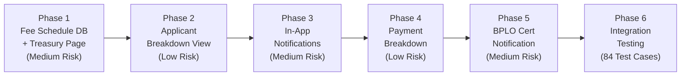

# eBPLS — July 2026 Adviser Changes: Agile Implementation Plan

> **Project**: eBPLS — Municipality of Liliw  
> **Scope**: 6 changes across Treasury, Applicant, and BPLO modules  
> **Approach**: 6 phases, chronological, each phase testable independently  
> **Date**: August 2026  
> **Revision**: v2 — Incorporates official Revenue Code fee schedule

---

## Summary of Changes

| # | Module | Change | Status |
|---|--------|--------|--------|
| 1 | Shared | Dedicated Fee Schedule page (full Revenue Code) available to Treasury and Applicant + DB storage | New |
| 1.5 | Applicant | Dynamic conditional inputs in Step 3 for tiered fees (heads, boarders, capacity) | New |
| 2 | Applicant | Assessment breakdown view (shows matched fees) + step-by-step procedure | New |
| 3 | Applicant | Pop-up notification for returned/declined applications + email notice | Enhancement |
| 4 | Applicant | Fee breakdown visible during online payment flow | Enhancement |
| 5 | BPLO | Property Tax tracking | ⏸️ Deferred (awaiting adviser confirmation) |
| 6 | BPLO | Certificate ready notification with notes to applicant (pop-up notif) | New |

> [!IMPORTANT]
> **Property Tax tracking (item #5)** is deferred until you confirm the requirements with your adviser. The plan includes a placeholder phase for it, but it won't block the other phases.

---

## Revenue Code — Fee Schedule Analysis

The adviser provided the official **Municipality of Liliw Revenue Code** for Mayor's Permit Fees. This document defines **~200+ individual fee entries** organized into **12 categories** with three distinct computation models:

### Fee Computation Models

| Model | Description | Example |
|-------|-------------|---------|
| **Fixed per Business Type** | Flat fee based on specific business/trade classification | Bakery Products = ₱500, Funeral Parlors = ₱1,000 |
| **Tiered by Count** | Fee varies by number of heads/boarders/capacity | Piggery: 10-14 heads = ₱500, 15-29 heads = ₱600, etc. |
| **Surcharge** | 25% penalty on original fee for late payment | ₱500 fee → ₱625 if renewed late |

### 12 Fee Categories from the Revenue Code

| # | Category | # of Entries | Fee Model |
|---|----------|:------------:|-----------|
| 1 | Manufacturers, Producers & Importers | 15 | Fixed per type |
| 2 | Exporters | 3 | Fixed per type |
| 3 | Distributors, Wholesalers & Retailers | 28 | Fixed per type |
| 4 | Sari-Sari Stores | 3 (by location) | Fixed per location |
| 5 | Piggery Farms | 8 tiers | Tiered by head count |
| 6 | Poultry & Duck Farms (Broiler) | 8 tiers | Tiered by head count |
| 7 | Poultry & Duck Farms (Layer) | 8 tiers | Tiered by head count |
| 8 | Service Establishments | ~65 | Fixed per type |
| 9 | Tobacco Dealers | 3 | Fixed per type |
| 10 | Liquor/Wine Dealers | 7 | Fixed per type |
| 11 | Amusement Places & Devices | ~25 | Fixed per type |
| 12 | Financial Establishments | ~12 | Fixed per type |
| 13 | Other Businesses (Board/Lodging, Apartments, Rice/Corn Mills) | ~20 | Mixed (fixed + tiered) |

### Special Rules from the Revenue Code

1. **Duplicate Permit Fee**: ₱200 per duplicate issued
2. **One Permit per Establishment**: Fee payable per distinct/separate establishment
3. **One Permit per Line of Business**: Each line of business requires its own permit fee
4. **Surcharge for Late Payment**: 25% of original fee (Section 3A.03)
5. **Default/Catch-All Fee**: ₱500 for any business not specifically enumerated
6. **Exempt Categories**: Piggery < 10 heads, Broiler < 300 heads, Layer < 100 heads

---

## Existing Architecture Context

| Feature | Current State | What Changes |
|---------|---------------|--------------|
| Fee types | 8 generic entries in `fee_types` (Mayor's Permit, Business Tax, etc.) | Add new `fee_schedule_items` table with ~200 Revenue Code entries |
| Mayor's Permit calc | Generic 2% of Gross Sales fallback in `assessment.service.js` | Look up fixed fee from `fee_schedule_items` based on business activity |
| Fee display | Treasury sees line items in `AssessmentGrid.jsx` | New full Fee Schedule reference page + Applicant breakdown view |
| Online payment | Fully functional (PayMongo + webhooks + status polling) | Add fee breakdown before checkout |
| Notifications | Email-only outbox pattern (10 triggers), in-app toasts | Add real-time in-app pop-up notifications |
| Certificate release | Auto-generated PDF on payment (digital-only) | Add BPLO "notify applicant" step with notes |

---

## Phase 1 — Shared: Fee Schedule Database + Reference Page

### Goal
1. Store the complete Revenue Code fee schedule in the database (new `fee_schedule_items` table)
2. Create a dedicated **"Fee Schedule"** sidebar page available to both **Treasury** and **Applicant** showing the full categorized schedule for full transparency.
3. Expose an API for looking up the correct Mayor's Permit fee for any business type

### Why First
This is the **foundation** for everything else. The fee schedule data drives the assessment engine (Phase 2) and all the breakdown views. Building the database and reference page first is zero-risk and provides immediate value to Treasury staff.

### Deliverables

---

#### Database

##### [NEW] Migration `036_fee_schedule.sql`

**File**: `ebpls-server/supabase/migrations/036_fee_schedule.sql`

```sql
-- ---------------------------------------------------------------
-- Table: fee_schedule_categories
-- Groups fee schedule items into Revenue Code sections
-- ---------------------------------------------------------------
CREATE TABLE IF NOT EXISTS public.fee_schedule_categories (
    id          SERIAL PRIMARY KEY,
    name        VARCHAR(150) NOT NULL UNIQUE,
    description TEXT,
    sort_order  INTEGER NOT NULL DEFAULT 0
);

-- ---------------------------------------------------------------
-- Table: fee_schedule_items
-- Individual fee entries from the Revenue Code
-- Supports: Fixed fees, tiered fees (min/max range)
-- ---------------------------------------------------------------
CREATE TABLE IF NOT EXISTS public.fee_schedule_items (
    id              SERIAL PRIMARY KEY,
    category_id     INTEGER NOT NULL REFERENCES public.fee_schedule_categories(id),
    
    -- Business type / line of business name
    business_type   VARCHAR(255) NOT NULL,
    
    -- For tiered fees (piggery, poultry, boarding houses):
    -- NULL = no tier (flat fixed fee)
    tier_label      VARCHAR(150),         -- e.g., "10 heads or more but less than 15 heads"
    tier_min        INTEGER,              -- e.g., 10
    tier_max        INTEGER,              -- e.g., 14 (NULL = unlimited upper)
    tier_unit       VARCHAR(50),          -- e.g., "heads", "boarders", "seating_capacity"
    
    -- The fee amount (PHP)
    amount          NUMERIC(10,2) NOT NULL DEFAULT 0.00,
    is_exempt       BOOLEAN NOT NULL DEFAULT FALSE,  -- TRUE for "Exempt" entries
    
    -- Matching: used to link to business_activities
    activity_match  VARCHAR(255),         -- Maps to business_activities.name for auto-matching
    
    sort_order      INTEGER NOT NULL DEFAULT 0,
    is_active       BOOLEAN NOT NULL DEFAULT TRUE
);

-- ---------------------------------------------------------------
-- Table: fee_schedule_rules
-- Special rules from the Revenue Code (surcharge, duplicates, etc.)
-- ---------------------------------------------------------------
CREATE TABLE IF NOT EXISTS public.fee_schedule_rules (
    id          SERIAL PRIMARY KEY,
    rule_code   VARCHAR(50) NOT NULL UNIQUE,
    title       VARCHAR(255) NOT NULL,
    description TEXT NOT NULL,
    value       NUMERIC(5,4),    -- e.g., 0.25 for 25% surcharge
    is_active   BOOLEAN NOT NULL DEFAULT TRUE
);

-- Seed: Special Rules
INSERT INTO public.fee_schedule_rules (rule_code, title, description, value) VALUES
    ('SURCHARGE_LATE', 'Late Payment Surcharge', 'Section 3A.03: 25% surcharge on original fee for failure to pay/renew within prescribed period.', 0.25),
    ('DUPLICATE_FEE', 'Duplicate Permit Fee', 'Section 3A.01(3): ₱200.00 for each duplicate permit issued.', 200.00),
    ('DEFAULT_FEE', 'Default Business Fee', 'Section 3A.01(a): ₱500.00 for any business not specifically enumerated.', 500.00);
```

**Plus**: Full seed data for all 12 categories and ~200 fee entries from the Revenue Code document. Each entry maps to a category and includes the exact fee amount.

Example seed entries:
```sql
-- Category: Manufacturers, Producers & Importers
INSERT INTO fee_schedule_categories (name, description, sort_order) VALUES
    ('Manufacturers, Producers & Importers', 'Businesses subject to graduated tax under Article A, Chapter II', 1),
    ('Exporters', 'Export businesses subject to graduated tax', 2),
    ('Distributors, Wholesalers & Retailers', 'Distribution and retail businesses subject to graduated tax', 3),
    ('Sari-Sari Stores', 'Sari-sari stores classified by road location', 4),
    ('Piggery Farms', 'Piggery farms classified by head count (tiered)', 5),
    ('Poultry & Duck Farms — Broiler', 'Broiler poultry farms classified by head count', 6),
    ('Poultry & Duck Farms — Layer', 'Layer poultry farms classified by head count', 7),
    ('Service Establishments', 'Service-based businesses', 8),
    ('Tobacco Dealers', 'Tobacco wholesale and retail dealers', 9),
    ('Liquor, Spirits & Wine Dealers', 'Dealers in fermented liquors, distilled spirits and wines', 10),
    ('Amusement Places & Devices', 'Entertainment venues and amusement devices', 11),
    ('Financial Establishments', 'Banks, insurance, pawnshops, money changers', 12),
    ('Other Businesses', 'Board/lodging, apartments, rice/corn mills, catch-all', 13);

-- Example items:
INSERT INTO fee_schedule_items (category_id, business_type, amount, sort_order, activity_match) VALUES
    (1, 'Bakery Products', 500.00, 2, 'Bakery Products'),
    (1, 'Furniture and other products', 800.00, 10, 'Furniture'),
    (1, 'Lumber and Lumber Products', 800.00, 11, 'Lumber Industry');

-- Tiered example (Piggery):
INSERT INTO fee_schedule_items (category_id, business_type, tier_label, tier_min, tier_max, tier_unit, amount, is_exempt, sort_order) VALUES
    (5, 'Piggery Farm', 'Less than 10 heads', NULL, 9, 'heads', 0.00, TRUE, 1),
    (5, 'Piggery Farm', '10 heads or more but less than 15 heads', 10, 14, 'heads', 500.00, FALSE, 2),
    (5, 'Piggery Farm', '15 heads or more but less than 30 heads', 15, 29, 'heads', 600.00, FALSE, 3),
    -- ... all tiers
    (5, 'Piggery Farm', '1000 heads or more', 1000, NULL, 'heads', 3000.00, FALSE, 8);
```

> [!NOTE]
> The full migration will contain all ~200 entries. Each entry will have an `activity_match` field to enable automatic fee lookup based on the applicant's declared business activities.

##### RLS Policies
- `fee_schedule_categories`: Read-only for all authenticated users
- `fee_schedule_items`: Read-only for all authenticated users
- `fee_schedule_rules`: Read-only for all authenticated users

---

#### Backend

##### [NEW] `GET /api/treasury/fee-schedule` endpoint

**File**: [treasury.routes.js](file:///c:/projects/eBPLS/ebpls-server/src/routes/treasury.routes.js)
- Add route: `GET /api/treasury/fee-schedule`
- Access: All authenticated users (public reference data)

**File**: [treasury.controller.js](file:///c:/projects/eBPLS/ebpls-server/src/controllers/treasury.controller.js)
- Add `getFeeSchedule` handler
- Returns the full categorized fee schedule:
```json
{
  "categories": [
    {
      "id": 1,
      "name": "Manufacturers, Producers & Importers",
      "items": [
        { "business_type": "Bakery Products", "amount": 500.00, "is_tiered": false },
        { "business_type": "Furniture and other products", "amount": 800.00, "is_tiered": false }
      ]
    },
    {
      "id": 5,
      "name": "Piggery Farms",
      "items": [
        { "business_type": "Piggery Farm", "tier_label": "Less than 10 heads", "amount": 0.00, "is_exempt": true },
        { "business_type": "Piggery Farm", "tier_label": "10-14 heads", "amount": 500.00, "is_exempt": false }
      ]
    }
  ],
  "rules": [
    { "rule_code": "SURCHARGE_LATE", "title": "Late Payment Surcharge", "description": "25% surcharge...", "value": 0.25 },
    { "rule_code": "DUPLICATE_FEE", "title": "Duplicate Permit Fee", "value": 200.00 },
    { "rule_code": "DEFAULT_FEE", "title": "Default Business Fee", "value": 500.00 }
  ]
}
```

##### [NEW] `GET /api/treasury/fee-schedule/lookup` endpoint

- Query params: `activity_name`, `tier_count` (optional)
- Returns the matched fee schedule item for a specific business activity
- Used by the assessment engine and the applicant breakdown view
- Matching logic:
  1. Try exact match on `activity_match`
  2. Try fuzzy/partial match
  3. Fall back to default fee (₱500)
  4. For tiered entries: match by `tier_min` / `tier_max` range using `tier_count`

##### [MODIFY] `getFeeSchedule` — also returns existing `fee_types`

Include the other fee types (Business Tax, Sanitary, Fire Safety, etc.) alongside the Mayor's Permit schedule so Treasury has a complete reference.

---

#### Frontend

##### [NEW] `FeeSchedule.jsx` — Shared Fee Schedule Reference Page

**File**: `ebpls-frontend/src/screens/shared/FeeSchedule.jsx`

A comprehensive, searchable reference page matching the official Revenue Code document layout. Available to both Treasury and Applicants.

**Page Layout:**
```
┌──────────────────────────────────────────────────────────────┐
│  📋 Official Fee Schedule — Municipality of Liliw            │
│  Revenue Code: Mayor's Permit Fees + Other Municipal Fees    │
│                                                              │
│  🔍 Search: [________________________]  Filter: [All ▾]     │
├──────────────────────────────────────────────────────────────┤
│                                                              │
│  ⚠️ SPECIAL RULES                                           │
│  ┌────────────────────────────────────────────────────────┐  │
│  │ • Late Payment Surcharge: 25% of original fee         │  │
│  │ • Duplicate Permit: ₱200.00 each                      │  │
│  │ • Default (unlisted business): ₱500.00                 │  │
│  └────────────────────────────────────────────────────────┘  │
│                                                              │
│  ── OTHER MUNICIPAL FEES ──────────────────────────────────  │
│  │ Business Tax              │ % of Gross Sales │          │  │
│  │ Sanitary Inspection Fee   │ Fixed            │ ₱XXX.XX │  │
│  │ Zoning / Occupancy Fee    │ Fixed            │ ₱XXX.XX │  │
│  │ Garbage Collection Fee    │ Fixed            │ ₱XXX.XX │  │
│  │ Environmental Fee         │ Fixed            │ ₱XXX.XX │  │
│  │ Weight and Measures Fee   │ Fixed            │ ₱XXX.XX │  │
│  │ Fire Safety Insp. Fee     │ 10% of Mayor's   │ auto    │  │
│  │────────────────────────────────────────────────────────│  │
│                                                              │
│  ── 1. MANUFACTURERS, PRODUCERS & IMPORTERS ───────────────  │
│  │ Air gun                   │                   │ ₱200.00 │  │
│  │ Bakery Products           │                   │ ₱500.00 │  │
│  │ Candies and Caramels      │                   │ ₱300.00 │  │
│  │ ...                                                     │  │
│                                                              │
│  ── 5. PIGGERY FARMS (Tiered) ─────────────────────────────  │
│  │ Less than 10 heads        │                   │ EXEMPT  │  │
│  │ 10-14 heads               │                   │ ₱500.00 │  │
│  │ 15-29 heads               │                   │ ₱600.00 │  │
│  │ ...                                                     │  │
│                                                              │
│  ── 8. SERVICE ESTABLISHMENTS ─────────────────────────────  │
│  │ Accounting/Business Mgmt  │                   │ ₱500.00 │  │
│  │ Barber Shops              │                   │ ₱400.00 │  │
│  │ ...                       │                   │         │  │
│  └────────────────────────────────────────────────────────┘  │
└──────────────────────────────────────────────────────────────┘
```

**Features:**
- **Category accordion sections** — each Revenue Code category is a collapsible section
- **Search bar** — instant filter across all business types (e.g., typing "bakery" highlights the row)
- **Category filter dropdown** — jump to a specific category
- **Tiered fee visualization** — Piggery, Poultry, Boarding Houses show range bars or step indicators
- **Exempt badge** — green "EXEMPT" badge for exempt entries (< 10 heads piggery, etc.)
- **Special rules banner** — always-visible rules card at the top (surcharge, duplicate, default)
- **Other Municipal Fees section** — shows the 7 existing `fee_types` (Business Tax, Sanitary, etc.)
- **Print button** — allows Treasury to print the schedule for reference

##### [MODIFY] Sidebars — Add "Fee Schedule" item

**File**: `ebpls-frontend/src/App.jsx` (route registration)
- Add route: `/treasury/fee-schedule` → `FeeSchedule.jsx`
- Add route: `/applicant/fee-schedule` → `FeeSchedule.jsx`
- Update `constants.js` with new route constants

**File**: `ebpls-frontend/src/layouts/TreasuryLayout.jsx` & `ApplicantLayout.jsx`
- Add sidebar item: 📋 "Fee Schedule" to both layouts for transparency.

### Acceptance Criteria
- [ ] Migration runs without errors (`npx supabase db reset`)
- [ ] `fee_schedule_categories` has 13 categories
- [ ] `fee_schedule_items` has all ~200 entries matching the Revenue Code
- [ ] `fee_schedule_rules` has 3 special rules (surcharge, duplicate, default)
- [ ] Tiered entries (Piggery, Poultry, Boarding Houses) have correct `tier_min`/`tier_max` ranges
- [ ] Exempt entries have `is_exempt = true` and `amount = 0`
- [ ] `GET /api/treasury/fee-schedule` returns full categorized data
- [ ] `GET /api/treasury/fee-schedule/lookup?activity_name=Bakery Products` returns ₱500.00
- [ ] `GET /api/treasury/fee-schedule/lookup?activity_name=Piggery&tier_count=25` returns ₱600.00
- [ ] `GET /api/treasury/fee-schedule/lookup?activity_name=UnknownBusiness` returns default ₱500.00
- [ ] Admin "Master Data" page has a new tab for "Fee Schedule" to View, Add, Edit, and Delete fee items.
- [ ] Treasury and Applicant sidebars show "Fee Schedule" item
- [ ] Fee Schedule page renders all 13 categories with correct entries
- [ ] Search filter works across all business types
- [ ] Tiered fees display correctly with range indicators
- [ ] Special rules banner is visible
- [ ] No existing Treasury functionality is broken (AssessmentGrid, CashierPOS)

### 🔍 Human Test Checkpoint
> Log in as Treasury Officer → Click "Fee Schedule" in sidebar → Verify all 13 categories are listed → Search for "Bakery" → Verify ₱500.00 → Expand "Piggery Farms" → Verify 8 tiers with correct amounts → Check "Service Establishments" → Verify ~65 entries → Check special rules banner → Verify existing assessment workflow still works.

---

## Phase 1.5 — Applicant: Dynamic Conditional Inputs in Step 3

### Goal
Modify the applicant's UAF Step 3 ("Business Activities") to dynamically ask for the necessary conditional metric (number of heads, number of boarders, etc.) when they select a business activity that falls under a tiered fee structure in the Revenue Code.

### Why Phase 1.5
To properly assess tiered fees in Phase 2, the system needs the correct multiplier/metric from the applicant. Currently, Step 3 only asks for general "Units". We need specific conditional inputs based on the selected industry.

### Deliverables

---

#### Backend

##### [MODIFY] `GET /api/applications/lookups` endpoint
- Update the lookups endpoint to include a `business_activity_metrics` mapping.
- This tells the frontend which specific metric to ask for when a certain activity is selected.
- Example mapping:
  ```json
  {
    "Piggery Farms": { "metric": "Number of Heads", "type": "number", "min": 1 },
    "Poultry Farms": { "metric": "Number of Heads", "type": "number", "min": 1 },
    "Board and Lodging Houses": { "metric": "Number of Boarders", "type": "number", "min": 1 },
    "Apartment for Rent": { "metric": "Number of Doors", "type": "number", "min": 1 },
    "Theater and Cinema Houses": { "metric": "Seating Capacity", "type": "number", "min": 1 }
  }
  ```

##### [MODIFY] Application Submission Payload
- Ensure the UAF submission payload and `business_activities` table can store this `metric_count` alongside the `units` field.

---

#### Frontend

##### [MODIFY] `Step3_Activities.jsx` — Dynamic Conditional Inputs

**File**: `ebpls-frontend/src/screens/applicant/uaf-steps/Step3_Activities.jsx`

- When the applicant selects a "Line of Business" from the dropdown, check against the `business_activity_metrics` map.
- If it matches a tiered industry (e.g., "Piggery Farms"):
  - Dynamically render a new required input field next to "Capital Investment".
  - The label will adapt based on the metric (e.g., "Number of Heads", "Number of Boarders").
  - This value is bound to a new `metric_count` field in the `lineOfBusinesses` array in the Zustand store.
- If it does not match a tiered industry, the field remains hidden.

### Acceptance Criteria
- [ ] Backend lookups API returns the mapping for tiered industries.
- [ ] Selecting "Piggery Farms" in Step 3 reveals a "Number of Heads" input field.
- [ ] Selecting a standard business (e.g., "Bakery") does not show the conditional field.
- [ ] The `metric_count` is successfully saved to the draft and submitted to the backend.
- [ ] The value is persisted correctly in the `business_activities` table.

### 🔍 Human Test Checkpoint
> Log in as Applicant → Start new application → Go to Step 3 → Select "Piggery Farms" → Verify "Number of Heads" input appears → Select "Bakery" → Verify input disappears → Submit application and verify data is saved in DB.

---

## Phase 2 — Applicant: Assessment Breakdown + Step-by-Step Procedure

### Goal
When an applicant's application reaches the `Assessed` / `For Payment` status, they should see a **detailed fee breakdown** showing exactly which fees were charged and how they were computed. This connects to the Revenue Code fee schedule — the applicant sees the specific business type match and the resulting fee.

### Why Second
Builds on Phase 1's fee schedule data. Still read-only for applicants.

### Deliverables

---

#### Backend

##### [NEW] `GET /api/applications/:app_no/assessment` endpoint (Applicant-accessible)

**File**: [application.routes.js](file:///c:/projects/eBPLS/ebpls-server/src/routes/application.routes.js)
- Add route: `GET /api/applications/:app_no/assessment`
- Access: `Applicant` (owner only via taxpayer_id check), `Treasury_Officer`, `Admin`

**File**: [application.controller.js](file:///c:/projects/eBPLS/ebpls-server/src/controllers/application.controller.js)
- Add `getAssessmentForApplicant` handler
- Security: Validates ownership (application → business → taxpayer → user)
- Returns line items with human-readable computation descriptions:

```json
{
  "total_amount": 2450.00,
  "assessed_at": "2026-07-15T10:30:00Z",
  "line_items": [
    {
      "name": "Mayor's Permit Fee",
      "amount": 500.00,
      "computation": "Fixed — Bakery Products (Revenue Code: Manufacturers, Producers & Importers)"
    },
    {
      "name": "Business Tax",
      "amount": 1500.00,
      "computation": "Based on Gross Sales (₱150,000)"
    },
    {
      "name": "Sanitary Inspection Fee",
      "amount": 200.00,
      "computation": "Fixed municipal fee"
    },
    {
      "name": "Fire Safety Inspection Fee",
      "amount": 50.00,
      "computation": "10% of Mayor's Permit Fee (₱500.00)"
    }
  ],
  "special_notes": [
    "Late payment surcharge of 25% applies if not paid within the prescribed period."
  ]
}
```

- The `computation` field connects back to the fee schedule:
  - For Mayor's Permit: shows the matched business type and category
  - For Business Tax: shows the gross sales base
  - For Fire Safety: shows the reference fee and percentage
  - For Fixed fees: shows "Fixed municipal fee"

---

#### Frontend

##### [MODIFY] `StatusTracker.jsx` — Add Assessment Breakdown Card

**File**: [StatusTracker.jsx](file:///c:/projects/eBPLS/ebpls-frontend/src/screens/applicant/StatusTracker.jsx)

When application status is `Assessed`, `For Payment`, `PaymentProcessing`, `Paid`, or `Completed`:

**New "Fee Assessment Breakdown" Card** (inserted between the Timeline card and the Payment card):
```
┌──────────────────────────────────────────────────────────────┐
│  📋 Fee Assessment Breakdown                                 │
│  Assessed: Jul 15, 2026                                      │
│  ─────────────────────────────────────────────────────────── │
│                                                              │
│  Mayor's Permit Fee                              ₱   500.00 │
│  └─ Bakery Products (Manufacturers category)                 │
│                                                              │
│  Business Tax                                    ₱ 1,500.00 │
│  └─ Based on Gross Sales: ₱150,000                           │
│                                                              │
│  Sanitary Inspection Fee                         ₱   200.00 │
│  └─ Fixed municipal fee                                      │
│                                                              │
│  Zoning / Occupancy Fee                          ₱   100.00 │
│  └─ Fixed municipal fee                                      │
│                                                              │
│  Garbage Collection Fee                          ₱    50.00 │
│  └─ Fixed municipal fee                                      │
│                                                              │
│  Environmental Fee                               ₱    50.00 │
│  └─ Fixed municipal fee                                      │
│                                                              │
│  Fire Safety Inspection Fee                      ₱    50.00 │
│  └─ 10% of Mayor's Permit Fee (₱500.00)                     │
│  ─────────────────────────────────────────────────────────── │
│  TOTAL AMOUNT DUE                                ₱ 2,450.00 │
│                                                              │
│  ⚠️ Late payment surcharge of 25% applies if not paid       │
│     within the prescribed period (Sec. 3A.03)                │
│                                                              │
│  📄 Download Tax Order of Payment (TOP)              [btn]   │
└──────────────────────────────────────────────────────────────┘
```

- Clean table with fee name (bold), amount (monospaced right-aligned), and computation explanation (muted subtitle)
- Total row with bold/large styling
- Surcharge warning note from Revenue Code
- "Download TOP" button (reuses existing logic)
- Collapsed by default on mobile, expandable with "View Breakdown" toggle

##### [NEW] `ProcedureGuide.jsx` — Step-by-Step Procedure Component

**File**: `ebpls-frontend/src/components/shared/ProcedureGuide.jsx`

A reusable card component showing the applicant what to do next:

| Status | Instruction |
|--------|-------------|
| Pending | "Your application is being reviewed by the BPLO office. Please wait for verification." |
| Under Review | "BPLO officers are checking your documents. This usually takes 1-2 business days." |
| Returned | "⚠️ Your application needs corrections. Click 'Update Application' to fix the issues." |
| Verified | "Your documents are verified! Your application has been forwarded to Treasury for fee assessment." |
| Assessed / For Payment | "Your fees have been assessed based on the Liliw Revenue Code. Review the breakdown above and proceed to payment (OTC at Treasury or Online via GCash/Card)." |
| PaymentProcessing | "We are verifying your online payment. This page will update automatically." |
| Paid / Completed | "✅ Your payment has been confirmed! Download your Business Permit and E-Resibo below." |

### Acceptance Criteria
- [ ] `GET /api/applications/:app_no/assessment` returns line items with computation descriptions
- [ ] Mayor's Permit Fee computation shows the matched business type and Revenue Code category
- [ ] Fire Safety Fee computation shows "10% of Mayor's Permit Fee"
- [ ] Applicant cannot access another user's assessment (ownership check)
- [ ] StatusTracker shows fee breakdown card when status ≥ Assessed
- [ ] Each fee line item shows name, amount, AND computation explanation
- [ ] Total amount matches the treasury assessment total
- [ ] Surcharge warning note appears
- [ ] Step-by-step procedure guide shows correct instructions per status
- [ ] Breakdown card collapses gracefully on mobile
- [ ] Existing StatusTracker functionality is unchanged

### 🔍 Human Test Checkpoint
> Log in as Applicant with an assessed application → View StatusTracker → Verify fee breakdown shows all line items with computation explanations → Verify Mayor's Permit Fee shows the correct Revenue Code category → Verify total matches → Check surcharge warning → Test on mobile viewport → Try accessing another user's assessment (should fail).

---

## Phase 3 — Applicant: In-App Pop-Up Notification for Returned Applications

### Goal
Add a real-time in-app notification system so that when a BPLO officer returns an application, the applicant sees an **immediate pop-up notification** (in addition to the existing email). This applies to any "action required" event.

### Why Third
Introduces a new cross-cutting concern (notification store + polling). Must be carefully layered to not break existing toast system.

### Deliverables

---

#### Backend

##### [NEW] Database migration `037_notifications.sql`

**File**: `ebpls-server/supabase/migrations/037_notifications.sql`

```sql
CREATE TABLE IF NOT EXISTS public.notifications (
    id              UUID PRIMARY KEY DEFAULT gen_random_uuid(),
    user_id         UUID NOT NULL REFERENCES public.users(user_id),
    application_no  VARCHAR(20) REFERENCES public.applications(application_no),
    type            VARCHAR(50) NOT NULL,  -- 'APPLICATION_RETURNED', 'CERT_READY', etc.
    title           VARCHAR(255) NOT NULL,
    message         TEXT NOT NULL,
    action_url      VARCHAR(255),          -- Deep link to relevant page
    is_read         BOOLEAN NOT NULL DEFAULT FALSE,
    created_at      TIMESTAMPTZ NOT NULL DEFAULT NOW()
);

CREATE INDEX idx_notifications_user_unread 
    ON public.notifications(user_id, is_read) 
    WHERE is_read = FALSE;
```

##### [NEW] `GET /api/notifications/unread` endpoint

**File**: New `notification.routes.js` + handler in a new controller or within `application.controller.js`
- Returns unread notifications for the authenticated user
- Sorted by `created_at DESC`

##### [NEW] `PUT /api/notifications/:id/read` endpoint
- Marks a notification as read

##### [MODIFY] BPLO Return flow — Insert notification on return

**File**: [bplo.controller.js](file:///c:/projects/eBPLS/ebpls-server/src/controllers/bplo.controller.js)
- In `returnApplication` handler, after dispatching the `APPLICATION_RETURNED` email, also INSERT into `notifications`:
  ```js
  { type: 'APPLICATION_RETURNED', title: 'Application Returned', 
    message: remarks, action_url: `/applicant/status?id=${app_no}` }
  ```

---

#### Frontend

##### [NEW] `notificationStore.js` — Zustand store for notifications

**File**: `ebpls-frontend/src/store/notificationStore.js`
- State: `notifications[]`, `unreadCount`, `isLoading`
- Actions: `fetchUnread()`, `markAsRead(id)`, `markAllAsRead()`
- Auto-polls every 30 seconds when user is logged in as Applicant

##### [NEW] `NotificationBell.jsx` — Header notification icon

**File**: `ebpls-frontend/src/components/shared/NotificationBell.jsx`
- Bell icon in the Applicant header/navbar
- Shows red badge with unread count
- Dropdown panel listing recent notifications
- Click on a notification → navigates to `action_url` + marks as read

##### [NEW] `NotificationPopup.jsx` — Pop-up overlay for urgent notifications

**File**: `ebpls-frontend/src/components/shared/NotificationPopup.jsx`
- When a new `APPLICATION_RETURNED` notification is detected:
  - Shows a modal/overlay with:
    - ⚠️ "Application Returned" heading
    - BPLO officer's remarks
    - "View Application" button → navigates to StatusTracker
    - "Dismiss" button → marks as read
- Animated entrance (slide-in from top or scale-in)
- Auto-dismisses after 15 seconds if no interaction

##### [MODIFY] `ApplicantLayout.jsx` — Mount notification components

**File**: [ApplicantLayout.jsx](file:///c:/projects/eBPLS/ebpls-frontend/src/layouts/ApplicantLayout.jsx)
- Mount `<NotificationBell />` in the header
- Mount `<NotificationPopup />` as a global overlay
- Initialize notification polling on layout mount

### Acceptance Criteria
- [ ] `notifications` table created successfully
- [ ] Returning an application creates a notification row for the applicant
- [ ] `GET /api/notifications/unread` returns unread notifications
- [ ] NotificationBell shows unread count badge
- [ ] Clicking a notification navigates to the correct page
- [ ] Pop-up modal appears when a new `APPLICATION_RETURNED` notification is detected
- [ ] Pop-up shows the BPLO officer's remarks
- [ ] "View Application" button works correctly
- [ ] Notifications can be marked as read
- [ ] Email notification still works alongside in-app notification
- [ ] No interference with existing toast notification system
- [ ] Polling stops when user logs out

### 🔍 Human Test Checkpoint
> Open two browser tabs: Tab 1 = Applicant dashboard, Tab 2 = BPLO verifier → In Tab 2, return an application with remarks → Within 30 seconds, Tab 1 should show a pop-up notification → Verify bell icon shows badge → Click notification → Verify navigation to StatusTracker → Verify email was also sent.

---

## Phase 4 — Applicant: Fee Breakdown During Online Payment

### Goal
Before the applicant clicks "Pay Online", show them the **complete fee breakdown** so they know exactly what they're paying for. Connects to Phase 2's assessment API.

### Why Fourth
Small, focused change to the existing payment card. Depends on Phase 2's data.

### Deliverables

---

#### Frontend

##### [MODIFY] `StatusTracker.jsx` — Enhance Payment Card with Breakdown

**File**: [StatusTracker.jsx](file:///c:/projects/eBPLS/ebpls-frontend/src/screens/applicant/StatusTracker.jsx)

**Current** (For Payment status): Shows a blue payment card with total amount + two options (OTC / Pay Online).

**Enhanced**: Before the payment buttons, insert a collapsible fee summary:

```
┌──────────────────────────────────────────────────────────────┐
│  💳 Payment Required                                Total:   │
│  Please settle your dues.                       ₱ 2,450.00  │
│                                                              │
│  ▼ View Fee Breakdown                                        │
│  ┌────────────────────────────────────────────────────────┐  │
│  │ Mayor's Permit Fee (Bakery Products) ···· ₱   500.00  │  │
│  │ Business Tax ························· ₱ 1,500.00     │  │
│  │ Sanitary Inspection Fee ·············· ₱   200.00     │  │
│  │ Zoning / Occupancy Fee ··············· ₱   100.00     │  │
│  │ Garbage Collection Fee ··············· ₱    50.00     │  │
│  │ Environmental Fee ···················· ₱    50.00     │  │
│  │ Fire Safety (10% of MP) ·············· ₱    50.00     │  │
│  │ ─────────────────────────────────────────────────────  │  │
│  │ TOTAL ································ ₱ 2,450.00     │  │
│  └────────────────────────────────────────────────────────┘  │
│                                                              │
│  ┌────────────────┐  ┌────────────────┐                      │
│  │  Download TOP  │  │  Pay Online    │                      │
│  └────────────────┘  └────────────────┘                      │
└──────────────────────────────────────────────────────────────┘
```

- Reuses the assessment data already fetched in Phase 2 (no new API call)
- Collapsible toggle to keep the card clean
- White/semi-transparent table rows inside the blue payment card
- Mayor's Permit Fee line shows the matched business type in parentheses

### Acceptance Criteria
- [ ] Payment card shows a "View Fee Breakdown" toggle
- [ ] Expanding shows all assessment line items with amounts
- [ ] Mayor's Permit Fee shows matched business type
- [ ] Total matches the header amount
- [ ] Breakdown collapses/expands smoothly
- [ ] "Pay Online" and "Download TOP" buttons still work correctly
- [ ] PayMongo checkout redirect still functions
- [ ] Mobile layout handles the expanded breakdown gracefully

### 🔍 Human Test Checkpoint
> Log in as Applicant with "For Payment" application → Expand fee breakdown in payment card → Verify fees listed → Click "Pay Online" → Verify PayMongo redirect works → Return and verify status updates.

---

## Phase 5 — BPLO: Certificate Ready Notification with Notes

### Goal
Add a **"Notify Applicant"** action in the BPLO module for completed applications. BPLO can add notes and the system sends both an **in-app pop-up** AND **email** to the applicant.

### Why Fifth
Builds on Phase 3's notification infrastructure.

### Deliverables

---

#### Backend

##### [NEW] `POST /api/bplo/applications/:app_no/notify-ready` endpoint

**File**: [bplo.routes.js](file:///c:/projects/eBPLS/ebpls-server/src/routes/bplo.routes.js)  
**File**: [bplo.controller.js](file:///c:/projects/eBPLS/ebpls-server/src/controllers/bplo.controller.js)

- Body: `{ notes: "Your permit is ready for download. ..." }`
- Validations: Application must be `Completed` status
- Actions:
  1. Insert `CERT_READY` notification into `notifications` table
  2. Dispatch `CERT_READY_NOTIFICATION` email with notes
  3. Store timestamp + notes on application record
  4. Audit log

##### [NEW] Database migration `038_cert_ready_notification.sql`

```sql
ALTER TABLE public.applications
    ADD COLUMN IF NOT EXISTS cert_notified_at TIMESTAMPTZ,
    ADD COLUMN IF NOT EXISTS cert_notes TEXT;
```

##### [NEW] Email template: `CERT_READY_NOTIFICATION`

**File**: [email.service.js](file:///c:/projects/eBPLS/ebpls-server/src/services/email.service.js) + [constants.js](file:///c:/projects/eBPLS/ebpls-server/src/utils/constants.js)
- New trigger + HTML template
- Subject: "eBPLS — Your Business Permit is Ready for Download"
- Body includes BPLO notes and download instructions

---

#### Frontend

##### [NEW] `CompletedQueue.jsx` — BPLO Completed Applications Page

**File**: `ebpls-frontend/src/screens/bplo/CompletedQueue.jsx`

- Lists applications in `Completed` status
- Each row: business name, app no, completion date, notification status
- **"Notify Applicant"** button → opens modal with notes textarea
- After sending: row shows "✅ Notified" with timestamp and notes preview

##### [MODIFY] BPLO Sidebar — Add "Completed" item

**File**: [App.jsx](file:///c:/projects/eBPLS/ebpls-frontend/src/App.jsx)
- Route: `/bplo/completed` → `CompletedQueue.jsx`
- Sidebar item: ✅ "Completed"

##### Applicant Side — Auto-handled by Phase 3

Phase 3's notification infrastructure automatically handles CERT_READY notifications (bell + popup).

### Acceptance Criteria
- [ ] `POST /api/bplo/applications/:app_no/notify-ready` creates notification + sends email
- [ ] Only `Completed` applications can be notified
- [ ] Multiple notifications can be sent for the same application if needed
- [ ] BPLO Completed Queue shows all completed applications
- [ ] "Notify Applicant" modal allows entering notes
- [ ] After notification: row shows "Notified" status with timestamp
- [ ] Applicant receives in-app pop-up notification with notes
- [ ] Applicant receives email with BPLO notes
- [ ] Application record stores `cert_notified_at` and `cert_notes` (updates to latest on re-notify)
- [ ] Audit log records the action
- [ ] Existing BPLO Dashboard and Verifier are unaffected

### 🔍 Human Test Checkpoint
> Log in as BPLO → Navigate to Completed Queue → Click "Notify Applicant" → Enter notes → Send → Verify pop-up appears for Applicant → Verify email received → Verify "Notified" badge on BPLO row.

---

## Phase 6 — Final Integration Testing & Full Frontend Test Plan

### Goal
Comprehensive end-to-end integration testing of all 5 phases, plus a **complete frontend test plan** for human execution.

---

### 📋 COMPLETE FRONTEND TEST PLAN

> **Instructions**: Execute each test case in order. Mark PASS ✅ or FAIL ❌. For failures, note the actual behavior.

---

#### Module A: Treasury — Fee Schedule Page (13 tests)

| # | Test Case | Steps | Expected Result | Status |
|---|-----------|-------|-----------------|--------|
| A1 | Sidebar visibility | Log in as Treasury → Check sidebar | "Fee Schedule" item visible | ☐ |
| A2 | Page loads | Click "Fee Schedule" | Page renders with categorized schedule | ☐ |
| A3 | Categories count | Count category sections | All 13 categories present | ☐ |
| A4 | Manufacturers section | Expand "Manufacturers" | 15 entries (Air gun ₱200, Bakery ₱500, etc.) | ☐ |
| A5 | Service Establishments | Expand "Service Establishments" | ~65 entries with correct fees | ☐ |
| A6 | Piggery tiers | Expand "Piggery Farms" | 8 tiers: Exempt, ₱500, ₱600, ₱700, ₱800, ₱1,500, ₱2,000, ₱3,000 | ☐ |
| A7 | Poultry Broiler tiers | Expand "Poultry — Broiler" | 8 tiers starting at Exempt (< 300 heads) | ☐ |
| A8 | Exempt entries | Check piggery "< 10 heads" | Shows "EXEMPT" badge, ₱0.00 | ☐ |
| A9 | Special rules banner | Check top of page | Shows surcharge (25%), duplicate (₱200), default (₱500) | ☐ |
| A10 | Other Municipal Fees | Check "Other Municipal Fees" section | Shows Business Tax, Sanitary, Fire Safety, etc. | ☐ |
| A11 | Search filter | Type "bakery" in search | Bakery Products row highlighted, others filtered | ☐ |
| A12 | Category filter | Select "Financial Establishments" | Only financial entries shown | ☐ |
| A13 | Existing Treasury intact | Navigate to Assessment Queue → Open assessment | AssessmentGrid works, CashierPOS works | ☐ |

---

#### Module B: Applicant — Assessment Breakdown (17 tests)

| # | Test Case | Steps | Expected Result | Status |
|---|-----------|-------|-----------------|--------|
| B1 | No breakdown before assessment | StatusTracker for "Pending" app | No fee breakdown card | ☐ |
| B2 | No breakdown for "Under Review" | StatusTracker for "Under Review" app | No fee breakdown card | ☐ |
| B3 | Breakdown appears for "Assessed" | StatusTracker for "Assessed" app | Fee breakdown card visible | ☐ |
| B4 | Breakdown appears for "For Payment" | StatusTracker for "For Payment" app | Fee breakdown card visible | ☐ |
| B5 | Line items present | Count items in breakdown | All assessed fees listed | ☐ |
| B6 | Mayor's Permit shows category | Check Mayor's Permit line | Shows matched business type + Revenue Code category | ☐ |
| B7 | Fire Safety shows reference | Check Fire Safety line | Shows "10% of Mayor's Permit Fee (₱X)" | ☐ |
| B8 | Fixed fees show "Fixed" | Check Sanitary/Garbage lines | Shows "Fixed municipal fee" | ☐ |
| B9 | Total correct | Manually sum all line items | Sum matches displayed total | ☐ |
| B10 | Surcharge warning | Check notes area | Late payment surcharge warning visible | ☐ |
| B11 | Download TOP works | Click "Download TOP" | TOP PDF opens in new tab | ☐ |
| B12 | Breakdown after payment | StatusTracker for "Completed" app | Breakdown still visible (read-only) | ☐ |
| B13 | Mobile collapse | 375px viewport → Open breakdown | Collapsed by default, toggle expands | ☐ |
| B14 | Ownership check | DevTools: change app_no to another user's | API returns 403 Forbidden | ☐ |
| B15 | Procedure guide — Pending | Guide for "Pending" app | "Awaiting BPLO review" message | ☐ |
| B16 | Procedure guide — Returned | Guide for "Returned" app | "Needs corrections" + action link | ☐ |
| B17 | Procedure guide — Completed | Guide for "Completed" app | "Download your permit" message | ☐ |

---

#### Module C: In-App Pop-Up Notifications (15 tests)

| # | Test Case | Steps | Expected Result | Status |
|---|-----------|-------|-----------------|--------|
| C1 | Bell visible | Log in as Applicant | Bell icon in header | ☐ |
| C2 | Zero badge | Fresh login, no notifications | No badge or "0" | ☐ |
| C3 | Return creates notification | BPLO returns app with remarks | Notification row created | ☐ |
| C4 | Pop-up appears | Wait on Applicant tab | Pop-up within 30s: "Application Returned" | ☐ |
| C5 | Pop-up shows remarks | Check pop-up content | BPLO remarks displayed | ☐ |
| C6 | Pop-up navigation | Click "View Application" | Navigated to StatusTracker | ☐ |
| C7 | Bell badge updates | Check bell after notification | Badge shows "1" | ☐ |
| C8 | Dropdown shows notification | Click bell | Notification in dropdown list | ☐ |
| C9 | Mark as read | Click notification in dropdown | Marked read, badge decrements | ☐ |
| C10 | Pop-up auto-dismiss | Don't interact with pop-up | Dismisses after ~15s | ☐ |
| C11 | Email also sent | Check email inbox | APPLICATION_RETURNED email received | ☐ |
| C12 | Multiple notifications | Return two apps | Badge shows "2", both in dropdown | ☐ |
| C13 | Polling stops on logout | Logout → Check network tab | No more polling requests | ☐ |
| C14 | Other roles no bell | Log in as Treasury | No notification bell | ☐ |
| C15 | Toasts still work | Trigger a form error | Standard toast appears normally | ☐ |

---

#### Module D: Payment Flow Breakdown (10 tests)

| # | Test Case | Steps | Expected Result | Status |
|---|-----------|-------|-----------------|--------|
| D1 | Breakdown toggle visible | "For Payment" StatusTracker | "View Fee Breakdown" toggle in payment card | ☐ |
| D2 | Collapsed by default | Check initial state | Only total shown, breakdown hidden | ☐ |
| D3 | Expands on click | Click toggle | All fees visible inside blue card | ☐ |
| D4 | Mayor's Permit business type | Check expanded breakdown | Shows matched business type (e.g., "Bakery Products") | ☐ |
| D5 | Total matches header | Compare totals | Breakdown total = card header total | ☐ |
| D6 | Pay Online works | Expand → Click "Pay via GCash/Card" | PayMongo checkout opens | ☐ |
| D7 | Download TOP works | Click "Download TOP" | TOP PDF downloads | ☐ |
| D8 | Mobile layout | 375px viewport → Expand | Fits within card, no overflow | ☐ |
| D9 | PaymentProcessing state | After checkout → Return | Polling UI appears, breakdown accessible | ☐ |
| D10 | Post-payment persistence | After payment completes | Breakdown still visible | ☐ |

---

#### Module E: BPLO Certificate Notification (16 tests)

| # | Test Case | Steps | Expected Result | Status |
|---|-----------|-------|-----------------|--------|
| E1 | Completed Queue sidebar | Log in as BPLO | "Completed" in sidebar | ☐ |
| E2 | Page loads | Click "Completed" | List of completed applications | ☐ |
| E3 | Applications listed | Check table | All "Completed" apps shown | ☐ |
| E4 | Notify button visible | Check each row | "Notify Applicant" button present | ☐ |
| E5 | Modal opens | Click "Notify Applicant" | Modal with notes textarea | ☐ |
| E6 | Send with notes | Enter notes → Send | Success toast, modal closes | ☐ |
| E7 | Row updates | Check notified row | "✅ Notified" badge + timestamp | ☐ |
| E8 | Applicant pop-up | Check Applicant tab | Pop-up: "Permit Ready" with notes | ☐ |
| E9 | Applicant email | Check email | "Ready for Download" email with notes | ☐ |
| E10 | Navigation from popup | Click "View" on popup | Navigated to StatusTracker downloads | ☐ |
| E11 | Send without notes | Notify → Leave empty → Send | Sent with default message | ☐ |
| E12 | Re-notification | Notify already-notified app | Allowed OR prevented (verify behavior) | ☐ |
| E13 | Non-completed guard | API call for "Pending" app | Error returned | ☐ |
| E14 | Audit log | Admin → Audit Logs | CERT_READY action recorded | ☐ |
| E15 | BPLO Dashboard intact | Navigate to BPLO Dashboard | Pending queue works | ☐ |
| E16 | Verifier intact | Open SplitScreenVerifier | Verification workflow works | ☐ |

---

#### Module F: Cross-Module Integration & Regression (13 tests)

| # | Test Case | Steps | Expected Result | Status |
|---|-----------|-------|-----------------|--------|
| F1 | Full E2E: New Application | Register → Submit → Verify → Assess → OTC Pay → Download | Complete lifecycle | ☐ |
| F2 | Full E2E: With Return | Submit → Return (check pop-up!) → Resubmit → Verify → Assess → Online Pay | Return notification + payment works | ☐ |
| F3 | Full E2E: Fee breakdown throughout | Submit → Assess → View breakdown → Pay Online → Completed | Breakdown visible at each relevant stage | ☐ |
| F4 | Full E2E: Cert notification | Complete app → BPLO notifies → Applicant gets popup + email → Downloads | Full chain works | ☐ |
| F5 | Fee schedule accuracy | Compare Fee Schedule page with Revenue Code document | All entries match the official document | ☐ |
| F6 | Auth regression | Login → Navigate all modules → Logout → Login | Sessions work correctly | ☐ |
| F7 | Role isolation | Login as each role | Each role sees only their pages | ☐ |
| F8 | Barangay untouched | Process a clearance | Clearance works | ☐ |
| F9 | Admin untouched | View Audit Logs, Master Data, Users | All admin pages work | ☐ |
| F10 | Retirement untouched | Submit retirement request | Retirement works | ☐ |
| F11 | Email health | Admin → Email Logs | All new triggers appear and send | ☐ |
| F12 | Mobile responsive | Key pages on 375px | All pages usable | ☐ |
| F13 | Browser compatibility | Chrome + Edge | All features work | ☐ |

---

### Test Summary Sheet

| Module | Total Tests | Pass | Fail | Notes |
|--------|:-----------:|:----:|:----:|-------|
| A — Treasury Fee Schedule | 13 | | | |
| B — Applicant Assessment | 17 | | | |
| C — Pop-Up Notifications | 15 | | | |
| D — Payment Breakdown | 10 | | | |
| E — Cert Ready Notification | 16 | | | |
| F — Integration & Regression | 13 | | | |
| **TOTAL** | **84** | | | |

---

## Phase Execution Summary



| Phase | Modules Touched | Risk Level | Estimated Effort | Key Risk |
|-------|----------------|:----------:|:----------------:|----------|
| 1 | Treasury + DB (new tables + ~200 seed entries) | 🟡 Medium | ~6-8 hours | Revenue Code data accuracy, tier logic |
| 2 | Applicant + Backend API | 🟢 Low | ~4-5 hours | Ownership security, computation description |
| 3 | Applicant + BPLO + Backend + DB | 🟡 Medium | ~6-8 hours | Polling performance, notification timing |
| 4 | Applicant (StatusTracker only) | 🟢 Low | ~2-3 hours | Layout inside blue card |
| 5 | BPLO + Backend + DB + Email | 🟡 Medium | ~5-6 hours | New workflow for BPLO staff |
| 6 | All modules (testing only) | 🟢 Low | ~4-5 hours | Test execution time |
| | | | **~27-35 hours** | |

---

## Files Changed Summary

| Phase | File | Action |
|-------|------|--------|
| 1 | `036_fee_schedule.sql` | **NEW** — 3 tables + ~200 seed entries |
| 1 | `treasury.routes.js` | MODIFY |
| 1 | `treasury.controller.js` | MODIFY |
| 1 | `FeeSchedule.jsx` | **NEW** |
| 1 | `App.jsx` | MODIFY (route) |
| 1 | `constants.js` (frontend) | MODIFY |
| 2 | `application.routes.js` | MODIFY |
| 2 | `application.controller.js` | MODIFY |
| 2 | `StatusTracker.jsx` | MODIFY |
| 2 | `ProcedureGuide.jsx` | **NEW** |
| 3 | `037_notifications.sql` | **NEW** |
| 3 | `notification.routes.js` | **NEW** |
| 3 | `bplo.controller.js` | MODIFY |
| 3 | `notificationStore.js` | **NEW** |
| 3 | `NotificationBell.jsx` | **NEW** |
| 3 | `NotificationPopup.jsx` | **NEW** |
| 3 | `ApplicantLayout.jsx` | MODIFY |
| 3 | `app.js` (backend routes mount) | MODIFY |
| 4 | `StatusTracker.jsx` | MODIFY |
| 5 | `038_cert_ready_notification.sql` | **NEW** |
| 5 | `bplo.routes.js` | MODIFY |
| 5 | `bplo.controller.js` | MODIFY |
| 5 | `email.service.js` | MODIFY |
| 5 | `constants.js` (backend) | MODIFY |
| 5 | `CompletedQueue.jsx` | **NEW** |
| 5 | `App.jsx` | MODIFY (route) |

---


