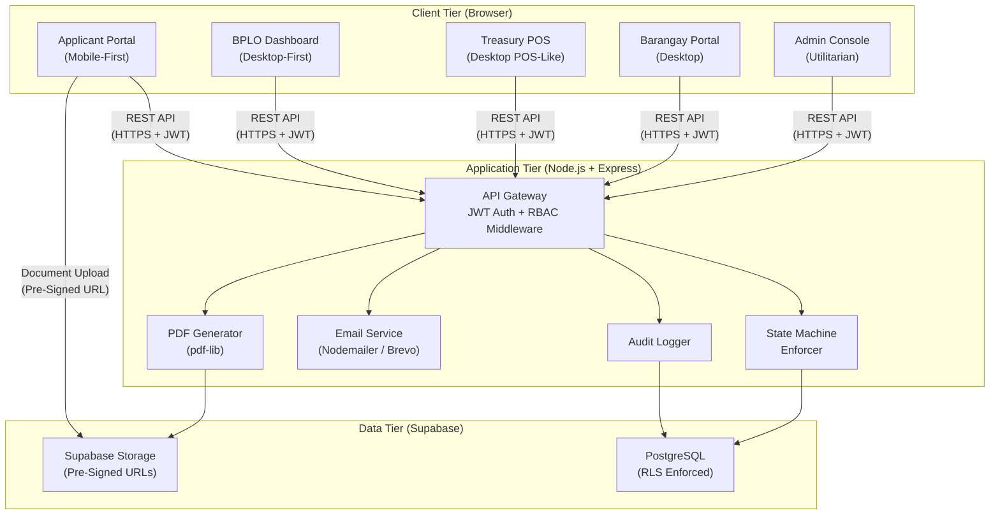
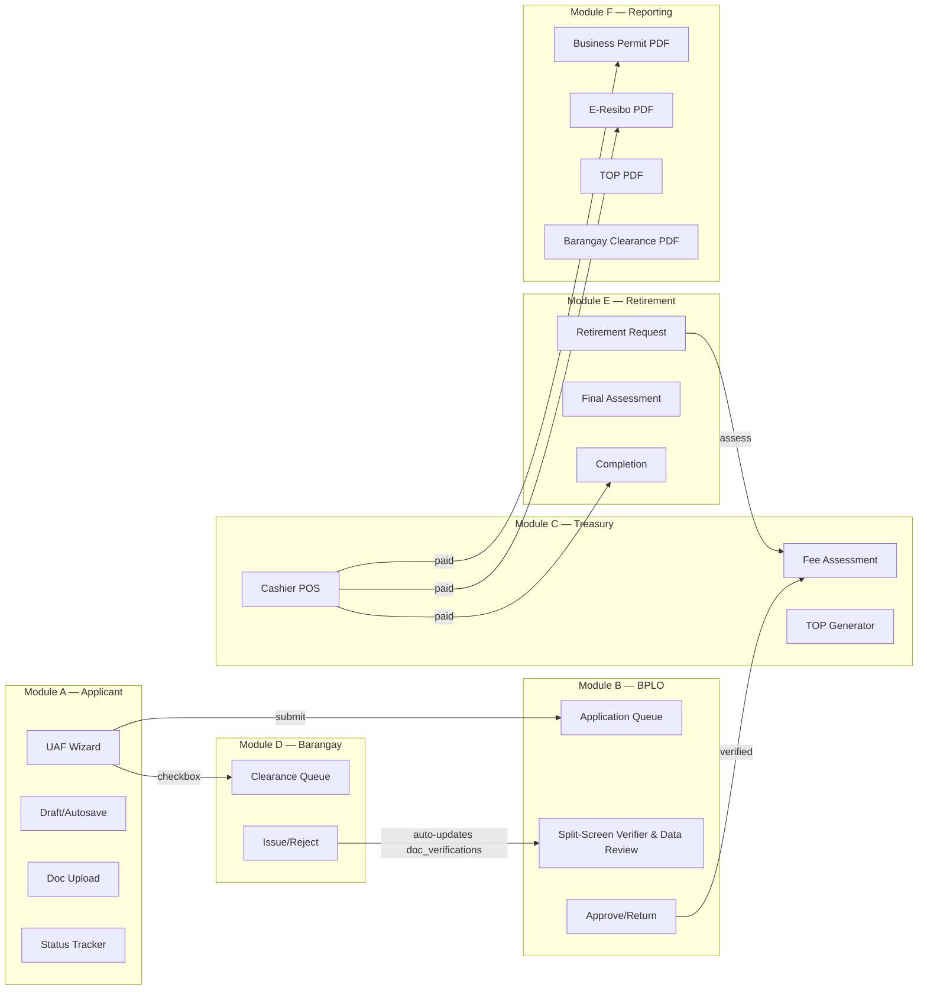
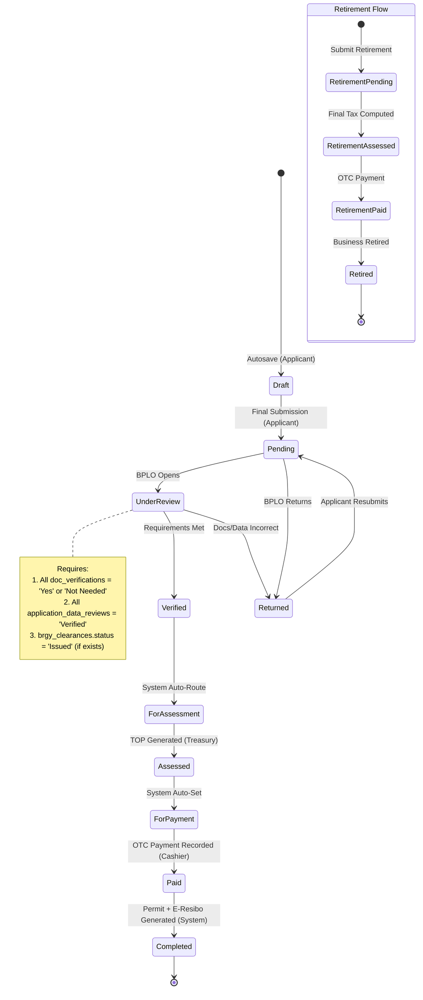
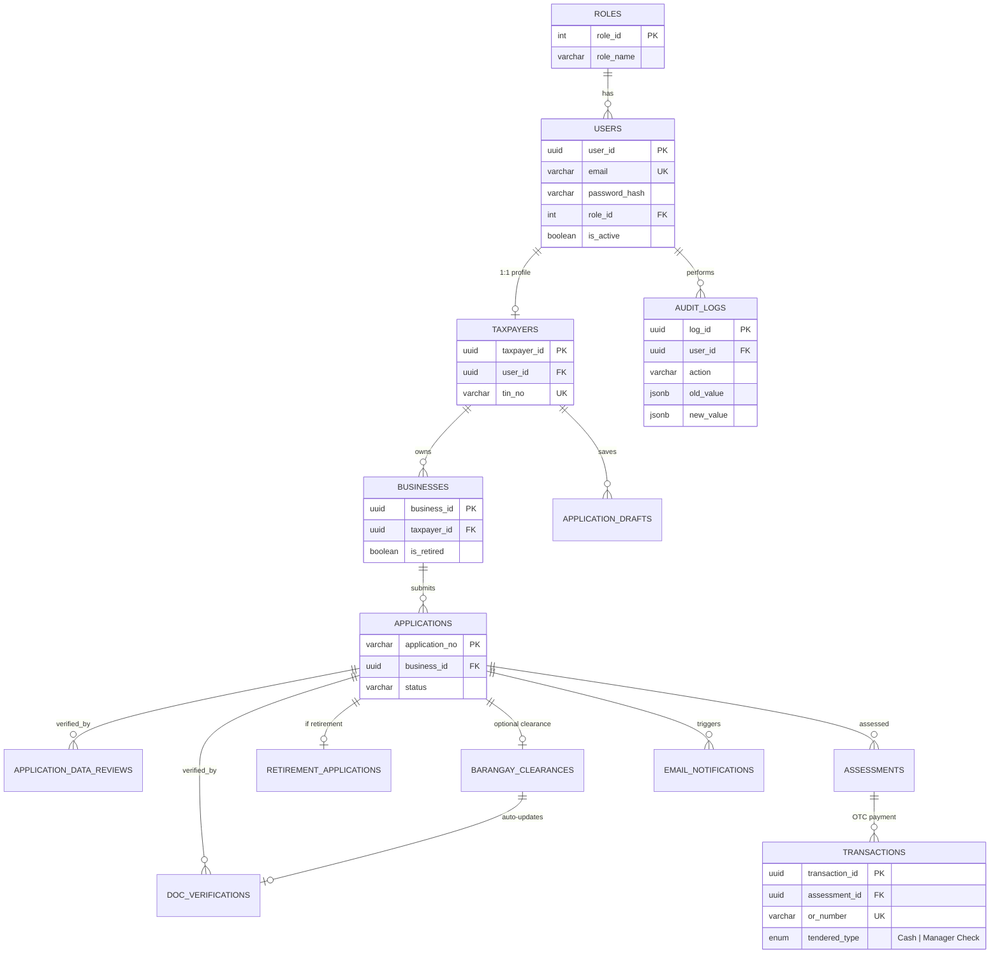
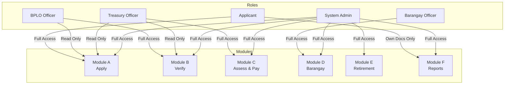
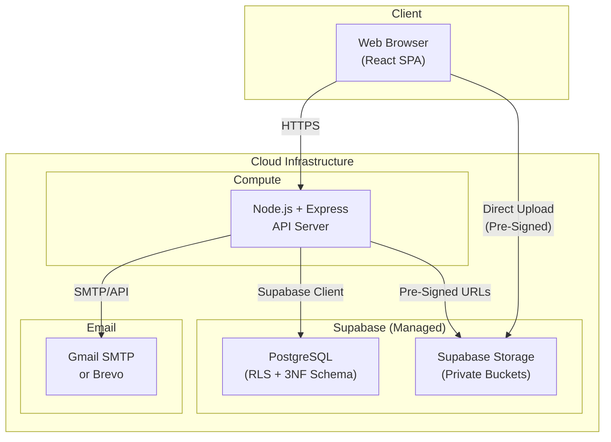

# eBPLS System Architecture

**Electronic Business Permits and Licensing System — BOSS & E-Resibo**
Municipality of Liliw | Architecture Document v2.0

---

## 1. Architecture Overview

**Pattern:** Web-Based Client-Server Architecture with Role-Based Access Control (RBAC)

**Principle:** OTC Payment STRICT Enforcement — the system supports Over-The-Counter cash and manager's check payments ONLY. Online payment channels are **explicitly excluded**.



---

## 2. Technology Stack Map

| Layer | Technology | Responsibility |
|---|---|---|
| **Frontend** | React.js + Tailwind CSS | SPA with role-based views |
| **State Mgmt** | Zustand | Client-side global state (auth, application, notifications) |
| **Backend** | Node.js + Express.js | REST API, business logic, middleware |
| **Database** | PostgreSQL via Supabase | Primary data store with RLS |
| **File Storage** | Supabase Storage | Private document buckets, pre-signed URLs (15-min expiry) |
| **Auth** | JWT (LocalStorage/SessionStorage) | 24-hour expiry, bcrypt (cost ≥ 12) |
| **Maps** | Leaflet.js + OpenStreetMap | Business location pinning (no API key) |
| **Email** | Nodemailer (Gmail SMTP) / Brevo | Transactional notifications |
| **PDF** | pdf-lib | Permit, E-Resibo, TOP, Barangay Clearance rendering |

---

## 3. Module Architecture

The system is decomposed into **six modules**, each with clear ownership boundaries:



### Module Boundaries & API Surface

#### Module A — Applicant (Apply)

| Method | Endpoint | Purpose |
|---|---|---|
| POST | `/api/applications/drafts` | Create/update draft (autosave) |
| GET | `/api/applications/drafts/:taxpayer_id` | Retrieve saved draft |
| DELETE | `/api/applications/drafts/:draft_id` | Delete draft on submission |
| POST | `/api/applications/uaf` | Final UAF submission |
| POST | `/api/applications/upload` | Secure upload via pre-signed URL |
| GET | `/api/applications/:app_no/status` | Poll current status |

#### Module B — BPLO (Verify & Process)

| Method | Endpoint | Purpose |
|---|---|---|
| GET | `/api/bplo/applications/pending` | Queue of applications awaiting review |
| GET | `/api/bplo/applications/:app_no` | Full detail with pre-signed doc URLs |
| PUT | `/api/bplo/applications/verify/:app_no` | Update verification checklist |
| PUT | `/api/bplo/applications/return/:app_no` | Return with mandatory remarks |

#### Module C — Treasury (Assess & Pay — OTC Only)

| Method | Endpoint | Purpose |
|---|---|---|
| POST | `/api/treasury/assess` | Calculate fees, generate assessment + TOP |
| PUT | `/api/treasury/assess/:id/override` | Override line item (audit-logged) |
| GET | `/api/documents/top/:app_no` | Generate TOP PDF |
| POST | `/api/treasury/payments/otc` | Record OTC payment (Cash / Manager Check) |

#### Module D — Barangay Clearance

| Method | Endpoint | Purpose |
|---|---|---|
| GET | `/api/barangay/clearances/pending` | Clearance requests queue |
| PUT | `/api/barangay/clearances/:id/issue` | Mark clearance as issued |
| PUT | `/api/barangay/clearances/:id/reject` | Reject with remarks |
| GET | `/api/documents/barangay-clearance/:id` | Generate clearance PDF |

#### Module E — Business Retirement

| Method | Endpoint | Purpose |
|---|---|---|
| POST | `/api/retirements/submit` | Submit retirement request |
| GET | `/api/retirements/pending` | BPLO/Treasury pending queue |
| POST | `/api/retirements/:id/assess` | Compute final taxes |
| PUT | `/api/retirements/:id/complete` | Mark business as retired |

#### Module F — Reporting & Documents

| Method | Endpoint | Purpose |
|---|---|---|
| GET | `/api/documents/permit/:app_no` | Generate Business Permit PDF(s) |
| GET | `/api/documents/permit/:app_no?lob=:id` | Per-line-of-business permit |
| GET | `/api/documents/eresibo/:transaction_id` | Official Receipt (E-Resibo) PDF |

---

## 4. Application State Machine

> [!IMPORTANT]
> The backend **MUST reject** any status update that does not follow the transitions below. All violations are logged in `audit_logs`.



### Transition Rules

| From | To | Actor | Guard Condition |
|---|---|---|---|
| Draft | Pending | Applicant | All required UAF fields completed |
| Pending | Under Review | BPLO Officer | Officer opens application |
| Pending | Returned | BPLO Officer | Missing/incorrect documents/data, remarks required |
| Under Review | Verified | BPLO Officer | All `doc_verifications` = 'Yes' or 'Not Needed' AND all `application_data_reviews` = 'Verified'. If brgy_clearances record exists, brgy_clearances.status must = 'Issued' |
| Returned | Pending | Applicant | Resubmission with corrections |
| Verified | For Assessment | System | Auto on Verified transition |
| For Assessment | Assessed | Treasury Officer | TOP generated and finalized |
| Assessed | For Payment | System | Auto on TOP generation |
| For Payment | Paid | Treasury Cashier | OTC payment with valid OR number |
| Paid | Completed | System | Permit + E-Resibo generated |

---

## 5. Data Architecture

### Entity-Relationship Overview



### Table Groups

| Group | Tables | Purpose |
|---|---|---|
| **Auth & Identity** | `roles`, `users` | Authentication, JWT, RBAC |
| **Profiles** | `taxpayers`, `businesses`, `organization_types` | Taxpayer & business registration |
| **Applications** | `applications`, `application_drafts`, `application_types`, `payment_modes` | UAF workflow, draft persistence |
| **Verification** | `doc_verifications`, `application_data_reviews`, `clearance_types` | BPLO document & data verification |
| **Barangay** | `barangay_clearances` | Integrated clearance issuance |
| **Treasury** | `assessments`, `assessment_line_items`, `fee_types`, `transactions` | Fee calculation, OTC payment |
| **Retirement** | `retirement_applications` | Business cessation processing |
| **Documents** | `permits`, `permit_line_items`, `business_activities` | Permit generation per LOB |
| **System** | `audit_logs`, `email_notifications` | Compliance, DPA, notifications |

---

## 6. Role-Based Access Control (RBAC)



### Permission Matrix

| Capability | Applicant | BPLO | Treasury | Barangay | Admin |
|---|:---:|:---:|:---:|:---:|:---:|
| Submit UAF | ✅ | — | — | — | — |
| Upload Documents | ✅ | — | — | — | — |
| View Own Status | ✅ | — | — | — | ✅ |
| Verify Documents | — | ✅ | — | — | — |
| Approve/Return App | — | ✅ | — | — | — |
| Assess Fees | — | — | ✅ | — | — |
| Override Fee Items | — | — | ✅ | — | — |
| Record OTC Payment | — | — | ✅ | — | — |
| Issue Brgy Clearance | — | — | — | ✅ | — |
| Process Retirement | — | ✅ | ✅ | — | ✅ |
| Download Documents | ✅ (own) | ✅ | ✅ | — | ✅ |
| Manage Users/Roles | — | — | — | — | ✅ |
| View Audit Logs | — | — | — | — | ✅ |
| Configure Templates | — | — | — | — | ✅ |

---

## 7. Cross-Cutting Concerns

### 7.1 Security Architecture

| Concern | Implementation |
|---|---|
| **Authentication** | JWT tokens, 24-hour expiry, bcrypt (cost ≥ 12) |
| **Authorization** | RBAC middleware on every API route |
| **Data Security** | Supabase RLS on all tables |
| **File Access** | Pre-signed URLs with 15-minute expiry |
| **Audit** | Every data mutation → `audit_logs` with old/new JSONB snapshots |
| **Privacy** | DPA 2012 compliance; all PII access logged; admin access reports |

### 7.2 Email Notification Triggers

| Event | Recipient | Trigger |
|---|---|---|
| `APPLICATION_SUBMITTED` | Applicant | UAF final submission |
| `BARANGAY_CLEARANCE_REJECTED` | Applicant | Barangay Officer rejects the clearance (includes remarks) |
| `APPLICATION_RETURNED` | Applicant | BPLO returns with remarks |
| `APPLICATION_VERIFIED` | Applicant | All docs verified |
| `TOP_GENERATED` | Applicant | Treasury generates TOP |
| `PAYMENT_RECORDED` | Applicant | OTC payment confirmed |
| `PERMIT_READY` | Applicant | Permit + E-Resibo generated |
| `RETIREMENT_COMPLETE` | Applicant | Business retirement finalized |
| `ACCOUNT_CREATED` | New User | Registration with activation link |
| `PASSWORD_RESET` | Any User | Reset link (1-hour expiry) |

### 7.3 Audit Logging Strategy

Every significant system action is captured in `audit_logs`:

- **Who:** `user_id` (actor)
- **What:** `action` (e.g., `APPLICATION_SUBMITTED`, `PAYMENT_RECORDED`)
- **Which:** `entity_type` + `entity_id` (affected record)
- **Before/After:** `old_value` / `new_value` (JSONB snapshots)
- **Where:** `ip_address` (client IP)
- **When:** `created_at` (server timestamp)

---

## 8. Frontend Architecture

### Project Structure

```
/src
├── /components      # Reusable UI — Buttons, Inputs, Map, Badges
├── /screens         # Main views per module
│   ├── UAFWizard
│   ├── BPLODashboard
│   ├── CashierPOS
│   ├── BarangayPortal
│   └── AdminConsole
├── /store           # Zustand slices
│   ├── authSlice
│   ├── applicationSlice
│   └── notificationSlice
├── /utils           # Tax calc helpers, date formatters, PDF builders
└── /hooks           # useAutosave, useApplicationStatus, useNotifications
```

### UI Design Principles by Role

| Portal | Design | Key Pattern |
|---|---|---|
| **Applicant** | Mobile-first | Quick-action buttons, status badges, autosave indicator |
| **BPLO** | Desktop-first | Split-screen verifier, sortable data tables, SLA indicators |
| **Treasury** | Desktop POS-like | Assessment grid, high-contrast cashier panel, large typography |
| **Barangay** | Desktop | Clearance queue with issue/reject actions |
| **Admin** | Utilitarian | Health metrics, master data CRUD, DocumentBuilder, audit viewer |

---

## 9. Deployment Topology



---

## 10. Non-Functional Requirements Summary

| Requirement | Target |
|---|---|
| **API Response Time** | < 2 seconds under normal load |
| **Uptime** | 99.5% availability |
| **Concurrent Users** | Handle January renewal spikes |
| **Auth Security** | bcrypt (cost ≥ 12), JWT 24h expiry |
| **File Security** | Pre-signed URLs, 15-min expiry |
| **Privacy** | DPA 2012 compliant, full audit trail |
| **Payment** | OTC only (Cash + Manager Check) |
| **Mobile** | Applicant portal fully responsive |

---

## 11. Explicit Exclusions

> [!CAUTION]
> The following are **permanently out of scope** and must never be implemented:
> 1. Online payment gateways (Landbank, DBP, GCash, PayMaya, credit/debit)
> 2. Legacy system data migration
> 3. National database integration (BIR, DTI, SEC)
> 4. SMS notifications
> 5. Native mobile apps (iOS/Android)
> 6. Multi-LGU or federated deployment

---

*Architecture derived from [eBPLS SDD v2.0](file:///c:/projects/eBPLS/system-planning/eBPLS_SDD_v2.md) — Municipality of Liliw*
