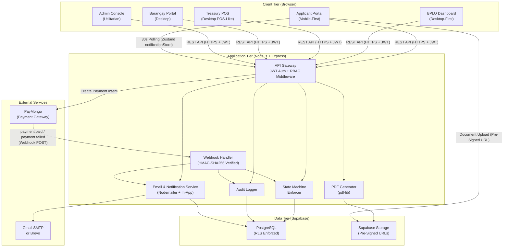
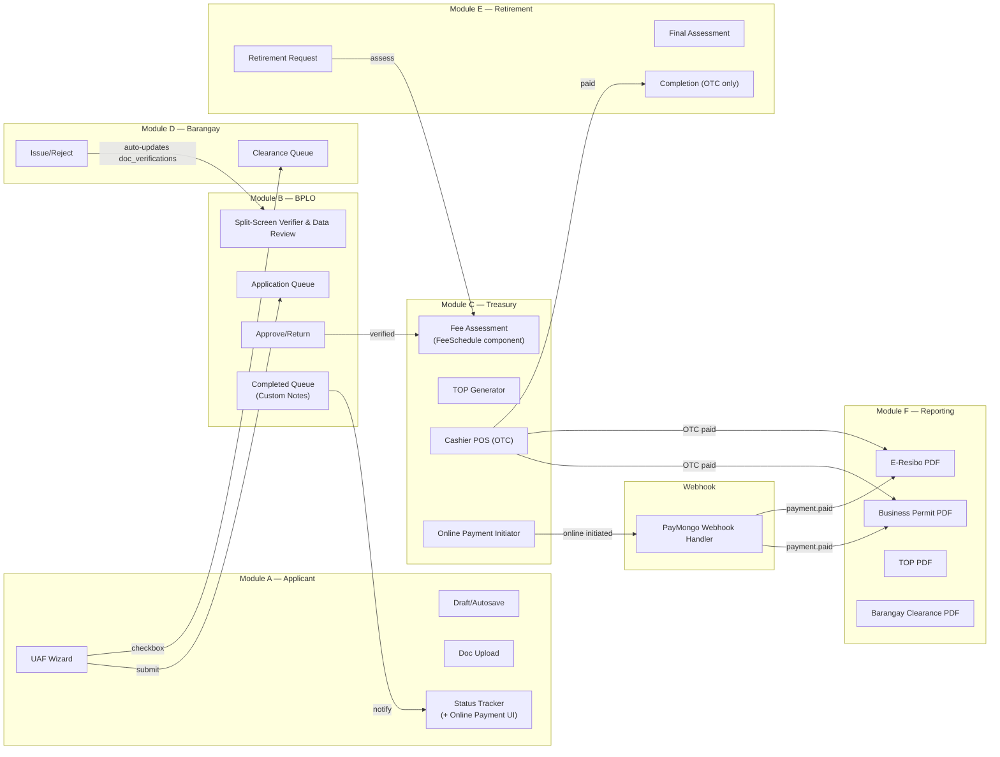
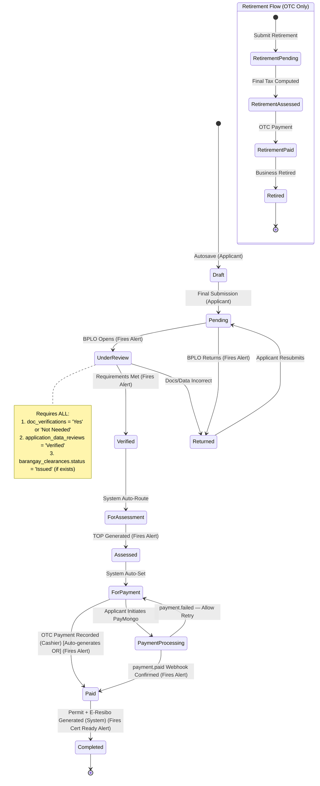
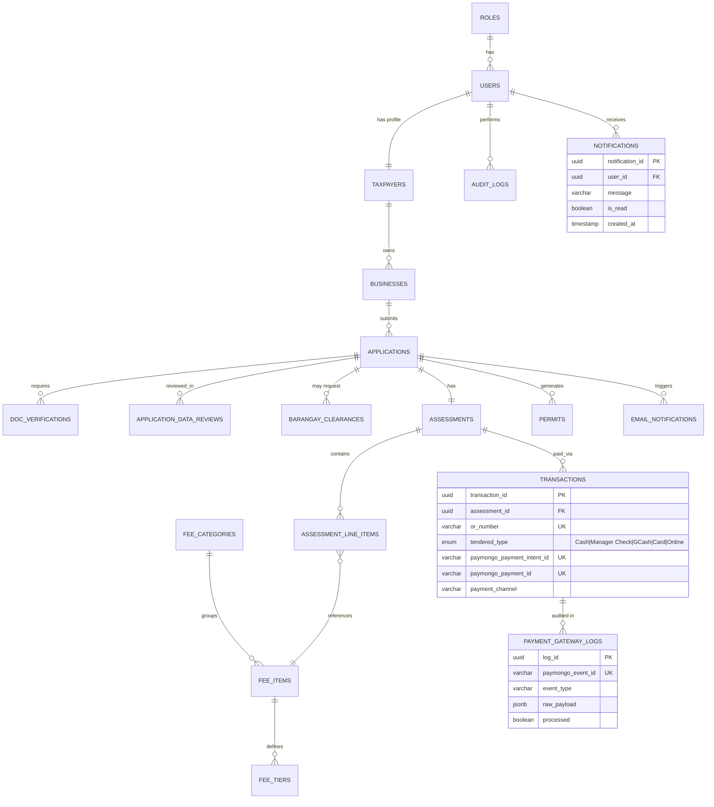
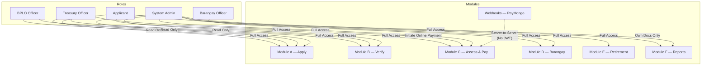
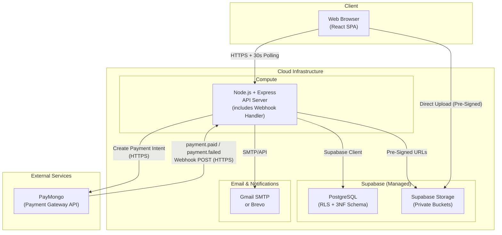

# eBPLS System Architecture

**Electronic Business Permits and Licensing System — BOSS & E-Resibo**
Municipality of Liliw | Architecture Document v3.0

> **What changed in v3.0 (July 2026 Adviser Changes Phase 1 to 6)**
> - **Database Schema**: Added `fee_categories`, `fee_items`, `fee_tiers`, and `notifications` tables.
> - **State Management**: Added `notificationStore` in Zustand for 30s polling of unread notifications.
> - **Core Modules/Components**: Added shared `FeeSchedule` component (digitized Revenue Code with accordions), `NotificationBell` & `NotificationPopup` components for real-time applicant alerts (fires on Under Review, Verified, Assessed, Paid, Returned, Cert Ready), and BPLO `CompletedQueue` for notifying applicants with custom notes.
> - **Automations**: OTC payments now auto-generate OR numbers.
>
> **What changed in v2.0**
> PayMongo added as an optional online payment channel. Revised Requirements system with dynamic, conditional checklists based on org type, business activities, and rental status.

---

## 1. Architecture Overview

**Pattern:** Web-Based Client-Server Architecture with Role-Based Access Control (RBAC)

**Payment Principle:** OTC remains the primary payment channel. PayMongo online payment (GCash, Card, Payment Link) is an optional additive channel. Both channels produce the same outcome. The Retirement Module uses OTC only.



---

## 2. Technology Stack Map

| Layer | Technology | Responsibility |
|---|---|---|
| **Frontend** | React.js + Tailwind CSS | SPA with role-based views |
| **State Mgmt** | Zustand | Client-side global state (auth, application, `notificationStore` for 30s polling of unread notifications) |
| **Backend** | Node.js + Express.js | REST API, business logic, middleware |
| **Database** | PostgreSQL via Supabase | Primary data store with RLS |
| **File Storage** | Supabase Storage | Private document buckets, pre-signed URLs (15-min expiry) |
| **Auth** | JWT (LocalStorage/SessionStorage) | 24-hour expiry, bcrypt (cost ≥ 12) |
| **Maps** | Leaflet.js + OpenStreetMap | Business location pinning (no API key) |
| **Email/Alerts** | Nodemailer (Gmail SMTP) + DB Notifications | Transactional emails and real-time in-app alerts |
| **PDF** | pdf-lib | Permit, E-Resibo, TOP, Barangay Clearance rendering |
| **Payment Gateway** | PayMongo | Online GCash / Card / Payment Link processing |

---

## 3. Module Architecture

The system is decomposed into **six modules**, each with clear ownership boundaries:



### Module Boundaries & API Surface

#### Module A — Applicant (Apply)

| Method | Endpoint | Purpose |
|---|---|---|
| POST | `/api/applications/drafts` | Create/update draft (autosave) |
| GET | `/api/applications/drafts/:taxpayer_id` | Retrieve saved draft |
| DELETE | `/api/applications/drafts/:draft_id` | Delete draft on submission |
| POST | `/api/applications/uaf` | Final UAF submission |
| POST | `/api/applications/upload` | Secure upload via pre-signed URL |
| GET | `/api/applications/:app_no/status` | Poll current status (used during PaymentProcessing) |
| GET | `/api/notifications/unread` | 30s polling for `NotificationBell` |

#### Module B — BPLO (Verify & Process)

| Method | Endpoint | Purpose |
|---|---|---|
| GET | `/api/bplo/applications/pending` | Queue of applications awaiting review |
| GET | `/api/bplo/applications/:app_no` | Full detail with pre-signed doc URLs |
| PUT | `/api/bplo/applications/review/:app_no` | Upsert `application_data_reviews` sections |
| PUT | `/api/bplo/applications/verify/:app_no` | Update verification checklist |
| PUT | `/api/bplo/applications/return/:app_no` | Return with mandatory remarks |
| GET | `/api/bplo/applications/completed` | Completed Queue for notifying applicants |
| POST | `/api/bplo/applications/notify/:app_no` | Send custom notes to applicant from CompletedQueue |

#### Module C — Treasury (Assess & Pay)

| Method | Endpoint | Purpose | Auth |
|---|---|---|---|
| POST | `/api/treasury/assess` | Calculate fees (via digitized Revenue Code), generate TOP | Treasury_Officer |
| PUT | `/api/treasury/assess/:id/override` | Override line item (strictly requires remarks; blank/empty reverts to default; audit-logged) | Treasury_Officer |
| PUT | `/api/treasury/assess/:id/reset` | Revert fee line item back to default calculated price | Treasury_Officer |
| GET | `/api/documents/top/:app_no` | Generate TOP PDF | Treasury_Officer |
| POST | `/api/treasury/payments/otc` | Record OTC payment (Cash / Manager Check) — **auto-generates OR number** | Treasury_Officer |
| **POST** | **`/api/treasury/payments/online`** | **Initiate PayMongo Payment Intent; create pending transaction; transition to PaymentProcessing** | **Applicant or Treasury_Officer** |


#### Module D — Barangay Clearance

| Method | Endpoint | Purpose |
|---|---|---|
| GET | `/api/barangay/clearances/pending` | Clearance requests queue |
| PUT | `/api/barangay/clearances/:id/issue` | Mark clearance as issued; auto-updates `doc_verifications` to 'Yes' |
| PUT | `/api/barangay/clearances/:id/reject` | Reject with remarks; auto-updates `doc_verifications` to 'No'; sends email/alert |
| GET | `/api/documents/barangay-clearance/:id` | Generate clearance PDF |

#### Module E — Business Retirement

| Method | Endpoint | Purpose |
|---|---|---|
| POST | `/api/retirements/submit` | Submit retirement request |
| GET | `/api/retirements/pending` | BPLO/Treasury pending queue |
| POST | `/api/retirements/:id/assess` | Compute final taxes |
| PUT | `/api/retirements/:id/complete` | Mark business as retired |

> **Note:** Retirement settlement uses `POST /api/treasury/payments/otc` exclusively. Online payment is not available for the Retirement Module.

#### Module F — Reporting & Documents

| Method | Endpoint | Purpose |
|---|---|---|
| GET | `/api/documents/permit/:app_no` | Generate Business Permit PDF(s) |
| GET | `/api/documents/permit/:app_no?lob=:id` | Per-line-of-business permit |
| GET | `/api/documents/eresibo/:transaction_id` | Official Receipt (E-Resibo) PDF |

#### Webhooks

| Method | Endpoint | Purpose | Auth |
|---|---|---|---|
| POST | `/api/webhooks/paymongo` | Receive PayMongo payment events; raw body; HMAC-SHA256 verified | None (PayMongo server-to-server) |

> **Critical implementation constraint:** The webhook route is mounted with `express.raw({ type: 'application/json' })` and registered in `app.js` **before** the global `express.json()` middleware. Mounting after will pre-parse the body and break HMAC verification.

---

## 4. Application State Machine

> The backend **MUST reject** any status update that does not follow the transitions below. All violations are logged in `audit_logs`. State transitions also trigger `NotificationPopup` events.



### Transition Rules

| From | To | Actor | Guard Condition |
|---|---|---|---|
| Draft | Pending | Applicant | All required UAF fields completed |
| Pending | UnderReview | BPLO Officer | Officer opens application |
| Pending | Returned | BPLO Officer | Missing / incorrect documents or data; remarks required |
| UnderReview | Verified | BPLO Officer | All `doc_verifications` = 'Yes' or 'Not Needed' AND all `application_data_reviews` = 'Verified' AND (if exists) `barangay_clearances.status` = 'Issued' |
| Returned | Pending | Applicant | Resubmission with corrections |
| Verified | ForAssessment | System | Auto on Verified transition |
| ForAssessment | Assessed | Treasury Officer | TOP generated and finalized |
| Assessed | ForPayment | System | Auto on TOP generation |
| **ForPayment** | **PaymentProcessing** | **System** | **Applicant initiates PayMongo checkout; Payment Intent created** |
| **ForPayment** | **Paid** | **Treasury Cashier** | **OTC payment — Auto-generates OR number** |
| **PaymentProcessing** | **Paid** | **System (webhook)** | **PayMongo fires payment.paid; HMAC verified; idempotency check passes** |
| **PaymentProcessing** | **ForPayment** | **System (webhook)** | **PayMongo fires payment.failed or link expires** |
| Paid | Completed | System | Permit + E-Resibo generated |

---

## 5. Data Architecture

### Entity-Relationship Overview



### Table Groups

| Group | Tables | Purpose |
|---|---|---|
| **Auth & Identity** | `roles`, `users` | Authentication, JWT, RBAC |
| **Profiles** | `taxpayers`, `businesses`, `organization_types` | Taxpayer & business registration |
| **Applications** | `applications`, `application_drafts`, `application_types`, `payment_modes` | UAF workflow, draft persistence |
| **Verification** | `doc_verifications`, `application_data_reviews`, `requirement_types`, `requirement_conditions`, `clearance_types` | BPLO document & data verification |
| **Barangay** | `barangay_clearances` | Integrated clearance issuance |
| **Treasury** | `assessments`, `assessment_line_items`, `fee_categories`, `fee_items`, `fee_tiers`, `transactions` | Fee calculation via digitized Revenue Code, OTC + online payment |
| **Payment Audit** | `payment_gateway_logs` | Webhook audit trail, idempotency checks |
| **Retirement** | `retirement_applications` | Business cessation processing |
| **Documents** | `permits`, `permit_line_items`, `business_activities` | Permit generation per LOB |
| **System** | `audit_logs`, `email_notifications`, `notifications` | Compliance, DPA, emails, and in-app alerts |

---

## 6. Role-Based Access Control (RBAC)



### Permission Matrix

| Capability | Applicant | BPLO | Treasury | Barangay | Admin |
|---|:---:|:---:|:---:|:---:|:---:|
| Submit UAF | ✅ | — | — | — | — |
| Upload Documents | ✅ | — | — | — | — |
| View Own Status | ✅ | — | — | — | ✅ |
| Verify Documents | — | ✅ | — | — | — |
| Approve/Return App | — | ✅ | — | — | — |
| Assess Fees | — | — | ✅ | — | — |
| Override Fee Items | — | — | ✅ | — | — |
| Record OTC Payment | — | — | ✅ | — | — |
| **Initiate Online Payment** | **✅** | **—** | **✅** | **—** | **—** |
| Issue Brgy Clearance | — | — | — | ✅ | — |
| Process Retirement | — | ✅ | ✅ | — | ✅ |
| Download Documents | ✅ (own) | ✅ | ✅ | — | ✅ |
| Manage Users/Roles | — | — | — | — | ✅ |
| View Audit Logs | — | — | — | — | ✅ |
| Configure Templates | — | — | — | — | ✅ |

---

## 7. Cross-Cutting Concerns

### 7.1 Security Architecture

| Concern | Implementation |
|---|---|
| **Authentication** | JWT tokens, 24-hour expiry, bcrypt (cost ≥ 12) |
| **Authorization** | RBAC middleware on every API route |
| **Data Security** | Supabase RLS on all tables |
| **File Access** | Pre-signed URLs with 15-minute expiry |
| **Audit** | Every data mutation → `audit_logs` with old/new JSONB snapshots |
| **Privacy** | DPA 2012 compliance; all PII access logged; admin access reports |
| **Webhook Security** | HMAC-SHA256 verification of `Paymongo-Signature` header before any processing |
| **Webhook Idempotency** | `payment_gateway_logs.paymongo_event_id` UNIQUE constraint prevents duplicate processing |
| **Credentials** | `PAYMONGO_SECRET_KEY` and `PAYMONGO_WEBHOOK_SECRET` stored in env vars only; never logged or stored in DB |

### 7.2 Email & In-App Notification Triggers

| Event | Recipient | Trigger (Email + `NotificationPopup`) |
|---|---|---|
| `APPLICATION_SUBMITTED` | Applicant | UAF final submission |
| `BARANGAY_CLEARANCE_REJECTED` | Applicant | Barangay Officer rejects the clearance (includes remarks) |
| `APPLICATION_UNDER_REVIEW` | Applicant | BPLO opens application (In-app alert) |
| `APPLICATION_RETURNED` | Applicant | BPLO returns with remarks |
| `APPLICATION_VERIFIED` | Applicant | All docs verified |
| `TOP_GENERATED` | Applicant | Treasury generates TOP (Assessed status) |
| `PAYMENT_RECORDED` | Applicant | OTC **or online** payment confirmed (Paid status) |
| `PERMIT_READY` | Applicant | Permit + E-Resibo generated (Cert Ready status) |
| `CUSTOM_NOTE` | Applicant | BPLO sends a custom note via CompletedQueue |
| `RETIREMENT_COMPLETE` | Applicant | Business retirement finalized |
| `ACCOUNT_CREATED` | New User | Registration with activation link |
| `PASSWORD_RESET` | Any User | Reset link (1-hour expiry) |

### 7.3 Audit Logging Strategy

Every significant action is captured in `audit_logs`:

- **Who:** `user_id` (actor; null for system/webhook actions)
- **What:** `action` (e.g. `ONLINE_PAYMENT_INITIATED`, `ONLINE_PAYMENT_CONFIRMED`, `ONLINE_PAYMENT_FAILED`)
- **Which:** `entity_type` + `entity_id` (affected record)
- **Before/After:** `old_value` / `new_value` (JSONB snapshots)
- **Where:** `ip_address` (client IP)
- **When:** `created_at` (server timestamp)

Webhook events also written to `payment_gateway_logs` (append-only audit table with raw payload).

### 7.4 PayMongo Integration Notes

| Concern | Specification |
|---|---|
| API Base URL | `https://api.paymongo.com/v1` |
| Authentication | Base64-encode `PAYMONGO_SECRET_KEY:` (trailing colon); pass as `Authorization: Basic <encoded>` |
| Amount units | Centavos (PHP × 100). PHP 500.00 → `50000` |
| Test card | `4343434343434343`, any future expiry, any CVV |
| Test GCash | Use PayMongo sandbox instructions |
| Key prefix | `sk_test_...` for development; `sk_live_...` for production |
| Webhook tunnel | Use ngrok in development; PayMongo requires a publicly accessible URL |
| OR number format | `PM-{YYYYMMDD}-{6-digit-sequence}` for online payments |

---

## 8. Frontend Architecture

### Project Structure

```text
/src
├── /components      # Reusable UI — Buttons, Inputs, Map, Badges
│   ├── FeeSchedule           ← Digitized Revenue Code with accordions
│   ├── NotificationBell      ← UI for real-time alerts
│   └── NotificationPopup     ← Global toaster for state changes
├── /screens
│   ├── /applicant
│   │   ├── UAFWizard
│   │   └── StatusTracker     ← Online payment button + polling UI
│   ├── /bplo
│   │   ├── Dashboard
│   │   ├── SplitScreenVerifier
│   │   └── CompletedQueue    ← For notifying applicants with custom notes
│   ├── /treasury
│   │   ├── AssessmentGrid    ← Integrates FeeSchedule component
│   │   └── CashierPOS        ← Online payment initiation added
│   ├── /barangay
│   │   └── ClearanceQueue
│   └── /admin
│       ├── MasterData
│       ├── DocumentBuilder
│       └── AuditLogs
├── /store
│   ├── authSlice
│   ├── applicationSlice      ← PaymentProcessing status managed here
│   └── notificationStore     ← Zustand store for 30s polling of unread notifications
├── /utils           # Tax calc helpers, date formatters
└── /hooks           # useAutosave, useApplicationStatus, useNotifications
```

### UI Design Principles by Role

| Portal | Design | Key Pattern |
|---|---|---|
| **Applicant** | Mobile-first | Quick-action buttons, status badges, autosave indicator, online payment button, polling for PaymentProcessing, real-time NotificationBell |
| **BPLO** | Desktop-first | Split-screen verifier, data review panel, sortable tables, SLA indicators, CompletedQueue for applicant notes |
| **Treasury** | Desktop POS-like | Assessment grid, high-contrast cashier panel, large typography, online payment initiation, interactive FeeSchedule |
| **Barangay** | Desktop | Clearance queue with issue/reject actions |
| **Admin** | Utilitarian | Health metrics, master data CRUD, DocumentBuilder, audit viewer |

---

## 9. Deployment Topology



> **Webhook requirement:** The API server must be publicly accessible to receive PayMongo webhook callbacks. Use ngrok or a deployed environment during development. `localhost` URLs will not work with PayMongo.

---

## 10. Non-Functional Requirements Summary

| Requirement | Target |
|---|---|
| **API Response Time** | < 2 seconds under normal load |
| **Uptime** | 99.5% availability |
| **Concurrent Users** | Handle January renewal spikes |
| **Auth Security** | bcrypt (cost ≥ 12), JWT 24h expiry |
| **File Security** | Pre-signed URLs, 15-min expiry |
| **Webhook Security** | HMAC-SHA256 verified; reject 400 on failure |
| **Idempotency** | Duplicate webhooks produce no side effects |
| **Privacy** | DPA 2012 compliant, full audit trail |
| **Payment** | OTC (Cash + Manager Check) + Online via PayMongo |
| **Real-time Comms** | 30s polling for `NotificationBell` updates |

---

## 11. Explicit Exclusions

> The following are **out of scope** and must not be implemented:
> 1. ~~Online payment gateways~~ — **PayMongo is in scope. All other gateways remain excluded** (Landbank ePay, DBP PayConnect, PayMaya, direct GCash integration outside PayMongo)
> 2. Legacy system data migration
> 3. National database integration (BIR, DTI, SEC)
> 4. SMS notifications
> 5. Native mobile apps (iOS/Android)
> 6. Multi-LGU or federated deployment
> 7. **Online payment for the Retirement Module (OTC only)**

---

## 12. Official Liliw LGU Requirements Checklists

### New Business Permit
| Requirement Name | Applies To | Conditional | Condition Type | Max Files |
|---|---|---|---|---|
| Laboratories (Photocopy of X-ray Result) | New | No | none | 1 |
| Realty Tax (OR-Amilyar) | New | No | none | 1 |
| Lessor's Permit | New | Yes | rental_status | 1 |
| Latest Water Analysis Result | New | Yes | business_activity | 1 |
| DTI Registration | New | Yes | org_type | 1 |
| SEC Registration | New | Yes | org_type | 1 |
| CDA Registration | New | Yes | org_type | 1 |
| Valid Government ID | New | Yes | org_type | 2 |
| PCAB License | New | Yes | business_activity | 1 |
| Lease Contract | New | Yes | rental_status | 1 |
| Building Permit / Locational Clearance | New | Yes | business_activity | 1 |
| ECC or CNC, LLDA Clearance | New | Yes | business_activity | 1 |
| BSP Certificate / Authority to Operate | New | Yes | business_activity | 1 |
| Chainsaw Registration | New | Yes | business_activity | 1 |
| FDA Registration | New | Yes | business_activity | 1 |

### Renewal Business Permit
| Requirement Name | Applies To | Conditional | Condition Type | Max Files |
|---|---|---|---|---|
| Laboratories (Photocopy of X-ray Result) | Renewal | No | none | 1 |
| Realty Tax (OR-Amilyar) | Renewal | No | none | 1 |
| Lessor's Permit | Renewal | Yes | rental_status | 1 |
| Latest Water Analysis Result | Renewal | Yes | business_activity | 1 |
| Previous Business Permit and Receipt | Renewal | No | none | 1 |
| Audited Financial Statement / VAT Returns / Gross Sales | Renewal | No | none | 3 |
| Previous FSIC Issued (BFP) | Renewal | No | none | 1 |
| Real Property Tax Receipt | Renewal | Yes | business_activity | 1 |
| DOE Certificate (LPG Dealer/Retailer) | Renewal | Yes | business_activity | 1 |

> Note: Requirements such as 'Zoning Clearance', 'Community Tax Certificate (CTC)', 'Owner's Valid ID (Front/Back)' (separate) have been retired (`is_active = false`).

---

*eBPLS System Architecture v3.0 — Municipality of Liliw*
*Previous version: Architecture v2.0. This version integrates the July 2026 Adviser Changes.*
