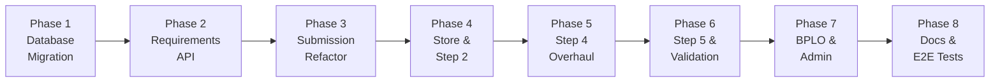

# Business Permit Requirements Revision — Agile Implementation Plan

> **Project**: eBPLS — Municipality of Liliw
> **Scope**: Revise the requirements/checklist system for New and Renewal business permit applications
> **Approach**: 8 phases, chronological, each phase reviewed before proceeding

---

## Confirmed Design Decisions

| # | Decision | Resolution |
|---|---|---|
| 1 | DTI / SEC / CDA Registration | Split into 3 conditional requirements by org type. Old combined entry retired. |
| 2 | Valid Government ID | Single requirement slot with **mandatory dual upload** (Front + Back). Old Front/Back entries retired. |
| 3 | Business Activity Granularity | **Option A — Standalone Activities**. Flat entries in `business_activities` (Piggery, Poultry, Hotel/Hostel, etc.). |
| 4 | Audited Financial Statement / VAT Returns / Gross Sales | Single requirement slot with **multi-file upload (1–3 files)**. |
| 5 | Laboratories (X-ray Result) | **Universal** for both New and Renewal. |
| 6 | Rental Status | New `is_renting` boolean on `businesses` table + toggle in Step 2. |
| 7 | Backward Compatibility | In-progress applications finish under their original checklist. New apps use revised requirements. |

---

## Phase 1 — Database Migration (Foundation)

### Goal
Lay the database foundation: new columns, new tables, new seed data. Everything else depends on this.

### Deliverables

#### [NEW] [034_requirements_revision.sql](file:///c:/projects/eBPLS/ebpls-server/supabase/migrations/034_requirements_revision.sql)

**Step 1.1 — Add new columns to `requirement_types`**
```sql
ALTER TABLE requirement_types ADD COLUMN applies_to_new      BOOLEAN NOT NULL DEFAULT TRUE;
ALTER TABLE requirement_types ADD COLUMN applies_to_renewal   BOOLEAN NOT NULL DEFAULT TRUE;
ALTER TABLE requirement_types ADD COLUMN is_conditional       BOOLEAN NOT NULL DEFAULT FALSE;
ALTER TABLE requirement_types ADD COLUMN condition_type       VARCHAR(50) DEFAULT 'none'
    CHECK (condition_type IN ('none', 'org_type', 'business_activity', 'rental_status'));
ALTER TABLE requirement_types ADD COLUMN condition_description TEXT;
ALTER TABLE requirement_types ADD COLUMN sort_order           INTEGER NOT NULL DEFAULT 0;
ALTER TABLE requirement_types ADD COLUMN max_files            INTEGER NOT NULL DEFAULT 1;
```
- `max_files` supports multi-file requirements (Valid ID = 2, Financial Statement = 3, default = 1)

**Step 1.2 — Create `requirement_conditions` table**
```sql
CREATE TABLE requirement_conditions (
    id              SERIAL PRIMARY KEY,
    requirement_id  INTEGER NOT NULL REFERENCES requirement_types(id) ON DELETE CASCADE,
    match_value     VARCHAR(255) NOT NULL,
    UNIQUE(requirement_id, match_value)
);
```

**Step 1.3 — Add `is_renting` to `businesses`**
```sql
ALTER TABLE businesses ADD COLUMN is_renting BOOLEAN NOT NULL DEFAULT FALSE;
```

**Step 1.4 — Insert new `business_activities` entries**
Add flat standalone activities for conditional requirement matching:
- Hotel / Hostel / Hometel, Apartment, Resort, Event's Place, Storage
- Piggery, Poultry, Hatchery
- Gasoline Refilling Station, Cemetery, Parking, Space Rental
- Banks / Banking, Mini Mart, Groceries
- Water Refilling Station, LPG Dealer / Retailer
- Lumber Industry, Lambanog Industry
- Remittance Center, Microfinance, Commercial Establishment

**Step 1.5 — Retire obsolete requirement types** (`is_active = false`)
- DTI / SEC / CDA Registration
- Zoning Clearance
- Community Tax Certificate (CTC)
- Lease Contract / TCT
- Owner's Valid ID (Front)
- Owner's Valid ID (Back)
- Previous Year Business Permit

**Step 1.6 — Update existing active requirements** with applicability flags and sort order:
- Barangay Business Clearance: `applies_to_new=T, applies_to_renewal=T, sort_order=1`
- Fire Safety Inspection Certificate: `applies_to_new=T, applies_to_renewal=F, sort_order=6`
- Sanitary Permit: `applies_to_new=T, applies_to_renewal=F, sort_order=7`

**Step 1.7 — Insert all new requirement types** with full metadata:

| Requirement Name | New | Renewal | Conditional | Condition Type | max_files | Sort |
|---|---|---|---|---|---|---|
| Laboratories (Photocopy of X-ray Result) | ✓ | ✓ | No | none | 1 | 2 |
| Realty Tax (OR-Amilyar) | ✓ | ✓ | No | none | 1 | 3 |
| Lessor's Permit | ✓ | ✓ | Yes | rental_status | 1 | 4 |
| Latest Water Analysis Result | ✓ | ✓ | Yes | business_activity | 1 | 5 |
| DTI Registration | ✓ | ✗ | Yes | org_type | 1 | 8 |
| SEC Registration | ✓ | ✗ | Yes | org_type | 1 | 9 |
| CDA Registration | ✓ | ✗ | Yes | org_type | 1 | 10 |
| Valid Government ID | ✓ | ✗ | Yes | org_type | **2** | 11 |
| PCAB License | ✓ | ✗ | Yes | business_activity | 1 | 12 |
| Lease Contract | ✓ | ✗ | Yes | rental_status | 1 | 13 |
| Building Permit / Locational Clearance | ✓ | ✗ | Yes | business_activity | 1 | 14 |
| ECC or CNC, LLDA Clearance | ✓ | ✗ | Yes | business_activity | 1 | 15 |
| BSP Certificate / Authority to Operate | ✓ | ✗ | Yes | business_activity | 1 | 16 |
| Chainsaw Registration | ✓ | ✗ | Yes | business_activity | 1 | 17 |
| FDA Registration | ✓ | ✗ | Yes | business_activity | 1 | 18 |
| Previous Business Permit and Receipt | ✗ | ✓ | No | none | 1 | 19 |
| Audited Financial Statement / VAT Returns / Gross Sales | ✗ | ✓ | No | none | **3** | 20 |
| Previous FSIC Issued (BFP) | ✗ | ✓ | No | none | 1 | 21 |
| Real Property Tax Receipt | ✗ | ✓ | Yes | business_activity | 1 | 22 |
| DOE Certificate (LPG Dealer/Retailer) | ✗ | ✓ | Yes | business_activity | 1 | 23 |

**Step 1.8 — Insert `requirement_conditions` seed data** for every conditional requirement:
- **DTI Registration** $\rightarrow$ `Sole Proprietorship`
- **SEC Registration** $\rightarrow$ `Corporation`, `Partnership`, `Non-Governmental Organization`, `Government-Owned or Controlled Corporation`
- **CDA Registration** $\rightarrow$ `Cooperative`
- **Valid Government ID** $\rightarrow$ `Sole Proprietorship`
- **Real Property Tax Receipt** $\rightarrow$ 16 activity match values (Hotel/Hostel, Apartment, Resort, Event's Place, Storage, Piggery, Poultry, Hatchery, Gasoline Station, Cemetery, Parking, Space Rental, Banks, Mini Mart, Groceries)

**Step 1.9 — Add RLS policy** for `requirement_conditions` (read-only for authenticated users).

### Acceptance Criteria
- [ ] Migration runs without errors on `npx supabase db reset`
- [ ] All 23 requirement types exist with correct `applies_to_new`, `applies_to_renewal`, `is_conditional`, `condition_type`, `max_files` values
- [ ] 7 retired requirement types have `is_active = false`
- [ ] `requirement_conditions` table has correct condition rows for all conditional requirements
- [ ] All new `business_activities` entries exist
- [ ] `businesses.is_renting` column exists with default `false`

### 🔍 Human Review Checkpoint
> Review the migration SQL file and verify the seed data tables before proceeding. Run `npx supabase db reset` and inspect the database state.

---

## Phase 2 — Backend: Requirements Resolution API

### Goal
Create a new API endpoint that returns the applicable requirements list based on application type, organization type, selected activities, and rental status. This is the engine that drives the dynamic checklist.

### Deliverables

#### [MODIFY] [application.routes.js](file:///c:/projects/eBPLS/ebpls-server/src/routes/application.routes.js)
- Add route: `GET /api/applications/requirements`

#### [MODIFY] [application.controller.js](file:///c:/projects/eBPLS/ebpls-server/src/controllers/application.controller.js)
- Add `getApplicableRequirements` handler
- Accepts query params: `type_id`, `org_type_id`, `activity_names` (comma-separated), `is_renting`
- Returns sorted array: `[{ id, name, description, is_conditional, condition_description, sort_order, max_files }]`

#### [NEW] [requirement.service.js](file:///c:/projects/eBPLS/ebpls-server/src/services/requirement.service.js)
- New service with shared resolution logic: `resolveApplicableRequirements({ application_type_id, org_type_id, activity_names[], is_renting })`
- Resolution algorithm:
  1. Fetch all active `requirement_types` where `applies_to_new` / `applies_to_renewal` matches the application type
  2. For non-conditional requirements → include automatically
  3. For conditional requirements → check `condition_type`:
     - `'org_type'`: look up the org type name from `organization_types`, match against `requirement_conditions.match_value`
     - `'business_activity'`: match any provided activity name against `requirement_conditions.match_value`
     - `'rental_status'`: include only if `is_renting = true`
  4. Return matching requirements sorted by `sort_order`
- This service is reused in Phase 3 by the submission flow

### Acceptance Criteria
- [ ] `GET /api/applications/requirements?type_id=1&org_type_id=1` (New + Sole Prop) returns DTI Registration, Valid Government ID, Fire Safety, Sanitary Permit, Laboratories, Realty Tax, Barangay Clearance
- [ ] `GET /api/applications/requirements?type_id=1&org_type_id=3` (New + Corporation) returns SEC Registration instead of DTI
- [ ] `GET /api/applications/requirements?type_id=2` (Renewal) returns Previous Business Permit, Financial Statement, Previous FSIC, Laboratories, Realty Tax, Barangay Clearance
- [ ] `GET /api/applications/requirements?type_id=2&activity_names=Piggery` (Renewal + Piggery) includes Real Property Tax Receipt
- [ ] `GET /api/applications/requirements?type_id=1&is_renting=true` includes Lessor's Permit and Lease Contract
- [ ] `GET /api/applications/requirements?type_id=1&is_renting=false` excludes both

### 🔍 Human Review Checkpoint
> Test the API endpoint using Postman or curl with various combinations of parameters. Verify the returned requirements match the official Liliw LGU checklists.

---

## Phase 3 — Backend: Submission Flow Refactor

### Goal
Update the UAF submission pipeline so it accepts the new payload format (using `requirement_id` instead of `doc_type` strings), creates `doc_verifications` for ALL applicable requirements, and persists the `is_renting` field.

### Deliverables

#### [MODIFY] [validators.js](file:///c:/projects/eBPLS/ebpls-server/src/utils/validators.js)
- Add `is_renting: z.boolean().default(false)` to `UAFSubmissionPayloadSchema`
- Change `documents` array item from `{ doc_type: z.string() }` to `{ requirement_id: z.coerce.number().int().positive() }`
- Keep `file_path` and `file_name` fields

#### [MODIFY] [application.service.js](file:///c:/projects/eBPLS/ebpls-server/src/services/application.service.js)
- **`submitApplication()` changes:**
  1. Add `is_renting: payload.is_renting ?? false` to `businessPayload` (line ~265)
  2. Remove the hardcoded `DOC_TYPE_TO_REQUIREMENT` mapping (lines 385–396)
  3. After creating the application record and activities, call `resolveApplicableRequirements()` from Phase 2 to get ALL applicable requirement IDs
  4. Create `doc_verifications` rows for **every** applicable requirement:
     - Requirements with uploaded files → `status: 'Pending', file_path: doc.file_path`
     - Requirements without uploads → `status: 'Pending', file_path: NULL`
  5. Preserve the Barangay Clearance RPC hook (unchanged)

#### [MODIFY] [application.controller.js](file:///c:/projects/eBPLS/ebpls-server/src/controllers/application.controller.js)
- **`getApplicationForEdit()` changes:**
  - Remove the hardcoded `REQ_NAME_TO_TYPE` mapping (lines ~297–308)
  - Map documents using `requirement_id` directly: `{ requirement_id: d.requirement_id, file_path, file_name }`
  - Add `is_renting` to the `step2` response object from the business record

### Acceptance Criteria
- [ ] Submitting a New application as Sole Proprietorship creates `doc_verifications` rows for DTI Registration, Valid Government ID, Fire Safety, Sanitary Permit, Laboratories, Realty Tax, Barangay Clearance (minimum)
- [ ] Submitting a Renewal application creates `doc_verifications` rows for Previous Business Permit, Financial Statement, Previous FSIC, Laboratories, Realty Tax, Barangay Clearance (minimum)
- [ ] Requirements with uploaded files have `file_path` set; requirements without uploads have `file_path = NULL`
- [ ] `businesses.is_renting` is correctly persisted
- [ ] Existing Barangay Clearance dual-path flow still works
- [ ] Returned application edit endpoint returns `requirement_id`-keyed documents and `is_renting`

### 🔍 Human Review Checkpoint
> Submit test applications via Postman with the new payload format. Inspect the `doc_verifications` table to confirm all applicable requirements are created. Verify backward compatibility — old applications must remain unchanged.

---

## Phase 4 — Frontend: Store & Step 2 Rental Toggle

### Goal
Prepare the frontend state layer and add the rental status toggle to Step 2, so Step 4 (Phase 5) can consume these values for dynamic requirement fetching.

### Deliverables

#### [MODIFY] [applicationStore.js](file:///c:/projects/eBPLS/ebpls-frontend/src/store/applicationStore.js)
- Add `is_renting: false` to `step2` initial state
- Update `step4.documents` comment: items now use `{ requirement_id, file_path, file_name }` instead of `{ doc_type, file_path, file_name }`

#### [MODIFY] [Step2_Location.jsx](file:///c:/projects/eBPLS/ebpls-frontend/src/screens/applicant/uaf-steps/Step2_Location.jsx)
- Add a rental status toggle section (styled consistently with the Barangay Clearance toggle in Step 4):
  - **Header**: *"Business Location Ownership"*
  - **Option A**: *"I am renting this location"* → sets `is_renting = true`
  - **Option B**: *"I own this property"* → sets `is_renting = false`
- Saves to `step2.is_renting` in the Zustand store

### Acceptance Criteria
- [ ] Step 2 displays the rental toggle with two clearly styled options
- [ ] Selecting "I am renting" sets `formData.step2.is_renting = true`
- [ ] Selecting "I own this property" sets `formData.step2.is_renting = false`
- [ ] Default value is `false` (own property)
- [ ] Draft autosave includes the `is_renting` field
- [ ] Toggle styling matches the existing Barangay Clearance toggle design language

### 🔍 Human Review Checkpoint
> Visually review the Step 2 toggle in the browser. Verify the toggle state is persisted across steps and saved in drafts.

---

## Phase 5 — Frontend: Step 4 Documents Overhaul

### Goal
Replace the hardcoded document checklist with a dynamic, API-driven checklist that adapts based on application type, organization type, selected activities, and rental status.

### Deliverables

#### [MODIFY] [Step4_Documents.jsx](file:///c:/projects/eBPLS/ebpls-frontend/src/screens/applicant/uaf-steps/Step4_Documents.jsx)

**Major changes:**

1. **Remove hardcoded `STANDARD_DOCUMENTS` constant** (lines 14–49)

2. **Add dynamic requirements fetching via `useEffect`**:
   - On mount + when Step 1/2/3 data changes, call `GET /api/applications/requirements` with:
     ```
     type_id      = step1.type_id
     org_type_id  = step1.org_type_id
     activity_names = step3.lineOfBusinesses[].name (joined)
     is_renting   = step2.is_renting
     ```
   - Store returned requirements in local state

3. **Render dynamic checklist grouped into sections**:
   - **"Required Documents"** — non-conditional universal requirements
   - **"Additional Requirements (Based on Your Business)"** — conditional requirements that matched, with `condition_description` shown as a subtle label

4. **Special upload behaviors based on `max_files`**:
   - `max_files = 1` (default): Standard single `DocumentUploadPanel`
   - `max_files = 2` (Valid Government ID): **Dual dropzone** with labels *"Front of ID"* and *"Back of ID"*, both mandatory
   - `max_files = 3` (Financial Statement): **Multi-file panel** allowing 1–3 uploads with an "Add another file" button

5. **Preserve Barangay Business Clearance dual-path toggle** — this special workflow (request via municipality vs upload own) stays as-is at the top of Step 4

6. **Add informational notes**:
   - *"All requirements must be photocopied."* (info banner for all)
   - *"All new applicants are subject to inspection."* (shown only when `type_id` = New)

7. **Update document payload structure**: Documents keyed by `requirement_id` (integer) instead of `doc_type` (string)

#### [MODIFY] [DocumentUploadPanel.jsx](file:///c:/projects/eBPLS/ebpls-frontend/src/components/shared/DocumentUploadPanel.jsx)
- Add optional `maxFiles` prop (default: 1)
- When `maxFiles = 2`: render two distinct dropzones side-by-side (labeled "Front" / "Back")
- When `maxFiles = 3`: render 1 dropzone with an "Add another file" button (up to 3)
- Emit an array of file metadata instead of a single object when `maxFiles > 1`

### Acceptance Criteria
- [ ] Step 4 no longer shows hardcoded documents — checklist is fully API-driven
- [ ] Selecting "New" + "Sole Proprietorship" in Step 1 → Step 4 shows DTI Registration, Valid Government ID (dual upload), Fire Safety, Sanitary Permit, Laboratories, Realty Tax, Barangay Clearance
- [ ] Selecting "Renewal" in Step 1 → Step 4 shows Previous Business Permit, Financial Statement (1–3 files), Previous FSIC, Laboratories, Realty Tax, Barangay Clearance
- [ ] Selecting "Piggery" in Step 3 for Renewal → Real Property Tax Receipt appears dynamically
- [ ] Toggling "I am renting" in Step 2 → Lessor's Permit appears; toggling back → it disappears
- [ ] Valid Government ID **blocks progression** unless both Front and Back images are uploaded
- [ ] Financial Statement **blocks progression** unless at least 1 file is uploaded
- [ ] Informational notes display correctly based on application type
- [ ] Barangay Clearance dual-path toggle works unchanged
- [ ] BPLO return feedback renders correctly for dynamic requirements

### 🔍 Human Review Checkpoint
> Full visual and functional review of Step 4 in the browser. Test all combinations: New vs Renewal, each org type, various business activities, renting vs owning. Verify the checklist dynamically adapts in real-time as Step 1/2/3 data changes.

---

## Phase 6 — Frontend: Step 5 Review & Wizard Validation

### Goal
Update the final review summary and wizard validation to work with the dynamic requirements.

### Deliverables

#### [MODIFY] [Step5_Review.jsx](file:///c:/projects/eBPLS/ebpls-frontend/src/screens/applicant/uaf-steps/Step5_Review.jsx)
- Update the "Uploaded Documents" summary card to display dynamically fetched requirement names (from the same API call used in Step 4) instead of hardcoded labels
- Show conditional requirements with their `condition_description`
- Display the rental status selection ("Renting" / "Own Property")
- For multi-file requirements (Valid ID, Financial Statement), show file count (e.g. "2 files uploaded")

#### [MODIFY] [UAFWizardScreen.jsx](file:///c:/projects/eBPLS/ebpls-frontend/src/screens/applicant/UAFWizardScreen.jsx)
- Update `validateStep` for Step 4:
  - Fetch applicable requirements using the same resolution logic
  - For each non-conditional (universal) requirement: ensure at least 1 file is uploaded (or `max_files` files for multi-upload requirements)
  - For Valid Government ID: ensure exactly 2 files (Front + Back)
  - For Financial Statement: ensure at least 1 file
  - Block progression with clear error messages if any mandatory requirement is missing uploads
- Update the submission payload builder:
  - Include `is_renting` field
  - Map documents as `{ requirement_id, file_path, file_name }` instead of `{ doc_type, file_path, file_name }`

### Acceptance Criteria
- [ ] Step 5 review summary shows all applicable requirements with their names and upload status
- [ ] Multi-file requirements display file count
- [ ] Rental status is displayed in the review summary
- [ ] Step 4 → Step 5 navigation is blocked if mandatory requirements are missing uploads
- [ ] Submission payload includes `is_renting` and `requirement_id`-keyed documents
- [ ] Full New application E2E: fill Steps 1–5, submit → application appears in BPLO queue with correct `doc_verifications`

### 🔍 Human Review Checkpoint
> Complete a full E2E test: fill out the entire UAF wizard (Steps 1–5) for both a New and Renewal application. Submit and verify the application record, business profile, and doc_verifications in the database match expectations.

---

## Phase 7 — BPLO Verifier & Admin Module Updates

### Goal
Ensure the BPLO Split-Screen Verifier and Admin Master Data module work seamlessly with the expanded requirements.

### Deliverables

#### [MODIFY] [SplitScreenVerifier.jsx](file:///c:/projects/eBPLS/ebpls-frontend/src/screens/bplo/SplitScreenVerifier.jsx)
- No major structural changes (it already dynamically renders `doc_verifications` rows)
- Add visual grouping: show a subtle divider or label between "Standard Requirements" and "Conditional Requirements" (using `condition_description` if present)
- For multi-file requirements: ensure the document viewer can cycle through multiple files for the same requirement (e.g., front and back of Valid ID)

#### [MODIFY] [bplo.controller.js](file:///c:/projects/eBPLS/ebpls-server/src/controllers/bplo.controller.js)
- `getApplicationDetails`: Add `max_files` and `condition_description` to the checklist response so the verifier can display grouping and multi-file navigation
- Ensure the verification guard logic (all items must be Verified/Not Needed) works correctly with the expanded checklist

#### [MODIFY] [admin.controller.js](file:///c:/projects/eBPLS/ebpls-server/src/controllers/admin.controller.js)
- Expose new `requirement_types` columns (`applies_to_new`, `applies_to_renewal`, `is_conditional`, `condition_type`, `condition_description`, `sort_order`, `max_files`) in the Admin Master Data CRUD
- Add `requirement_conditions` to the Admin master data allowlist so admins can manage condition mappings

### Acceptance Criteria
- [ ] BPLO verifier shows the full expanded checklist for a newly submitted application
- [ ] Multi-file requirements (Valid ID) show both files in the document viewer
- [ ] Conditional requirements display their `condition_description` as a label
- [ ] BPLO can still Verify, Return, or mark Not Needed for each requirement
- [ ] The "Approve" button is blocked until all checklist items pass
- [ ] Admin can view and edit requirement types with new columns
- [ ] Admin can manage `requirement_conditions` entries

### 🔍 Human Review Checkpoint
> Submit a test application, then review it in the BPLO Split-Screen Verifier. Verify the full checklist displays correctly, documents are viewable, and the verification workflow completes without issues. Check the Admin module for requirement management.

---

## Phase 8 — Documentation & End-to-End Verification

### Goal
Update system planning documentation and run comprehensive end-to-end tests to verify the entire revised workflow.

### Deliverables

#### [MODIFY] [eBPLS_System_Architecture.md](file:///c:/projects/eBPLS/system-planning/eBPLS_System_Architecture.md)
- Update "Data Architecture & Table Groups" to include `requirement_conditions` table
- Update `requirement_types` column list with new columns
- Add the official Liliw LGU requirements checklists

#### [MODIFY] [eBPLS_SDD_v2.md](file:///c:/projects/eBPLS/system-planning/eBPLS_SDD_v2.md)
- Update master database schema to reflect new tables and columns
- Document the requirement resolution algorithm

#### End-to-End Test Scenarios

| # | Scenario | Expected Result |
|---|---|---|
| 1 | New + Sole Prop + General Merchandise | DTI Registration, Valid Government ID (2 files), Fire Safety, Sanitary, Laboratories, Realty Tax, Barangay Clearance |
| 2 | New + Corporation + Financial Services | SEC Registration, BSP Certificate, Fire Safety, Sanitary, Laboratories, Realty Tax, Barangay Clearance |
| 3 | New + Cooperative + Piggery + Renting | CDA Registration, ECC/LLDA Clearance, Lease Contract, Lessor's Permit, Fire Safety, Sanitary, Laboratories, Realty Tax, Barangay Clearance |
| 4 | Renewal + Hotel/Hostel + Own Property | Previous Business Permit, Financial Statement (1–3 files), Previous FSIC, Real Property Tax Receipt, Laboratories, Realty Tax, Barangay Clearance |
| 5 | Renewal + Water Refilling Station + Renting | Previous Business Permit, Financial Statement, Previous FSIC, Latest Water Analysis Result, Lessor's Permit, Laboratories, Realty Tax, Barangay Clearance |
| 6 | Renewal + LPG Dealer + Own Property | Previous Business Permit, Financial Statement, Previous FSIC, DOE Certificate, Laboratories, Realty Tax, Barangay Clearance |
| 7 | New + Sole Prop + Lumber Industry | DTI Registration, Valid Government ID, Chainsaw Registration, Fire Safety, Sanitary, Laboratories, Realty Tax, Barangay Clearance |
| 8 | New + Sole Prop + Lambanog Industry | DTI Registration, Valid Government ID, FDA Registration, Fire Safety, Sanitary, Laboratories, Realty Tax, Barangay Clearance |
| 9 | Backward compat: existing in-progress app | Old checklist shows in BPLO verifier, no errors, completes lifecycle normally |
| 10 | BPLO return + resubmission | Applicant sees correct dynamic checklist with BPLO feedback on returned requirements |
| 11 | New + NGO / GOCC | SEC Registration, Fire Safety, Sanitary, Laboratories, Realty Tax, Barangay Clearance |

### Acceptance Criteria
- [ ] All 11 E2E test scenarios pass
- [ ] System planning documents are updated
- [ ] No regressions in existing functionality (payment, barangay clearance, retirement)
- [ ] Admin can manage all new requirement data

### 🔍 Human Review Checkpoint
> Final acceptance review. Walk through all 10 test scenarios. Verify system planning docs match the implementation. Sign off on the complete requirements revision.

---

## Phase Execution Summary



| Phase | Layer | Effort | Key Risk |
|---|---|---|---|
| 1 | Database | Low | Seed data accuracy |
| 2 | Backend | Medium | Condition resolution edge cases |
| 3 | Backend | High | Payload format breaking change |
| 4 | Frontend | Low | None |
| 5 | Frontend | **High** | Dynamic UI complexity, multi-file upload |
| 6 | Frontend | Medium | Validation completeness |
| 7 | Frontend + Backend | Medium | Multi-file viewer UX |
| 8 | Docs + Testing | Medium | Regression coverage |

---

## Files Changed Summary

| Phase | File | Action |
|---|---|---|
| 1 | `034_requirements_revision.sql` | **NEW** |
| 2 | `application.routes.js` | MODIFY |
| 2 | `application.controller.js` | MODIFY |
| 2 | `requirement.service.js` | **NEW** |
| 3 | `validators.js` | MODIFY |
| 3 | `application.service.js` | MODIFY |
| 3 | `application.controller.js` | MODIFY |
| 4 | `applicationStore.js` | MODIFY |
| 4 | `Step2_Location.jsx` | MODIFY |
| 5 | `Step4_Documents.jsx` | MODIFY (major) |
| 5 | `DocumentUploadPanel.jsx` | MODIFY |
| 6 | `Step5_Review.jsx` | MODIFY |
| 6 | `UAFWizardScreen.jsx` | MODIFY |
| 7 | `SplitScreenVerifier.jsx` | MODIFY |
| 7 | `bplo.controller.js` | MODIFY |
| 7 | `admin.controller.js` | MODIFY |
| 8 | `eBPLS_System_Architecture.md` | MODIFY |
| 8 | `eBPLS_SDD_v2.md` | MODIFY |
